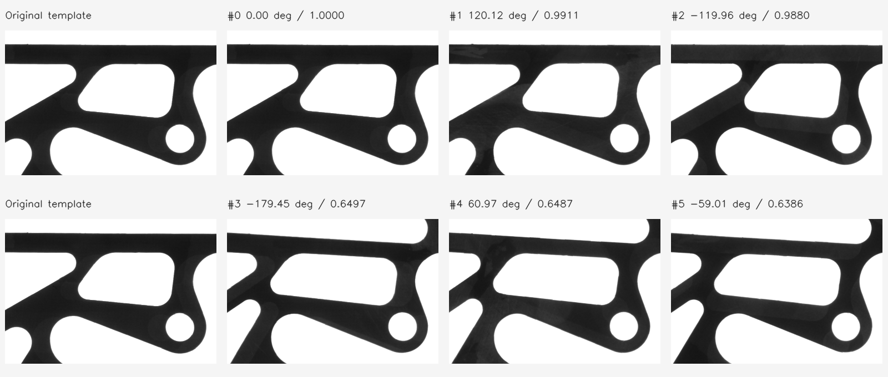

# Git 原版、目前移植與新 C++ 稽核

稽核日期：2026-10-08。判定依據為本機 Git 原始碼、可重現反例、編譯測試與影像輸出；不使用主觀完成百分比。

## 結論

目前改寫保留了主要 NCC／金字塔／旋轉搜尋流程，但**不能視為原 C++ 的完整等價移植**。Python 存在候選漏檢與 NMS 語意不一致；macOS C++ 缺少原版雙角度區間及 FastMode，且仍依賴 OpenCV 的多項核心運算。

這次建立 `cpp-core/` 作為有完整源碼、可独立建置的新 C++ 演算法基準，並把 Qt GUI 改接此核心。原 `MatchTool/` MFC 原始碼與 `macos-cli/match_core.{h,cpp}` 保留，方便查證歷史。Python 演算法本身沒有在這次被偷偷換成別的流程；新增 C ABI／ctypes 作為明確的另一個呼叫入口。

## Git 基準

| 提交 | 日期 | 定位 |
|---|---|---|
| `432442a` | 2022-05-05 | Git root；只有 LICENSE、.gitignore，沒有 C++ 程式 |
| `f521243` | 2022-05-05 | 第一份可檢視的 C++；路徑是 `ELCVMatchTool/ELCVMatchToolDlg.cpp` |
| `359696d` | 2022-06-02 | 後續加入 SIMD |
| `dbcc7ef` | 2022-10-04 | 後續加入 BlockMax |
| `d8edabb` | 2025-08-21 | 本機 `origin/main` 的 MFC 上游基準 |
| `fd698ac` | 2026-02-16 | 本機 macOS／Qt6 C++ 移植 |
| `738680c` | 2026-02-16 | 本機 Python 移植 |
| `3546282` | 2026-02-16 | 本次作業前的 main |

這是已取得的本機 Git 歷史，沒有把 `origin/main` 稱為目前遠端的最新提交。MFC 目錄與 `d8edabb` 相較沒有本機修改。

整合推送時另重新 fetch 上游 `00da009`：相較 `d8edabb` 只有 README 的 `FLT_EPSILON` 說明修正，MFC 演算法原始碼沒有改變。上述演算法稽核仍以明確的 `d8edabb` 快照為準。

第一份 C++ 已包含模板學習、金字塔、旋轉、ROI 精修、NCC、旋轉矩形去重疊與 27 點次像素。SIMD／BlockMax 是後續演進，不能說第一版已含這些。第一版粗層門檻使用 `score-0.05*level`，現行上游改成 `score*0.9^level`；新核心選用後者。

原 MFC 主程式的原始碼本來就在 Git 內；問題是 UI、平台、演算法耦合及 OpenCV 運算邊界不適合作為逐段轉語言的規格，而不是整個原專案都沒有源碼。

## Src7 旋轉盤：為什麼原先只顯示 3 個，如何顯示 6 個

使用者指出盤上有 6 個可比對位置後，追加以下實驗。單純確認「已有 ±120° 結果」不足以解釋完整數量；先前檢查漏看了最大重疊設定。

輸入固定 `Src7.bmp`／`Dst7.bmp`，target=70、minArea=256、subpixel=false。每組分別執行新核心與保留的舊 macOS C++，**兩版的數量全部相同**：

| 容許旋轉 | 最低分數 | 最大重疊比例 | 舊／新 C++ 數量 |
|---|---:|---:|---:|
| ±8° | 0.5 | 0 | 1／1 |
| ±180° | 0.5 | 0 | 3／3 |
| ±180° | 0.5 | 0.05 | 3／3 |
| ±180° | 0.5 | 0.10 | 6／6 |
| ±180° | 0.8 | 0.10 | 3／3 |

6 個結果的角度／分數如下（GUI 與 CLI 共用核心）：

| 角度 ° | NCC 分數 |
|---:|---:|
| 0.000 | 1.000000 |
| 120.098 | 0.991061 |
| −119.954 | 0.987982 |
| −179.415 | 0.649706 |
| 60.880 | 0.648685 |
| −58.936 | 0.638579 |

新增的 3 個矩形各自與原有高分矩形交疊。用獨立 OpenCV 凸多邊形交集計算，6 組非零交疊比例介於 **8.795%～9.977%**。比例是「矩形交集面積／模板面積」，不是物件黑色像素的交集，也不是 IoU。設定 0 表示不容許交疊，低分框因此被 NMS 排除；0.1 才能保留這 6 個。這是此圖片與模板的條件，並非所有圖片都應固定用 0.1。

另外，新增 3 個的整張模板相似度只有約 0.64～0.65，不能把它們說成與高分 3 個同樣精確。將最低分數提高到 0.8 後即使容許重疊，也只剩 3 個。NCC 衡量整個模板區域的像素關係，並非判斷「同一類零件」的語意辨識器。若業務要求 6 個都具備高相似度，需重新選擇共同局部模板或使用多模板，不能只調旋轉就把分數提升到 0.99。

原 README 的同圖商用函式庫比較表本身也列 3 個高分結果；原 17 組稽核對此圖採 score=0.8、overlap=0，所以原先的 3／3／3 記錄仍正確，但未涵蓋本次 6 個候選情境。

追加證據：[rotor-validation.json](rotor-validation.json)，包含 5 組設定、兩版逐筆輸出、圖片／核心原始碼 hash，以及獨立交集數據。執行 `python-port/venv/bin/python cpp-core/tools/diagnose_rotor.py` 可重現。`tests/gui_test.cpp::rotorRotationAndOverlap` 以實際 Qt GUI 路徑回歸 1→3→6→3，並核對 6 個不同位置、角度與分數群，避免只測數量而把重複框誤認為 6 個物件。

## 追加檢查：旋轉、金字塔與粗到精搜尋是否錯過高分解

不能只因新舊版本相同就排除共同的搜尋限制。因此另以獨立 OpenCV 實作檢查此圖，完全跳過正式核心的金字塔、候選截斷、逐層門檻與 NMS：

- 對 6 個位置各取原解析度鄰域，在旋轉座標軸的 ±96 pixels 平移範圍內逐點比對。
- 全周角度步長 0.5°（720 個角度），再於最佳角度附近以 0.05°、0.01° 細化；不先縮圖。
- 參考實作用獨立的目的座標→來源座標仿射矩陣及 `TM_CCOEFF_NORMED`，沒有呼叫新核心的旋轉／搜尋程式。

| 區域 | 一般 C++ 模式分數 | 獨立原解析度搜尋 | 更新後次像素模式 |
|---|---:|---:|---:|
| 約 −179° | 0.649706 | 0.649738 | 0.649786 |
| 約 +61° | 0.648687 | 0.648694 | 0.648773 |
| 約 −59° | 0.638579 | 0.638639 | 0.638687 |

把 minReducedArea 從 256 改為 1024、4096，也沒有出現 >=0.8 的另外三個解。這表示在**本次鄰域、取樣解析度與剛體旋轉模型**下，沒有證據支持「金字塔把本來 0.9 的三個目標降成 0.65」。這不是連續位置／角度的全域最優保證，也沒有測試縮放或非剛體變形。

每列第一張是相同模板；上列是高分 3 個，下列是另外 3 個。整個矩形中孔洞輪廓、支架角度與邊界內容不同，NCC 並不只比對右下的小圓孔。

同時新增旋轉 stage 對照：奇偶尺寸、非連續 stride、0／±90／180／21.3／60／−119.95°、內部／邊界 ROI。與 OpenCV 仿射取樣相比，最大灰階差 5、各案例最大平均差 0.933；差異落在完整雙線性權重與 OpenCV 1/32 權重量化的容許值內。金字塔像素一致、NCC 最大差 1.322e-6。

### 確實發現並改善的次像素精修不足

獨立生成 51×39 模板的 6 個旋轉副本（0、±60、±120、180°）時，舊次像素流程在 minArea=64 的一個位置，角度誤差由未精修約 0.919° 增為 2.702°。原因是直接以約 2.246° 的角度網格擬合，加上整數平移取樣可能把平移偏差混入角度峰值；僅有 QR 與 Hessian 檢查不足以避免這類近似誤差。

`src/matcher.cpp` 現在在啟用次像素時：

1. 最細層角度間距連續減半兩次，縮為原步長 1/4，每次重新尋找包圍峰值的取樣點。
2. 使用精修後的浮點位置重設局部原點，共做三輪取樣／擬合，只有第一輪會沿用金字塔座標放大。
3. 保留角度界限、2D fallback、QR、負定 Hessian 及有限值／位移界限檢查。

合成 6 副本測試在 score=.95、minArea=64／256／1024、次像素開／關時都找到 6 個不同位置。精修開啟後：

| minArea | 最大位置誤差 px | 最大角度誤差 ° | 最低分數 |
|---:|---:|---:|---:|
| 64 | 0.1261 | 1.1296 | 0.999078 |
| 256（預設） | 0.0051 | 0.0217 | 0.999881 |
| 1024 | 0.0050 | 0.0189 | 0.999880 |

預設與 1024 的測試門檻為位置 <0.02 px、角度 <0.1°；64 仍可能受粗層與局部近似限制，沒有把這些數字宣稱為所有模板的精度保證。原先 21.3° 的獨立 fractional-pose 案例，位置誤差由舊精修約 0.177 px 改為 0.00245 px，角度由約 21.603° 改為 21.303°。

這是以計算量交換精度。Src7、score=.5、overlap=.2、target=70 的本機單次量測：未精修約 355 ms；修正前精修約 652 ms；新精修約 3240 ms。這些不是跨機效能保證。`--subpixel`／GUI「次像素位置與角度精修」才使用追加流程；一般模式與 FastMode 不增加這三輪精修。

精修後約 −59° 的最佳框與高分框交疊 **10.006%**，剛好超過 0.1；若卡在這個界限，NMS 可能選中該處較差的另一個框。因此本次精修 GUI 驗證採 overlap=.2，最低分數 .5 時六個分數如上，.8 時仍為三個。這不是因為把重疊比例調大會提高 NCC。

重建後的核心、C ABI、OpenCV stage、GUI 測試及 scalar ASan／UBSan 通過；修正後 17 組原圖（次像素關閉）仍全部通過舊版比較容許值，記錄在 [validation-after-refinement.json](validation-after-refinement.json)。新增 GUI 回歸也涵蓋精修開啟時 score .5／.8 的 6／3 個結果。

完整原始數據：[修正前](rotation-search-validation-before-refinement.json)、[修正後與独立搜尋](rotation-search-validation.json)。重跑：`python-port/venv/bin/python cpp-core/tools/audit_rotation_search.py`，會產生 JSON 與上述對齊圖。

## 原版宣稱的演算法逐項核對

以下依本機 README 的 Improvements 1–5 與原 MFC 原始碼核對，不把論文列為參考就當成論文內每一種方法皆已實作。

| 原版項目 | 新核心實作位置 | 驗證／差異 |
|---|---|---|
| NCC／零均值正規化相關 | `src/ncc.cpp::ncc`、`src/image.cpp::learnLevel` | 積分圖計算 sum／sum²，原始點積減去均值項；直接公式與 OpenCV stage 對照 |
| 任意角度搜尋 | `src/matcher.cpp::coarseAngles`、`localAngles` | ±180°、雙區間、各層角度步長；實際六位置及合成旋轉測試 |
| Gaussian pyramid 粗到細搜尋 | `src/image.cpp::pyrDown`、`src/matcher.cpp::match` | [1,4,6,4,1]、REFLECT101、逐層 ROI；pyrDown 像素對照一致 |
| 縮小旋轉畫布與調整矩陣／ROI | `src/image.cpp::rotateCanvas`、`rotatedRoi`、`warp` | 保留縮小畫布策略、逆向仿射取樣；插值改為完整 double 精度，非 OpenCV 查表逐位元重現 |
| SIMD convolution／相關點積 | `src/ncc.cpp::dotProduct` | ARM NEON、x86 SSE2 與 scalar 路徑；溢位／尾數測試。此 Mac 實跑 NEON，未在 x86 實機驗證 |
| `s_BlockMax` 加速取峰值 | `src/ncc.cpp::selectPeaks` | 分區保存最大值，抑制後只更新受影響區；與完整掃描逐點相同，非近似 top-k |
| 旋轉矩形去重疊 | `src/geometry.cpp::overlap`、`suppress` | 凸多邊形裁切；此次 3／6 數量差的直接原因 |
| 27 點次像素位置／角度精修 | `src/subpixel.cpp::refine3d`、`refine2d` | QR 擬合＋負定 Hessian 檢查；原 MFC 有此功能但求解與取樣方式已修正 |
| 反色、FastMode、模板學習重用 | `src/matcher.cpp`、`src/image.cpp`、Qt GUI | 有對應 API／CLI／GUI，並有回歸測試 |

**功能流程有對應；效能最佳化不能宣稱全部等價。** 新版還沒有舊 macOS C++ 的專用 `vdotq_u32` DOTPROD 路徑，也沒有重寫 OpenCV 相關運算內部可能選用的 DFT／其他最佳化後端。新核心採自有直接相關，因此已有 SIMD 並不代表速度等同原版；README 的 4～128 倍等歷史效能數字不適用於新核心。

README 另提的 pybind11／.NET／對外 DLL 是語言綁定與發行形式，不是另一套旋轉演算法。本次提供 C ABI＋ctypes，沒有冒稱已重現作者另外發行、未在此專案提供完整源碼的商用／跨平台套件。旋轉搜尋也不代表尺度、鏡射、透視或任意遮罩搜尋；新核心沒有這些額外模型。

## 已確認的移植差異

### 1. Python 的 top-k 候選近似會漏掉其他目標

`python-port/src/fpm_py/pyramid.py::_find_topk_suppressed` 先取最高 `k*50` 個像素，再做距離抑制。若第一個物件附近有很多高分像素，這些名額全被它佔住，第二個物件即使高於門檻也無法入選。

實際反例：30×100 response，左上 20×20 全為 0.99，遠處 (90,25) 為 0.90；要求 2 個、抑制半徑 25、門檻 0.8。Python 只回傳 1 個。新 C++ 的完整掃描與 BlockMax 均回傳 2 個，且兩條路徑逐點一致。

這也說明 `topk_blocked`／向量化 top-k 不等於原 `s_BlockMax` 的動態區塊最大值。

### 2. Python 在 NMS 前提前停止，沒有正確性的保證

同檔案 `early_stop_count=target_num+5` 在精修期間直接截斷。粗層排序不能保證細層排序，且不同角度的候選可能屬於同一目標。這與原 C++「全部精修、再去重疊」不同。

在實際 `Src6.jpg/Dst6.bmp`、target=15、score=.8、angle=180、overlap=0、area=256、subpixel=false 的比較中，舊 C++ 與新 C++ 均找到 15 個，Python 只找到 14 個。此實測確認端到端漏檢差異；沒有把這個差異的全部因果僅歸給某一項最佳化。

### 3. 零旋轉與旋轉模式採用不同重疊指標

`pyramid.py` 在零角度呼叫 `nms()`（IoU），旋轉時呼叫 `nms_rotated()`（intersection/template-area）。原 C++ 一律採後者。

兩個 10×10 框水平相差 4 pixels，交集面積比例為 0.6，但 IoU 約為 0.42857。門檻 0.5 時，Python 零角度保留兩個，旋轉 NMS 留一個。新核心統一使用 intersection/template-area。

### 4. 功能介面未完整移植

| 功能 | 原 MFC 後期版本 | 舊 macOS C++ | Python 比對 API | 新 C++／GUI |
|---|---|---|---|---|
| NCC、金字塔、來源旋轉、ROI | 有 | 有，部分交給 OpenCV | 有，部分交給 OpenCV/NumPy | 核心完整源碼 |
| ±角度容忍 | 有 | 有 | 有 | 有 |
| 兩組角度區間 | 有 | 缺 | 缺 | 有，API 可多組 |
| 反轉來源明暗 | 有 | 核心／CLI 有，舊 GUI 沒接 | 沒有對等參數 | 有 |
| 半解析度 FastMode | 有內部開關 | 缺 | 缺 | 有設定、CLI、GUI |
| BlockMax 完整候選擷取 | 有 | 有 | 以近似 top-k 取代 | 有，與直接掃描等價 |
| 次像素 | 有，但解與樣本有風險 | 延續原邏輯 | 有，但精修條件有限 | QR、有效性檢查、固定角度 2D、旋轉 3D |
| 可獨立建置且不需影像函式庫的核心 | 無 | 無 | 無 | 有 |
| C ABI＋可執行呼叫範例 | 此公開 MFC 專案未提供 | 無 | Python API | 有 |

Python 的 `coarse_step/fine_step/scale/topk_per_level` 接受參數但不參與目前主流程。舊文件把它們當成有效調整選項，容易造成誤解。

### 5. 舊 C++ 仍有需要隔離的狀態與數值風險

以下為原始碼檢查發現，不冒稱全部已在原 Windows 執行檔重現：

- Match 根據目前 minArea 重算 pyramid depth，卻接收另一份已學習的可變模板資料；兩者不一致時可能越界或使用錯誤層數。
- `s_TemplData::clear()` 沒有清除 learned flag；原始模板 Mat 的所有權也不明確。
- 次像素僅檢查最佳角度是否在 response 邊界，卻讀取三個角度的 patch，可能讀到未填資料。
- 三個角度各自最大值周圍的 patch，被視為同一空間位置；求解又使用絕對座標 normal equations 的顯式 inverse，缺少奇異／鞍點／越界檢查。
- `overlap=1` 的抑制矩形可縮成空集合；長列 SIMD int32 點積有溢位風險。

新 Pattern 擁有且固定模板與層数、API 驗證輸入、點積使用 uint64 分段累加、最大值每次至少消耗一個像素，次像素以同一空間座標取樣並驗證局部最大值。

## 新版與原版刻意不同的部分

- 核心完全不呼叫 OpenCV；旋轉使用完整雙精度雙線性插值，沒有 OpenCV 的 1/32 插值查表量化。
- 角度區間嚴格受限且採輸出角度語意；原 MFC 的搜尋角度區間需反號並交換端點。
- 零角度也能做 2D 次像素；旋轉次像素增加峰值包圍搜尋及解的有效性檢查。輸出的 score 仍是量測到的取樣峰值。
- 全解析度為預設；半解析度 FastMode 的框使用原模板尺寸，避免奇數尺寸縮放造成框變大。
- GUI 背景比對、已學習模板重用、資料更換時清除過期結果、JSON 匯出，並且 GUI／CLI 使用共同的灰階轉換。

因此新版本是可驗證的重構基準，沒有宣稱與所有舊缺陷或所有 OpenCV 位元結果完全相同。

## 驗證範圍

本機 Apple Silicon、Apple Clang 21、Qt 6.10.2、C++ OpenCV 4.13.0；使用 Release。沒有執行 Windows MFC binary，也尚未實機測試 Windows/Linux 的新程式。**執行期比較對象是保留的 macOS CMatchCore**；第一份 C++ 與 MFC 以 Git 原始碼稽核。

已完成：

- 純 C++／無 OpenCV 建置、真正 C 編譯器的 ABI 測試、Python ctypes 執行。
- Qt-only GUI 建置／操作測試，以及 Qt+OpenCV 版本建置／操作測試。
- GUI 載入中文路徑、背景工作時事件迴圈仍能執行、結果座標、JSON 匯出、設定改變後重新學習、清除舊結果及錯誤恢復。
- 實際原生 GUI 讀取與顯示範例影像、結果框及結果表。
- NCC 對獨立直接公式、stride、常數影像、精確匹配／反相關；SIMD 長列溢位與尾數；BlockMax 等價性；幾何／NMS；角度區間、反色、FastMode、參數驗證。
- Gaussian pyramid 與 OpenCV 比較像素完全相同；30 組 NCC stage 對照門檻 2e-5。
- 3D／2D 已知二次曲面、退化／鞍點拒絕；独立連續紋理的 fractional pose 測試要求位置誤差低於 0.25 px、角度誤差低於 0.5°，並相對整數結果改善位置。
- scalar Debug ASan／UBSan 檢查。
- 原 Python 13 個測試通過；但同時存在上述可重現反例，所以原測試通過不足以證明移植等價。

17 組實際影像比較涵蓋 Src1–4、Src6–10、Src5 八種旋轉。均關閉 subpixel、使用相同 target/score/overlap/minArea 設定。每筆位置配對後比較，事先設定容許值為位置 2 px、角度 1°、score 0.03；每一組的具體設定、每筆輸出、輸入與原始碼 SHA-256 均存於 [validation.json](validation.json)。此測試是有限資料的版本對照，不代表所有影像的辨識保證。

## 實测結果與效能

17/17 組新 C++ 與舊 macOS C++ 的目標數量一致，全部在上述容許值內。各項最大差異分別為：
- 0.599376 px
- 0.716160 °
- 0.006558 score

下表為各流程一次 warm-up 後三次的中位數。C++ 計時只含比對，Python 計時含模板學習與比對；均排除圖片讀取。沒有把 Python 的時間當作相同區段的嚴格效能比較。舊版 ARM 開啟原 CMake 的 DOTPROD 指令，新版採一般 NEON，頂層也使用專案內的直接相關。

| 影像 | 目標數（舊／新／Python） | 舊 C++ ms | 新 C++ ms | Python ms |
|---|---|---:|---:|---:|
| Src1.bmp | 5/5/5 | 102.12 | 198.22 | 81.89 |
| Src2.bmp | 5/5/5 | 43.28 | 68.36 | 42.99 |
| Src3.bmp | 36/36/36 | 3.83 | 8.36 | 10.30 |
| Src4.bmp | 5/5/5 | 20.76 | 24.98 | 26.26 |
| Src6.jpg | 15/15/14 | 210.30 | 437.15 | 317.80 |
| Src7.bmp | 3/3/3 | 63.75 | 134.23 | 226.62 |
| Src8.bmp | 3/3/3 | 14.66 | 22.26 | 22.38 |
| Src9.bmp | 1/1/1 | 0.90 | 1.18 | 1.69 |
| Src10.bmp | 100/100/100 | 14.85 | 58.67 | 22.09 |
| Src5-0.bmp | 1/1/1 | 15.68 | 33.64 | 27.22 |
| Src5-45.bmp | 1/1/1 | 15.85 | 33.81 | 31.07 |
| Src5-90.bmp | 1/1/1 | 15.56 | 33.51 | 26.64 |
| Src5-135.bmp | 1/1/1 | 14.93 | 32.34 | 26.66 |
| Src5-180.bmp | 1/1/1 | 15.84 | 33.63 | 27.19 |
| Src5-225.bmp | 1/1/1 | 15.33 | 33.56 | 27.14 |
| Src5-270.bmp | 1/1/1 | 15.29 | 34.61 | 27.31 |
| Src5-315.bmp | 1/1/1 | 15.48 | 33.72 | 26.69 |

目前新 C++ 在這些樣本比舊 macOS C++ 慢，因此本次成果是完整源碼、正確性基準與模組化，**沒有宣稱更快或達到舊版速度**。之後可在保留 scalar 參考路徑下，追加 DOTPROD 的安全分派、FFT 或 pyramid SIMD 最佳化，並用同一份數據驗證。

> 2026-10-24更新：穩定核心已加入編譯期選擇的 UDOT 點積，輸出與原 NEON／scalar 逐位元相同；同一設定下 Src7 為舊版 65.38ms、新版 122.43ms（改之前 138.10ms）。見[DOTPROD點積報告](CORE_DOTPROD_zh-TW.md)。2026-10-25再加入精確 NEON 旋轉與 pyrDown 內部直接計算，輸出同樣逐位元相同，同設定 Src7 新版 85.76ms（舊版 64.45ms），見[旋轉與金字塔報告](CORE_WARP_PYRDOWN_zh-TW.md)。同日再改窮舉 NCC 後，同設定下 17 張全部比舊版快（Src7 新版 56.08ms、舊版 67.77ms），見[窮舉NCC報告](CORE_EXHAUSTIVE_NCC_zh-TW.md)。2026-10-31 在 Windows 11 x64（Core Ultra 9 285K）加入執行期選擇的 x86 SIMD 分級，該機 17 張影像幾何平均快 57.2%，同平台輸出逐位元相同，見[x86 SIMD報告](CORE_X86_SIMD_zh-TW.md)。本稽核的表格與文字保留當時原狀。

Python 在 Src2、Src4、Src6、Src10 未通過同一組版本對照門檻；除 Src6 的數量差異外，有些是相同數量但選中不同位置／角度。含對稱或多個高分物件時，不同選擇不必然都屬於誤檢，因此逐筆結果保留於 JSON，不把差異數字直接當成精確率。

重跑方式見 `../README_zh-TW.md`；`tools/compare_versions.py` 遇到缺圖或程式錯誤會失敗，不會悄悄跳過；超出版本對照容許值會以非零 exit code 結束。
