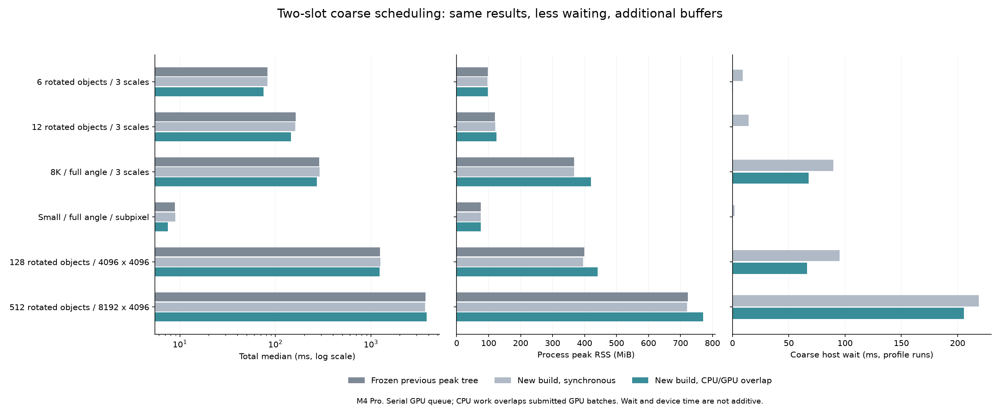

# Metal 粗搜尋：CPU／GPU 雙槽重疊實驗

2026-10-14，Apple M4 Pro（12 CPU／16 GPU cores）、48 GiB，macOS 26.6.2，Release。

本輪已實作 CPU 下一批旋轉與 Metal NCC 重疊，以及 GPU 執行下一批時，CPU 消費上一批的正規化與選峰。**所有正式案例的有序輸出、分數與搜尋工作量保持一致；速度收益依負載而異。六／十二物件約減少 9% 耗時，512 物件反而退化，因此維持實驗選項、預設關閉。** 完整 C++／Objective-C++、Metal、C ABI、Python binding、測試與原始量測均保留。

## 實作與生命週期

原排程每批依序為 CPU 旋轉 → 提交 GPU NCC → 等待 → CPU double 正規化／選峰。新排程使用兩個槽：

```text
CPU：旋轉 A → 提交 A → 旋轉 B → 提交 B → 消費 A → 旋轉 C → 提交 C → 消費 B …
GPU：                  NCC A ──────────→ NCC B ───────────────────→ NCC C …
```

示意圖只表示依賴與重疊機會，不是硬體時間線。兩槽共用同一個 Metal command queue；GPU commands 仍依序執行，不宣稱兩個 NCC kernel 同時執行。外部 match API 仍同步回傳，也沒有新增同一 handle 的跨執行緒並行使用契約。

- 每槽獨立擁有 source、template、整數 statistics buffer；`begin` 回傳後不持有呼叫者影像／模板指標。CPU 畫布可釋放，僅保留角度與座標轉換 metadata。
- 每槽 source 上限 64 MiB、statistics 上限 16 MiB，template 另計。兩槽之外，原同步 arena、金字塔、score map、fine／pose buffer 仍存在；不能把每槽上限當作全程記憶體上限。
- 單 map、退化模板、整批超過上限時，沿用原同步 `computeBatch` 的分塊路徑並記錄原因。這不是改用 CPU NCC，也不降低搜尋範圍。
- 按原角度順序取回結果；GPU 仍計算原 uint32／uint64 統計，CPU 使用原 double 正規化與原選峰。未改門檻、候選數、rescue 預算或精度。
- 讀取結果前等待 GPU 完成；異常、reset、destructor 均 drain 在途工作。使用中的槽不可覆寫，取回順序與設定變更均檢查。
- 關閉選項後槽容量仍快取在 frame 內，到銷毀 frame 才釋放。新的 retained bytes 已計入原 coarse GPU memory，不可重複加總。

源碼：[排程](../src/matcher.cpp)、[Metal 槽與同步](../experiments/coarse_metal.mm)、[既有 GPU kernels](../experiments/coarse_ncc.metal)、[C ABI](../experiments/coarse_ncc.h)、[Python binding](../tools/coarse_experiment.py)。這次新增排程，沒有新增 NCC 分塊 kernel。

## 比較方法

凍結上一版為 `4092754`，使用 peak tree／原 NCC kernel。另以同一新 build 分別關閉及開啟 overlap，避免把其他 build 差異算成重疊收益。三者皆使用 `peak_mode=1, ncc_mode=0`、共享 Metal 金字塔、coarse batch4、fine512；profile 另開 process 測量。

正式測量為 6 場景 × 5 方法 × 正反順序 2 blocks，共 60 個獨立串行 worker；每 worker 至少 1 秒暖機、5 次正式測量。共 300 次正式、60 次 first、1,435 次暖機。每次 frame prepare 計入總時間，library／model construction 及 first 另記。原始 source、library、input、job、worker 均驗 SHA。GT 僅在父程序事後評估，不傳入 matching worker。

## 總時間、記憶體與精度

時間為十次正式呼叫 pooled median；RSS 為兩個 process 峰值最大值。最後一欄比較同 build 開／關，正數表示減少耗時。

| 場景 | 凍結上一版 ms | 同步 ms | 重疊 ms | 同步 RSS MiB | 重疊 RSS MiB | 耗時減少 |
|---|---:|---:|---:|---:|---:|---:|
| 6 旋轉物件／3 尺度 | 82.71 | 82.31 | 75.09 | 96.2 | 97.4 | 8.8% |
| 12 旋轉物件／3 尺度 | 163.01 | 161.01 | 145.86 | 120.8 | 124.0 | 9.4% |
| 8K／256 模板／全角度／3 尺度 | 286.97 | 290.52 | 272.76 | 367.5 | 419.6 | 6.1% |
| 小圖／全角度／subpixel | 8.86 | 8.96 | 7.49 | 75.5 | 75.8 | 16.5% |
| 128 旋轉縮放物件／4096² | 1246.38 | 1260.06 | 1227.50 | 395.3 | 440.9 | 2.6% |
| 512 旋轉縮放物件／8192×4096 | 3738.89 | 3691.49 | 3823.28 | 720.3 | 770.6 | **−3.6%** |

小圖真值是兩個正向物件，但搜尋設定仍為全角度，40 maps 都走非同步批次；不能當作 angle=0 測試。8K 案例有 6 個真物件，與 512 物件案例的模板／工作量不同。

全部案例的有序 proposals／最終 matches／scores 與凍結版相同，coarse／fine map 工作量一致。獨立位置 ≤2 px、角度 ≤1°、相對尺度 ≤2% 的一對一評估，所有方法均 TP=GT、FP=FN=0。128／512 場景使用同一真實模板的分離實例、旋轉縮放及光度／噪聲變化；不包含遮擋或不同物件類別。更多 64／256／正向控制結果見 [大量物件報告](MANY_OBJECT_STUDY_zh-TW.md)。兩份報告為不同測量輪次，不串接成單一加速比例。



**512 案例未通過預先固定的性能門檻。** 門檻為各 block 相對基準不得退化超過 `max(10%, 2 ms)`。其第二 block 同步 3670.89 ms、重疊 4127.31 ms，退化 12.43%；相對凍結版也退化 11.04%。其他五案例皆通過。`integrity_passed`／`detection_all_passed` 只表示正確性，不能解讀為全部加速成功；完整逐 block gate 另存於 results。

### 512 案例的獨立複測

因上述退化，保持同一程式、library、輸入、門檻及配置，額外只跑這個場景的三個無 profile 方法，仍為正反兩 blocks、各 5 次與至少 1 秒暖機。這是事後診斷，不取代原正式資料，也未修改參數直到取得較快數字。

| 複測 | 凍結上一版 | 同步 | 重疊 |
|---|---:|---:|---:|
| 總時間 median ms | 3674.57 | 3664.41 | 3635.46 |
| 峰值 RSS MiB | 720.5 | 723.1 | 770.3 |

此次輸出與 GT 仍全數通過，兩 block 退化門檻也通過；重疊 pooled median 比同步快 **0.8%**，但多約 **47.3 MiB**。兩輪從慢 3.6% 到快 0.8%，不足以支持 512 負載穩定加速。沒有硬體 trace，不能斷言第一輪波動的唯一原因；仍維持預設關閉。[複測數值](coarse-overlap/recheck-512/results.json)・[完整複測紀錄](coarse-overlap/recheck-512/raw-results.tar.gz)・[校驗](coarse-overlap/recheck-512/artifact-sha256.json)。

## 等待是否比資料傳輸更重要？

以下是獨立 profile 呼叫中，跨尺度加總後的 pooled median，涵蓋非同步與同步 fallback。copy 是現有 coarse `upload_ms`，即 host 複製資料至 shared buffer 的時間；不是硬體 DRAM 流量量測。

| 場景 | 同步→重疊 host wait ms | 同步→重疊 device ms | 同步→重疊 copy ms | 兩者 command 數 |
|---|---:|---:|---:|---:|
| 6 物件 | 9.189 → 0.474 | 4.079 → 4.221 | 0.098 → 0.099 | 36 |
| 12 物件 | 14.231 → 0.036 | 9.049 → 8.556 | 0.188 → 0.187 | 36 |
| 8K／256 模板 | 89.505 → 67.538 | 62.542 → 70.982 | 0.925 → 0.919 | 47 |
| 小圖／subpixel | 1.774 → 0.211 | 0.466 → 0.426 | 0.018 → 0.019 | 10 |
| 128 物件 | 95.257 → 66.343 | 65.635 → 65.155 | 1.055 → 1.058 | 54 |
| 512 物件 | 218.897 → 205.625 | 165.548 → 169.053 | 2.236 → 2.231 | 102 |

六／十二物件可用 CPU rotation／normalization／peak 工作遮住大部分剩餘等待，不必減少 command 數。直接 host copy 相對較小；這支持優先改善排程，但**不能據此推論 GPU 內部記憶體頻寬沒有瓶頸**。

大場景的限制主要有兩項：

1. **容量限制使大批次仍同步執行。** 128 場景三尺度的 async／fallback map 數依序是 14／32、18／40、36／0；512 是 2／44、2／56、36／0。這些 fallback 都是整批超限，512 的 100／140 maps 因此仍走同步。不能看到 `max_pending=2` 就認為所有粗搜尋都重疊了。8K／256 模板也有 64／124 maps fallback。
2. **大量候選使 fine 成為主成本。** 512 的同步 profile 中 fine rotation 約 817 ms、fine NCC 約 1572 ms，而重疊只讓 coarse host wait 減少約 13 ms。整體總時間與記憶體配置更敏感；目前資料不能把第二 block 的全部退化歸因於單一 kernel 或硬體因素。原始 worker 保留了每次呼叫與所有階段，未刪除較慢資料。

512 的新增槽 retained capacity 約 30.93 MiB，RSS 增加約 50.3 MiB；兩者不是同一測量範圍。暫存 score maps、CPU 畫布、allocator 及其他路徑也包含在 process RSS。穩態 frame capacity 在 first 與全部正式呼叫保持一致，這是容量穩定證據，不宣稱已證明所有工作負載皆無洩漏。

新的診斷 API 分開記錄 submit、copy、encode、finish wait、normalization、device duration／span、在途數、fallback 原因、slot capacity。**device、wait 與 CPU 計時可能重疊，不能相加當作總時間；device span 也包含 commands 間空白。** 本輪沒有擷取硬體 timeline，pending 指尚未消費的 command，並不證明 GPU kernels 並行，亦不量化精確的 CPU／GPU 相交毫秒數。

## 使用與驗證

使用實驗 `SourceFrame` 時明確啟用：

```python
frame.set_coarse_optimization(peak_mode=1, ncc_mode=0)
frame.set_coarse_overlap(enabled=True)
# 完成 match 後：
diagnostics = frame.coarse_overlap_metrics()
```

CPU backend 不接受 enabled=True。原 API／GUI 預設維持關閉；開關需要 frame idle。凍結舊 library 的 benchmark 路徑不呼叫新 symbol。

- Release：23／23 通過，含 OpenCV 比對與 Qt GUI smoke。
- Debug scalar＋AddressSanitizer／UndefinedBehaviorSanitizer：21／21 通過；停用 LeakSanitizer，故不作 leak 檢查聲明。
- Python 新舊比較工具隔離：6／6；大量場景／獨立精度／GT 隔離：14／14。
- [非同步測試](../tests/coarse_async_test.cpp) 包含兩槽在途、呼叫者 source／template 修改、strided source、32／64-bit 統計、out-of-order／空槽／重複使用、drain／exception／destructor、同步 fallback 與非同步槽同時存在、容量穩定、angle=0／角度範圍／subpixel 和完整 matcher 有序相等。

```sh
python-port/venv/bin/python cpp-core/tools/benchmark_coarse_overlap.py \
  --build build/coarse-overlap --baseline build/many-objects-current \
  --output build/coarse-overlap-results/formal.json
# 純資料重建摘要，不呼叫 GPU：
python-port/venv/bin/python cpp-core/tools/benchmark_coarse_overlap.py \
  --summarize /archive/formal.json --worker-root /archive --output /tmp/replayed.json
```

比較工具：[benchmark](../tools/benchmark_coarse_overlap.py)、[圖表](../tools/plot_coarse_overlap.py)。[數值摘要](coarse-overlap/results.json)・[事先固定 protocol](coarse-overlap/protocol.json)・[完整原始紀錄與精確來源快照](coarse-overlap/raw-results.tar.gz)・[封存校驗](coarse-overlap/artifact-sha256.json)。封存不含 binaries／大型生成 PNG；保留 hashes、生成源碼、metadata 及全部 worker/job，解壓後可完全離線重建摘要。baseline provenance 指向凍結 `4092754`，而 current library 的 SHA 對應本次新實作。

## 下一步的研究價值

CPU／GPU overlap 已可工作，但目前收益與額外記憶體不足以支持全面開啟。更合理的後續對照是：保留現有 source/statistics 上限，將超限批次依容量切成可排程的小組；或以單 GPU arena 配合 CPU 預做下一批，降低額外 memory。這些都需要重新測量，不能預設更快。

使用 L1／L2 或 Metal 晶片內儲存的 NCC output tiling 仍有研究空間。三個整數統計可精確分塊加總，相鄰視窗可以共用 source 區塊；動態候選不妨礙單一批次的規則計算。Apple GPU 的 threadgroup staging 也可能比直接 cache 讀取更慢，因此要比較 implicit cache 與顯式 staging，並驗證整數統計及整體輸出。[數學推導、FlashAttention 與 Apple 原始文獻](NCC_TILING_AND_OVERLAP_RESEARCH_zh-TW.md)。本輪沒有將這項尚未量測的設計當作已完成加速。
