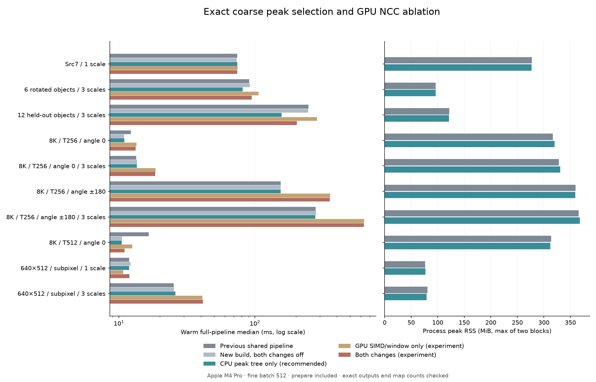

# 粗搜尋下一階段：精確選峰與 GPU NCC 平行方式比較

本輪基準為 `010c8982890c4abbbaedb1968b6b1e158c554578`，即上一輪共享來源金字塔、Metal 批次細搜尋版本。目標是減少 coarse peak selection 與粗 NCC 的時間，固定模板、候選數、分數門檻、尺度／角度搜尋範圍、fine512 與既有 rescue，逐一比較兩項更改。

## 兩項可獨立開關的實作

**CPU 精確選峰（peak_mode=1）**：原本每次抑制一個峰，重新掃描相交區塊；在未分塊情況則掃描整張 score map。新版以 32×32 tile 的最大值建立 tournament tree。抑制只會降低分數，若某 tile 的最大值不在抑制矩形內，它仍然是該 tile 最大值，所以不必重掃。只更新最大值被抑制的 tile，再沿樹向上更新。

選峰序維持「分數降序、y 升序、x 升序」，保留原版矩形端點的截斷方式，以及 overlap=1 時仍抑制已選像素。threshold 邊界、NaN／infinity、signed zero 等行為有獨立比較；沒有縮減候選數或改用近似 top-K。

設 score map 為 W×H，tile 數 \(T=\lceil W/32\rceil\lceil H/32\rceil\)。初始化掃描 O(WH)，每次選擇的樹頂讀取 O(1)；後續成本取決於抑制寫入、確實失去 winner 的 tile 重掃，以及更新的 O(log T) 樹路徑。額外 tree 容量小於 `4*T*sizeof(Peak)`，不隨輸出目標數增加；score map 沿用原本 move-in 的 buffer。這是 CPU 資料結構改善，沒有聲稱已將選峰搬到 GPU。

**GPU 粗 NCC 協作歸約（ncc_mode=1）**：mode0 沿用一個 GPU thread 對一個視窗；mode1 以完整 SIMD group 分攤同一視窗的 template pixels，再精確歸約 `sum / sumSquare / dot`。uint32 模式以 `65025*area <= UINT32_MAX` 證明完整與部分和不溢位；uint64 模式沿用 16／16／32 位 limb 歸約。CPU double 正規化完全相同。新 kernels 的 pipeline state 只在明確啟用時建立。

增加單一視窗的平行度不保證更快：coarse 層模板小、視窗非常多，原版已能藉各視窗並行使用 GPU，且相鄰視窗的 source 讀取相鄰。每視窗分給一組 threads 會增加排程、座標索引與歸約成本。這與 fine 層較大模板、較少視窗的負載不同。本輪保留完整失敗實驗，不因 fine 的成功就假設 coarse 也適用。

## CPU／GPU 等待邊界

本輪兩項更改**沒有減少 coarse command buffer 的提交次數，也沒有新增 CPU／GPU 非同步重疊**。選峰減少 CPU 工作；NCC 實驗只改 GPU 內部的工作分配。既有 source、statistics buffer 容量維持不變，retained RSS 以實測確認。

目前流程仍是：CPU 旋轉一批 → GPU coarse NCC → 等待 → CPU double normalization／選峰 → 下一批。若讓 GPU 第 n 批 NCC 和 CPU 第 n+1 批旋轉重疊，需要兩組各有明確 ownership 的 source／statistics buffers、begin／finish 介面及依原角度順序收結果；直接刪除等待會覆寫 GPU 正在讀寫的資料。這是後續可驗證的方向，不是本輪已實現的功能。雙槽會增加記憶體，應以實際批次容量及上限一起評估。

## API 與源碼

既有 frame／execution 結構與 reserved 欄位不改。新增 32-byte `FpmCoarseOptimizationConfigV1` 和 `fpm_frame_set_coarse_optimization`；兩個 mode 僅接受 0、1，版本、長度、reserved 與 backend 都驗證。舊預設維持 0／0，GUI 不自動切換。CPU-only frame 不接受啟用這個實驗設定，內部選峰函式本身仍為可移植 C++。

```python
# 先按上一輪文件建立 SourceFrame 與 CPU-only CoarsePattern 模型庫。
frame.set_coarse_optimization(peak_mode=1, ncc_mode=0)
frame.prepare(source_view, models)  # 每張新圖一次，包含在總時間內
results = [frame.match(model, config) for model in models]
```

在第一次 prepare 前設定，可將需要的 Metal pipeline 建立成本明確列入 setup；同一 frame 也可在已完成的呼叫之間切換。handle 不支援並行呼叫。

- [選峰實作與原版對照](../src/ncc.cpp)、[matcher 啟用位置](../src/matcher.cpp)
- [GPU 完整 kernels](../experiments/coarse_ncc.metal)、[Metal 派工](../experiments/coarse_metal.mm)
- [新 C ABI](../experiments/coarse_ncc.h)、[實作與驗證](../experiments/coarse_ncc.cpp)、[Python binding](../tools/coarse_experiment.py)
- [選峰對照測試](../tests/peak_selection_test.cpp)、[GPU NCC 精確測試](../tests/coarse_parallel_test.cpp)、[frame 生命週期／mode 測試](../tests/shared_frame_test.cpp)
- [完整比較工具](../tools/benchmark_coarse_next.py)、[純資料測試](../tests/test_coarse_next_harness.py)

## 正式比較方法

所有路徑都使用 shared source frame、Metal pyramid mode1、四角度 coarse batch、fine512；baseline 使用凍結 `010c898` 的 core／coarse library，所有方法的實圖後段 pose rescue 使用同一 current build。五個模式：previous_shared、current_control(0/0)、peak_only(1/0)、simd_only(0/1)、combined(1/1)；另跑各 current profile 版本。

每方法／案例／block 為新 process，串行，正反順序兩個 block，各暖機至少一秒、五次正式計時。first call／construction 分開列，每次新 frame prepare 計入總時間。主要速度使用 profile 關閉數據；profile 用於分解階段，不能挑其較好的數值替代正式成績。

每呼叫比對完整 ordered proposals、最終 matches、pose、scores，另檢查每模型 coarse／fine maps 數相同。有 GT 的場景在計時／RSS 後評估。來源、輸入、library SHA 在前後核對。效能容忍門檻為各 block `new <= reference + max(10%, 2 ms)`；通過只代表未超容忍退步，不等於加速。RSS 與 frame buffers 重疊，不能相加。

## 正式結果與採用決定

量測於 2026-10-13 晚間完成，2026-10-14 整理。Apple M4 Pro（12 CPU／16 GPU cores）、48 GiB，macOS 26.6.2、AppleClang 21、Release。十組案例、九個模式（含四種 profile）、兩個順序 block，共 180 個新 process、900 次正式計時、180 次 first call、7,326 次暖機。

**推薦 `peak_mode=1, ncc_mode=0`：只啟用精確選峰樹，保留原粗 NCC GPU 分配方式。** 所有設定的輸出均正確，但 SIMD 粗 NCC 在主要負載上失敗，保留為可重現的對照實驗，不當作加速成果或自動預設。

表中為 profile 關閉的十次計時 pooled median，單位 ms；完整 prepare／搜尋／NMS／有啟用的 rescue 均包含。current control 使用新 build，但兩個 mode 都關閉；用來區分版本與時序噪音。

| 案例 | 凍結上一版 | 新版全關 | 僅新選峰 | 僅 SIMD 粗 NCC | 兩者同開 |
|---|---:|---:|---:|---:|---:|
| Src7（1尺度） | 74.29 | 73.53 | 74.00 | 74.57 | 74.04 |
| 6旋轉物件（3尺度） | 90.54 | 91.91 | 81.02 | 106.34 | 94.72 |
| 12旋轉物件（3尺度） | 248.04 | 246.91 | 156.96 | 286.29 | 203.58 |
| 8K／T256／0°（1尺度） | 12.24 | 10.88 | 10.95 | 13.49 | 13.27 |
| 8K／T256／0°（3尺度） | 13.43 | 13.59 | 13.50 | 18.61 | 18.49 |
| 8K／T256／±180°（1尺度） | 154.25 | 154.52 | 154.37 | 357.43 | 355.29 |
| 8K／T256／±180°（3尺度） | 279.48 | 281.44 | 278.26 | 634.29 | 632.88 |
| 8K／T512／0° | 16.59 | 10.53 | 10.50 | 12.52 | 11.00 |
| 640×512／次像素（1尺度） | 11.90 | 12.15 | 11.90 | 10.74 | 11.94 |
| 640×512／次像素（3尺度） | 25.24 | 25.43 | 25.95 | 41.00 | 41.39 |

六物件：90.54→81.02 ms，約快 10.5%（1.12×）；十二物件：248.04→156.96 ms，約快 36.7%（1.58×）。相對同 build 全關，十二物件也由 246.91→156.96 ms，支持收益來自新選峰。Src7、8K 全角度與少候選案例多數接近持平；小圖三尺度略慢，不宣稱全面加速。

8K／T512 的凍結 baseline pooled median 16.59 ms，有明顯順序波動：兩 block 中位數 10.41／24.59 ms。新版全關 10.53 ms 和僅選峰 10.50 ms 幾乎相同，**不能把這一欄約 6 ms 的差額歸功新選峰**。小圖單尺度也有 15.74／8.23 ms 的 baseline block 波動，保留全部紀錄，未刪慢樣本。

僅新選峰在十組場景、對 previous_shared 與 current_control 的所有配對效能門檻通過。SIMD-only 對凍結版七組失敗、對新版全關八組失敗；combined 對兩個 reference 各五組失敗。通過精度檢查與通過效能容忍門檻分別記錄，不混成「所有優化都成功」。



## 分段時間與傳輸判斷

以下是獨立 profile runs 的中位數；profile 的 peak_selection 包含粗峰／排序及 fine maxima，fine 工作保持相同。

| 案例 | 原選峰 ms | 新選峰 ms | 原粗 NCC ms | 改用 SIMD 粗 NCC ms |
|---|---:|---:|---:|---:|
| controlled6 | 16.23 | 3.92 | 13.07 | 26.70 |
| heldout12 | 86.26 | 8.84 | 37.42 | 79.92 |
| 8k_t256_angle180_3scales | 30.60 | 26.83 | 159.39 | 513.64 |

十二物件選峰約 86.26→8.84 ms。8K 全角度三尺度粗旋轉仍約 81 ms、粗 NCC 約 158 ms，新選峰僅約少 3.8 ms，因此整體收益有限。

六物件粗 NCC 的診斷：原 mode0 GPU device 約 3.62 ms、host wait 約 8.32 ms、upload 約 0.101 ms；mode1 device 約 16.12 ms、wait 約 21.53 ms、upload 約 0.099 ms。36 個 command buffers、140 張 coarse maps、1,720,662 個 NCC windows 完全相同。**此項退步主要出現在 GPU 計算，並不是增加了資料傳輸或候選量。** 細搜尋的成功不能直接類推到這種大量小窗口的粗搜尋。

wait 包含 device 執行，兩者不可相加；upload 為共享記憶體 host copy 診斷，不是獨立 PCIe 傳輸。wait−device 可觀察等待中非 device 的粗略部分，不能當成精確 CPU／GPU 同步開銷的單獨量測。本輪仍沒有將 CPU 與 GPU 重疊執行。

## 記憶體與精度

RSS 為兩個 process block 峰值的最大值，MiB。frame host／coarse GPU／fine GPU retained capacity 在所有模式中相同，first call 與每次正式計時的容量快照相同（暖機只保留摘要）；這不等於驗證了所有大小序列或無記憶體洩漏。

| 案例 | 上一版 RSS | 新版全關 RSS | 僅新選峰 RSS | 僅 SIMD RSS | 兩者同開 RSS |
|---|---:|---:|---:|---:|---:|
| Src7（1尺度） | 277.1 | 276.8 | 276.8 | 277.0 | 276.9 |
| 6旋轉物件（3尺度） | 96.0 | 97.0 | 96.0 | 97.6 | 96.6 |
| 12旋轉物件（3尺度） | 121.6 | 121.0 | 121.2 | 123.2 | 120.8 |
| 8K／T256／0°（1尺度） | 317.0 | 317.8 | 320.1 | 316.8 | 318.8 |
| 8K／T256／0°（3尺度） | 328.0 | 329.0 | 330.9 | 329.0 | 328.1 |
| 8K／T256／±180°（1尺度） | 359.5 | 361.6 | 359.3 | 362.5 | 362.0 |
| 8K／T256／±180°（3尺度） | 365.8 | 367.9 | 367.8 | 365.9 | 367.9 |
| 8K／T512／0° | 313.7 | 313.7 | 312.0 | 311.9 | 312.1 |
| 640×512／次像素（1尺度） | 76.3 | 76.2 | 77.0 | 76.7 | 76.5 |
| 640×512／次像素（3尺度） | 80.5 | 79.6 | 79.2 | 79.6 | 78.7 |

沒有以增加大型 GPU arena 換取選峰速度；選峰樹是每張 score map 暫時的 CPU 配置。RSS 包含 Python、來源圖、allocator 與 driver，會有 process 間波動；buffer容量與 RSS 重疊不可相加。

所有 first／正式輸出、暖機輸出 digest 都與凍結上一版一致；有序 proposals、最終 match、pose、score 及每尺度 coarse／fine map counts 均保持。九組有 GT 的案例皆零漏檢、零誤檢；Src7 只有一致性驗證。六／十二物件最大位置誤差 0.0228／0.0903 px、角度誤差 0.0271／0.0503°、相對尺度誤差 0.191%／0.250%，與上一版相同。

8K 測資是六個正立、scale=1 的植入物件；即使搜尋 ±180°／三尺度，不代表測過任意 8K 旋轉物件。非零旋轉與非1尺度由六／十二物件測試覆蓋。小圖另含 stop_layer=0、subpixel=1。這是保留原結果的效能優化，沒有修復原算法共同失敗或提高召回率的宣稱。

## 驗證與完整封存

- Release 22／22 通過，包括原核心、GUI／OpenCV、Metal fine／coarse／pose 與新選峰。
- scalar Debug＋ASan／UBSan 20／20 通過；使用 macOS 支援的 `detect_leaks=0`，未宣稱 LeakSanitizer 驗證。
- benchmark 純資料／fake backend 測試 4／4 通過。
- 新 coarse SIMD 測試 289 張 map 逐值等於 CPU reference，包含 strided input、1×1／非方形模板、257²與258²分支、真正超 uint32 的值、mode 切換及非零起點的分塊 NCC。
- 選峰測試比較兩個舊 blocked 模式及新樹，涵蓋 ties、signed zero、NaN／infinity、threshold 邊界、overlap 0／1／小數、狹長圖與 count 1／70／1000。
- frame 整合測試涵蓋精確輸出、反相、準備失敗、模板重用、mode 驗證與 ABI 錯誤。

[正式摘要](coarse-next/formal-summary.json)、[驗證與資料稽核](coarse-next/validation.json)、[量測 protocol](coarse-next/protocol.json)、[完整原始紀錄封存](coarse-next/raw-results.tar.gz)、[封存 SHA-256](coarse-next/archive-sha256.json) 保留。原始紀錄包含 pilot、所有正式 job／worker／stderr、完整輸出、暖機 digest、測試日誌及量測源碼；大圖可依固定種子重建，平台 binaries 不提交但保留 hashes。

```sh
cmake -S cpp-core -B build/fourier-gpu -DCMAKE_BUILD_TYPE=Release -DFPM_BUILD_EXPERIMENTS=ON
cmake --build build/fourier-gpu --parallel 8
ctest --test-dir build/fourier-gpu --output-on-failure
# frozen baseline 需是010c898的三個libraries及已核對的baseline-provenance.json。
python-port/venv/bin/python cpp-core/tools/benchmark_coarse_next.py \
  --methods previous_shared,current_control,peak_only,simd_only,combined,current_control_profile,peak_only_profile,simd_only_profile,combined_profile \
  --blocks 2 --repeats 5 --warmup-seconds 1 --fine-batch-size 512 \
  --output build/coarse-next/formal.json
# 不執行matching，只從搬移後封存重建摘要：
python-port/venv/bin/python cpp-core/tools/benchmark_coarse_next.py \
  --summarize /path/to/archive/formal.json --worker-root /path/to/archive \
  --output /path/to/replayed-summary.json
```

下一個工作重點是粗旋轉與 coarse NCC 的雙緩衝排程：用實際量測確認能否讓下一批 CPU 旋轉和當批 GPU 計算重疊，並計入雙份 buffer 的記憶體代價。本輪推薦先使用已驗證的選峰樹。
