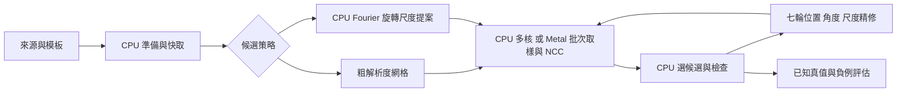

# 旋轉／尺度 NCC 的 CPU 與 GPU 實驗

2026-10-12，分支 `codex/ncc-fourier-gpu-experiments`。目的：用同一批姿態和同一數學契約，量測演算法時間、記憶體與精度，再比較搜尋策略。結果和失敗案例見 [實測報告](EXPERIMENT_RESULTS_zh-TW.md)，數學背景見 [Fourier／尺度／RGB 研究](RESEARCH_FOURIER_SCALE_RGB_zh-TW.md)。

本次有實際執行的 C++ 單執行緒、C++ 固定執行緒池，以及 Metal GPU 核心。浮點 RGB、尺度、GPU 是獨立的研究介面；正式 `fpm_core`、穩定 C ABI 和 Qt GUI 仍使用原有灰階固定尺度核心。

## 原始碼與界線

| 檔案 | 已實作 |
|---|---|
| `experiments/pose_ncc.h` | 獨立 C ABI；建立來源／模板、批次姿態評分、記憶體資訊、釋放 |
| `experiments/pose_ncc.cpp` | 自有雙線性插值、每通道中心化的 joint NCC、double 累加、固定 CPU 執行緒池、參數檢查 |
| `experiments/pose_ncc.metal` | 相同幾何的 FP32 取樣、Welford 分塊變異數、兩階段平行歸約；完整 kernel 源碼 |
| `experiments/pose_metal.mm` | Apple Metal 資源、提交、同步、GPU 時間與配置量；只有這一層依賴 Apple SDK |
| `tools/pose_experiment.py` | 呼叫同一份 C++／Metal 的 ctypes 包裝，沒有另一套 Python NCC 取代核心 |
| `tools/benchmark_pose_experiments.py` | 隔離程序基準、CPU Fourier 提案、四參數局部網格精修、回退、已知真值與負例評估 |
| `tools/validate_pose_experiment.py` | 獨立 NumPy 雙精度／兩次中心化參考；旋轉尺度真值、RGB、邊界、奇數尺寸、低變異及配置重用測試 |
| `tests/pose_experiment_test.cpp` | 不依賴 Python 的 C ABI、生命週期、多執行緒、配置重用與錯誤恢復測試 |
| `tools/report_pose_experiments.py` | 從 JSON 重建結果表格，避免手動抄寫數字 |

沒有使用 OpenCV 比對函式；Src7 的 Python OpenCV 只負責解碼。本次 Fourier、log-polar、phase correlation 的組合源碼可查，但 **FFT 運算仍依賴外部 NumPy**，沒有把 FFT、Metal SDK 或驅動宣稱為本專案自有原始碼。尚未實作 C++ Fourier 管線、GPU FFT、CUDA backend、連續 Gauss–Newton 精修、mask 或自動 CPU／GPU 分派。

## 可移植的計算契約

輸入為緊密 HWC float32，1 或 3 通道，值必須有限且絕對值不超過 16。使用座標 x 向右、y 向上；來源與模板各自以 `(width/2, height/2)` 為中心，而非 `(width−1)/2`。姿態為 `p = (tx, ty, θ, α)`，θ 的 API 單位是度，`α = log(s)`。

模板位置 u 對應來源位置：

$$W_p(u)=t+e^\alpha R_\theta u.$$

直接在來源做雙線性取樣，超出來源的值定義為零。支撐是固定的完整模板矩形，不會因為旋轉而裁掉角落；不是有效交集遮罩 NCC。沒有中間旋轉圖，也沒有額外積分圖。RGB 分別扣除均值，再合併分子和能量：

$$\rho(p)=\frac{\sum_c\sum_u(T_c(u)-\bar T_c)(I_c(W_p(u))-\bar I_{p,c})}
{\sqrt{\left[\sum_c\sum_u(T_c(u)-\bar T_c)^2\right]
\left[\sum_c\sum_u(I_c(W_p(u))-\bar I_{p,c})^2\right]}}.$$

三通道權重相同；不是三個 NCC 的平均。共同正增益與每通道固定偏移不改變理想分數，但三通道分別改變增益通常會改變分數。此實驗不執行 sRGB 線性化、白平衡或色彩管理。

source 預先減去全圖各通道平均以改善浮點條件，越界補值也相應減去該均值；因此仍等價於原始來源零補值的 NCC。模板中心化轉為 float32 後，再保存殘餘總和，計算時修正殘餘均值。

CPU 使用相同 float32 幾何／插值、double 統計量。Metal 使用 FP32 並關閉 fast math；容許合理的歸約順序差異，不承諾逐位元一致。任一總變異能量除以像素數 ≤10⁻¹² 時，回傳 `-2` 表示無效；這是研究契約，與正式核心的常數模板退化規則不同。

每個 handle 不可同時被多個呼叫者使用。CPU 的平行工作由內部執行緒池管理。來源、模板在 handle 建立時複製，釋放 handle 前可多次評分不同姿態；同一圖換姿態不需要重新上傳整張影像。

## GPU 平行方式

每個 GPU 工作群組处理一個「姿態 × 1,024 像素區塊」，256 個 thread 各負責最多 4 個像素。取樣後立即累加統計量，不寫出完整 warp 影像。模板大時由多個群組分攤，同一批中也同時處理多個姿態。

最初用 `Q−S²/N` 計算 GPU 變異數時，嵌在不同背景內的平坦 ROI 有抵消誤差，得到接近零但非無效的分數。現在使用每塊 `(n, μ, M₂)` 的穩定合併：

$$n=n_a+n_b,\quad \delta=\mu_b-\mu_a,\quad
\mu=\mu_a+\delta\frac{n_b}{n},$$

$$M_2=M_{2,a}+M_{2,b}+\delta^2\frac{n_an_b}{n}.$$

另保存 `P = Σ I·Tc`。第二個 kernel 合併各塊，分子為 `P−μ·ΣTc`，分母使用合併後的 M₂。每個區塊的三通道摘要連同 count 為 64 bytes。這個公式與工作分割可直接對應 CUDA／其他 compute API。

GPU 中間摘要容量約為：

$$64\;\text{bytes}\times N_{pose}\times\lceil N_{template}/1024\rceil.$$

此外還有來源／模板 float32 buffer、每姿態 16 bytes 的幾何與 4 bytes 結果。現在 Metal backend 也保留 CPU 預處理副本，所以記憶體還有改善空間。每次增長先配置新 buffer 再替換舊 buffer，暫時配置尖峰可能高於 steady-state buffer 欄位；process RSS 高水位另行記錄。



目前每輪精修仍與 CPU 同步。這已能測量真實異構成本，但尚未把 argmax、下一輪姿態產生或 4×4 求解留在 GPU。

## 實驗設計

固定姿態測試包含 64、128、256 像素方形模板，1～4,096 個候選，灰階／RGB，以及 Src7 的 6×27 局部候選。對同一批輸入逐個檢查 CPU／GPU 分數及最佳索引。

配準測試中的資料由解析函數直接生成，真值不是用待測的 warp 程式生成。完整支撐使用 256×256；裁切組使用 128×128 模板補零。局部精修為 4D 的 3⁴ 點网格，共七輪減半，最後平移步距 0.03125 px、角度步距約 0.1172°、log-scale 步距約 0.000998。這是可得到次像素座標的取樣搜尋，尚未用前份研究推導的連續 Jacobian 求解。

初始網格為平移每 4 px、角度每 15°、5 個等 log-scale 點；在半解析度評分。合成圖是平滑 Gaussian 組合，因此這裡使用簡單二倍取樣。高頻真實圖需要正式 Gaussian pyramid／抗混疊，不能套用此簡化當成完整多尺度實作。

時間分為 setup、首次評分、提案、NCC wall、GPU command、精修和整體 ROI algorithm。Metal command 時間用 [GPUStartTime](https://developer.apple.com/documentation/metal/mtlcommandbuffer/gpustarttime)／GPUEndTime，完成後讀取；不拿這個數字代替包含提交、等待與讀回的 wall time。

記憶體分為新程序的 RSS 高水位、核心持有 buffer 容量、[Metal currentAllocatedSize](https://developer.apple.com/documentation/metal/mtldevice/currentallocatedsize)。在 Apple [shared memory](https://developer.apple.com/documentation/metal/mtlstoragemode/shared) 上，這些欄位互有重疊，不能相加當成總用量。RSS 也含 Python／NumPy 及資料生成的歷史尖峰，不是精確的每階段增量；FFT 的額外需求由整體峰值反映，沒有宣稱已量到每個 FFT 暫存的峰值。

## 重跑

```sh
cmake -S cpp-core -B build/fourier-gpu -DCMAKE_BUILD_TYPE=Release \
  -DFPM_BUILD_EXPERIMENTS=ON -DFPM_WITH_OPENCV=ON -DFPM_BUILD_GUI=ON
cmake --build build/fourier-gpu --config Release -j 8
ctest --test-dir build/fourier-gpu -C Release --output-on-failure

python-port/venv/bin/python cpp-core/tools/validate_pose_experiment.py \
  --output cpp-core/docs/pose-experiment-validation.json
python-port/venv/bin/python cpp-core/tools/benchmark_pose_experiments.py
python-port/venv/bin/python cpp-core/tools/report_pose_experiments.py
```

Python 需要 NumPy；要跑 Src7 解碼還需 OpenCV。不跑 Src7 可加 `--no-fixture`。沒有 Metal 的主機加 `--no-metal`；實驗 C++ 核心仍可編譯，macOS 之外不編入 Objective-C++。Windows 的 Python RSS 量測目前未實作；Linux RSS 的 KiB 會轉為 bytes。本次僅在上述 macOS 實機驗證，未宣稱 Windows／Linux／CUDA 驗證完成。

macOS 的 Metal kernel 在建立 handle 時從內嵌完整源碼編譯，費用列入 setup；編譯可能使用系統快取，所以這不是清除驅動快取後的首次安裝成本。修改 `.metal` 後 CMake 會重新產生內嵌來源。

這次通過 Release 的 5 個 CTest（含原有 core、C ABI、OpenCV 階段比較、Qt GUI）、Debug scalar ASan／UBSan 的 3 個 CTest，以及獨立 CPU／Metal 數值測試。另開啟 [Metal API](https://developer.apple.com/documentation/xcode/validating-your-apps-metal-api-usage) 與 [Shader Validation](https://developer.apple.com/documentation/xcode/validating-your-apps-metal-shader-usage) 跑完整數值測試，沒有 API／shader 錯誤。驗證層只用於正確性檢查，效能數據是在關閉驗證層的程序中取得。

```sh
MTL_DEBUG_LAYER=1 MTL_SHADER_VALIDATION=1 \
MTL_SHADER_VALIDATION_REPORT_TO_STDERR=1 MTL_SHADER_VALIDATION_ABORT_ON_FAULT=1 \
  python-port/venv/bin/python cpp-core/tools/validate_pose_experiment.py

cmake -S cpp-core -B build/fourier-gpu-sanitized -DCMAKE_BUILD_TYPE=Debug \
  -DFPM_BUILD_EXPERIMENTS=ON -DFPM_SANITIZERS=ON -DFPM_DISABLE_SIMD=ON
cmake --build build/fourier-gpu-sanitized -j 8
ctest --test-dir build/fourier-gpu-sanitized --output-on-failure
```

## CUDA 對應與下一個研究問題

| 現有分工 | CUDA 可對應方式 | 還要驗證 |
|---|---|---|
| Metal source/template 常駐 | device buffers，來源更新用 pinned staging／非同步複製 | PCIe 傳输成本；不能套用 Apple shared-memory 數字 |
| pose×tile 的工作群組 | block grid 的 tile／pose 維度、256 threads/block | occupancy、register pressure、shared memory |
| Welford 區塊摘要與第二 kernel | 相同摘要結構與兩階段 reduction | FP32 誤差、資料尾塊、低變異與 RGB |
| command buffer 計時 | CUDA events 加獨立 CPU wall timer | 整批時間與同步成本；不能只報 kernel |
| CPU Fourier 提案 | 後續可用 cuFFT 或可攜 FFT backend | 批量 ROI、plan 重用、GPU log-polar／phase correlation、額外記憶體 |

CUDA 是對應設計，尚無實作或實測。優先順序由這次結果決定：先接回真正候選批次，保留小工作量的 CPU 路徑；再測試降低每輪同步與 CPU／GPU 副本。Fourier 需要先解决裁切／背景的候選可靠性，再擴大尺度區間與 ROI 大小，找出減少姿態枚舉能抵銷 FFT 成本的範圍。

測試資料目前仍小且偏平滑；後續加入高頻紋理、不同照明、對稱物、更多負例、人工真值，以及完整全圖多目標資料集，才適合評估正式替換與研究貢獻。
