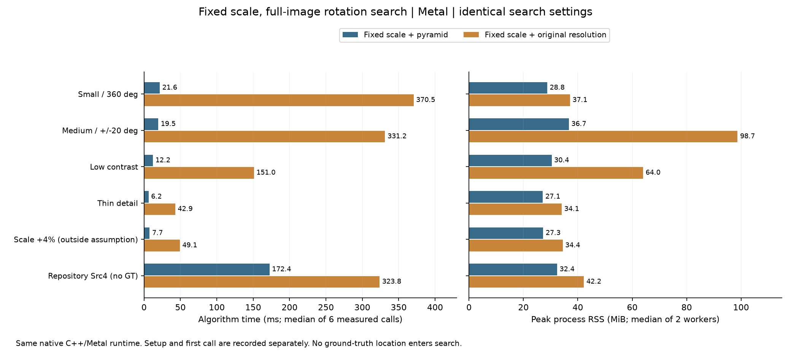
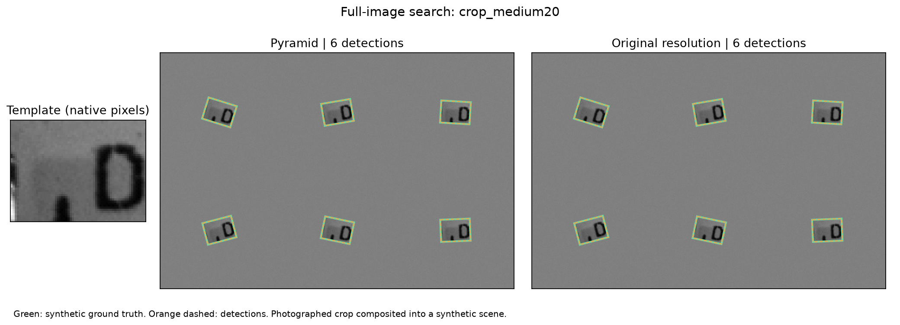
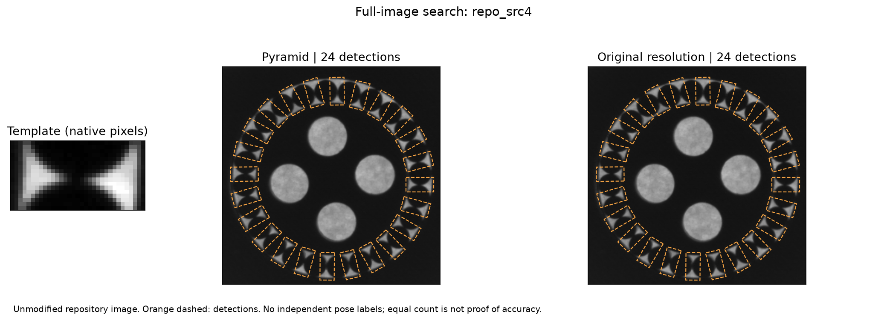

# 固定尺度、全圖旋轉搜尋：金字塔與原解析度比較

日期：2026-10-14，Apple M4 Pro（12 CPU／16 GPU）、48 GiB、Release。需求是從實拍圖裁模板、搜尋整張圖，允許旋轉但尺度不變。三個 agent 分別檢查架構／文獻、建立實驗、審查尺度與層數契約；效能量測由同一台機器依序執行。

**結論：固定尺度原解析度搜尋可運作，但本輪不支持直接取消金字塔作為加速方案。** 四個符合固定尺度假設的有真值場景，兩條路徑皆零FP／FN；Metal原解析度路徑的中位時間為金字塔的6.9～17.1倍，沒有增加召回率。保留無金字塔作實驗對照，實用基準仍選固定尺度＋金字塔。下一個無金字塔方向應研究旋轉模板／稀疏提案／遮罩FFT，詳見 [設計與改善方向](FIXED_SCALE_SEARCH_DESIGN_zh-TW.md)。

## 實作與固定比較方法

新增 [實驗工具](../tools/benchmark_fixed_scale.py) 和 [C++契約測試](../tests/fixed_scale_contract_test.cpp)，後者已接入CTest。演算法與GUI沒有改動；受測runner及兩個C++／Metal動態庫SHA與上一輪GUI正式比較完全一致，基底commit為`a4d9e14`。新實驗有完整程式，但沒有新增GUI框選裁模板互動或獨立的無金字塔選單。

兩路都只用`scales=[1]`；連續精修和救援會鎖住尺度。金字塔路徑`min_area=256`；原解析度路徑`min_area=ceil(sqrt(template_area))²`，只保留level0，Metal不建立縮小層。兩路都保留原圖局部細化、subpixel與常駐連續精修。因此「無金字塔」是移除縮小層，不是取消所有局部精修。

固定相同搜尋角度、最終分數0.8、提案分數0.5、maxTargets64、重疊0.2、stopLayer0、mode0與overlap關閉。maxTargets為固定上限，不等於真值物件數。全圖位置未知，worker不收到GT、物件數或搜尋ROI。這輪只隔離金字塔有無的影響，沒有把取消多尺度模型的收益混入，也沒有比較mode2或新的旋轉模板kernel。

正式規則在量測前保存於 [protocol](fixed-scale/protocol.json)。六個場景、兩方法、正／反兩個block、每worker暖機至少一秒再量三次；小圖另比較CPU。共28個新程序、84次正式呼叫，setup／first另存。每個worker最多120秒，且事前設全解析度粗NCC估計工作量上限；本輪沒有timeout、跳過或程序錯誤。工作前後來源、輸入與二進位SHA不變。

影像與真值：

- `crop_small360`：256²、單物件、37.3°，搜尋±180°。
- `crop_medium20`：768×512、六個分離物件，搜尋±20°。
- `crop_lowcontrast20`：512×384、兩物件、對比縮至0.3加雜訊，搜尋±20°。
- `thin_detail20`：256²、單物件、細線診斷圖，搜尋±20°。
- `scale_violation20`：256²、物件放大1.04倍，刻意違反固定尺度；單列負控制。
- `repo_src4`：未改動的Src4／Dst4圖片，全角搜尋；沒有獨立姿態GT。

前述裁切模板取自`Src3.bmp`的`x=450,y=8,w=64,h=48`，保持原生像素。它是實拍文字紋理區塊，不是完整物體去背；再用獨立OpenCV warpAffine生成合成位置／角度並加雜訊。這些GT不是另外拍攝的實物資料。細線例子完全合成。所有輸入及生成來源都封存，未挑選能使某方法勝出的重跑來替代正式結果。

## 時間、記憶體與準確度

時間是每路六次正式演算法時間中位數；RSS是兩個新程序peak RSS的中位數。皆不包含檔案解碼與一次Session建構的演算法計時，完整setup／first與每次數值留在原始資料。以下為Metal：

| 場景 | 金字塔 ms | 原解析度 ms | 金字塔 RSS MiB | 原解析度 RSS MiB | 結果 |
|---|---:|---:|---:|---:|---|
| 小圖全角 | 21.61 | 370.45 | 28.75 | 37.11 | 兩路1/1，零FP/FN |
| 中圖六物件 | 19.54 | 331.16 | 36.70 | 98.70 | 兩路6/6，零FP/FN |
| 低對比 | 12.22 | 150.97 | 30.38 | 63.98 | 兩路2/2，零FP/FN |
| 細線診斷 | 6.20 | 42.86 | 27.14 | 34.08 | 兩路1/1，零FP/FN |
| 尺度+4%負控制 | 7.69 | 49.09 | 27.26 | 34.44 | 均定位到物件，但尺度不符GT |
| repository Src4 | 172.40 | 323.81 | 32.38 | 42.22 | 均24個，無GT不報準確率 |



小圖全角CPU對照：金字塔42.21ms、原解析度1326.42ms；peak RSS約18.44／21.96MiB，兩路都找對單一物件。CPU與Metal在這個工作量的快慢不能推廣至所有模板或GPU。

精度驗收為一對一最大配對，位置≤2px、包角誤差≤1°、尺度比0.98～1.02，要求零FP／FN。四個正常GT場景共有10個植入姿態，重複執行不增加獨立樣本量。Metal金字塔／原解析度的最大位置誤差為0.12120／0.12020px，最大角度誤差0.25096／0.23759°；這點差距不足以推論普遍精度改善。兩路最後尺度皆精確為1，每路重跑有序輸出完全相等。不同路徑的角度網格／候選不同，不要求跨路逐位相等。

**效能門檻全部失敗。** 原解析度每個block都超過金字塔`+max(2ms,10%)`；中圖兩個block及低對比第一個block也超過`+max(32MiB,10%)`的RSS容忍。正確性通過不代表這個替代方法值得作預設。





尺度負控制仍得到約0.94473的高NCC，位置誤差約0.23px，卻回報尺度1而真值1.04，相對尺度誤差3.85%，不通過2%契約。這是刻意違反假設的結果，不計入正常固定尺度通過率；也說明高分不保證尺寸正確，不能據此說固定尺度法能處理尺度變化。

## 為什麼變慢，以及下一步

小圖的粗角度map由52增為202，粗視窗由182,416增為11,186,978，細搜尋map也從2482增為6734。中圖準備時間雖從約0.180降到0.010ms，但proposal時間從17.61增加到329.37ms；準備階段省下的時間遠小於增加的全解析度搜尋量。`proposal_ms`已含prepare，不能相加。這些是完整流程計數與階段時間，不是硬體頻寬／cache counter，也沒有量到全GPU極限。

保留兩條方向：

1. **現在可用：固定尺度＋金字塔＋原圖NCC精修。** 使用`scales=[1]`，減少不需要的尺度模型；仍保留搜尋加速。若相機條件變動，可回到原多尺度路徑。
2. **無金字塔新架構：原圖方向特徵／旋轉模板提案＋完整NCC精修。** 預先處理模板，把每幀重複旋轉整張來源圖的工作改成模板方向與來源資料共用；先驗證提案召回率，再移到Metal。遮罩FFT和諧波／張量模板是並行研究選項，尚未實作或證實更快。

現有主流程另優先處理大量候選的fine搜尋資料共用、大圖來源副本、週期高分錯峰。本輪沒有宣稱改善了這些問題；具體數學、記憶體與驗收條件見 [設計文件](FIXED_SCALE_SEARCH_DESIGN_zh-TW.md)。

## 重跑與證據

```sh
# 使用已建好、啟用GUI與experiments的原生runner；輸出目錄必須是新的。
python3 cpp-core/tools/benchmark_fixed_scale.py \
  --build build/gui-integration --output build/fixed-scale-new/results.json --prepare-only
python3 cpp-core/tools/benchmark_fixed_scale.py \
  --build build/gui-integration --output build/fixed-scale-new/results.json

ctest --test-dir build/gui-integration -R native_fixed_scale --output-on-failure
```

此Python工具需要NumPy與OpenCV來生成／評估資料；匹配由完整自有源碼C++／Metal執行。CPU與Metal新契約測試2/2通過，檢查原圖level0容量、尺度鎖定、植入位置、旋轉搜尋開啟與精確重跑；沒有因新增工具就重報整套歷史測試為本輪重新通過。

[事前protocol](fixed-scale/protocol.json)・[完整摘要](fixed-scale/results.json)・[驗證](fixed-scale/validation.json)・[原始資料與來源封存](fixed-scale/raw-results.tar.gz)・[SHA與重播核對](fixed-scale/artifact-sha256.json)。封存包含本輪影像／真值、每worker設定與結果、受測來源快照；不含二進位但保存SHA。可從解壓目錄的來源執行`--summarize`重算摘要，不需GPU，也不需原工作目錄。
