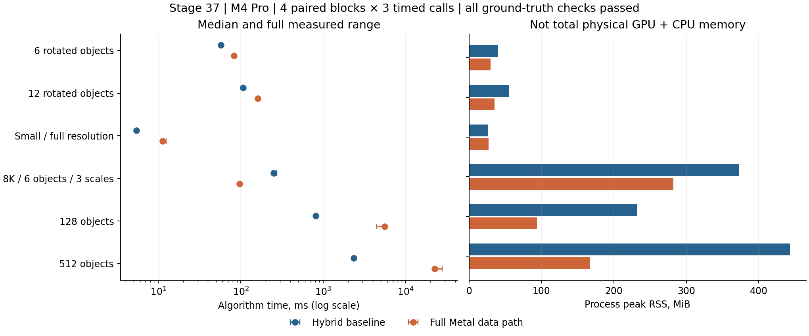

# 完整 Metal 灰階搜尋流程常駐實驗

第37輪，2026-10-18，Apple M4 Pro／48 GiB。這一輪補齊第36輪尚留在CPU的粗旋轉、細搜尋控制、連續精修的候選交接、救援、最終評分與NMS。研究入口為 `Settings::fullGpu=true`，JSON runner 對應 `full_gpu=true`。原CPU核心、混合路徑與GUI預設保留。

**結論：完整灰階資料路徑已實作並通過本輪GT驗證，但不採用為通用預設。** 8K少物件耗時降低61.6%；128／512物件則耗時約6.85／9.63倍。不能再用第36輪的局部常駐結果概括整條GPU，也不能由這個實作推論所有GPU架構都慢。

> **2026-10-19更正（第40輪合併後驗收審查的非阻塞發現；原文保留）**：混合對照的正式呼叫重用首次建立的pose context，完整GPU每次重建，計時並不完全對稱；加回後128／512約為6.69／9.48倍，結論不變。8K是常數背景上6個0°、尺度1的完全複本，主要是速度負載。`cpu_algorithm_steps`、`intermediate_readbacks`當時從未遞增。詳見文末「2026-10-19 更正與補充揭露」。

## 正式結果

九組固定場景、兩方法、四個順序交錯block，共72個獨立程序、72次first call與216次正式計時。每程序至少一秒暖機；92,393次暖機僅保留時間，不列入288次GT驗收。下表時間為每方法12次正式樣本的pooled median，RSS是四程序峰值的最大值。混合對照已使用Metal NCC／金字塔／批次細搜尋，CPU負責精確選峰、控制與部分驗分，並非全CPU。

| 場景 | 混合 ms | 完整GPU ms | 耗時變化 | RSS MiB 混合→GPU | 新後端buffer MiB | 兩者TP／FP／FN |
|---|---:|---:|---:|---:|---:|---|
| 6旋轉物件 | 57.152 | 82.504 | +44.4% | 40.00→29.45 | 6.00 | 6／0／0 |
| 12旋轉物件 | 106.266 | 159.862 | +50.4% | 54.91→35.03 | 14.77 | 12／0／0 |
| 小圖完整解析度 | 5.436 | 11.219 | +106.4% | 26.62→27.02 | 0.88 | 2／0／0 |
| 8K全角度三尺度，6物件 | 251.680 | 96.735 | -61.6% | 372.92→282.42 | 157.74 | 6／0／0 |
| 128物件 | 810.500 | 5548.852 | +584.6% | 231.81→93.58 | 112.74 | 128／0／0 |
| 512物件 | 2340.244 | 22532.297 | +862.8% | 443.42→167.23 | 227.69 | 512／0／0 |
| 邊界1物件 | 0.439 | 0.420 | -4.3% | 24.88→25.92 | 0.15 | 1／0／0 |
| 雜訊空場景 | 0.208 | 0.231 | +11.3% | 24.86→26.08 | 0.15 | 0／0／0 |
| 常數空場景 | 0.215 | 0.223 | +3.8% | 24.73→26.27 | 0.15 | 0／0／0 |



兩方法所有首次及正式呼叫均零FP、零FN；同方法跨程序／重複輸出一致。新後端最大位置誤差0.12834px、角度0.09952°、相對尺度0.27442%，皆在事前2px／1°／2%界線內。這不是實拍泛化或所有門檻的保證。相對混合對照，已配對輸出的最大分數差1.61e-6；所有有目標場景都存在有序結果數值差異，不能稱binary64逐位一致。

8K四個配對block均有明顯收益；邊界與空場景只有約0.2～0.4ms，應視作小量級差異，不能以通過容忍當成穩定加速。6／12／小圖／128／512五類共20個配對性能gate全部未通過，失敗保留。性能gate為 `new <= control + max(2ms, 10%)`；各場景RSS均通過預定 `+max(8MiB,10%)` 界線，但RSS下降不代表所有實體記憶體用量下降。

512新後端12次正式樣本範圍22.471～27.888秒；第一個block較慢，沒有剔除。128的第一個block較快，同樣保留。各block均明顯慢於混合對照，因此波動不改變本輪採用判斷；未將其歸因到未量測的thermal或GPU occupancy。

512正式呼叫的中位GPU區間為22528.99ms、最終等待22531.35ms、編碼0.325ms、明確輸入複製0.531ms、結果接收0.045ms。這支持瓶頸在GPU執行區間，而不是CPU中途往返；沒有量到GPU內部記憶體流量，仍不能把其內部帶寬／運算／barrier成本精確拆開。

首次呼叫與建構時間也有保存：8K混合／GPU首次中位254.62／109.68ms，建構25.16／31.30ms；512首次2479.59／23311.11ms，建構26.50／31.13ms。獨立程序不表示已清除作業系統或Metal編譯快取。8K、小圖、邊界與空場景為core-only，不含後段連續LM；其餘有目標主案例保留連續精修與救援。


## 完成範圍

```text
CPU：輸入影像、靜態尺寸／角度規劃、編碼指令
  ↓ 原始 gray8 影像與靜態參數
同一個 Metal command buffer
  反相／來源金字塔（跨尺度共用）
  模板尺度庫／金字塔／整數統計
  粗旋轉 → NCC → 正規化 → 逐次選峰與停止
  每候選：逐層細搜尋 → 角度縮小／重新置中 → subpixel
  每尺度 NMS → 壓縮候選 → 初始化連續姿態
  GPU LM 求解／接受／停止
  GPU 多起點救援／續跑選擇／最終評分
  跨尺度 NMS → 結果四角座標
  ↓ 一次等待，最後才讀回
CPU：接收結果與序列化
```

精修可由 `refine=false` 關閉；其餘資料路徑仍常駐。中間影像、分數、候選、解算狀態和計數器使用 Metal private buffers，沒有CPU中途讀取、重新排序、NCC驗分或根據候選數重新派工。固定容量的dispatch由GPU計數器與有效旗標決定實際工作；容量不足會明確報錯，不默默截斷或轉回CPU。

「完整」限定本輪**密集 gray8、多尺度研究搜尋路徑**。RGB驗色、稀疏方向特徵、CPU尺度支撐修正不是這個後端的功能。CPU仍建立靜態參數和指令，不是機器完全不使用CPU。`cpu_algorithm_steps=0` 指沒有影像相關的CPU求解或決策；它不包含CPU的尺寸與角度規劃。常駐證據為程式碼審查、private buffer配置及實際提交／等待計數，並非GPU硬體追蹤。

> 2026-10-19更正：`cpu_algorithm_steps`與`intermediate_readbacks`在本輪程式中從未遞增，0是常數而非量測；提交／等待計數是在唯一提交點旁手動加一。見文末。

最後讀回的內容包含最終結果、狀態，以及供review的精修前候選快照。候選快照在GPU複製，直到整條流程完成後才讀回；它不是中途CPU參與算法。

## 數學、精度與平行粒度

NCC先以整數計算像素和、平方和及點積。令模板面積為N，來源視窗統計為S、Q，模板統計為S_T、Q_T，點積為P：

```text
C   = N·P − S·S_T
V_I = N·Q − S²
V_T = N·Q_T − S_T²
NCC = C / sqrt(V_I·V_T)
```

中心化差值先在uint64完成，再轉FP32作正規化，避免直接用float大數相減丟掉低對比變異。原始模板與每個尺度均檢查 `65025·N² <= UINT64_MAX`。常數模板沿用核心的NCC=1行為；連續精修對無變異資料仍可能判為退化，不代表存在唯一可定位姿態。

旋轉採GPU雙線性取樣；粗搜尋旋轉來源圖，細搜尋直接取樣局部旋轉ROI。尺度仍以模板尺度庫提案，再以 `(x,y,角度,log尺度)` 連續精修。這次沒有引入FFT／神經網路，也沒有宣稱旋轉、尺度已由一個封閉解消除搜尋。

每個細搜尋候選由一個256-thread工作群組處理整段層級、角度與subpixel流程。7×7視窗共用ROI快取；每窗四個lane作整數NCC統計。固定3×3或3×3×3格點上的二次曲面擬合，以正交基底矩代替每次建立設計矩陣再QR；驗證其係數與獨立最小平方法一致。擬合仍需曲率、位移與角度邊界檢查。

連續精修重用完整公開的fused LM核心，30次最大迭代，求解、阻尼、步長、接受與停止均在GPU。救援保留最多4個父候選、每個16個Halton起點、8次短跑與30次續跑的策略，從原始種子的邊界出發，保留512Mi sample-iterations預算。最終NMS保留逐次接受／抑制規則，沒有改成一次近似top-K。

兩路使用相同圖片、角度、尺度、門檻和候選預算，但數值表示、工作分配與精修kernel同時改變，不能把全部時間差當成只省去等待的單因素效果。

這是**FP32取樣、角度、精修與幾何的新數值路徑**，不是CPU binary64逐位移植。接近同分、門檻、取整或旋轉邊界時可能改變順序。接受分數向上取到相鄰FP32值，避免把低於使用者double門檻的分數錯收；仍不能因此宣稱所有double運算等價。沒有原本的CPU精確NCC驗分與回退，獨立GT評估是必要條件。

## 成本與記憶體

粗選峰仍是一張map一個工作群組，維護分段最大值，依序選出下一峰並抑制。整條常駐消除了中途往返，卻沒有消除逐次選峰與NMS的相依成本。大量候選的這項結構限制仍存在；不能由本實作的退步推論GPU、Metal或NCC本身已到極限。

細搜尋預設16KiB ROI快取，整個工作群組使用28,560bytes。較大的ROI使用相同取樣公式直接從GPU來源讀取。這個共享記憶體用量可能限制同時駐留的工作群組，但本輪沒有硬體occupancy／cache counters，不能捏造精確利用率或快取命中率。

支援範圍明確有界：來源最多128M gray像素；每個粗旋轉畫布和分數map各不超過64MiB；統計暫存最多16MiB；此後端自有的命名Metal buffers最多1GiB；粗候選最多2M slots；精修前候選容量最多65,536；角度區間最多16段。refine的種子需落在既有解算器的座標與log尺度範圍，GPU發現非法種子會回傳錯誤旗標。

本版每次執行都重新在GPU建立模板尺度庫與金字塔，並上傳來源與模板；容量可重用，但沒有假裝已實作跨呼叫的模板計算快取。Session也保留自己的輸入快照。因此它是完整資料路徑的基準，不是最小配置量或初始化成本的最終版本。

總時間包含靜態規劃、配置、上傳、編碼、GPU執行、最後等待及結果接收；不含影像解碼、Session建立／shader編譯、JSON輸出和GT評估。首次呼叫與建構時間分開保留。`wait_ms`包含GPU執行，不能和`device_ms`相加。上傳欄位只計明確的影像／描述資料memcpy，不含`setBytes`；讀回bytes是有效輸出大小，兩者都不是實測匯流排流量。

> 2026-10-19更正：混合Session的正式呼叫重用首次呼叫建立的pose context（`pose_create_ms`為0），完整GPU每次重建；兩種方法的「總時間」範圍並不相同。見文末。

`gpu_bytes`是此後端自有的命名Metal buffer配置量，包含shared輸入／輸出及private中間資料；不包含Metal驅動內部配置、指令或shader庫，也不是獨立實體VRAM用量。RSS是程序峰值，兩者不能相加。混合路徑的舊frame GPU欄位不包含全部擁有者，不能拿它和full GPU總buffer作等範圍比較。完整GPU的prepare／proposal／refine／NMS分段時間本輪未量測，摘要使用null，不能把舊欄位的零值解讀為沒有成本。

## 驗證及失敗記錄

原工作目錄Release測試58／58通過；API Validation 2／2、API＋Shader Validation 2／2、ASan＋UBSan 2／2及benchmark負控制12／12通過。ASan未開啟leak detection；這些不取代新後端的長時間資源穩定性驗收。

從封存來源獨立重建三個目標成功。新位置首次執行時，pipeline測試在300秒逾時、runner在180秒逾時；取樣顯示停在main之前的dyld載入／fcntl，finish測試也曾停在dyld入口。動態函式庫及執行檔的磁碟簽章驗證通過，但未查明系統載入延遲的根因。未改程式、binary或系統安全設定，重試後兩項測試全通過；重建runner的controlled6兩方法、各首次及一次重複呼叫，匹配結果與精修前候選均和正式資料逐值一致。初次失敗及堆疊保留，不併入演算法性能樣本；其他八個正式場景未在重建版重新量測。

單元測試涵蓋輸入快照與stride、來源更新及尺寸改變、更新失敗保留舊狀態、精確90度旋轉、角度排除、影像邊界、無目標、常數來源／模板、stopLayer1、反相、subpixel角度列表縮減、多尺度連續精修、較大模板及4KiB／16KiB快取分界、相鄰浮點分數門檻、非法模式和解算範圍。後段另外獨立測試旋轉矩形交集、同分順序、NMS重疊規則、救援預算與原始種子邊界。

早期隨機紋理模板在過深金字塔下零檢出；CPU原核心也有同樣失敗。保留原始失敗與CPU對照，成功單元案例改用較淺層級，90度像素排列案例則使用無金字塔設定。stopLayer1的縮小圖分數低於全解析度分數，其測試使用對應門檻。這些是既有方法限制，不靠降低正式benchmark門檻掩蓋。

審查修正兩處共享角度數量／停止條件的同步風險；縮減角度清單的回歸測試重複執行。Metal驗證另外發現空候選測試仍須綁定至少一筆完整ABI大小的buffer，測試配置已修正，正式路徑原本即有256-byte下限。

Shader Validation把細搜尋共享配置加倍為57,116bytes，超過裝置32,768byte上限。明確啟用該檢查時，後端使用4KiB ROI快取，儀器化總配置32,540bytes；超出快取的ROI仍在GPU直接取樣。API／Shader測試與正式16KiB效能量測分開，`fine_roi_cache_bytes`記錄實際配置。不能把儀器化時間當正式性能。

## 重建與使用

```sh
cmake -S cpp-core -B build/fourier-gpu -DCMAKE_BUILD_TYPE=Release \
  -DFPM_BUILD_EXPERIMENTS=ON -DFPM_BUILD_GUI=ON -DFPM_WITH_OPENCV=ON
cmake --build build/fourier-gpu --parallel 8
ctest --test-dir build/fourier-gpu --output-on-failure
python-port/venv/bin/python cpp-core/tests/test_full_gpu_harness.py
python-port/venv/bin/python cpp-core/tools/benchmark_full_gpu.py \
  --methods hybrid_best,full_gpu \
  --cases controlled6,heldout12,small_fullres,8k_t256_angle180_3scales,many128_pose,many512_pose,boundary_one,empty_scene,constant_source \
  --blocks 4 --repeats 3 --warmup 1 \
  --output build/stage37-replay/formal/manifest.json
```

單一既有job加上 `full_gpu=true`、`backend=1`、`refinement_backend=1`，並設 `pose_resident_mode=0` 選擇整條常駐後端。舊resident mode1／2的16,384像素預檢仍先於整條後端選擇執行；設為0可避免這項舊包裝限制，這也是本輪正式設定。此後端固定使用整數strip NCC、GPU細搜尋與256-thread fused精修；舊路徑的模式鍵仍經共同合法值檢查，但不選擇此後端的內部kernel；實際256-thread fused精修在輸出記為refinement_mode=1。`full_gpu`預設false。CPU overlap排程、CPU scale-support correction、sparse與fine profiling組合明確拒絕。此入口是研究API／runner，GUI尚未加入這個實驗的獨立選項。

## 源碼與移植入口

| 職責 | 完整源碼 |
|---|---|
| API、容量規劃、buffer與唯一提交／等待 | [full_gpu.hpp](../experiments/full_gpu.hpp)、[full_gpu_metal.mm](../experiments/full_gpu_metal.mm) |
| 跨CPU／GPU固定布局 | [full_gpu_types.h](../experiments/full_gpu_types.h) |
| 金字塔、整數NCC、旋轉、正規化、選峰、影像中心化 | [coarse_ncc.metal](../experiments/coarse_ncc.metal)、[full_gpu.metal](../experiments/full_gpu.metal) |
| 細搜尋、角度細化與二次曲面擬合 | [full_gpu_fine.metal](../experiments/full_gpu_fine.metal) |
| LM求解、停止／接受 | [pose_ncc.metal](../experiments/pose_ncc.metal)、[pose_resident.metal](../experiments/pose_resident.metal)、[pose_fused.metal](../experiments/pose_fused.metal) |
| 壓縮、救援、NMS及四角輸出 | [full_gpu_finish.metal](../experiments/full_gpu_finish.metal) |
| 獨立驗證與重播 | [pipeline測試](../tests/full_gpu_pipeline_test.cpp)、[finish測試](../tests/full_gpu_finish_test.mm)、[benchmark](../tools/benchmark_full_gpu.py) |

這些是專案自有完整來源；Metal系統框架、Qt與其他外部依賴的完整源碼不在此封存。移往CUDA時可沿用資料布局、容量、GPU計數器、演算法和測試定義，重寫派工、barrier與記憶體介面。CUDA尚無實作或裝置驗收；較快硬體不會自動消除依序選峰的成本。本輪也沒有把第34輪混合路徑的30分鐘長跑當成這個新後端的穩定性驗收；新影格效能、長跑與實拍泛化仍需獨立測量。

## 封存與離線重播

[封存清單](stage37-full-gpu/archive.json)列出每份檔案的SHA256、大小與用途；[驗證紀錄](stage37-full-gpu/validation.json)區分原建置測試、乾淨重建、統計重播與尚未驗證的範圍。[採用決定與失敗](stage37-full-gpu/decision-and-failures.json)保留20個未通過的配對性能gate。

正式來源快照有267個檔案，涵蓋正式manifest所列的253個來源fingerprint；輸入封存有14個唯一圖片。來源與圖片解壓到同一資料夾，原始量測另解壓。下例只重算已有結果，不會啟動GPU量測；Python需有NumPy與OpenCV，封存不包含系統依賴或虛擬環境。

```sh
mkdir -p build/stage37-repro/source build/stage37-repro/raw
tar -xzf cpp-core/docs/stage37-full-gpu/source-snapshot.tar.gz -C build/stage37-repro/source
tar -xzf cpp-core/docs/stage37-full-gpu/fixtures.tar.gz -C build/stage37-repro/source
tar -xzf cpp-core/docs/stage37-full-gpu/raw-results.tar.gz -C build/stage37-repro/raw
python-port/venv/bin/python build/stage37-repro/source/cpp-core/tools/benchmark_full_gpu.py \
  --summarize build/stage37-repro/raw/formal/manifest.json \
  --output build/stage37-repro/summary.json
cmp cpp-core/docs/stage37-full-gpu/formal-summary.json build/stage37-repro/summary.json
cmake -S build/stage37-repro/source/cpp-core -B build/stage37-repro/release \
  -DCMAKE_BUILD_TYPE=Release -DFPM_BUILD_EXPERIMENTS=ON \
  -DFPM_BUILD_GUI=ON -DFPM_WITH_OPENCV=ON
cmake --build build/stage37-repro/release --parallel 8 \
  --target fpm_full_gpu_test fpm_full_gpu_finish_test fpm_native_pipeline_runner
ctest --test-dir build/stage37-repro/release -R experimental_full_gpu --output-on-failure
```

原始job保留當時的絕對路徑供審查。要使用封存圖片重新執行runner，應將job的source／template改為解壓後的位置，並另存新job及輸出；不要覆寫原結果。重新生成合成場景的benchmark命令則見前節。摘要已從解壓的原始量測與封存版工具重新計算，和正式摘要逐byte相同；這證明資料彙整可重播，不等於新硬體會取得相同速度。

pilot保留探索過程、當時hash及結果，但沒有獨立完整來源快照，不聲稱能重建當時每個開發版本。正式量測之後的修改只涉及報告與索引；算法及驗證工具的凍結版本由source snapshot保留。

## 2026-10-19 更正與補充揭露

第40輪合併後的獨立驗收審查指出以下非阻塞弱點；上文與`stage37-full-gpu/`封存不修改。數字只讀封存的原始結果，沒有重新量測，可用[`audit_full_gpu_disclosure.py`](../tools/audit_full_gpu_disclosure.py)重算。第38–40輪各自的數字與詳細說明見[第40輪報告的更正](GPU_NCC_CLOSURE_zh-TW.md)。

- **計時範圍**：上文的總時間範圍對完整GPU成立，但混合Session在第一次精修時建立source pose context，之後對同一來源影像的正式呼叫直接重用。首次`pose_create_ms`在128為19.90／19.05／18.56／22.57ms、512為37.93／37.38／39.86／37.68ms（四個程序），正式呼叫皆為0；完整GPU每次都重建。把首次值中位數加回混合正式中位數（估算，非新量測）：128為810.50→829.97ms，完整GPU為其6.69倍（原6.85倍）；512為2340.24→2378.05ms，9.48倍（原9.63倍）；6／12旋轉物件由+44.4%／+50.4%變為+40.0%／+46.5%。8K、小圖、邊界與空場景為core-only，不受影響。採用判斷不變。
- **8K場景**：`8k_t256_angle180_3scales`是8192×8192常數127背景上，同一張256×256隨機模板的6個完全複本，全部0°、尺度1；搜尋仍掃全角度與三尺度。框外沒有可混淆的紋理，兩方法都是6／0／0，精度鑑別力低。表中−61.6%是大圖少目標的速度結果，不能推論到有紋理背景或旋轉、縮放目標的大圖。
- **常駐計數**：`cpu_algorithm_steps`、`intermediate_readbacks`在本輪程式中從未遞增，JSON永遠為0，常駐gate的這兩項不可能失敗。上文「`cpu_algorithm_steps=0`指沒有影像相關的CPU求解或決策」是設計意圖，不是量測；「實際提交／等待計數」是在唯一提交點旁手動加一。2026-10-19起這些計數改由實際的提交、等待與GPU輸出讀取點推導，並由`experimental_full_gpu_residency`在同一程序攔截Metal呼叫獨立檢查。
