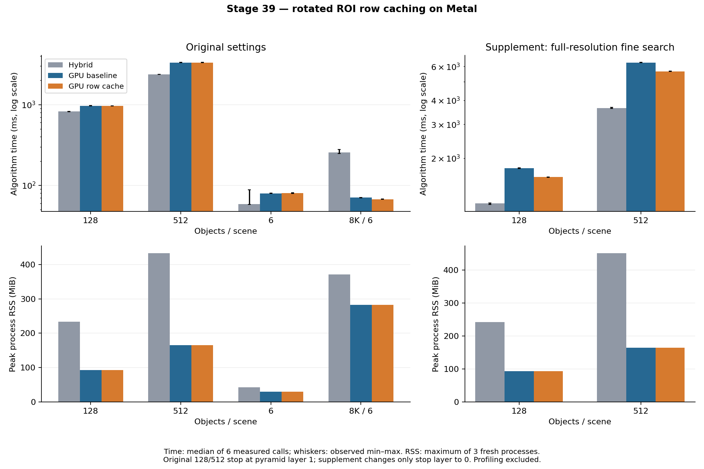

# Metal細搜尋旋轉ROI分列快取

第39輪，2026-10-18～19，Apple M4 Pro／48 GiB。基線為第38輪分塊選峰，兩個完整GPU方法都使用`full_gpu_peak_mode=1`；本輪只改細搜尋取樣重用，保留原有uint64統計、NCC、旋轉取樣、精修和停止規則。

**本輪主假說沒有改善原128／512工作負載。** GPU實際計數證明兩者在金字塔第1層停止，所有執行過的細搜尋ROI都已能放入原快取，新的分列路徑執行次數為零。完整GPU仍保留第38輪方案；新`full_gpu_fine_mode=1`保留作有條件的研究選項，不改GUI或混合預設。

上一輪依原始模板尺寸提出「大尺度ROI超過快取」的推測，當時尚未量到候選是否到達該層。本輪補上實際執行計數，排除了它作為原設定大量物件瓶頸的解釋。另加只改`stop_layer=0`的補充實驗，單獨評估需要原始解析度細搜尋時的效果；沒有用補充設定取代原有主要驗收。

## 未插樁的正式比較

主實驗四場景×三方法×三個順序交錯block，每程序保存首次呼叫、至少1秒暖機及2次正式呼叫；36程序、108次首次／正式GT驗收。時間取每方法6次正式呼叫中位數，首次與暖機另外保存。所有比較使用同一本輪執行檔，不沿用第38輪歷史時間。

| 場景 | 混合 ms | 原完整GPU ms | 分列完整GPU ms | 分列相對原GPU |
|---|---:|---:|---:|---:|
| 128物件 | 822.182 | 964.672 | 962.956 | -0.18% |
| 512物件 | 2366.006 | 3318.802 | 3320.584 | +0.05% |
| 6物件 | 58.588 | 79.683 | 79.953 | +0.34% |
| 8K三尺度，6物件 | 256.930 | 70.602 | 67.307 | -4.67% |

128／512的−0.18%／+0.05%不作為加速證據：兩模式執行相同取樣路徑，且都未達事前至少降低10%總時間的目標。四場景相對原GPU均通過時間／RSS退步容忍；「沒有明顯退步」和「改善主要工作負載」是不同驗收條件。

6物件混合方案第一block兩次為88.18／74.06ms，其餘四次58.01～58.98ms；全部保留。它使該場景第一個速度gate通過，但不改變本輪沒有改善主要場景的結論。正式數據沒有依結果刪除樣本或重跑挑選。

## 診斷：實際走過哪些路徑

原設定128／512的12次診斷呼叫全部有效，6組新舊模式的有序輸出一致；同案例各次候選／角度計數相同。每個FGLevel記錄進入的候選數及實際評估角度數，包含subpixel重新置中與解析度重算。計數保留在GPU private buffer，整條完成後一次複製／讀取；沒有中途CPU決策。

| 原設定 | 128物件 | 512物件 |
|---|---:|---:|
| 實際評估角度圖 | 228,673 | 659,373 |
| 全ROI快取／直接取樣／分列比例 | 100%／0%／0% | 100%／0%／0% |
| 旋轉取樣函式呼叫數 | 461,128,452 | 1,470,471,680 |
| NCC像素配對數 | 約172.89億 | 約558.79億 |
| 第1層占NCC配對工作量 | 67.66% | 72.01% |
| 細搜尋GPU診斷時間，原→分列模式 | 572.299→572.262ms | 1837.301→1835.009ms |

角度與候選是實測計數；取樣函式／NCC配對數由計數和模板尺寸精確換算，並非硬體記憶體交易、cache命中率或每層實測時間。此結果將下一個研究焦點指向已快取路徑的NCC累加，而不是本輪沒有用到的大ROI旋轉取樣。

## 補充：搜尋到原始解析度

補充protocol在主診斷發現零分列角度後另行記錄。沿用相同圖片、模板、GT、尺度、角度、分數與精修，僅將128／512的`stop_layer`由1改為0；三方法×三block×2正式重複，18程序／54次首次與正式GT。它不屬於原主要場景10%改善門檻，摘要的主要改善目標欄位為null，不當成主要目標通過。

| 場景 | 混合 ms | 原完整GPU ms | 分列完整GPU ms | 分列相對原GPU |
|---|---:|---:|---:|---:|
| 128物件，stop0 | 1165.651 | 1774.387 | 1596.021 | -10.05% |
| 512物件，stop0 | 3646.021 | 6284.702 | 5662.667 | -9.90% |

這個較深入的搜尋設定本身比原本stop1慢。即使新方法改善stop0，也不構成把原方案改成stop0的速度理由。

| stop0診斷 | 128物件 | 512物件 |
|---|---:|---:|
| 實際分列角度 | 4,498 | 16,530 |
| 旋轉取樣呼叫，原→新 | 5,746,918,076→953,201,564 | 20,958,046,058→3,341,297,738 |
| 細搜尋GPU時間，原→新 ms | 1389.458→1217.161 | 4821.144→4202.644 |

stop0的總取樣呼叫分別減少83.4%／84.1%，但全部算法時間約少10%；兩者的角度數、到達層級及候選完全相同。8K原設定另有51次角度評分走分列路徑，取樣呼叫42,424,560→2,683,728，正式總時間70.602→67.307ms（−4.67%）。

分段timestamp只用於診斷，正式速度沒有開啟它。主診斷的階段加總與command GPU區間差為−0.81649～+1.48084ms，4次為負；兩種計時介面不是精確分割，所有有號差值保留。五份摘要中另列同來源、圖片、設定與binary的開／關儀器總時間差，該差仍包含一般程序間波動。



## 記憶體、準確度與採用判斷

| 場景 | 峰值RSS MiB：混合／原GPU／分列 | 命名Metal buffers MiB：原GPU＝分列 |
|---|---:|---:|
| 128物件 | 233.05／93.20／93.12 | 116.474 |
| 512物件 | 432.88／164.86／165.03 | 236.296 |
| 6物件 | 42.41／29.75／29.70 | 6.153 |
| 8K三尺度，6物件 | 371.02／282.66／282.53 | 161.498 |
| 128物件，stop0 | 241.88／92.89／92.94 | 116.474 |
| 512物件，stop0 | 450.77／164.69／164.95 | 236.296 |

162次首次及正式GT全部零FP／FN；每個設定內，新舊GPU的完整有序matches與proposals一致，同方法重複一致。分列模式跨主／補充的最大位置誤差0.12834px、角度0.09952°、相對尺度0.27806%，符合2px／1°／2%門檻；不要求stop0與stop1彼此輸出相同。

主實驗保留2項主要改善目標失敗及8個相對混合的速度block失敗，補充另有6個相對混合的速度block失敗。所有相對原GPU的時間／RSS容忍通過。完整GPU的建議仍以第38輪分塊選峰為基礎；本輪mode1只適合確實出現過大ROI的研究設定，並不解決現有128／512的主瓶頸。

分列快取重用原有`roi[]`，正式快取仍為16,384bytes，整個細搜尋kernel的static threadgroup memory為28,560bytes；不新增算法device scratch。Shader Validation使用4,096bytes快取，需另報其儀器化容量，不能以驗證版時間作正式速度。

`fine_diagnostic_bytes`計兩個保留的命名buffer，已包含在`gpu_bytes`內；`fine_diagnostic_readback_bytes`是當次診斷payload，和算法輸出`readback_bytes`分開。關閉profiling後Session可能保留容量，但觀測陣列及當次payload歸零。RSS、命名Metal配置及threadgroup static storage範圍不同，不相加，也不當成實體VRAM總用量。

## 實作與數學等價性

設模板寬高為w、h，49個搜尋位置為7×7。原旋轉ROI為(w+6)×(h+6)。若整塊放得下，維持原快取；否則mode1取：

```text
B = min(16, floor(cacheBytes / (w+6)) - 6)
```

B至少1時，按B列模板加6列垂直邊界載入；最後一塊只載入剩餘列數加6列。若連7列都放不下，維持原直接取樣。每塊前後所有256個lane都參與barrier，包含沒有負責NCC視窗的lane。

模板像素仍由全域索引`p % 4`分派；分塊只改變讀取位置，沒有改變每個lane負責的像素集合。每項像素、平方、點積均以uint64精確累加，原始絕對座標與灰階量化取樣不變，所以每lane三個統計、四lane合併、49個NCC分數和選峰規則均保持一致。這是相對既有GPU FP32座標／分數的等價性，不宣稱和CPU binary64逐位相同。

每角度邏輯旋轉取樣次數：

```text
直接取樣 = 49 × w × h
完整快取 = (w+6) × (h+6)
分列快取 = (w+6) × (h + 6 × ceil(h/B))
```

175×128模板的分列暫存為181×22=3,982bytes，8塊總取樣31,856次，直接法為1,097,600次。NCC的49組點積仍完整計算，還有金字塔、粗選峰及精修成本，所以不能把取樣次數比當成整體加速倍數。

診斷角度counter使用uint32；每候選每層至多3passes×(1初始+9重試+2解析度重算)×35angles=1260次。既有2M候選上限使每層計數不超過2.52B；host採uint64換算取樣工作量，JSON保留整數。關閉診斷時不做原子累加，並固定使用dummy record0，避免大尺度庫形成越界參照。

## 驗證、完整源碼與重現

Release64／64通過；96組細搜尋差分逐位核對49個分數、196個lane的三組uint64統計、合併統計、選峰／門檻和guard bytes，包含16KiB／4KiB邊界、極寬fallback、最後不足16列、奇偶尺寸、旋轉、越界及常數案例。整數座標另用CPU oracle核對。

Metal API＋Shader Validation四項通過（48組差分使用4KiB快取）；30項量測負控制及7項實際runner非法JSON檢查通過。封存來源乾淨建置的ASan／UBSan四項通過，leak detection關閉。另乾淨Release重建runner，controlled6三方法各首次與一次重複，共6次完整有序輸出均和正式資料一致；未將小案例重建比對當成全部場景重跑。

[分列kernel](../experiments/full_gpu_fine.metal)、[選項／counter ABI](../experiments/full_gpu_fine_types.h)、[Metal host](../experiments/full_gpu_metal.mm)、[96組差分](../tests/full_gpu_fine_test.mm)、[全流程測試](../tests/full_gpu_pipeline_test.cpp)、[正式量測工具](../tools/benchmark_gpu_fine_tiles.py)、[30項負控制](../tests/test_gpu_fine_tiles_harness.py)均保留完整原始碼。舊mode0也保留。

研究JSON：在`full_gpu=true, full_gpu_peak_mode=1`下加入`full_gpu_fine_mode=1`；0使用原細搜尋方式。`full_gpu_profiling=true`同時啟用分段時間與執行計數；非法mode或混合路徑上的非零mode明確拒絕。GPU仍一次提交、最後一次等待，沒有中途算法回讀。

[封存清單](stage39-fine-tiles/archive.json)、[驗證範圍](stage39-fine-tiles/validation.json)、[採用與失敗](stage39-fine-tiles/decision-and-failures.json)保存來源、輸入、程序輸出、負面結果與統計重播。主／補充formal和三份profile分開，診斷時間不混入正式門檻。276份凍結來源與7份唯一輸入逐檔核對；從解壓資料與封存工具重算五份摘要均逐byte一致。暖機另保留主258次、補充18次時間，不計入獨立GT驗收。

```sh
mkdir -p build/stage39-repro/source build/stage39-repro/raw
tar -xzf cpp-core/docs/stage39-fine-tiles/source-snapshot.tar.gz -C build/stage39-repro/source
tar -xzf cpp-core/docs/stage39-fine-tiles/fixtures.tar.gz -C build/stage39-repro/source
tar -xzf cpp-core/docs/stage39-fine-tiles/raw-results.tar.gz -C build/stage39-repro/raw
python-port/venv/bin/python build/stage39-repro/source/cpp-core/tools/benchmark_gpu_fine_tiles.py \
  --summarize build/stage39-repro/raw/formal/manifest.json \
  --output build/stage39-repro/formal-summary.json
cmp cpp-core/docs/stage39-fine-tiles/formal-summary.json build/stage39-repro/formal-summary.json
cmake -S build/stage39-repro/source/cpp-core -B build/stage39-repro/release \
  -DCMAKE_BUILD_TYPE=Release -DFPM_BUILD_EXPERIMENTS=ON -DFPM_BUILD_GUI=ON -DFPM_WITH_OPENCV=ON
cmake --build build/stage39-repro/release --parallel 8 \
  --target fpm_native_pipeline_runner fpm_full_gpu_test fpm_full_gpu_fine_test
ctest --test-dir build/stage39-repro/release \
  -R 'experimental_full_gpu($|_fine$|_fine_tiled$|_fine_profile$)' --output-on-failure
```

Python需要NumPy／OpenCV；Qt與系統框架等外部依賴未封入來源。重跑原job時需將圖片絕對路徑改到解壓source，另存新輸出；`validation/check_rebuilt.py`保留實際重建比對方法。主正式命令為`benchmark_gpu_fine_tiles.py --output <新目錄>/manifest.json`，預設沿用第37輪素材manifest。補充使用封存的`stop0-fixtures.json`及`--cases many128_pose_stop0,many512_pose_stop0`，不得誤稱原設定。

## 下一個有證據支持的實驗

原設定實際走過的最大模板為88×64；每lane最多1,408像素，平方或點積累加上界為1,408×65,025=91,555,200，落在uint32內。下一輪可先測「有界uint32局部累加，四lane合併前擴成uint64」，並保留超界fallback；一般條件為`ceil(area/4) <= 66051`。之後再測49個重疊視窗的來源sum／square重用，點積仍完整。

這兩項尚未實作或取得時間結果。第1層配對量占比不能當成該層GPU時間占比，也不能由本輪推論occupancy或硬體cache命中。RGB、CUDA、多模板與新長跑不在本輪驗收內。
