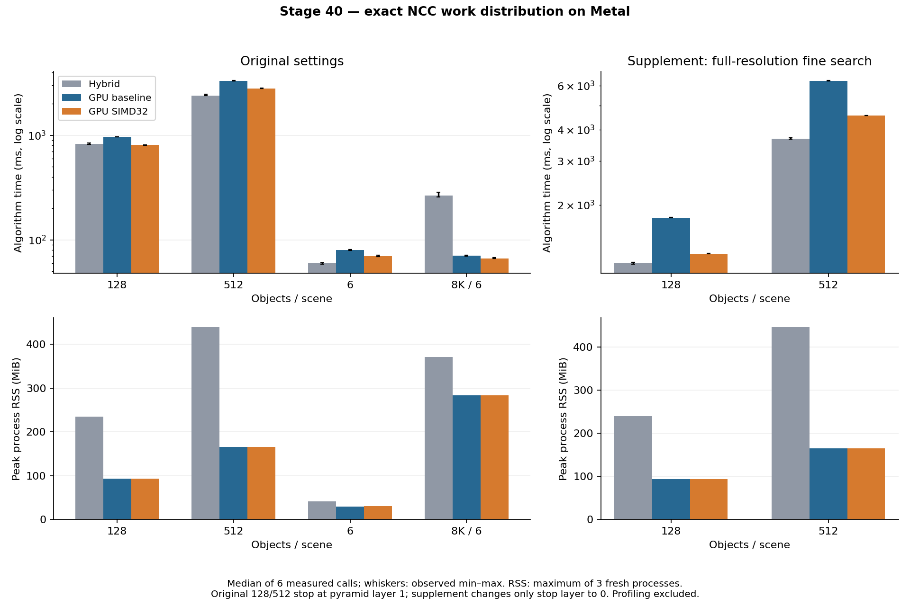

# 完整 Metal 灰階搜尋：NCC 優化與本大階段結案

第40輪，2026-10-19，Apple M4 Pro／48 GiB。這一輪接續第37輪全流程常駐、第38輪分塊選峰及第39輪旋轉 ROI 分列快取，完成已規劃的精確 NCC 內迴圈、統計重用及 SIMD 工作分配實驗。完整源碼、無效方案、原始量測與獨立審核全部保留。

**結論：本大階段已完成。GPU研究路徑採用分塊選峰＋精確SIMD32 NCC（peak1／fine4）；不改GUI與通用預設。** 原128／512工作負載的完整GPU算法耗時再減少16.3%／15.4%，沒有增加命名GPU配置，所有GPU完整有序輸出保持一致。128已接近混合方案，512仍以混合方案延遲較低；不能宣稱全GPU全面勝出。

> **2026-10-19更正（合併後驗收審查的非阻塞發現；原文保留）**：混合方案的正式呼叫重用首次呼叫建立的pose context，完整GPU每次重建，「包含每次準備」並不對稱；加回後fine4在原128約快4%，512仍以混合較快。8K只有6個0°、尺度1的目標放在常數背景上，是精度鑑別力低的速度負載，完整GPU最大的優勢來自這一組。文末「中途零讀回、零CPU算法步驟」所依據的兩個計數器當時是從未遞增的常數。詳見文末「2026-10-19 更正與補充揭露」。

> 2026-10-19補充：第41輪已實測每次換新影格的成本，fine4在128快6.9%、512仍慢13.7%，上述估算方向成立。見[每影格成本報告](NEW_FRAME_COST_zh-TW.md)。

## 正式結果與採用判斷

同一建置、同一工作量的完整算法中位數，單位ms；每格六次正式呼叫，另保存三個程序的首次與暖機。

| 場景 | 既有混合 | GPU基線fine0 | 有界u32 fine2 | SIMD32 fine4 | fine4對GPU基線 |
|---|---:|---:|---:|---:|---:|
| 原128物件 | 824.59 | 963.10 | 898.44 | **806.46** | −16.3% |
| 原512物件 | 2391.95 | 3314.24 | 3105.06 | **2805.18** | −15.4% |
| 六物件控制 | **59.85** | 80.20 | 75.38 | 70.03 | −12.7% |
| 8K、256模板、全角三尺度 | 265.28 | 70.57 | 66.99 | **66.80** | −5.3% |

fine4通過兩個主要案例「至少少10%時間」目標及相對GPU基線的各block時間／RSS門檻。128對混合少2.2%，應視為接近；512仍比混合多17.3%時間。fine2只有6.7%／6.3%改善，未達主要目標，保留作分解比較與安全回退。[正式逐次結果](stage40-ncc-closure/formal-summary.json)



| 場景 | 混合 peak RSS MiB | GPU基線 peak RSS MiB | fine4 peak RSS MiB | GPU基線與fine4命名配置 MiB |
|---|---:|---:|---:|---:|
| 原128 | 234.86 | 93.41 | 93.47 | 116.47，完全相同 |
| 原512 | 438.95 | 165.22 | 164.98 | 236.30，完全相同 |
| 六物件 | 41.58 | 29.84 | 29.92 | 6.15，完全相同 |
| 8K | 370.94 | 282.92 | 282.89 | 161.50，完全相同 |

static threadgroup配置固定28,560bytes。RSS與命名Metal配置是不同範圍；上表不能相加，也不能將RSS差當成節省了同樣多的實體GPU記憶體。

### 深搜尋與保留場景

只將原圖設定改成stop0，搜尋到原始解析度後，128的GPU基線／分列mode1／SIMD4為1776.72／1594.75／1277.01ms；512為6267.52／5657.65／4549.18ms。SIMD比基線少28.1%／27.4%，也比mode1少約20%；混合為1169.59／3672.98ms，仍較快。這是不同搜尋深度的補充結果。[stop0正式紀錄](stage40-ncc-closure/stop0-formal-summary.json)

| 保留場景 | GT物件數 | 混合ms | GPU基線ms | fine4 ms |
|---|---:|---:|---:|---:|
| heldout12 | 12 | 109.32 | 120.57 | 99.60 |
| 小圖原始解析度 | 2 | 5.88 | 11.46 | 8.15 |
| 邊界單物件 | 1 | 0.51 | 0.44 | 0.38 |
| 無目標 | 0 | 0.25 | 0.25 | 0.26 |
| 常數來源 | 0 | 0.23 | 0.25 | 0.25 |
| 新種子128 | 128 | 841.70 | 959.39 | 802.22 |
| 新種子512 | 512 | 2399.14 | 3302.80 | 2797.30 |

前五個保留場景曾用於第37輪，本輪沒有拿它們選擇變體；只有新種子128／512是本輪新生成。所有方法零FP／FN，新舊GPU完整有序matches／proposals一致。fine4跨主、stop0與保留集的最大位置／角度／相對尺度誤差為0.12834px／0.09951°／0.27806%，低於事前門檻。新128／512以獨立OpenCV renderer產生，位置種子20261019、噪聲種子20261020；不依搜尋輸出產生GT。它們不是新的實拍姿態序列。[保留集摘要](stage40-ncc-closure/holdout-summary.json)

### 無效方案與跨版本對照

來源S/Q滑動重用mode3在初測128／512為1112.78／3778.66ms，對基線961.32／3326.26ms反而更慢，因此不進正式採用比較；保留原碼、初測與獨立階段診斷。mode4已包含mode2的有界累加及過大ROI退路；沒有另一個獲勝的互補方案可組合，不再任意增加變體。[初測](stage40-ncc-closure/pilot-summary.json)、[篩選決定](stage40-ncc-closure/screening-decision.json)

另用封存第39輪binary驗證基線沒有被新程式拖慢：128舊版／本輪fine0／fine4為964.55／963.60／806.42ms；512為3322.05／3311.65／2801.24ms。基線差異低於0.4%，且54次直接GT與完整有序輸出全過。[跨版本摘要](stage40-ncc-closure/cross-version-summary.json)

所有52筆未通過門檻均保留：初測22、主正式14、stop0正式10、保留集6。它們是速度容忍或10%改善目標失敗，沒有精度或RSS門檻失敗。部分是「GPU不能取代混合」的證據，不能因新GPU比舊GPU快就刪除。[採用與完整失敗清單](stage40-ncc-closure/decision-and-failures.json)

### GPU時間實際花在哪裡

下列為另跑的timestamp診斷，不能混入上述正式速度：

| 階段ms | 原128 fine0 | 原128 fine4 | 原512 fine0 | 原512 fine4 |
|---|---:|---:|---:|---:|
| 細搜尋 | 573.17 | 416.14 | 1837.02 | 1326.81 |
| 粗選峰（fine4） | — | 229.30 | — | 938.09 |
| 粗NCC（fine4） | — | 33.85 | — | 72.35 |
| 初次連續精修（fine4） | — | 76.13 | — | 272.99 |
| GPU整段（fine4） | — | 807.67 | — | 2787.78 |

fine4細搜尋仍占GPU時間約51.5%／47.6%，粗選峰占28.4%／33.7%。前兩階段仍可作未來研究題目，沒有達到理論極限。mode3的細搜尋則增至722.69／2302.22ms，支持本次工作分配不合適的判斷。

fine4的`upload_ms`約0.49／0.52ms，實際量的是CPU memcpy到shared輸入；`readback_ms`約0.008／0.022ms，量的是最後等待後的結果轉換。它們不是硬體DMA／PCIe傳輸時間。CPU等待約808.14／2788.29ms已包含上述GPU運算，不可再次加成通信成本。此M4統一記憶體結果不能預測CUDA裝置的傳輸時間。

54次profile呼叫皆取得timestamp。分階段總和與GPU整段的signed residual為−0.977～+5.322ms，其中11筆負值原樣保留，不強行改成零或宣稱完美分割。[主診斷](stage40-ncc-closure/profile-summary.json)、[stop0診斷](stage40-ncc-closure/stop0-profile-summary.json)

## 問題、研究來源與實作

第39輪實測發現，原128／512物件工作負載的細搜尋 ROI 已全部放入既有快取；繼續改善超大 ROI 載入並不能幫助這兩組案例。因此本輪直接改變已快取的 NCC 計算，不改尺度庫、角度、搜尋深度、分數、候選預算或停止規則。

三個 agent 分別負責 kernel／數值測試、量測工具／保留場景、文獻／獨立證據審核；主流程整合 host、依序執行實驗與封存。GPU 計時期間沒有並行的其他實驗或編譯工作。

| fine mode | 實作 | 結果判讀 |
|---|---|---|
| 0 | 原完整 ROI 快取，過大時直接取樣；uint64 統計 | 保留為基線 |
| 1 | 第39輪過大 ROI 分列快取，統計仍 uint64 | 原128／512不會走新路徑；stop0另測 |
| 2 | mode1＋有界 uint32 局部累加，合併前轉 uint64 | 與mode4分開正式比較 |
| 3 | mode2＋已快取 ROI 的垂直窗口 S/Q 重用 | 初測兩主要場景變慢，保留負面結果及診斷 |
| 4 | mode2＋每32個 SIMD lanes共同處理一個窗口 | 本輪主要候選；超出適用條件回到mode2 |

文獻主要借鑑 Lewis 的局部統計重用，以及 Maděra、Šmelko、Kruliš 的2025年 GPU cross-correlation 工作分配研究。前者說明分母可用 running sums，後者的作者套件提供 warp-per-shift 對照；本專案自行實作精確 gray8 整數版本，未複製第三方 kernel，也未引用作者的加速倍率作本機結果。[Lewis原文](https://www.scribblethink.org/Work/nvisionInterface/nip.html)、[2025論文](https://doi.org/10.1016/j.jpdc.2025.105054)、[作者重現程式](https://github.com/asmelko/jpdc23-artifact/tree/21bfe6d09170e5f297eeff5753f74588773fbaad)

完整[研究筆記](stage40-ncc-closure/research.md)另查核 OpenCV CUDA、stereo Z²-ZNCC、FFT、矩形近似與旋轉 tensor 的適用前提。FFT 與近似方法沒有在本輪實作，不能由閱讀論文宣稱已取得其速度或精度。

## 為何能保持結果一致

對每個旋轉後的 gray8 窗口，保留三個整數統計：

```text
S = Σ Xᵢ,  Q = Σ Xᵢ²,  P = Σ XᵢTᵢ
NCC = (nP − S·Sₜ) / sqrt((nQ − S²)(nQₜ − Sₜ²))
```

像素乘積最大為65,025。原四條帶每條最多`ceil(n/4)`個像素，因此`ceil(n/4) ≤ floor((2³²−1)/65025) = 66051`時，每條帶的 S、Q、P 都可用 uint32 精確計算。結果先寫進既有 uint64 partials，再按原運算順序合併及計算 NCC。超過此界限直接保留 uint64，不依影像內容猜測是否安全。

mode3只重用來源 S／Q。先求七個橫向偏移的第一列窗口，再將窗口向下滑動六次：先減掉離開的列，再加進新的列。各條帶按全域列索引分派，單一條帶的 S／Q 可與舊版不同，但每個窗口的合併值必須精確相同。固定模板的 dot 權重會隨來源窗口平移而重新對應，不能照搬 stereo 兩張 patch 一起移動的增量公式；49組 dot 仍完整計算。

mode4讓256 threads組成8個32-lane SIMD groups，各組依次處理窗口`g, g+8, …`。每個 lane 讀取`p % 32`的像素；shuffle偏移16、8、4後，前四個 lane正好重建原來`p % 4`的四條帶。沒有把整個窗口直接以uint32相加，因為四個安全條帶的總和仍可能超過uint32。所有49個分數、完整候選順序、門檻和 tie 規則保持原樣。

host查詢實際`threadExecutionWidth`。只有32時啟用mode4，其他寬度明確以mode2執行；JSON同時報`fine_mode`、`fine_effective_mode`和`fine_simd_width`。這仍是GPU算法回退，沒有加入CPU求解。非32硬體本輪只有程式與負控制驗證，沒有實機效能結果。[Apple SIMD groups說明](https://developer.apple.com/documentation/metal/creating-threads-and-threadgroups)

> 2026-10-19補充：`fine_effective_mode=4`只代表啟用了SIMD32 kernel，未快取或需uint64的層仍逐視窗回到mode2；逐視窗計數見文末。

mode3雖然減少總加法，實作卻在dot迴圈之後，讓28個lane執行額外S/Q迴圈，其餘lane等待。這是源碼可見、與退步一致的解釋；本輪沒有硬體stall或cache命中率計數，不將它冒稱為已量出的微架構原因。

## 量測與驗收界線

正式速度用新程序、三個交錯順序block、每次至少1秒暖機及兩次正式呼叫；首次與暖機另外保存。時間為完整算法時間，包含每次準備，排除圖片解碼、Session建構、JSON與GT評估。階段診斷、短時間連續運行及測試時間不混入正式速度。未刪除慢樣本，也沒有以重跑挑選較漂亮的結果。

> 2026-10-19更正：「包含每次準備」只對完整GPU完全成立；混合方案正式呼叫的pose context建立時間為0，見文末。

GT在父程序獨立評估，從不給搜尋器位置提示。嚴格門檻為2px／1°／2%相對尺度，零FP／FN。GPU新舊完整有序matches及proposals還須完全一致；這與「GT通過」分別驗收。浮點幾何仍採既有GPU FP32契約，未宣稱與CPU FP64逐位相同。

原128／512設定在金字塔第1層停止；stop0補充只改搜尋深度，不能拿較慢的stop0基準宣稱原工作負載加速。新種子保留場景使用同一實拍紋理、不同位置／角度／尺度及背景噪聲；仍屬合成，不是已標註實拍影片。

RSS、命名Metal buffer容量、threadgroup static memory範圍不同，不能相加成實體記憶體。初始化與輸入／輸出拷貝另有欄位，CPU等待包含GPU執行時間；不能把整段wait當成通信時間。

## 驗證與穩定性

六組資料共177個新程序、507次直接GT評估；加上跨版本54次與連續檢查首次1次，共**562次直接GT，全部零FP／FN**。六組暖機92,660次只有時間與原生一致性確認，沒有被灌入直接GT數量。主要正式／stop0／保留集共135程序、405次GT；初測與診斷分開列出。

| 檢查 | 結果與範圍 |
|---|---|
| 完整Release | 70／70，含GUI既有測試；不是本輪新增人工GUI驗收 |
| 細搜尋差分 | 104fixtures×5種production模式，比對封存legacy與scalar；49分數、溢位、回退、tie與guard |
| 量測工具 | 73／73，含本輪25項工具測試與負控制；另7種非法runner JSON拒絕、7項soak工具檢查（含6項負控制） |
| Metal API／Shader Validation | 7／7；插樁容量4KiB下52fixtures×5模式，保留16KiB正常容量測試 |
| 乾淨來源重建 | 7／7；四種方法六物件＋512 SIMD共10次完整有序輸出對正式結果一致 |
| ASan／UBSan | 凍結來源另建置，相關7／7；未啟用LeakSanitizer，不當洩漏證明 |
| 獨立審核 | agent不匯入量測harness，重算GT、順序、指紋、跨版本、soak與時間範圍 |

五分鐘512物件連續檢查共108次算法呼叫（首次完整GT＋107次重複），第100次後重建一次Session。每次由原生程式確認完整輸出與首次一致；stream只保存摘要，因此107次不能寫成獨立GT。全程命名GPU配置236.30MiB不變；RSS首末10次中位數增加1.15625MiB（0.711%），peak164.20MiB，通過事前門檻。[soak摘要](stage40-ncc-closure/soak-summary.json)

這是新算術變體的短期回歸檢查，不是新的30分鐘／24小時驗收，也沒有實拍串流精度保證。測試與封存通過不會抹除上述性能失敗。[完整驗證清單](stage40-ncc-closure/validation.json)

## 使用與完整源碼

沿用研究runner的完整GPU設定，指定：

```json
{
  "full_gpu": true,
  "full_gpu_peak_mode": 1,
  "full_gpu_fine_mode": 4
}
```

其餘backend、尺度、角度與精修設定沿用對應benchmark job；以上只是新增選項片段，不是一份可直接執行的完整job。mode0–3均保留；GUI與通用預設未自動改動。`full_gpu_profiling=true`只用於另跑診斷。

[完整細搜尋kernel](../experiments/full_gpu_fine.metal)、[host](../experiments/full_gpu_metal.mm)、[選項與計數ABI](../experiments/full_gpu_fine_types.h)、[數值差分測試](../tests/full_gpu_fine_test.mm)、[全流程測試](../tests/full_gpu_pipeline_test.cpp)、[量測工具](../tools/benchmark_gpu_ncc_closure.py)、[量測負控制](../tests/test_gpu_ncc_closure_harness.py)都保留完整原始碼。自有演算法源碼完整，不包含Qt、OpenCV或系統Metal框架的全部外部來源。

## 封存與重現

[封存清單與SHA256](stage40-ncc-closure/archive.json)按用途分開保存：

| 檔案 | 內容 |
|---|---|
| [source-snapshot.tar.gz](stage40-ncc-closure/source-snapshot.tar.gz) | 實驗前凍結的278個源碼／建置檔案、內部指紋；包含完整kernel與測試 |
| [fixtures.tar.gz](stage40-ncc-closure/fixtures.tar.gz) | 16個去重輸入檔案，含圖像與GT，保留repo相對路徑 |
| [raw-results.tar.gz](stage40-ncc-closure/raw-results.tar.gz) | 初測、正式、stop0、七個保留場景、階段診斷、soak及新場景metadata，724檔 |
| [validation-logs.tar.gz](stage40-ncc-closure/validation-logs.tar.gz) | 建置、測試、獨立數學／GT審核、跨版本完整worker、乾淨重建與重播腳本 |
| 八份`*-summary.json` | 六組實驗、跨版本、soak的可重算摘要；未修改失敗門檻 |
| [research.md](stage40-ncc-closure/research.md)／[research.json](stage40-ncc-closure/research.json) | 論文、GitHub固定版本、授權與數學適用範圍 |

全部壓縮檔逐一讀過每個regular member並檢查路徑；換目錄解壓後，278個來源＋16個輸入的SHA256吻合。六組實驗、跨版本及soak共八份摘要，由封存工具重算後逐byte一致；重播不重新測GPU速度。跨版本重播另讀repo內第39輪`source-snapshot.tar.gz`的舊工具，依賴明確保留。

從repo根目錄，使用已安裝NumPy／OpenCV的Python重播：

```sh
python3 - <<'PY'
from pathlib import Path
import tarfile
destination = Path('build/stage40-ncc-closure')
destination.mkdir(parents=True, exist_ok=True)
with tarfile.open('cpp-core/docs/stage40-ncc-closure/validation-logs.tar.gz') as archive:
    archive.extractall(destination, filter='data')
PY
python3 build/stage40-ncc-closure/validation/replay.py
```

使用Python3.12以上；若依賴在專案venv，改用該Python執行。重播輸出寫到`build/stage40-review`，審核結果在`build/stage40-ncc-closure/validation/archive-replay.json`。不需Metal裝置即可重算摘要；重新執行Metal算法則需要macOS、Metal與相應建置依賴。

乾淨來源建置／驗證指令保存在`validation/validate_builds.py`與各configure log；此輪已實際重建並檢查10次完整輸出。封存後僅補上Log分類器的stage40目錄對照，以及報告／索引；算法與量測源碼未改。重現應使用凍結來源，不將日後HEAD與當時源碼視為同一份。

## 本大階段完成與未涵蓋的內容

| 輪次 | 本大階段完成的工作 | 保留的判斷 |
|---|---|---|
| 37 | 金字塔、旋轉、粗細搜尋、精修／救援、NMS與結果幾何全留在Metal | 功能完整不代表速度較快；原大量物件選峰很慢 |
| 38 | 完整分塊排序、精確合併與選峰，加入階段timestamp | 對該輪原GPU基線128／512少79.8%／87.3%時間；細搜尋成為主要成本 |
| 39 | 細搜尋過大ROI分列快取及路徑計數 | 原128／512已全部快取，主假說無效；原解析度stop0有約10%收益 |
| 40 | 有界累加、統計重用、SIMD32、保留場景、跨版本與重建／重播 | 採用fine4作GPU研究配置；失敗fine3保留；512仍以混合較快 |

本輪GPU呼叫仍是一次提交、一次最後等待、中途零讀回、零CPU算法步驟；CPU負責圖片I/O與靜態工作規劃。這是完整灰階資料路徑，並非只搬了粗搜尋。表中各輪使用各自同輪基線，不能將百分比直接相乘。

> 2026-10-19更正：「中途零讀回、零CPU算法步驟」所依據的`intermediate_readbacks`／`cpu_algorithm_steps`當時從未遞增，是程式結構判斷而非量測；一次提交、一次最後等待的結構屬實，見文末。

本階段結案範圍是完整gray8 Metal路徑、分塊選峰、分列旋轉快取，以及三個精確NCC變體的有界實驗、正式驗收與可重現封存。某變體較慢也算完成實驗，其原碼與失敗仍可供未來CUDA對照。沒有證據顯示NCC、GPU或整個專案已達理論極限。

RGB完整常駐搜尋、多種模板庫、實拍姿態標註長序列、CUDA實機、透視／遮擋、容許近似誤差的FFT或tensor改版，仍是另外的研究範圍。本輪不把它們列為已完成；也不因還有可研究方向，就無限延長這一大階段。

## 2026-10-19 更正與補充揭露

第40輪合併後的獨立驗收審查（ctest、GT重算與封存重播均通過）另列出幾項非阻塞弱點。本節更正相關敘述；上文原文、表格與`stage40-ncc-closure/`封存都不修改。以下數字只讀封存的原始結果，沒有重新量測GPU速度，可用[`audit_full_gpu_disclosure.py`](../tools/audit_full_gpu_disclosure.py)重算。

### 計時範圍並不對稱

上文說正式時間「包含每次準備」，但兩種方法的「每次準備」範圍不同：

- 混合Session在第一次精修時建立source pose context，之後對同一張來源影像的呼叫直接重用，`updateSource`後才重建。首次呼叫的`pose_create_ms`在原128為18.62／19.36／19.08ms，原512為42.41／40.87／38.99ms（三個程序）；所有正式呼叫皆為0。
- 完整GPU每次呼叫都在GPU上重算來源統計、置中float來源與模板，並重建模板金字塔。另跑的profile診斷中，fine4的`pose_prepare`為2.11／4.70ms、`template_pyramid`約0.17ms GPU時間；這是診斷值，不屬正式速度。

若每次呼叫都換新影格，混合方案也要重建pose context。下表把各程序首次值的中位數加回混合正式中位數，只是估算：

| 場景 | 混合正式ms | 首次`pose_create_ms`中位 | 加回後混合ms | fine4 ms | fine4對原混合 | fine4對加回後混合 |
|---|---:|---:|---:|---:|---:|---:|
| 原128 | 824.59 | 19.08 | 843.67 | 806.46 | −2.2% | −4.4% |
| 原512 | 2391.95 | 40.87 | 2432.82 | 2805.18 | +17.3% | +15.3% |
| 六物件控制 | 59.85 | 1.52 | 61.37 | 70.03 | +17.0% | +14.1% |
| 8K（core-only，無精修） | 265.28 | 0 | 265.28 | 66.80 | −74.8% | −74.8% |

同一估算下，保留場景heldout12／新種子128／新種子512由−8.9%／−4.7%／+16.6%變為−11.4%／−6.9%／+14.7%；stop0的128／512由+9.2%／+23.9%變為+7.4%／+22.5%。結論修正為：加回後fine4在原128約快4%，512仍以混合較快；「128接近、512混合較快」的方向不變。

首次值可能含冷啟動成本，不等於穩態的每影格成本；這是封存數字相加的估算，不是新的「每次換影格」量測。runner的`source_frames`序列模式可直接量這種情境，本次未執行（NOT RUN）。反方向的不對稱（完整GPU每次重建、混合只在Session建構時學習的模板金字塔）在上述診斷中約0.2ms，未納入估算。

> 2026-10-19補充（第41輪實測）：上面標為NOT RUN的量測已由[第41輪每影格成本](NEW_FRAME_COST_zh-TW.md)完成。每次呼叫都經過`updateSource`時，fine4對混合每影格為128 −6.9%、512 +13.7%、六物件 +13.3%、8K −70.2%，各6個block全部同向。**估算的方向四組全部成立**；128的差距比估算的−4.4%大。每次重建pose context的中位為19.94／40.19ms，與首次值相差不到1ms，但混合每換一張影格另有候選搜尋與精修的額外時間，估算沒有包含。上表與上文仍保留為當時的估算紀錄。

### 8K場景的性質

`8k_t256_angle180_3scales`來自`benchmark_coarse_ncc.py`的`cases_for`：8192×8192的常數127背景，貼上同一張256×256隨機模板的6個完全複本，全部0°、尺度1，沒有雜訊、遮擋或其他紋理；搜尋仍掃全角度與0.75／1／1.25三個尺度。稽核腳本由封存fixture確認框外像素只有127、6個框與模板逐像素相同。背景沒有可混淆的視窗，各方法都是6／0／0，精度鑑別力低；它是大圖、少目標的速度負載。完整GPU最大的時間優勢（混合265.28ms對fine4 66.80ms）正來自這一組，不能推論到有紋理背景、旋轉或縮放目標的大圖。

### 常駐計數與mode4回退

- `intermediate_readbacks`、`cpu_algorithm_steps`在第37–40輪的程式中從未遞增，JSON永遠為0，常駐gate的這兩項不可能失敗。上文「中途零讀回、零CPU算法步驟」是程式結構判斷，不是量測。一次提交、一次最後等待的結構屬實，但`command_buffers`／`cpu_waits`也只是在唯一提交點旁手動加一。
- 2026-10-19起，這四個計數改由實際的提交、等待與GPU輸出讀取點推導：讀取GPU輸出後若再有提交，該讀取計為中途讀回，該次提交計為一次host決策點（`cpu_algorithm_steps`）；最後等待之後的host工作不在後兩項範圍內，仍靠程式審查。新增`experimental_full_gpu_residency`在同一程序攔截Metal的command buffer建立、commit、等待、completion handler與buffer `contents`：出現第二個command buffer、中途等待，或從建立command buffer到最後等待之間有host讀取，即判失敗，並要求回報值與攔截值一致。
- `fine_effective_mode=4`只代表SIMD寬度檢查後啟用了SIMD32 kernel；未快取ROI或需uint64統計的層仍走mode2迴圈，摘要的`requested_algorithm_executed`、`fallback_calls`也只看kernel選項。2026-10-19起profile呼叫另報每層與每次呼叫的`simd32_windows`／`fallback_windows`（每次角度評分49個視窗）；本輪封存沒有這些欄位。依本輪profile診斷封存的角度計數與層級尺寸推導：原128／512的fine4角度評分100%走SIMD32；8K約97.0%，其餘51次落在128×128未快取層；stop0的128／512約98.3%／97.9%。這是推導值，不是新量測。
- 2026-10-19起runner拒絕任何未知的job key，錯誤訊息列出可用的key；拼錯的選項不再默默沿用預設值。
