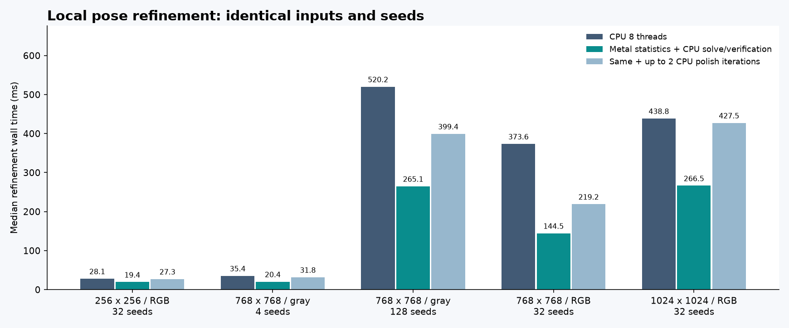
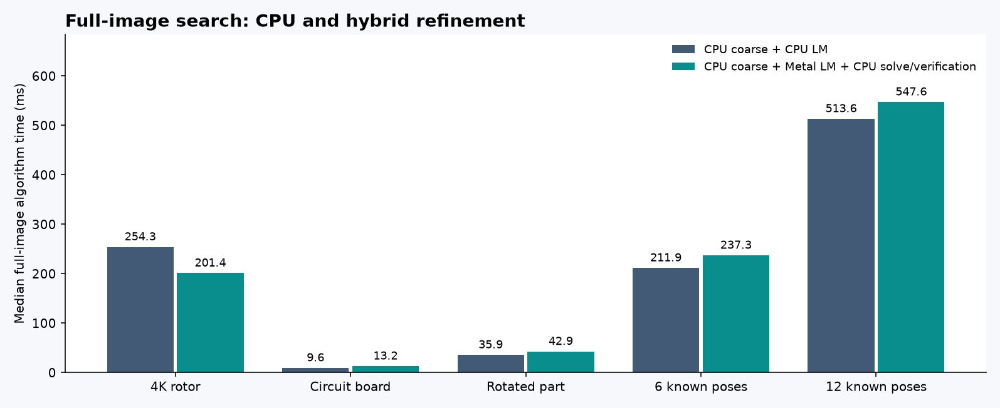

# GPU 連續 NCC 精修：實作與驗證

2026-10-12，Apple M4 Pro（12 CPU／16 GPU 核心、48 GiB），Release、CPU 使用 8 執行緒。這輪把旋轉、尺度與次像素平移精修中的逐像素導數搬到 Metal，CPU 保留小矩陣求解及最終分數複核。完整 C++／Metal 原始碼、C ABI、Python 呼叫範例與測試已提供。

大型模板的局部精修有加速；整張圖搜尋仍受 CPU 粗搜尋與同步成本限制。這是研究模式，尚未接入 GUI、尚無自動 CPU／GPU 選擇器，也沒有 CUDA 實作。本輪沒有新增 FFT；既有 Fourier 提案實驗及限制見[前期研究](RESEARCH_FOURIER_SCALE_RGB_zh-TW.md)。

## 實作與可移植性

流程：CPU 金字塔粗搜尋 → 候選姿態 → GPU 批次取樣與導數統計 → CPU 4×4 阻尼求解 → GPU 候選評分，迭代後由 CPU 複核分數 → 可選 CPU polish → 去重疊。

- [pose_ncc.cpp](../experiments/pose_ncc.cpp)：CPU 參考求解、批次迭代控制、姿態界限、分數複核；[pose_ncc.h](../experiments/pose_ncc.h) 新增 `fpm_pose_refine_accelerated`，既有 API 保留。
- [pose_ncc.metal](../experiments/pose_ncc.metal)：雙線性取樣、旋轉／尺度導數、分塊統計與歸約；[pose_metal.mm](../experiments/pose_metal.mm)：派工、共用緩衝區、GPU 計時、重建小矩陣。
- [pose_experiment.py](../tools/pose_experiment.py)：`Scorer.refine_accelerated`；CPU handle 會使用原本 CPU 精修，CPU polish 參數在此回退路徑不增加額外迭代。

GPU 計算量大的部分可轉寫成 CUDA kernel；統計資料結構與 CPU 求解端可以共用。但 Metal 的 command buffer、記憶體與 threadgroup 操作須另行移植，不能把現在的 Metal 實測速度當作 CUDA 結果。

最終 CPU 分數低於初始 seed 分數時回復 seed。polish 的界限始終相對原始 seed；另修正了 double 夾限後轉 float 可能向界限外捨入的問題，增加大座標、極窄搜尋區間回歸測試。這些保證針對實作的 NCC 分數與座標界限，沒有保證幾何真值或全域最優。

## 為什麼能平行化

令姿態為 \(p=(t_x,t_y,\theta,\ell)\)，尺度 \(s=e^\ell\)。模板座標採 y 向上，\(r=sR_\theta u\)，來源取樣座標為

\[
W_x=W/2+t_x+r_x,\qquad W_y=H/2-t_y-r_y.
\]

若雙線性取樣的空間導數是 \((I_x,I_y)\)，每像素的姿態 Jacobian 為

\[
J=(I_x,\;-I_y,\;-I_xr_y-I_yr_x,\;I_xr_x-I_yr_y).
\]

角度導數使用弧度，API 輸入輸出仍使用度。對灰階或 RGB 各通道分別去均值，令 \(c=PI(W(p))\)、\(t=PT\)、\(z=c/\|c\|\)、\(\tau=t/\|t\|\)。全部通道一起做內積及正規化：

\[
\rho=z^T\tau,\qquad E=\tfrac12\|z-\tau\|^2=1-\rho.
\]

RGB 不是三個各自正規化 NCC 的平均，而是各通道去均值後共用能量正規化。設 \(J_c=PJ\)，則

\[
J_z=\frac{J_c}{\sqrt U}-\frac{c b^T}{U^{3/2}},\quad
U=c^Tc,\quad V=t^Tt,\quad b=J_c^Tc,
\]

\[
D=J_c^TJ_c,\quad a=J_c^Tt,\qquad
H=\frac D U-\frac{bb^T}{U^2},\quad
g=\frac a{\sqrt{UV}}-\rho\frac b U.
\]

這裡的 \(H=J_z^TJ_z\) 是 Gauss–Newton 近似。CPU 只需解帶阻尼的小系統 \((H+\lambda\,\mathrm{diag}(d))\Delta p=g\)，其中 \(d_i=\max(H_{ii},10^{-12})\)。GPU 不必存每像素 Jacobian 或整張旋轉圖，只需歸約出均值、協方差及與模板的內積，再組裝 \(H,g\)。步幅限制與停止條件以 C++ 原始碼為準。

每個 tile 有 1024 個像素，由 128 個 threads 處理；每個 partial 144 bytes，使用逐通道 Welford 更新與 Chan 合併降低直接相減的抵消誤差。最後每個姿態只交回 144 bytes 統計。GPU 使用 float，CPU 組矩陣與求解用 double；近退化資料仍可能產生不同優化路徑，需要阻尼與分數複核。

## 局部精修的時間與精度

以下是**提供相同初始姿態**的局部精修，不是全圖找物件。每變體獨立程序、序列執行，先暖機至少一次及 200 ms，再量 5 次取中位數。計時包含派工、等待、CPU 求解與最終複核，排除輸入產生／讀取及建立 scorer。GPU 0 為不加 CPU polish；GPU 2 為最多加兩輪。Python API 預設仍為 2，可明確指定 0。

| 模板／候選數 | CPU ms | GPU 0 ms | GPU 2 ms | CPU／GPU 0 | 嚴格精度通過，各變體 |
|---|---:|---:|---:|---:|---:|
| 256² RGB／32 | 28.06 | 19.38 | 27.28 | 1.45× | 32／32 |
| 768² 灰階／4 | 35.42 | 20.38 | 31.77 | 1.74× | 4／4 |
| 768² 灰階／128 | 520.18 | 265.06 | 399.42 | 1.96× | 128／128 |
| 768² RGB／32 | 373.59 | 144.51 | 219.24 | 2.59× | 32／32 |
| 1024² RGB／32 | 438.77 | 266.51 | 427.45 | 1.65× | 32／32 |

嚴格門檻：NCC ≥ 0.8，位置誤差 ≤ 0.5 px、角度 ≤ 0.5°、尺度相對誤差 ≤ 1%。256／768 的來源圖為 1280×1536；1024 的來源圖為 2048×2048。每組模板、種子與來源內容不同，表格是工作負載比較，不能當成單一變數的擴展曲線。



另有 12 組獨立紋理、每組 4 個種子的資料：CPU、GPU 0／2／4 均為 48／48 通過嚴格門檻。加上低對比、常數模板、邊界、凍結角度／尺度、非整 tile、CPU 回退及大量候選，共 90 個工作均通過數值／界限檢查；最大獨立 float64 分數誤差約 8.38e−8，CPU 最終重算分數與回傳值一致。這仍是有限的局部資料集，不能代表所有紋理的召回率。

小模板的 12 組局部案例，中位數再取跨案例中位數，CPU 約 1.12 ms、GPU 0 約 6.85 ms。因此 RGB 有三通道並不保證 GPU 較快；模板大小、候選數、迭代分歧與同步都會影響結果。額外 CPU polish 在本批資料沒有提高通過數，卻會抵消部分加速。

## 整張圖搜尋

共同使用 CPU 粗搜尋取得 seeds，沒有用標準答案指定位置。下表同樣量 5 次，GPU 使用 polish=0，CPU 與 GPU 均連續精修角度／尺度／平移。

| 圖片 | CPU 完整流程 ms | GPU 完整流程 ms | 結果 |
|---|---:|---:|---|
| Src7，4K 旋轉盤 | 254.26 | 201.37 | 兩者 6 個，照片沒有幾何標註 |
| Src3，電路板 | 9.64 | 13.19 | 兩者 36 個，照片沒有幾何標註 |
| Src5，旋轉零件 | 35.90 | 42.87 | 兩者 1 個，照片沒有幾何標註 |
| 6 個已知旋轉／尺度物件 | 211.86 | 237.34 | 兩者 TP=6、FP=0、FN=0 |
| 12 個保留測試物件 | 513.60 | 547.55 | 兩者 TP=12、FP=0、FN=0 |

全圖姿態門檻沿用實驗工具：位置 ≤ 2 px、角度 ≤ 1°、尺度誤差 ≤ 2%。照片找到相同數量不構成精度驗證。



Src7 的粗搜尋約 140 ms，精修中位數從 111.24 降到 60.18 ms；整體約加速 1.26×。12 物件案例則有約 500 ms 用在 CPU 粗搜尋，精修從 13.74 增到 46.88 ms，整體變慢。各階段中位數不必精確相加等於總時間中位數。

另外保留 polish=2 的 25 個全圖工作，含傳統 CPU、FastMode 與舊離散 GPU 評分流程，可從 [full-image.json](gpu-refinement/full-image.json) 比較。舊 GPU 網格方法在已知尺度場景為 3／6 與 7／12，連續 CPU／GPU 精修為 6／6 與 12／12；這說明這組資料上的幾何精修改善，並非任意輸入皆可成功。

## 記憶體與裁切失敗

評分與導數共用可重用的分批 workspace，保留容量目標為 16 MiB；來源／模板常駐資料不計入此上限。單一姿態本身超過上限時可超出，換配置的瞬間也可能同時留有舊、新 buffer。768² 灰階、256 候選回歸測試的輔助容量為 16,704,016 bytes（15.93 MiB），未分批的導數 partial 光本體即需 20.25 MiB。

完整 1024² RGB／32 候選測試中，GPU 輔助容量 4.50 MiB，加上來源與模板的 Metal buffers 約 64.50 MiB；程序 peak RSS 為 CPU 約 153.7 MiB、GPU 0 約 225.9 MiB。RSS 含 Python、輸入與初始化，並非純 C++ 演算法用量；Apple 共用記憶體不可把 RSS 與 Metal buffers 相加。

最初的 1024² 測試只有 1280 高的來源圖，真值旋轉後約 1315 px 高，被邊界裁切。CPU、GPU 0、GPU 2 的嚴格精度皆只有 2／32，寬鬆門檻亦僅 6／32。數值一致及 NCC 不下降仍能通過，顯示這兩者不足以代表幾何精度。完整失敗數據保留於 [large-workloads-clipped.json](gpu-refinement/large-workloads-clipped.json)。

改為完整包含物件的 2048² 來源後才得到 32／32；不能據此宣稱已解決遮擋／裁切。效能 fixture 已加入真值範圍檢查以防誤用，邊界失敗仍須研究有效像素遮罩、重疊能量正規化及遮擋模型。

## 驗證與原始資料

Release 全套 6／6（含 GUI 工作流程與 Metal 導數）、ASan／UBSan 4／4 通過；另外在 Metal API Validation 下執行完整 GPU 精修測試通過。導數測試使用獨立有限差分比對正規化取樣的 Jacobian／Hessian 統計，涵蓋灰階、RGB、低對比與凍結維度。所有數字為本機有限次測量，未提供統計信賴區間或跨硬體效能保證。

- [local-refinement.json](gpu-refinement/local-refinement.json)：90 工作、3 次計時的局部精度／回歸與 polish 消融。
- [large-workloads-clipped.json](gpu-refinement/large-workloads-clipped.json)：15 工作、5 次計時，包含最初裁切失敗。
- [large-1024-complete-support.json](gpu-refinement/large-1024-complete-support.json)：修正來源大小後的 3 工作。
- [large-workloads.json](gpu-refinement/large-workloads.json)：上述兩次量測的選取視圖；保留來源檔與 hash，並非新的一次量測。
- [full-image.json](gpu-refinement/full-image.json)：25 工作、polish=2；[full-image-no-polish.json](gpu-refinement/full-image-no-polish.json)：10 工作、polish=0。
- [validation.json](gpu-refinement/validation.json)：最終來源／binary hash、測試與資料完整性檢查。

原始 JSON 的 `git_head` 是量測時基底 `0d445e7`，當時新實作尚未提交，應搭配 `source_sha256`／`binary_sha256` 查核。早期 90 工作及 polish=2 全圖資料在 float 界限修正、計時 finite 檢查前完成；新的大型與 polish=0 全圖量測使用修正後同一 binary。1024 fixture 尺寸及防裁切檢查的後續修改只影響資料產生／驗證；原始來源 hash 保持原值，沒有覆寫成最終版本。

重跑（repository 根目錄）：

```sh
cmake -S cpp-core -B build/fourier-gpu -DCMAKE_BUILD_TYPE=Release -DFPM_BUILD_EXPERIMENTS=ON
cmake --build build/fourier-gpu -j
ctest --test-dir build/fourier-gpu --output-on-failure
MTL_DEBUG_LAYER=1 build/fourier-gpu/experiments/fpm_pose_test metal
python-port/venv/bin/python cpp-core/tools/benchmark_hybrid_refinement.py --suite all --output build/gpu-refinement/recheck.json
python-port/venv/bin/python cpp-core/tools/benchmark_hybrid_refinement.py --suite large --profile large --polish 0 2 --repeats 5 --warmup-ms 200 --output build/gpu-refinement/complete-support-recheck.json
python-port/venv/bin/python cpp-core/tools/real_image_experiments.py --methods continuous_direct_cpu accelerated_direct_metal --held-out --cpu-polish-iterations 0 --repeats 5 --output build/gpu-refinement/full-image-recheck.json --assets build/gpu-refinement/assets
```

`report_gpu_refinement.py` 可用裝有 Matplotlib 的環境，從已保存的 JSON 重建圖表與選取視圖，不重跑演算法。全圖工具需既有 NumPy／OpenCV Python 環境；C++ 精修與 Metal kernel 本身不依賴 OpenCV 的影像演算法。

下一步應先建立含模板面積、候選數、通道數與迭代成本的路由模型，讓小工作保留 CPU、大工作使用 GPU；再針對約佔 500 ms 的多尺度粗搜尋做批次化或 GPU 化。裁切／遮擋需獨立準確度門檻；CUDA 移植亦需在 NVIDIA 硬體重新取得速度、精度與記憶體證據。
