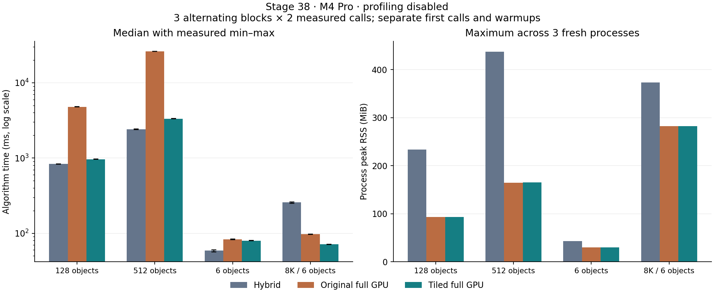

# GPU大量物件瓶頸與精確分塊選峰

第38輪，2026-10-18，Apple M4 Pro／48 GiB。基線為第37輪完整gray8 Metal資料路徑，提交、求解與停止控制的範圍不變。本輪先量128／512物件的GPU各階段，再比較精確分塊選峰；原模式、混合方案與全部失敗均保留。

**結論：分塊選峰有效，128／512完整GPU耗時降低79.8%／87.3%，有序結果完全一致；大量物件仍未勝過目前混合方案。** 需要完整灰階GPU常駐的研究設定可選`full_gpu_peak_mode=1`。通用GUI／混合預設不變，原模式0繼續作為可重現對照。

## 正式時間、記憶體與準確度

四場景、三方法、三個順序交錯block，共36個新程序；每程序先保留首次呼叫、至少一秒暖機，再量兩次。下表是每方法六次正式樣本的中位數，**未開啟profiling**，不是沿用第37輪的歷史時間。首次36次及正式72次共108次均獨立比對GT；242次暖機僅保存時間與程序內重複一致性，不計入獨立GT驗收。

| 場景 | 混合 ms | 原完整GPU ms | 分塊完整GPU ms | 分塊較原GPU | 分塊較混合 |
|---|---:|---:|---:|---:|---:|
| 128物件 | 834.833 | 4780.284 | 963.842 | −79.8% | +15.5% |
| 512物件 | 2399.524 | 26121.907 | 3328.017 | −87.3% | +38.7% |
| 6物件 | 58.853 | 83.071 | 79.905 | −3.8% | +35.8% |
| 8K三尺度，6物件 | 257.305 | 97.298 | 71.233 | −26.8% | −72.3% |



| 場景 | 峰值RSS MiB：混合／原GPU／分塊 | 命名Metal buffers MiB：原GPU→分塊 |
|---|---:|---:|
| 128物件 | 233.58／93.02／93.11 | 112.74→116.47 |
| 512物件 | 437.31／164.86／165.08 | 227.69→236.30 |
| 6物件 | 43.50／29.70／29.70 | 6.00→6.15 |
| 8K三尺度，6物件 | 372.94／282.48／282.66 | 157.74→161.50 |

RSS取三個程序峰值的最大值。混合的舊frame buffer欄位不涵蓋全部擁有者，故沒有用它和新後端總buffer作等範圍比較。RSS幾乎持平，不代表新增GPU暫存不占實體記憶體；兩者不可相加。

所有108次呼叫零FP、零FN；分塊與原GPU的完整有序matches及proposals逐值一致，同方法跨程序／重複也一致。分塊的最大位置誤差0.12834px、角度0.09952°、相對尺度0.27442%，在事前2px／1°／2%範圍內。這仍是第37輪的FP32數值契約，不代表和CPU binary64逐位相等。

相對原GPU，四場景全部通過每block `+max(2ms,10%)` 的速度容忍及 `+max(8MiB,10%)` 的RSS容忍，兩個主要場景也超過事前耗時至少降低20%的目標。相對混合，128／512／6物件共九個速度gate未通過；8K則較快。故採用判斷限於完整GPU研究選項，不以此取代通用混合方案。所有失敗保留在[採用決定](stage38-gpu-peaks/decision-and-failures.json)。

128分塊六次範圍962.72～968.16ms；512為3321.62～3341.02ms。首次與建構成本另存：512原GPU／分塊首次中位26099.84／3337.95ms，建構26.01／29.66ms。獨立程序不表示已清除系統或Metal快取；8K為core-only、不含連續LM，其餘三場景保留精修及救援。

## 各階段實測

下表為獨立診斷程序中兩次重複呼叫的中位數，單位ms；每方法／場景另保留首次呼叫。兩場景、兩GPU方法共4程序、12次呼叫的timestamp均有效。**這是開啟計時儀器的診斷，不當作正式速度結果。** 來源、圖片、參數及執行檔與正式比較一致；GT僅在父程序評估。

| GPU階段 | 128原版 | 128分塊 | 512原版 | 512分塊 |
|---|---:|---:|---:|---:|
| 初始化／清零 | 0.016 | 0.015 | 0.020 | 0.022 |
| 來源金字塔／輸入轉換 | 1.835 | 1.832 | 3.638 | 3.727 |
| 模板尺度庫、金字塔與統計 | 0.166 | 0.166 | 0.175 | 0.175 |
| 粗旋轉 | 4.884 | 4.869 | 10.667 | 10.686 |
| 粗NCC與正規化 | 34.152 | 33.889 | 72.858 | 72.298 |
| 粗選峰，分塊版含排序與合併 | 4364.725 | 228.442 | 24244.982 | 955.232 |
| 細搜尋／subpixel | 585.212 | 576.818 | 1853.816 | 1847.869 |
| 各尺度候選NMS | 22.876 | 22.934 | 148.634 | 148.294 |
| 連續精修準備／候選壓縮 | 2.065 | 2.159 | 4.730 | 4.864 |
| 初始LM精修 | 77.734 | 77.876 | 271.359 | 276.094 |
| 多起點救援／續跑／接受 | 18.402 | 18.269 | 6.570 | 6.788 |
| 最終驗分／發布狀態 | 0.327 | 0.327 | 1.161 | 1.164 |
| 跨尺度NMS | 0.668 | 0.669 | 3.594 | 3.603 |
| 最終結果格式化／複製 | 0.009 | 0.009 | 0.009 | 0.009 |
| Command buffer GPU區間 | 5111.862 | 968.826 | 26627.427 | 3329.556 |

原版粗選峰約占GPU區間85.4%／91.1%。分塊後粗選峰耗時降低94.8%／96.1%，細搜尋成為主要階段，約占59.5%／55.5%。這支持將後續研究移到細搜尋及剩餘選峰合併，而不是先重寫本輪只占少量時間的金字塔或NCC。

每個compute／blit encoder記錄前後timestamp，在**唯一一次command buffer完成等待之後**，才解析計數器。以提交前後的CPU／GPU時鐘對照換算毫秒，並拒收錯誤、零值、倒序或落在本次時鐘範圍之外的樣本。沒有以CPU逐段等待來測量，也沒有在CPU接手影像求解。

階段加總與command GPU區間使用不同計時介面，不能視為嚴格無誤差的分割。原始有號差值保留；部分呼叫階段和略高於整段GPU區間，沒有截成零或藏掉。`profile_host_ms`只記儀器化程式區段耗時；真正開關儀器的耗時差由另一組獨立程序估算，也包含一般量測波動。

獨立開／關量測的總耗時差：原GPU128／512為+7.02%／+1.96%，分塊為+0.86%／+0.19%。這不是扣除波動後的純counter開銷。12次中有4次階段和比GPU區間多1.10～1.44ms，最多0.043%；資料保留並明示「非精確時間分割」，不影響粗選峰占主要時間的判讀。

早期GPU端resolve曾在首次使用回傳零timestamp pair，重用時可能掩蓋舊資料。改為Shared counter storage，整條完成後呼叫CPU resolve，原始失敗及修改前來源留在validation封存。它只讀診斷計數器；影像、分數、候選及解算中間資料仍為private buffers。若裝置無支援、樣本不足或超過容量，計時標示不可用；不補造各階段時間。

## 分塊方法與正確性

原版將分數圖分成256條連續區段，每個lane維護區段最大值。某個最大值被抑制後，該lane重新掃描整條區段；大量候選時，許多長掃描集中在單一工作群組。

新模式保留完整分數圖，把每256筆資料交給一個工作群組並行排序。排序鍵仍是分數由大到小、相同分數以原始像素索引由小到大。第二個kernel維護每個排序區塊的游標，合併成原本的精確逐次選峰；已被抑制的項目只向前跳過。每張圖只用兩次dispatch，不需要每選一峰就提交或等待CPU。

這裡沒有截斷區塊內top-K，也沒有以局部NMS提前丟掉候選。區塊保存所有項目，所以跨區塊抑制後，較低分但仍合法的項目仍可被選中。

令P_l為lane l負責的完整排序區塊，U_k為選取k個峰後尚未被抑制的像素。維持不變量：

```text
w_l = max_(score, -index) (P_l ∩ U_k)
```

刪除下一個抑制區域時，若w_l未被刪除，它仍是該lane的最大值；若被刪除，就沿各區塊游標跳過已刪除項目，再選出新的w_l。對全部lane的w_l取最大值，等於從整張圖取原規則的最大值。因此可用歸納法維持相同的有序候選、抑制矩形、門檻停止及最後一峰不再抑制的行為。

排序成本為O(N·log²256)，全部游標的前進總量不超過O(N)；逐次仲裁與區塊頭檢查仍有相依成本，沒有宣稱greedy選峰已全部平行。排序與合併各使用約2KiB工作群組共享記憶體；它減少原本反覆掃描，沒有改變NCC、旋轉、subpixel或LM的數值計算。

## 記憶體與計時範圍

對N個分數、T=ceil(N/256)個區塊，排序項目及游標payload為：

```text
scratch = 8 × 256 × T + 4 × T bytes
```

按後端256-byte配置對齊後，128／512正式素材額外保留3.736／8.603MiB。各角度共用同一組scratch，不為每張分數圖另存一份。64MiB分數圖上限對應約128.25MiB scratch，仍受既有1GiB自有Metal buffer總預算限制；超出會明確拒絕，沒有隱藏CPU回退。

`peak_scratch_bytes`計保留容量，已包含在`gpu_bytes`內；同Session從分塊切回原版時仍可能保留配置。RSS是程序峰值，包含讀圖與程序資源，不能和Metal配置量相加。`gpu_bytes`沒有涵蓋所有驅動內部配置，也不是獨立實體VRAM總量。

`profile_counter_bytes`是opaque Metal counter的邏輯容量，不是已知的實體配置量；`profile_resolve_bytes`是暫時CPU NSData的解析payload，**不包含在gpu_bytes中**。正式量測關閉profiling。`wait_ms`包含GPU執行，不和`device_ms`相加；上傳／回讀欄位是明確payload及處理時間，不是硬體匯流排流量。

## 使用及完整來源

原版完整GPU的JSON設定加入`full_gpu_peak_mode=1`即可選擇分塊版；0保留第37輪選峰方式。`full_gpu_profiling=true`啟用診斷。兩者需要`full_gpu=true`，非法模式與將此選項套在混合路徑上會明確拒絕。原GUI及混合預設不變；其他完整GPU限制延續[第37輪報告](FULL_GPU_zh-TW.md)。

`full_gpu_peak_mode`專用於完整GPU，和混合路徑的`coarse_peak_mode`是不同選項。沿用`backend=1, refinement_backend=1, pose_resident_mode=0`，避免舊resident wrapper的小模板限制；後端仍使用fused GPU精修。

| 職責 | 來源 |
|---|---|
| 分塊排序、精確合併 | [Metal kernels](../experiments/full_gpu_peaks.metal)、[固定ABI](../experiments/full_gpu_peaks_types.h) |
| 配置、dispatch、單次等待與階段計時 | [Metal host](../experiments/full_gpu_metal.mm) |
| 研究API與嚴格JSON輸入／輸出 | [API](../experiments/research_pipeline.hpp)、[runner](../tools/native_pipeline_runner.cpp) |
| 獨立CPU參考、原GPU／分塊差分 | [選峰測試](../tests/full_gpu_peaks_test.mm) |
| 全流程、切換模式與計時一致性 | [pipeline測試](../tests/full_gpu_pipeline_test.cpp) |
| 正式比較、GT與統計重播 | [實驗工具](../tools/benchmark_gpu_peaks.py)、[負控制](../tests/test_gpu_peaks_harness.py) |

這一輪沒有修改RGB或CUDA，沒有新30分鐘長跑，也不能把同模板128／512物件的合成場景推論成多種模板或所有實拍場景。完整來源和負面結果均保留，供後續Metal與CUDA架構對照。

## 驗證與重現

Release61／61通過，其中分塊選峰測試另含64組獨立CPU參考／原GPU／分塊GPU差分，逐筆候選與完整抑制圖一致。Metal API＋Shader Validation四項通過；儀器化時細搜尋使用第37輪的4KiB快取，正式性能仍使用16KiB。18項量測工具負控制、8項實際runner非法JSON檢查通過。

封存來源獨立建置ASan＋UBSan後，原GPU、分塊、profiling與64組選峰差分四項通過；leak detection未啟用，不能取代長跑。另以封存來源乾淨Release重建runner，controlled6三方法各首次及一次重複共六次呼叫，有序matches／proposals均與正式資料完全一致。沒有將重建版小案例當成全部場景重跑。

[封存清單](stage38-gpu-peaks/archive.json)列出SHA256與檔案用途；[驗證紀錄](stage38-gpu-peaks/validation.json)列出測試、來源／輸入核對與統計重播範圍。完整正式來源272個檔案與7個唯一輸入均逐檔核對；formal及兩份profile摘要從解壓資料、封存版工具重新計算，逐byte相同。正式量測後只更新報告與Log索引分類；凍結算法來源不變。

從專案根目錄執行離線重算與重建：

```sh
mkdir -p build/stage38-repro/source build/stage38-repro/raw
tar -xzf cpp-core/docs/stage38-gpu-peaks/source-snapshot.tar.gz -C build/stage38-repro/source
tar -xzf cpp-core/docs/stage38-gpu-peaks/fixtures.tar.gz -C build/stage38-repro/source
tar -xzf cpp-core/docs/stage38-gpu-peaks/raw-results.tar.gz -C build/stage38-repro/raw
python-port/venv/bin/python build/stage38-repro/source/cpp-core/tools/benchmark_gpu_peaks.py \
  --summarize build/stage38-repro/raw/formal/manifest.json \
  --output build/stage38-repro/formal-summary.json
cmp cpp-core/docs/stage38-gpu-peaks/formal-summary.json build/stage38-repro/formal-summary.json
cmake -S build/stage38-repro/source/cpp-core -B build/stage38-repro/release \
  -DCMAKE_BUILD_TYPE=Release -DFPM_BUILD_EXPERIMENTS=ON \
  -DFPM_BUILD_GUI=ON -DFPM_WITH_OPENCV=ON
cmake --build build/stage38-repro/release --parallel 8 \
  --target fpm_native_pipeline_runner fpm_full_gpu_test fpm_full_gpu_peaks_test
ctest --test-dir build/stage38-repro/release \
  -R 'experimental_full_gpu($|_tiled$|_profile$|_peaks$)' --output-on-failure
```

Python重播需要NumPy與OpenCV；系統框架、Qt、外部依賴及虛擬環境不包含在來源封存。原job保留原始絕對路徑。要重新執行，將source／template的專案根路徑改成解壓source目錄，另存新job和結果；不要覆寫原量測。validation封存的`check_rebuilt.py`保存了本輪實際路徑改寫與逐值核對步驟。

原工作目錄可重新跑完整protocol：

```sh
python-port/venv/bin/python cpp-core/tools/benchmark_gpu_peaks.py \
  --build build/fourier-gpu --output build/stage38-new/formal/manifest.json
python-port/venv/bin/python cpp-core/tools/benchmark_gpu_peaks.py \
  --build build/fourier-gpu --profile --blocks 1 --repeats 2 --warmup 0 \
  --output build/stage38-new/profile/manifest.json
```

這兩個命令預設讀取已存在的第37輪素材manifest；可用`--fixtures-manifest`指定含相同圖片與雜湊的素材manifest。離開原工作目錄時需同步改寫其中的輸入路徑與input hash鍵，並驗證圖片雜湊，保留原manifest不變。GT始終只在評估端使用，不傳給runner。

## 下一輪可驗證的算法方向

源碼審查提出的第一個方向是**細搜尋旋轉ROI分列快取**。本輪模板140×102，1.25倍時變成175×128；7×7搜尋視窗所需ROI為181×134=24,254bytes，超過16,384bytes快取，進入逐次直接取樣分支。以16列模板加6列重疊邊界分塊，一塊只需181×22=3,982bytes。對單次完整ROI評分，理論旋轉取樣次數可由49×175×128=1,097,600降到8×181×22=31,856；NCC點積仍須完整計算，這**不是整體速度提高34倍的預測**。應先計數實際到達該尺度與層級的候選，再比較完整結果、取樣量與時間。

第二是對有證明上界的局部統計採uint32，合併前再擴成uint64，降低局部累加成本。第三是重用49個重疊來源視窗的sum與square，點積保持完整；兩者都必須維持目前的精確整數統計與分數門檻。這些目前只有源碼與運算量分析，尚未實作或取得加速結果。不能由本輪反推共享記憶體命中率、occupancy或特定硬體吞吐量。
