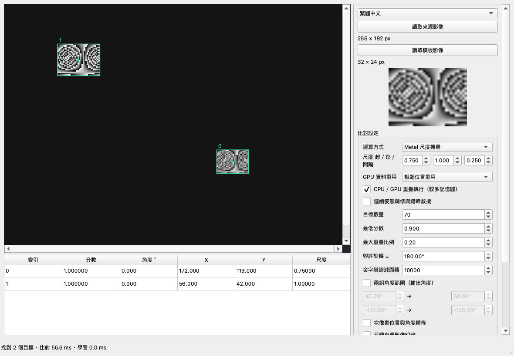
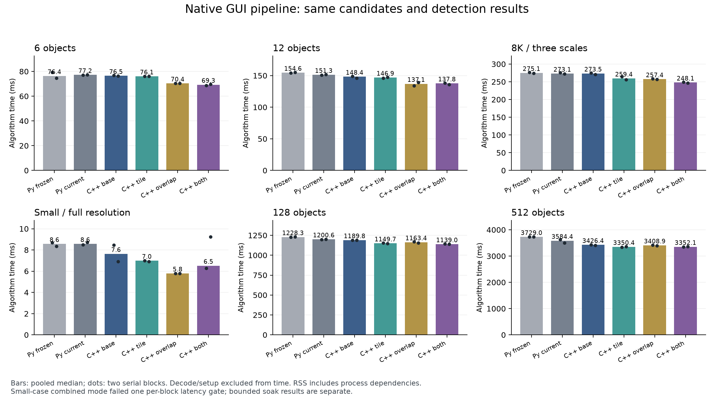
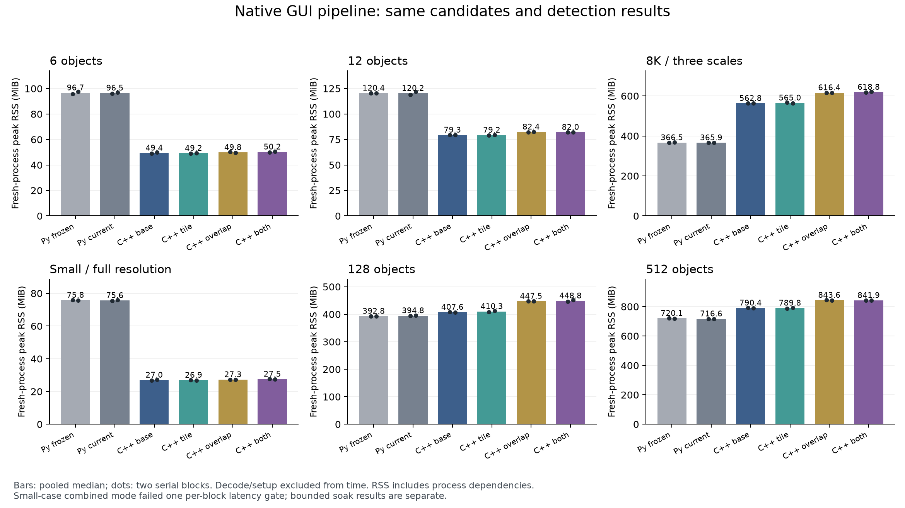
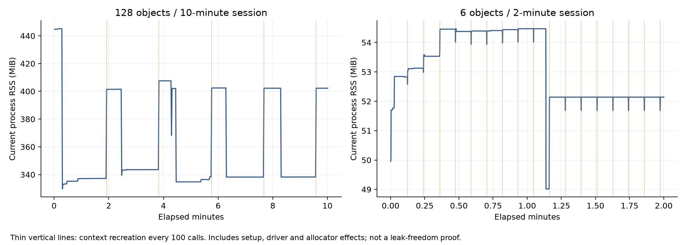

# 原生尺度 GUI、組合模式與持續運行驗證

日期：2026-10-14。這一輪把灰階研究排程移植成原生 C++，接入 Qt GUI，並比較 NCC 分塊、CPU／GPU 重疊及兩者組合。正式核心的固定尺度 API 保持原樣。實測是 Apple M4 Pro（12 CPU／16 GPU）、48 GiB、macOS 26.6.2、AppleClang 21、Release。

## 本輪交付

`research_pipeline.hpp/.cpp` 提供不依賴 Qt／OpenCV 的 `Session`：持有來源與模板、建立尺度模型、每次共用來源金字塔、Metal 批次粗細搜尋、連續姿態精修與低分救援、跨尺度 NMS。尺度重採樣、座標轉換、排序與幾何都保留自有 C++ 源碼，底層 Metal kernels 仍在 repository。GUI 沒有啟動 Python；Fourier／FFT 原型仍另留在 Python，未宣稱本輪把它移植完成。

GUI 的「運算方式」新增 CPU 尺度搜尋與 Metal 尺度搜尋；Metal 可切換相鄰位置重用（mode2）、區塊共享實驗（mode3），以及 CPU／GPU 粗搜尋重疊。原有 CPU 流程仍是預設，Metal 的 NCC 預設 mode0、重疊關閉。尺度區間最多 64 個提案值；連續精修能調整至候選區間外，不是硬性尺度界線。

結果表新增尺度。匯出 JSON schema2 保存**完成該次運算時**的圖片、參數、階段時間、buffer 容量與結果，不會被尚未執行的新參數覆寫。換圖／模板、非法尺度與執行失敗會清掉過期結果；空結果仍可匯出。耗時工作在背景執行，期間可以縮放畫面。關閉視窗不會讓背景工作引用失效的 UI；目前沒有中途取消運算功能。



上圖是兩個已知位置、尺度 1 與 0.75 的整合測試，不是額外的真實場景準確率證據。建置及操作見 [README](../README_zh-TW.md#原生尺度搜尋與-metal-gui)。

## 固定比較方法

[事前 protocol](gui-integration/protocol.json) 固定六場景：受控 6、保留 12、8K 全角度三尺度、小圖 full-resolution/subpixel、128／512 個同模板分離實例。每場景六條路徑，每條正／反兩個 block；每個新 process 先測 setup、first，再暖機至少一秒、量五次。共 72 workers、360 次正式量測；所有 worker 序列執行，不同時建置或跑 GPU 測試。

| 路徑 | 排程／執行期 | coarse NCC | CPU／GPU 重疊 |
|---|---|---:|---|
| Python frozen | 凍結 `1cba464` Metal 執行期＋既有 Python 排程 | 0 | 關 |
| Python current | 本輪 Metal 執行期＋相同 Python 排程 | 0 | 關 |
| Native original | GUI 相同 C++ Session | 0 | 關 |
| Native tile | 同上 | 2 | 關 |
| Native overlap | 同上 | 0 | 開 |
| Native combined | 同上 | 2 | 開 |

所有路徑固定 peak1、pyramid1、batch4、fine512、接受分數與候選預算。8K 與 full-res 小圖依原 fixture 僅量離散搜尋；另外四個 full-rescue 場景保留 resident 精修與既有最多 4 seeds／512M 工作預算的救援，沒有為速度少找物件。mode3 本輪只有正確性覆蓋，效能請看 [上一輪分塊報告](TILE_NCC_zh-TW.md)。

演算法時間排除解碼與一次尺度模型建立，包含每次 `frame.prepare`；首次 lazy pose 初始化列在 first。`proposal_ms` **已含** `prepare_ms`，不可再相加。first、setup、每次原始時間與工作量保留在封存。Python 對 native 的效益可能來自排程、NMS 與程序負擔，不歸因為 GPU kernel 加速；native 四路對照才隔離分塊／重疊的收益。

GT 只留在父程序，匹配 worker 不知道答案。全有序 proposals 與 matches（含角度、分數、尺度、四角）對 Python current 容許 1e-5 的跨語言浮點誤差；native 各模式之間要求完全相等，每次重跑也要求完全相等。另以 2 px／1°／2% 相對尺度、一對一最大配對檢查 GT，要求零 FP／FN。這不是只比輸出數量。

## 正式時間與精度

**72 個 workers、360 次正式呼叫的完整有序輸出、工作量與 GT 全部通過。** Native 四路逐值完全一致；frozen／current Python 與 native 均在固定 1e-5 容差內。各場景每次分別找到 6／12／6／2／128／512 個真值，均零 FP／FN。512 物件最大位置誤差 0.1281 px、角度 0.0995°、相對尺度 0.2744%，與原對照相同。

每格為十次正式演算法時間的中位數，單位 ms：

| 場景 | Python frozen | Python current | Native original | Native tile | Native overlap | Native combined |
|---|---:|---:|---:|---:|---:|---:|
| 6 物件 | 76.36 | 77.18 | 76.45 | 76.05 | 70.35 | 69.29 |
| 12 物件 | 154.65 | 151.33 | 148.36 | 146.94 | 137.06 | 137.77 |
| 8K 全角度三尺度 | 275.11 | 273.07 | 273.46 | 259.44 | 257.38 | 248.08 |
| 小圖 full-res | 8.57 | 8.57 | 7.63 | 6.99 | 5.80 | 6.52 |
| 128 物件 | 1228.33 | 1200.55 | 1189.79 | 1149.74 | 1163.38 | 1138.99 |
| 512 物件 | 3729.03 | 3584.36 | 3426.37 | 3350.39 | 3408.89 | 3352.14 |



Native original 對 Native combined：6 物件減時 9.4%、12 物件 7.1%、8K 9.3%、128 物件 4.3%、512 物件 2.2%。但 **512 僅分塊為 3350.39 ms，組合為 3352.14 ms**，重疊沒有額外收益；不能以比舊 Python 快來證明重疊有用。

**效能 gate 並非全數通過。** 固定每個 block 不超過對照 +max(10%,2 ms)：小圖 combined 第 2 block 為 9.233 ms、同 block original 為 6.896 ms，慢 33.90%，超過容忍。該路徑兩個 block 的中位數為 6.282／9.233 ms，存在波動；十次 pooled 中位數較低不會抹去此失敗。其餘比較通過預定容忍，但通過仍不表示每條都更快。本輪不另外挑較快的一次替換正式結果。

NCC mode2 可選於本機大圖／大量實例；CPU／GPU 重疊保持選配、預設關閉。小圖本輪 overlap-only 很快，但只有此 fixture，尚不形成可靠自動分流規則。

每格為兩個新 process peak RSS 的中位數，單位 MiB：

| 場景 | Python frozen | Python current | Native original | Native tile | Native overlap | Native combined |
|---|---:|---:|---:|---:|---:|---:|
| 6 物件 | 96.66 | 96.52 | 49.37 | 49.22 | 49.84 | 50.23 |
| 12 物件 | 120.44 | 120.24 | 79.32 | 79.17 | 82.37 | 82.05 |
| 8K 全角度三尺度 | 366.47 | 365.93 | 562.77 | 565.04 | 616.38 | 618.78 |
| 小圖 full-res | 75.83 | 75.60 | 26.95 | 26.92 | 27.27 | 27.55 |
| 128 物件 | 392.81 | 394.77 | 407.59 | 410.27 | 447.49 | 448.78 |
| 512 物件 | 720.14 | 716.59 | 790.41 | 789.84 | 843.56 | 841.85 |



**原生移植沒有讓所有場景省記憶體。** 8K native original 562.77 MiB，高於 Python current 365.93 MiB；128／512 也有增加。來源持有副本、Qt 解碼的 RGB 暫存及配置器生命週期不同，這些是可見的後續排查方向；本輪沒有做逐配置的完整歸因，不能把差額全歸給 Qt 或 NCC。完整 GUI 還有視窗／繪圖資源；這裡的原生 runner 使用同一個 Session，卻不是 GUI 程序整體 RSS 的保證。

Native original → combined 的額外 peak RSS：8K 約 56.0 MiB、128 約 41.2 MiB、512 約 51.4 MiB。若重視記憶體，512 選 mode2、關重疊更合適；保留此取捨，不以準確度相同就宣稱全面優於原版。

## 時間省在哪裡、還卡在哪裡

下表是未啟用詳細 profiler 的正式 worker 內既有 coarse 計時欄位中位數；單位 ms，original → combined。`wait` 是主機等待時間，可能包含 device 執行；不能把它與 device 相加。`copy` 是 coarse host buffer copy，不涵蓋整條流程的所有資料移動。

| 場景 | coarse device | coarse host wait | coarse copy |
|---|---:|---:|---:|
| 6 物件 | 3.711 → 2.962 | 8.355 → 0.298 | 0.114 → 0.107 |
| 12 物件 | 8.503 → 5.005 | 13.079 → 0.022 | 0.204 → 0.202 |
| 128 物件 | 63.591 → 29.517 | 96.293 → 42.698 | 1.027 → 1.027 |
| 512 物件 | 145.307 → 86.694 | 205.613 → 135.061 | 2.286 → 2.335 |

512 combined 的 async 子路徑 wait 約 0.001 ms，但**整個 coarse wait 仍有 135.061 ms**，因為容量限制保留同步 fallback。不能只取 async 子集合就宣稱整段沒有等待。這裡沒有硬體 timeline 或 DRAM/cache counters，不證明 CPU/GPU 實際交疊多少毫秒。

512 物件 Python current → Native original 的最後 NMS 中位數為 123.835 → 0.604 ms；這是 C++ 排程／幾何實作移植的效益，不是 GPU 並行收益。Native combined 仍有約 3144.488 ms 在 proposal（含 prepare），206.982 ms 在最後連續精修，NMS 只剩 0.605 ms。只減少最後 NMS 或 coarse copy 已無法帶來很大的總體收益。

完整欄位與 async／fallback maps 見 [計時診斷摘要](gui-integration/diagnostics.json)。下一輪若繼續優化，優先分開量大圖讀入／持有副本的記憶體，以及大量局部 fine requests 的成本；新的融合或預先計算仍須保持相同搜尋範圍與候選，不靠少做工作換成較漂亮的時間。

## 記憶體與持續運行

效能比較用新 process 的 peak RSS；GUI native 與 Python worker 的程序依賴不同，RSS 差額不能全部算成演算法 buffer 節省。Metal 在 Apple 統一記憶體中，RSS、frame buffer 與 pose buffer 不能相加當成總用量。重疊模式需要雙槽資源，應同時看時間與額外容量。

持續測試使用同一個 Session、mode2＋overlap＋resident/rescue，每 100 次銷毀並重建 Session，檢查所有輸出、async 提交／完成、frame generation、工作量與保留容量。程序把小型紀錄直接串流到檔案，不在 RAM 累積所有結果。預先固定 RSS 判定：最後五分之一與最初五分之一的 current RSS 中位數差，不超過 32 MiB 或起始中位數 10% 的較大者。

| 場景 | 實際秒數 | 比對次數 | 資源重建 | 起／末段 current RSS 中位數 MiB | 變化 MiB | 結果 |
|---|---:|---:|---:|---:|---:|---|
| 128 物件 | 600.40 | 523 | 5 | 337.12 → 338.27 | +1.14 | 全部通過 |
| 6 物件 | 120.02 | 1723 | 17 | 53.12 → 52.14 | -0.98 | 全部通過 |

**共 2246 次持續比對、22 次資源重建：每次完整輸出均與正式比較一致，工作量、frame generation、保留 buffer 容量與 async drain 全數通過。** 128 場景 current RSS 的範圍為329.64～445.11 MiB，6 場景49.02～54.47 MiB；峰值／起末中位數不同，不隱藏初期配置與回收的變化。兩者都通過事前 RSS 成長門檻。



持續測試的每次時間也有保留，但包含定期重建後的首次初始化；本輪效能結論引用上面的獨立正式比較，不用 soak 重新挑選較快時間。

這是 10 分鐘／2 分鐘的有界穩定性證據；並未測 24 小時、連續相機新影格、很多不同模板，不能證明無任何記憶體洩漏。定期重建涵蓋相同尺寸與圖像的生命週期；GUI 測試另外涵蓋換圖與反色。

## 驗證找到的問題與修正

Metal API＋Shader Validation 揭露原 `pose_derivative_partials` 的 128 個共享 `DerivativePartial`，驗證插裝後使用 36,864 bytes，超出裝置 32,768 bytes 的上限。原始配置名義上 18,432 bytes，正常執行未觸發相同錯誤；**開啟驗證的首次失敗照實保留**。

修正維持 128 lanes 的像素分工與原加總樹：第一次 64 對合併讓下半 lanes 保留自身資料在暫存器，上半 lanes 寫入 64 個共享槽，之後才進行原 32／16／…／1 reduction。名義共享容量降至 9,216 bytes，多兩個 barrier；不是改演算法或降低精度。建立 pipeline 時另外檢查裝置共享記憶體上限。新增的 frozen／current 對照驗證修正前後結果，耗時一起保留，不假設修改一定更快。

另一個整合測試初版使用高頻隨機模板及過小金字塔頂層，CPU 與 Metal 都漏掉植入物件。此問題不是 GUI 排程造成；整合 fixture 改為 full-resolution 以隔離尺度／座標／生命週期。**沒有把換 fixture 宣稱成修好了金字塔混疊**。初次失敗紀錄保留，正式效能仍使用原本六組固定場景與 minArea256。

測試也加入反色切換：來源 pose 快取必須隨反色設定重建，否則粗搜尋與最終精修會看到不同像素。來源／模板由 Session 自行持有，外部緩衝區改動不會偷偷改變已建立 Session。

## 功能與工具檢查

| 檢查 | 結果與範圍 |
|---|---|
| Release | 26／26 通過；共享記憶體修正後重跑受影響 8／8（含 GUI、resident、rescue、導數與 native Metal） |
| ASan＋UBSan | scalar Debug 24／24 通過；修正後重建並重跑 Metal 相關 4／4，未宣稱 LeakSanitizer |
| 不啟用實驗庫的 GUI | CPU core、C ABI、GUI 3／3 通過；維持原有建置方式 |
| Python 比較工具 | 19／19 通過，包含 GT 不傳 worker、順序／四角比較與模式獨立性 |
| Metal API＋Shader Validation | 確認驗證實際啟用；修正後 native Metal 完整測試及導數測試均通過 |
| GUI | 原旋轉盤 6 物件、CPU／Metal 兩尺度、連續精修、mode2＋overlap、重用／換圖、非法輸入恢復、匯出參數快照、工作中關閉視窗 |

Release 與 sanitizer 的全套通過在共享記憶體修正前完成，修正後只重跑受影響的檢查；不是把修正前的執行紀錄冒稱成修正後完整再跑。Linux／Windows／CUDA 本輪沒有實機測試，GUI 的 Metal 選項只在 Apple 建置顯示。

## 源碼與重現

- [原生 Session](../experiments/research_pipeline.hpp)、[實作](../experiments/research_pipeline.cpp)、[GUI](../../macos-cli/mainwindow.cpp)、[Metal 導數](../experiments/pose_ncc.metal)。
- [相同排程的原生量測入口](../tools/native_pipeline_runner.cpp)、[六路比較](../tools/benchmark_native_pipeline.py)、[持續測試](../tools/soak_native_pipeline.py)。
- [正式摘要](gui-integration/results.json)、[128 物件持續測試](gui-integration/soak128.json)、[6 物件持續測試](gui-integration/soak6.json)、[封存與驗證 SHA](gui-integration/artifact-sha256.json)、[完整封存](gui-integration/raw-results.tar.gz)。

```sh
python-port/venv/bin/python cpp-core/tools/benchmark_native_pipeline.py \
  --build build/gui-integration --baseline build/coarse-tiling \
  --output build/gui-integration-results/formal.json
python-port/venv/bin/python cpp-core/tools/soak_native_pipeline.py \
  --report build/gui-integration-results/formal.json --case many128_pose \
  --seconds 600 --output build/gui-integration-results/soak128.json
```

重跑前請另建正確的 frozen `1cba464` 執行期；不能把本輪 binary 複製到 baseline 冒充舊版。封存保存源碼快照、輸入／binary 雜湊、build 設定、所有 first／warmup／measured outputs、pilot、失敗診斷、修正後檢查與 soak 串流。大型合成 PNG 與本機 binary 不放 Git，保留生成程式、輸入 hash 與原圖來源。解壓後可從任意目錄重算摘要：

```sh
python-port/venv/bin/python cpp-core/tools/benchmark_native_pipeline.py \
  --summarize /path/to/extracted/formal.json --worker-root /path/to/extracted \
  --output /tmp/native-replayed.json
```

須與封存 `replayed-summary.json` 完全相同。新的尺度排程是實驗 C++ 介面；既有穩定 C ABI 與其固定尺度語意不變。Qt／OpenCV／標準函式庫本身仍是外部依賴，沒有把第三方全部源碼複製進專案。
