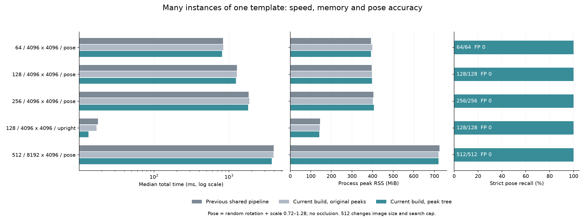
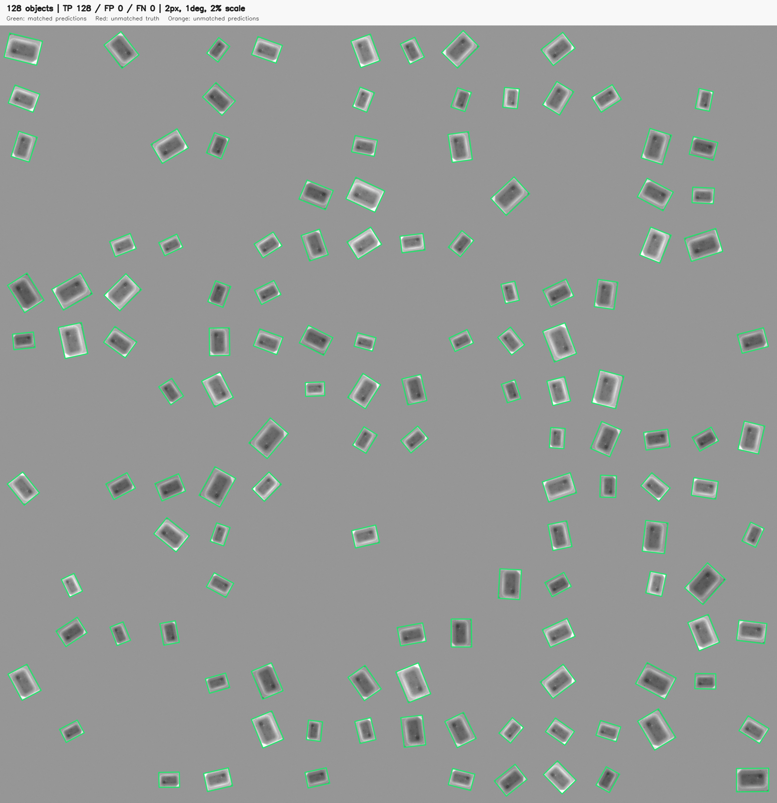

# 超過 100 個物件：多實例模擬與效能比較

2026-10-14，Apple M4 Pro（12 CPU／16 GPU cores）、48 GiB，Release。完整 matcher 沿用 `4092754`；本輪新增場景與評估，不改搜尋演算法、門檻或 rescue 預算。

**128、256、512 個旋轉／縮放物件均全數找到，沒有誤檢，原選峰與新選峰的有序輸出完全相同。** 這是同一個真實紋理模板的大量實例；不是 512 個不同模板，也沒有遮擋。

## 場景與比較方式

- 模板來自 `Test Images/Dst3.bmp`（102×140），OpenCV 獨立生成局部 affine warp，不使用 matcher 產生影像。
- 4096×4096 的 64／128／256 物件使用同一隨機序列前綴、256 像素網格與 ±8 px 中心抖動，固定 `max_targets=384`。
- 8192×4096 的 512 物件使用 `max_targets=768`，影像面積與候選上限也變大，不能當成單純物件數倍增的曲線點。
- 角度均勻分布於 −180°～180°、尺度 log-uniform 0.72～1.28，增益 0.85～1.1、偏移 ±12、背景 150、噪聲標準差 2。連插值外圍 ROI 都驗證無重疊、無截斷。
- pose 場景搜三尺度 0.75／1／1.25 與全角度，proposal 0.5、最終分數 0.8、overlap 0.2、stop_layer=1，沿用 resident refine／最多 4 seeds rescue。另有 angle=0／scale=1 的 128 物件控制組，不作旋轉縮放精修。
- 所有方法使用共享金字塔、Metal coarse batch4、fine512。previous_shared 是凍結 `010c898` 的舊選峰；current_control 是 `4092754` 關新選峰；peak_only 是開新選峰、維持原 GPU NCC。
- 每場景／方法／順序 block 為新 process，串行、正反兩輪，每輪至少 1 秒暖機與 5 次正式測量。profile 開關分開量；setup／first 另記，每次 frame prepare 包含在總時間內。
- 正式 worker job 只含搜尋設定，**不傳入 GT、ROI、物件個數或生成 metadata**。GT 評估於父程序事後執行，避免答案或評估配置影響時間／RSS。

## 正式時間與記憶體

時間為兩 block 共十次 pooled median；RSS 為兩 process 峰值最大值。

| 物件／場景 | 上一版 ms | 新 build 原選峰 ms | 新選峰 ms | 新選峰 RSS MiB | TP／FP／FN |
|---|---:|---:|---:|---:|---:|
| 64／旋轉縮放 | 830.95 | 838.64 | 806.15 | 392.3 | 64／0／0 |
| 128／旋轉縮放 | 1273.97 | 1274.69 | 1237.46 | 396.7 | 128／0／0 |
| 256／旋轉縮放 | 1834.81 | 1874.12 | 1804.66 | 406.4 | 256／0／0 |
| 128／正向控制 | 17.83 | 17.07 | 13.34 | 141.9 | 128／0／0 |
| 512／旋轉縮放 | 3947.82 | 3911.95 | 3711.11 | 720.1 | 512／0／0 |

新選峰對凍結上一版：128 個耗時減少約 2.9%，256 個約 1.6%，512 個約 6.0%。不能沿用之前十二物件的 36.7% 加速比例來推估大場景；新版原選峰控制也一併保留，以觀察時間波動。



## 精度與工作量

獨立準確度評估將滿足 **位置 ≤2 px、角度 ≤1°、相對尺度 ≤2%** 的配對建立二分圖，取最大一對一配對；另算 20 px 定位率。這避免舊版最近鄰貪婪配對被重複候選搶走。原評估仍保留對照。本次所有方法／first／正式輸出的嚴格 TP／FP／FN 一致，暖機完整輸出 digest 也一致。

旋轉縮放組的最大誤差：64／128／256 約 0.106 px、0.091°、0.271% 尺度；512 約 0.128 px、0.100°、0.275% 尺度。正向控制未作 resident refinement，最大位置誤差 1.472 px；不要把它與 pose 精修的次像素誤差混為一談。

以下為新選峰獨立 profile 的 pooled median，coarse candidates 是所有尺度與角度的粗候選總數；final NMS 指 Python 外層，與 C++ core NMS 分開。

| 物件 | 粗候選 | 粗旋轉 ms | 粗 NCC ms | 選峰 ms | 細旋轉 ms | 細 NCC ms | resident refine ms | final NMS ms |
|---|---:|---:|---:|---:|---:|---:|---:|---:|
| 64 | 23677 | 93.57 | 181.63 | 57.47 | 136.38 | 282.69 | 45.06 | 1.99 |
| 128 | 42458 | 93.86 | 189.21 | 79.01 | 241.23 | 484.95 | 83.35 | 7.84 |
| 256 | 54460 | 93.03 | 199.70 | 87.74 | 392.24 | 786.61 | 143.29 | 30.87 |
| 512 | 108220 | 190.34 | 497.93 | 199.29 | 804.16 | 1575.96 | 268.93 | 121.81 |

在固定 4096² 畫布、固定角度／尺度／上限下，coarse NCC 視窗數不因真物件數增加而直接增加；通過粗門檻的候選卻變多，細搜尋成本因此上升。256 物件已有約 5.4 萬粗候選。最後 NMS 也呈成對比較增長，但本次主要成本仍是細搜尋。

Rescue 仍最多選 4 seeds；其他低分 seeds 可能受額度限制，本次沒有因此漏掉 GT，不能推論所有密集／遮擋場景都不需要更大額度。相關 eligible、selected、cap-skipped、accepted 等資料保留於原始 worker。

## 圖像與可重現資料



[256 物件結果](many-objects/many256_pose-detections.png)・[512 物件結果](many-objects/many512_pose-detections.png)

[數值摘要](many-objects/results.json)・[預先固定的 protocol](many-objects/protocol.json)・[完整原始紀錄](many-objects/raw-results.tar.gz)・[封存校驗](many-objects/artifact-sha256.json)

源碼：[場景生成](../tools/many_object_scenes.py)、[一對一精度評估](../tools/many_object_accuracy.py)、[比較工具](../tools/benchmark_many_objects.py)、[圖表與標註](../tools/plot_many_objects.py)。場景／精度／worker 隔離共 14 項測試通過；本輪未改 C++ runtime，使用已驗證凍結 libraries。

```sh
python-port/venv/bin/python cpp-core/tools/benchmark_many_objects.py \
  --build build/many-objects-current --baseline build/coarse-next-baseline \
  --output build/many-objects/formal.json
# 僅重建摘要，無 GPU／matching：
python-port/venv/bin/python cpp-core/tools/benchmark_many_objects.py \
  --summarize /archive/formal.json --worker-root /archive --output /tmp/replayed.json
```

current／baseline libraries 分別為 4092754／010c898。因後續重疊實作同步進行，正式測量使用 `build/many-objects-snapshot` 的來源快照和獨立凍結 libraries；量測前後 SHA 核對。封存保留原始 absolute provenance、全部 job／worker／日誌／精確量測源碼；PNG 依固定種子與 metadata 重建，binaries 保留 hash 而不提交。

此實驗證明本機能處理超過 100 個分離的同模板物件；不保證遮擋、接觸、不同物件類別、複雜背景或其他硬體的相同性能。CPU／GPU 重疊的另一輪比較見 [重疊實作報告](COARSE_OVERLAP_zh-TW.md)。
