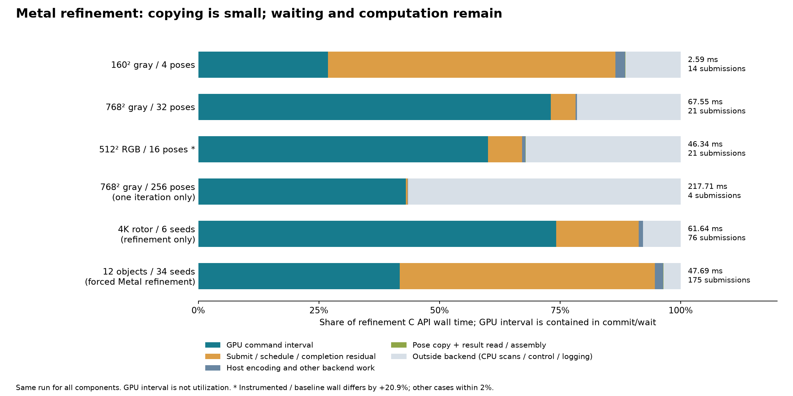

# Metal NCC 成本分析：計算、同步與資料移動

2026-10-13，Apple M4 Pro（12 CPU／16 GPU 核心、48 GiB），macOS 26.6.2、Release、CPU 8 執行緒。

**目前沒有證據顯示 GPU 已到極限；暖機後的小量 pose／統計資料交換，也不是這批案例的主要成本。** 已量到 GPU command 區間與反覆提交／等待的成本；原始碼另有串行歸約及 CPU 全模板複核可研究。本輪只增加隔離的診斷量測，沒有改變演算法、數值 kernel 或正式執行路徑，也沒有宣稱下列優化已完成。

## 資料與量測方法

- [完整量測 report.json](metal-cost-profile/report.json)：原始產出為 `build/metal-cost-profile/report.json`，保存每次執行、各階段事件、source／binary／trace SHA-256 與數值一致性檢查。
- [全圖自動路由量測](pose-routing/full-image.json)：用於後面的 CPU 粗搜尋比例；與本次強制 Metal 診斷是不同量測，不能混加階段時間。
- [診斷驗證摘要](metal-cost-profile/validation.json)、[成本圖](metal-cost-profile/breakdown.png)、[建置來源紀錄](metal-cost-profile/build-provenance.json)；12 份壓縮原始 trace 保存在 `metal-cost-profile/traces/`。

共 6 個案例、正常／插入計時兩個版本，合計 12 個工作；每個工作使用獨立程序，全部序列執行，至少暖機一次及 1 秒，再量 7 次。強制 Metal、CPU polish=0。工具把 host 計時補丁套到複製的 `pose_metal.mm`，另外編譯診斷 library；正式 library 不被覆寫。量測期間來源及 binary hash 未變。驗證通過 2,480 個事件的分段加總、GPU 區間與 API 一致性及邏輯交換 bytes 檢查。

每個案例選取「外部 wall time 排序後居中」的一次完整 run 作代表；表內階段均取自該 run，沒有把不同 run 的各欄中位數拼在一起。全圖的 API 欄是精修 C API `ncc_wall_ms`，不含 CPU 粗搜尋；局部案例為 `metrics.wall_ms`。commands 是實際 chunk／command buffer 次數，不是像素數或姿態數。

**量測擾動限制：** 6 個案例的首次及 7 次暖機後執行，其輸入、輸出姿態／分數／求解統計皆與正常版完全相同；這只能證明插入計時沒有改變這批數值結果。512² RGB／16 的正常版中位數 38.400334 ms、診斷版 46.438625 ms，增加 **20.9%**；其餘 5 組差異絕對值均低於 2%。因此 512 案例的時間不能當作無擾動基準，其他案例也不是零開銷證明。256 候選的一輪案例是分批與記憶體探針，不是收斂或幾何精度測試。

## 暖機後實際花在哪裡

單位 ms；GPU 區間已包含在 `commit_wait` 內，**兩欄不可相加**。

| 案例 | 精修 API wall | GPU command 區間 | commit＋wait | wait−GPU | commands |
|---|---:|---:|---:|---:|---:|
| Src7，4K 旋轉盤，6 seeds | 61.641375 | 45.725334 | 56.268795 | 10.543461 | 76 |
| 160² 灰階／4 | 2.585042 | 0.694708 | 2.234294 | 1.539586 | 14 |
| 768² 灰階／32 | 67.546625 | 49.346874 | 52.827622 | 3.480748 | 21 |
| 12 物件場景，34 seeds，強制 Metal | 47.690500 | 19.908916 | 45.142335 | 25.233419 | 175 |
| 512² RGB／16，擾動較大 | 46.335625 | 27.820043 | 31.106999 | 3.286956 | 21 |
| 768² 灰階／256，僅一輪 | 217.708166 | 93.730208 | 94.485875 | 0.755667 | 4 |



`commit_wait` 是 CPU 計時器包住 command 提交到等待完成的區間；GPU 區間來自 `GPUStartTime`／`GPUEndTime`，包含 GPU 讀取 RAM、cache 等待及內部停頓，並非純 ALU 計算時間，也不是 GPU utilization。兩者差值混有提交、排程、同步及喚醒延遲，也受計時邊界影響，**不是純 transfer 或純 CPU 計算時間**。API wall 尚含初始／最終 CPU 分數複核、姿態整理、小矩陣求解、配置與診斷記錄等成本。

4K 代表 run 的 pose 複製總時間為 **0.002920 ms**，讀結果及 CPU 組裝矩陣共 **0.019415 ms**；合計 0.022335 ms，約 API 時間的 0.036%。實際邏輯交換共 3,152 B pose 寫入、11,008 B 結果讀取；6 個代表 run 的複製＋讀取／組裝皆低於各自 API wall 的 0.1%。`readback_assemble` 並非純拷貝計時，內含 double 矩陣組裝；細小時間也接近計時器開銷尺度，但足以排除「這些顯式小拷貝占數十 ms」的解釋。

小模板案例的 14 次 command 只累計 0.695 ms GPU 區間，提交及等待區間卻達 2.234 ms；12 物件場景有 175 次 command，差距更明顯。同一代表 run 中，4K 的 76 次 backend 呼叫有 37 次只剩不超過 2 個姿態；12 物件的 175 次中有 106 次如此。活躍候選逐步收斂後，仍有很多小批次往返。這支持研究減少往返次數，但不能直接宣稱全部差距都能消除，或用它預測完成優化後的速度。

## 常駐資料與首次建立成本

[pose_metal.mm](../experiments/pose_metal.mm) L37–40 使用 `MTLResourceStorageModeShared`，L137–139 只在建立 backend 時把來源／模板各複製一次；L163、208 逐批寫入 pose，L185、231–233 取回分數或少量統計。沒有每輪上傳整張影像，也沒有建立整張旋轉圖或每像素 Jacobian 陣列。Apple 的 [shared storage 文件](https://developer.apple.com/documentation/metal/mtlstoragemode/shared) 說明 CPU／GPU 共用系統記憶體，但仍須同步彼此的存取；共享不表示沒有 cache、記憶體流量或等待成本。

Src7 診斷程序首次 Metal 建立共 **37.289875 ms**，其中 device／queue 取得及建立 **33.388333 ms**，來源＋模板 **50,455,464 B（48.12 MiB）** 的顯式複製 **2.925834 ms**。這是單一 fresh-process 樣本，**沒有清除 OS、driver 或 shader cache**，不是可泛化的「完全冷啟動」分布；device／queue 區間也不能細分成硬體啟動時間。全圖 constructor wall 還含影像解碼，應與這個 Metal setup 區分。

重複使用 scorer 可攤平建立及拷貝成本；不能推論每一 frame 都會重付上述 33 ms device／queue 成本。若每張影像都重建 handle，首次成本仍可能重要；本輪沒有新增串流影像更新 API，也沒有量測跨影格重用策略。CPU 與 Metal 目前各持有輸入副本，這是容量成本；Apple 共享 RAM 下不可直接把程序 RSS 與 Metal buffer bytes 相加。

## 數學成本與原始碼定位

令 \(P=W_T H_T\) 為模板像素數、\(C\in\{1,3\}\) 為通道數、\(N\) 為該批活躍姿態、\(T=\lceil P/1024\rceil\)。

- **取樣讀取：** 每像素／通道四個來源 float 加一個模板 float，約 \(20NPC\) bytes；這是原始碼的**邏輯讀取量，不是 DRAM 實測流量**，cache／相鄰像素可重用。導數 partial 寫入及讀回另約 \(288NT\) bytes；CPU 介面每次導數約 \(160N\) B（16 B pose＋144 B 統計），評分約 \(20N\) B。例：1024² RGB／32 一次取樣邏輯讀取 1.875 GiB，導數介面只有 5 KiB。來源邊界回傳常數時也不一定發生實際讀取。
- **像素平行：** [pose_ncc.metal](../experiments/pose_ncc.metal) L125–175，每個 1024-pixel tile 使用 128 threads，每 thread 最多 8 pixels，將雙線性取樣、解析 Jacobian 與 Welford 統計融合。五維向量為 \(v=(I,J_x,J_y,J_\theta,J_\ell)\)，每通道更新 5 個均值、5 個模板內積及 15 個上三角協方差項，成本 \(O(NPCd^2)\)，\(d=5\)。
- **分組歸約：** L130、165–173 的 derivative threadgroup 狀態為 \(128\times144=18{,}432\) B；一次初始 barrier 再加 7 層 barrier。score kernel L24–25 使用 13,312 B、256 threads。這些數字也由 pipeline metadata 確認；它們不是 occupancy 或 register spill 的實測值。
- **串行尾段：** L178–188 每姿態只用一個 thread 依序合併 \(T\) 個 partial；score 的 L65–84 也如此。1024²、4 姿態時，這段只有 4 threads 各做 1024 次合併。尚未量出其時間占比，不能斷言它已是主要瓶頸。
- **迭代往返：** [pose_ncc.cpp](../experiments/pose_ncc.cpp) L345–367 每輪導數、首輪額外建立同一 score kernel 的基準；L378–415 最多 10 批阻尼候選評分。[pose_metal.mm](../experiments/pose_metal.mm) L70–71、184、230 每 chunk 提交後等待。若實際 \(I\) 輪、每輪一次候選評分且不分 chunk，約 \(2I+1\) 次等待；最多可達 \(11I+1\)。這不是本次每個案例固定使用的次數。
- **CPU 下限：** `pose_ncc.cpp` L328–335、424–443 在初始與結束各做完整 CPU NCC；L380–398 串行組候選與解 4×4。CPU pool L222、250–258 按姿態平行，少量大姿態無法用滿所有 CPU threads；即使 polish=0，仍有這兩次 \(O(NPC)\) 掃描。

## 全流程應先看哪一段

以下取既有自動路由報告各案例的完整中位數代表 run；4K 選 Metal，12 物件選 CPU。與上面的強制 Metal 診斷分開解讀。

| 場景 | CPU 粗搜尋 ms | 完整流程 ms | 粗搜尋占比 | 假設粗搜尋減半的整體加速 | 即使其餘成本全消失的上限 |
|---|---:|---:|---:|---:|---:|
| Src7，4K | 137.335500 | 198.057958 | 69.34% | 1.531× | 1.442× |
| 12 物件 | 499.483250 | 512.905375 | 97.38% | 1.949× | 1.027× |

設粗搜尋比例 \(f\)，只把粗搜尋加速 \(s\) 倍，Amdahl 模型為 \(S=1/[(1-f)+f/s]\)；粗搜尋不動、其餘成本全消失則最多 \(1/f\)。兩欄假設不同，均非實測預測。尤其 12 物件即使把精修最佳化到零，也只有約 2.7% 空間；多尺度／旋轉粗搜尋的 Metal 化，比只打磨精修更可能影響完整工作負載。

## 優先實驗與正確性條件

1. **先量 per-kernel 與硬體 counter。** 分開 partial／finish GPU 區間、CPU 初始／最終複核與求解，查看記憶體頻寬、cache、occupancy、register／threadgroup 資源及 stall。現有資料沒有這些 counter，不能證明 bandwidth-bound、算力飽和或 reduction 占比。Apple 的 [shader 效能指引](https://developer.apple.com/videos/play/tech-talks/111373/) 說明資源占用會影響 occupancy，並建議依工作負載 profiling；增加 threads 不保證加速。
2. **平行 finish，保留穩定統計。** 每姿態由 \(K\) 個 threads 分工，關鍵路徑可由 \(O(T)\) 改為 \(O(T/K+\log K)\)。以 Chan 公式合併 \(M_{AB}=M_A+M_B+\frac{n_A n_B}{n_A+n_B}\sum_c\delta_c\delta_c^T\)，各通道均值仍分別保留。先只改 derivative finish 可減少同時改動評分基準的風險；浮點歸約順序改變仍須重驗低對比、退化矩陣、有限差分與幾何精度。
3. **SIMD-group 歸約、灰階與凍結維度專用化。** 現在 L149–162 把停用導數設零，仍走五維統計迴圈。平移限定可用三維，協方差項由 15 降為 6；灰階不需三組通道均值。用較小狀態與 SIMD-group 合併研究減少 barrier／資源壓力；function constants 是候選做法，但收益需量測。不能直接改成不穩定的 \(Q-S^2/N\)、half 或 fast math 來換速度。
4. **更多狀態留在 GPU，合併控制與派工。** 可以研究多 chunk 共用一次提交、獨立結果區域、少量阻尼候選預算，或 GPU 內接受／停止控制。Apple 的 [command buffer 指引](https://developer.apple.com/library/archive/documentation/3DDrawing/Conceptual/MTLBestPracticesGuide/CommandBuffers.html) 建議平衡提交次數與 GPU 利用率；迭代求解有資料依賴，不能直接套用每 frame 一次提交。必須避免覆寫尚在使用的 workspace，保留 16 MiB 輔助容量目標及既有單姿態超限例外；保留 CPU 最終安全複核、原始 seed 界限與候選接受順序。GPU 求解若從 double 改 float，須視為新的數值實驗。
5. **粗搜尋 Metal 化與 CPU 複核分塊化。** 前者對全圖高占比案例優先；需維持 uint8 旋轉、邊界、金字塔層門檻、NMS 及候選召回，不能用現有 float pose scorer 直接替換後宣稱等價。後者可改善少姿態、大模板的 CPU 下限；不得移除分數回退保證。每個候選優化都應獨立比較時間、保留／峰值記憶體及真值精度，再決定是否採用。

## 重跑與保存原始證據

先準備最新 `build/fourier-gpu` Release 實驗 library 與既有 Python 環境；下列命令會另外建立診斷版本並序列量測，使用新目錄保留原始報告：

```sh
python-port/venv/bin/python cpp-core/tools/profile_metal_costs.py \
  --baseline build/fourier-gpu \
  --directory build/metal-cost-profile-rerun \
  --repeats 7 --warmup-ms 1000
```

工具預設輸出該目錄的 `report.json`，並保留各工作 `.request.json`、`.response.json`、`.trace.txt`、fixtures、補丁後 source 與診斷 build。分享或封存時保留 raw 檔案及其 hash；本文件引用的發布副本在 `docs/metal-cost-profile/`。圖是既有報告的視覺化，不是另一次量測。跨硬體、CUDA、持續影格輸入及功耗仍須另外驗證。
