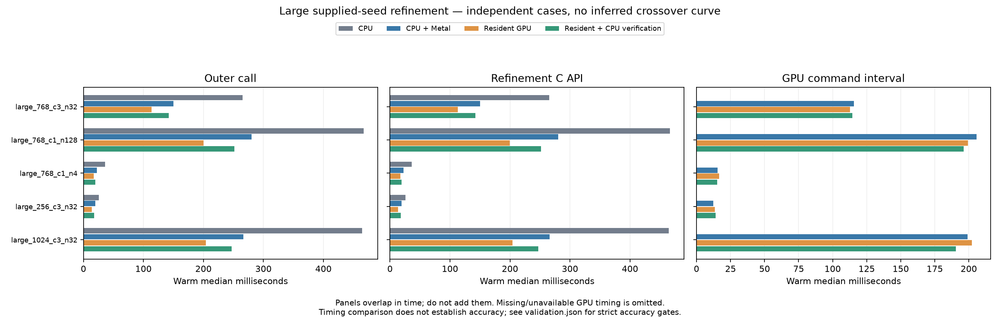
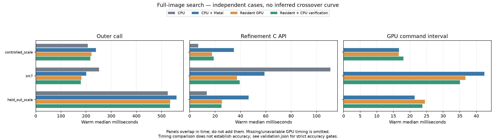
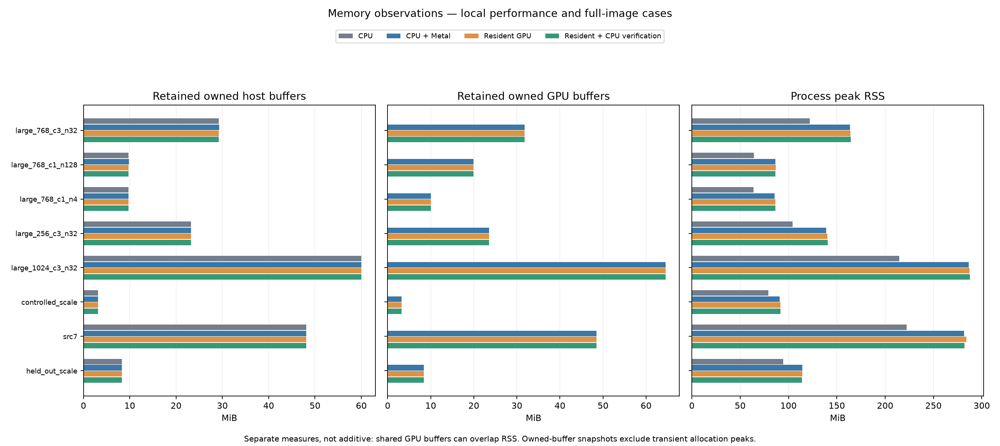
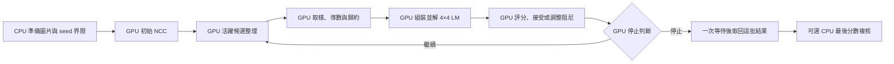

# Metal GPU 常駐 NCC 精修

後續的低分錯峰救援與更大型測試另見 [NCC 救援與 Metal 粗 NCC 實驗](NCC_RESCUE_AND_METAL_COARSE_zh-TW.md)；本頁保留本輪原始結果與失敗紀錄。

2026-10-13，Apple M4 Pro（12 CPU／16 GPU 核心、48 GiB），macOS 26.6.2，Release，CPU 8 threads。

**常駐控制已實作且有大型工作加速，沒有觀察到新增精度退步；嚴格的所有案例精度門檻尚未通過。** 擴大測試找到原 CPU、原混合版與新版本共同的 NCC 錯峰，保留失敗結果，因此本輪沒有搬粗搜尋，也沒有切換自動分流或 GUI 預設。

本輪把局部精修的矩陣組裝、LM 求解、阻尼調整、候選接受與停止判斷移到 Metal。原有 CPU 與 CPU／Metal 混合路徑完整保留；新增路徑明確選用。CPU 粗搜尋與最後 NMS 維持原流程，本次量測可直接比較精修改動。

## 舊版與常駐版實測

基準為 `4144ffc` 的固定保存 Release binary；本次來源與 binary 在整批量測期間 hash 不變。共 **46 案例 × 4 方法 = 184 組**，每組另存 first 與 5 次暖機後結果，總共 1,104 次輸出供重驗。原始資料、每次時間、輸出姿態／分數／統計、真值、環境與 SHA-256 全保存在 [report.json.gz](resident-refinement/report.json.gz)；[逐案例摘要](resident-refinement/table.json)、[嚴格驗收](resident-refinement/validation.json)及[補充稽核摘要](resident-refinement/audit-summary.json)分開保存。

下表是精修 C API 暖機後中位數，單位 ms；沒有把不同回合的分段中位數相加。兩個新版本都不做 CPU polish。

| 模板／候選數 | CPU | 原 CPU＋Metal | 常駐 GPU | 常駐＋最後 CPU 複核 | 含複核比原混合版減時 |
|---|---:|---:|---:|---:|---:|
| 256² RGB／32 | 25.660 | 19.490 | 13.754 | 17.964 | 7.8% |
| 768² 灰階／4 | 35.989 | 22.487 | 17.225 | 19.406 | 13.7% |
| 768² RGB／32 | 265.341 | 149.877 | 113.136 | 142.192 | 5.1% |
| 768² 灰階／128 | 466.803 | 280.072 | 199.723 | 251.390 | 10.2% |
| 1024² RGB／32 | 464.553 | 266.313 | 203.893 | 246.854 | 7.3% |

這五組的純 GPU 路徑比原混合版減少約 **23–29%** 時間；保留同樣 CPU 末端保證後仍減少 **5–14%**。純 GPU 與有複核版提供不同保證，不能只用最快一欄聲稱完全等價。



整圖每次都重新跑相同 CPU 粗搜尋，並未把既知位置當作搜尋輸入。三組整圖案例都是灰階，RGB 證據來自上述局部合成測試。

| 整圖案例 | CPU 完整流程 | 原混合版完整流程 | 常駐 GPU 完整流程 | 常駐＋複核完整流程 | 原混合版精修 → 常駐＋複核精修 |
|---|---:|---:|---:|---:|---:|
| 4K Src7，6 個結果 | 251.083 | 200.631 | 181.415 | 178.854 | 58.894 → 39.410 |
| 6 個已知真值物件 | 206.962 | 239.193 | 221.109 | 216.877 | 34.877 → 18.966 |
| 12 個已知真值物件 | 524.920 | 559.327 | 533.618 | 532.780 | 46.433 → 25.067 |

4K 含複核精修減時 **33.1%**，完整流程減時 **10.9%**。小模板整圖仍由 CPU 更快：例如 12 物件的 CPU 精修為 13.504 ms，新常駐加複核為 25.067 ms。24 組 96²／128² 局部案例的各組 API 中位數再取中位數，CPU 為 1.247 ms、原混合版 4.376 ms、常駐 GPU 2.583 ms、常駐加複核 2.859 ms；不是所有工作都適合 GPU。

常數圖回歸案例更明顯：原混合版 0.069 ms，新純 GPU 1.412 ms，固定派工成本在幾乎沒有有效運算時占優勢。這是現有實作的限制，沒有以大型案例掩蓋。完整流程各方法分別序列量測，CPU 粗搜尋、GPU 排程及暖機狀態仍有變動；例如某次含複核的總時間低於純 GPU，不代表加複核可以加速。5 次樣本及 p95 都是本機描述，未建立跨裝置或長時間信賴區間。



## 記憶體與等待成本

4K 的同一個常駐加複核代表回合：API 39.410 ms，編碼 0.298 ms、提交等待 35.659 ms、CPU 複核 3.442 ms；GPU command 區間 35.180 ms 已含於等待。**只提交一次、等待一次**，求解與停止沒有逐輪 CPU 往返。大型測試也均為一批；768²／256 候選的一輪容量探針使用兩批、兩次等待。

| 案例 | 新版輔助 workspace MiB | 原混合版 → 新版含複核 peak RSS MiB | 額外保留的 GPU buffer bytes |
|---|---:|---:|---:|
| 4K Src7 | 0.323 | 281.67 → 282.02 | 2,560 |
| 768² 灰階／128 | 10.172 | 86.38 → 86.62 | 28,416 |
| 1024² RGB／32 | 4.512 | 286.62 → 287.53 | 7,936 |

額外 GPU bytes 是相對原混合版同案例的可計數 retained buffers，不含所有 driver 配置。整批最大輔助配置為 **16,748,816 B（15.973 MiB）**，低於 16 MiB；source/template 不在這個工作區上限內。程序 RSS 包含 Python、影像與 driver 等成本，且先於獨立 oracle 計算截取；不同獨立程序之差不等於精確的 allocation 增量。



## 精度門檻與共同失敗

- 326 個有真值的局部 seeds，每個方法皆 **325／326** 通過 `NCC ≥ 0.8、位置 ≤ 0.5 px、角度 ≤ 0.5°、尺度誤差 ≤ 1%`。這包含 96 個 held-out seeds、大型案例 228 個及非整 tile 案例 2 個；反覆量測不是新增獨立樣本。
- 6／12 物件兩組整圖，每種方法的 first 與五回合皆全數通過，沒有新增 FP／FN。Src7 沒有校準真值，只能說每回合 6 個結果均與 CPU 一對一配對；新常駐相對 CPU 的最大位置差約 0.041 px、角度差約 0.0025°。
- 1,104 次輸出的 saved-data audit：沒有任何 CPU 重算分數低於原 seed（連小於 `3e-5` 的微小回退也沒有），依各案例實際 `0.5／0.8` 門檻檢查亦無歧異。這是本批觀察，不是 GPU-only API 的全域單調保證。新 GPU 分數與獨立 float64 oracle 的本批最大差約 `3.91e-7`。
- Release **8／8**、ASan／UBSan **6／6** 通過；resident 測試在 Metal API validation 下通過。測試包括獨立連續紋理的旋轉／尺度／RGB、低對比、常數與退化紋理、邊界、35,998°、凍結維度、不到一個 ULP 的界限、lazy setup、65,536 候選分批與失敗 API。這些測試通過不會覆蓋或取消完整 benchmark 的精度失敗。

共同失敗為 `heldout_16` 第四個 seed：原始 seed 相對真值偏移約 5 px、−4 px、−8°、−0.12 log-scale。真值在所有設定 bounds 內，完整合法範圍仍距影像邊界至少 106 px，排除裁切或界限不足。初始 NCC 0.114773，CPU 30 輪到錯誤位置的 0.303699；增加到 200 輪預算仍在第 53 輪 small-step 停於 0.303798，真值分數則為 0.999969。獨立 float64 計算與錯峰附近有限差分支持這是實際 NCC 局部極大，而非 GPU 浮點雜訊。

[完整診斷](resident-refinement/basin-diagnosis.json)保留迭代預算、分數剖面與影像邊界證據；[診斷程式](../tools/diagnose_resident_basin.py)可重現。診斷曾把 seed 朝已知真值移動 2.5% 後恢復收斂；**這使用 oracle 真值，只用於理解吸引域，沒有加入實驗搜尋、救援或精度計分**。同一姿態稍微不同的初始位置就可能進入另一個吸引域，加迭代或搬到 GPU 都不能保證找到全域最佳解。

因此 `acceptance_passed=false` 與報告／稽核工具的非零退出均保留。`observed_nonregression_passed=true` 只代表新版本在這批比較沒有新增失敗，不能取代絕對精度門檻。下一階段應先用不依賴真值的多起點／重捕捉策略評估這個案例，並將原粗搜尋候選召回率納入門檻；在此之前，粗搜尋繼續使用原版。

## 實作與可移植性

完整來源包括 [C ABI](../experiments/pose_ncc.h)、[C++ 驗證與可選末端複核](../experiments/pose_ncc.cpp)、[Metal 配置與派工](../experiments/pose_metal.mm)、[像素取樣／穩定統計](../experiments/pose_ncc.metal)、[GPU 求解與控制](../experiments/pose_resident.metal)，以及 [Python 包裝](../tools/pose_experiment.py)。CMake 把兩份可閱讀的 `.metal` 源碼嵌入 library，首次使用常駐功能時才編譯新增管線；沒有用封閉的求解器或預訓練模型代替算法。移植其他平台時可以分開重寫平行取樣、統計歸約及控制層。



「常駐」指迭代過程不需要 CPU 讀回統計、解矩陣或決定是否繼續。CPU 仍負責驗證參數、配置、初始 pose packing、預先編碼命令與取回最終結果；圖片中心化也在建立 handle 時完成。工作區容不下全部候選時分成多批，每批一個 command buffer、一次 CPU wait。來源／模板在 handle 生命週期中保留，不逐輪上傳或產生整張旋轉圖片。

每輪最多 10 次阻尼嘗試。GPU 寫入後續 indirect dispatch 的尺寸，已完成的工作尺寸設為零。CPU 仍預先編碼上限內的命令：每批 `3 + 34 × max_iterations` 次，預設 30 輪為 1,023 次。這是**編碼數**，不能解讀為實際執行的非空 kernel 數；提前停止也無法消除已付出的編碼成本。控制 kernel 使用一個 64-thread group 整理該批候選，像素 kernel 則跨候選與 tiles 平行，沒有跨 threadgroup 自旋等待。

## 數學與精度邊界

姿態為 \(p=(t_x,t_y,\theta,\ell)\)，尺度 \(s=e^\ell\)。外部角度使用 degree，內部導數使用 radian；RGB 各通道分別扣均值，再合併能量與內積，保留原 NCC 定義。原有 Welford／Chan 統計與雙線性取樣 kernel 不變。

令 \(z(p)\) 與 \(t\) 為中心化且正規化後的取樣影像與模板，\(r=t-z(p)\)，\(J=\partial z/\partial p\)。每輪計算 \(H=J^T J\)、\(g=J^T r\)，解

\[
\big[H+\lambda\,\operatorname{diag}(\max(H_{ii},10^{-12}))\big]\Delta p=g.
\]

GPU 以 \(D_{ii}=\sqrt{\max(H_{ii},10^{-12})}\) 做對角縮放，求解 \(D^{-1} A D^{-1}u=D^{-1}g\)，再還原 \(\Delta p=D^{-1}u\)。這與上述阻尼方程在實數算術下等價，可降低平移、角度與 log-scale 單位差距造成的消去問題。實作使用 FP32 與 partial pivoting；舊 CPU 求解使用 double，因此不保證迭代軌跡或最後一個 bit 相同。

接受判斷使用同一 GPU score kernel 評估兩邊，忽略不超過兩個 float epsilon 的改善。CPU 先用 double 算 seed 相對界限，再向內取可表示的 float 端點，GPU clamp 到這些端點；即使只准移動不到一個 ULP，也不能越界。角度與尺度可凍結，來源外部採原有零延伸規則。

新 API `fpm_pose_refine_resident` 僅接受 Metal 或 lazy-auto handle；沒有 GPU 時明確報錯，不悄悄換成 CPU。Python 預設 `cpu_verify=True`：**全部 GPU 迭代完成後**，CPU 重算原 seed 與結果分數，如果退步就還原 seed，沒有 CPU polish。`cpu_verify=False` 不掃描 CPU 像素，回傳 GPU 分數；仍做有限值與界限檢查，但不保證 CPU 定義的 NCC 單調改善。兩種模式分開量測。

```python
with Scorer(build, source_float, template_float, 'metal', 8) as scorer:
    poses, scores, stats, metrics = scorer.refine_resident(
        seeds, cpu_verify=True, max_iterations=30,
        optimize_angle=True, optimize_scale=True)
    diagnostics = metrics['resident']
```

## 計時與記憶體定義

`wall_ms` 包含本次參數驗證、配置、編碼、等待與選用的 CPU 複核。`setup_ms` 是本次 lazy Metal／新增管線建立；`encode_ms` 是命令編碼；`wait_ms` 包住提交至等待完成；`device_ms` 是 GPU command 時間區間總和。GPU 時間已包含在 wait 內，不能相加，亦不等於純 ALU 運算時間。`cpu_verify_ms` 只記錄選用的末端複核。

共享工作區包含動態設定、間接派工參數、每候選 208 B 狀態、索引、packed poses、每 tile 144 B 統計及歸約結果；保留容量上限為 **16 MiB**，不含來源／模板。新 API 對單候選即超限的情況明確報錯。與舊路徑共用一個 workspace，擴大或縮小替換時可能短暫同時保留舊、新配置；這不是整個程序或瞬間所有 GPU allocation 的 16 MiB 上限。

報告分開列出程序 peak RSS、可計數的 host／Metal buffer 容量，以及 Metal 裝置回報配置快照。Apple shared memory 下 RSS 與 GPU bytes 可能重疊，不能直接相加。容量快照不冒充所有 allocation 事件的峰值。

## 重跑方式

先以 Release 建置 `cpp-core`，開啟 `FPM_BUILD_EXPERIMENTS` 與 `FPM_BUILD_TESTS`。舊版建置必須另行保存；若本機沒有 `build/resident-baseline`，應由 `4144ffc` 的獨立 checkout 建置基準，不可把新版 binary 當作舊版。比較工具只複製指定 baseline，不重建或覆寫它。

```sh
python-port/venv/bin/python cpp-core/tools/benchmark_resident_refinement.py \
  --baseline build/resident-baseline \
  --baseline-manifest build/resident-baseline/baseline-provenance.json \
  --build build/fourier-gpu --suite all --profile large \
  --repeats 5 --warmup-ms 1000 \
  --output build/resident-refinement/report.json
```

工具將 CPU、舊混合版、常駐 GPU、常駐 GPU 加複核分開以新程序序列執行；相同圖片與 seed、相同 30 輪上限、CPU 8 threads、無 CPU polish。每種方法先暖機至少一次及 1 秒，再量 5 次。首次結果另外保存，沒有清除 OS／driver／shader cache，不能視為完全冷啟動。全部 first／measured 輸出都在計時及 RSS 截點後用固定舊 CPU 重評；另外抽樣獨立 float64 NCC oracle。未提供真值的原始圖片，只報告與基準的一致性。

保存結果可直接重做圖表與稽核，不需要 GPU；繪圖另外需要 Matplotlib。下列兩個報告工具對本次資料會**按設計回傳非零退出**，因為共同的局部精度失敗仍存在，輸出檔依然會完整寫入。

```sh
python-port/venv/bin/python cpp-core/tools/report_resident_refinement.py \
  --reports cpp-core/docs/resident-refinement/report.json.gz \
  --output build/resident-report-review
python-port/venv/bin/python cpp-core/tools/audit_resident_refinement.py \
  --report cpp-core/docs/resident-refinement/report.json.gz \
  --output build/resident-report-review/audit.json
python-port/venv/bin/python cpp-core/tools/diagnose_resident_basin.py \
  --report cpp-core/docs/resident-refinement/report.json.gz \
  --baseline build/resident-baseline \
  --output build/resident-report-review/basin-diagnosis.json
```

[建置／測試紀錄](resident-refinement/build-validation.json)、[Release log](resident-refinement/release-tests.txt)、[sanitizer log](resident-refinement/sanitizer-tests.txt)、[完整補充稽核](resident-refinement/supplemental-audit.json.gz)與[舊版來源紀錄](resident-refinement/baseline-provenance.json)一併保存。
