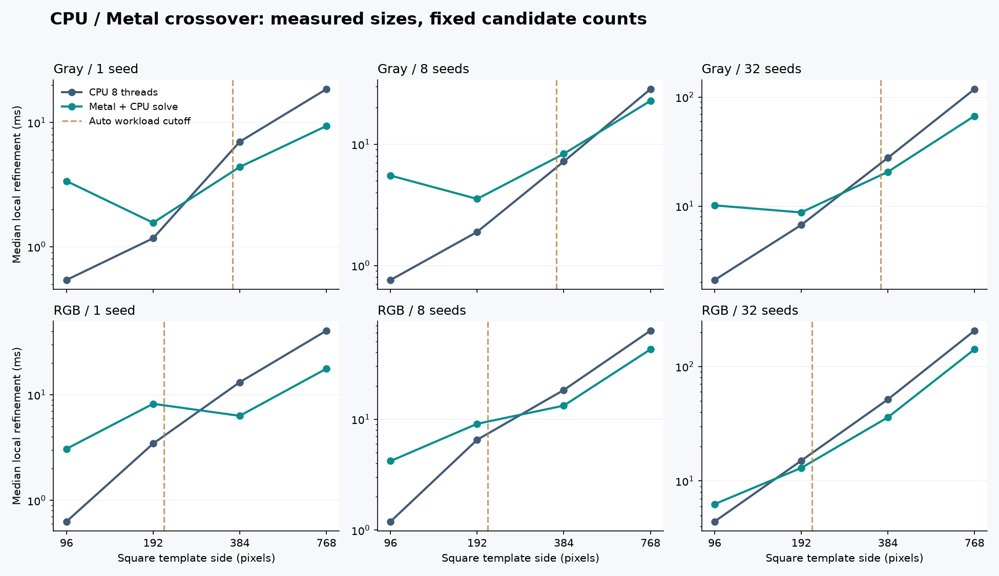
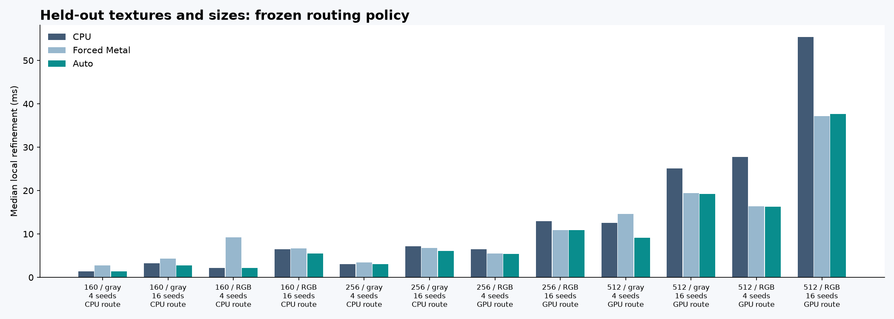
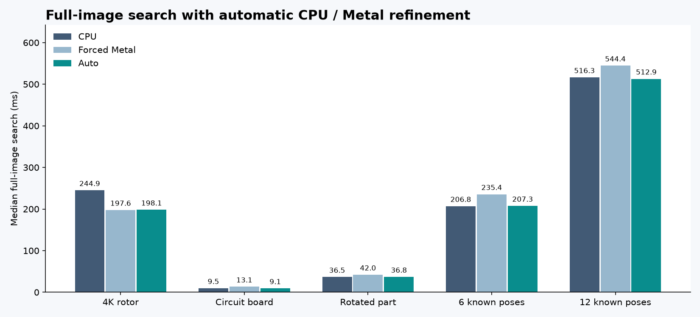

# CPU／Metal 自動分流與效能交界

2026-10-13，Apple M4 Pro、48 GiB、Release，CPU 使用 8 執行緒。本輪承接[GPU 連續 NCC 精修](GPU_REFINEMENT_zh-TW.md)，加入 C++ 自動分流與延遲 Metal 初始化，使用現有 Metal 硬體驗證。研究模式尚未接入 GUI。

完整流程現在可以依工作量選 CPU 或 Metal。4K 旋轉盤暖機後由 CPU 的 244.90 ms 降到自動模式 198.06 ms；四個較小模板案例選 CPU，避免強制 Metal 的額外成本。保留測試集的三種方法皆通過 120／120 次姿態測試，自動模式與所選強制後端輸出的姿態、分數、迭代紀錄完全一致。

## 實作

新增 `backend=2` 與 `fpm_pose_refine_auto`，原始碼在 [pose_ncc.cpp](../experiments/pose_ncc.cpp)、[pose_ncc.h](../experiments/pose_ncc.h)。建立 auto handle 時只準備 CPU 資料；第一次符合門檻時才建立 Metal queue、pipelines 與影像 buffers，之後重用。

每次呼叫回傳選定後端、原因、每姿態／批次樣本數及當次 Metal 初始化時間。配置、來源尺寸、seed 等參數先驗證，再判斷是否初始化。沒有 Metal 時可回退 CPU，shader、配置或執行失敗則回報錯誤，避免把故障當成成功加速。

既有 CPU／Metal handle 與 API 保持相容。auto handle 的一般 `score`、`refine`、`refine_accelerated` 都使用 CPU；**要啟用分流須呼叫 `refine_auto`**。`fpm_pose_device` 描述一般評分後端，自動精修的實際選擇應看 `FpmPoseRoute.selected_backend`。選定 Metal 後，若種子已達停止條件，可能沒有 GPU dispatch。

auto handle 曾初始化 Metal 後，即使下一次改選 CPU，也仍持有 Metal 緩衝區，記憶體統計會保留這部分。原先直接建立的 Metal handle 已經支付初始化成本，對它呼叫自動精修只能改變該次精修路徑。

## 門檻如何取得

用 \(S=W_T H_T C\) 表示每姿態通道樣本量，\(B=NS\) 表示 N 個候選的一次名目批次量。它們不包含實際迭代次數。CPU 平行的是候選，Metal 同時平行像素與候選；因此候選數、有效 CPU 執行緒數、每個候選的收斂速度都會影響交界。

校準集為 96／192／384／768²，灰階／RGB，候選 1／8／32，共 24 案例、48 個工作。固定大小與通道時，各候選數使用同一紋理及相同 seed 前綴。每工作獨立程序、序列執行，至少暖機一次及 200 ms，量 3 次。所有 CPU／Metal 姿態測試皆通過嚴格門檻（各 328／328）；其中部分 seed 隨候選數重複使用，並非 328 個獨立紋理。

從預先定義的 2 的次方門檻網格，最小化 24 案例等權重的

\[
\exp\!\left(\frac1{24}\sum_i
\log\frac{T_i(\text{選定後端})}{\min(T_i(\mathrm{CPU}),T_i(\mathrm{Metal}))}\right).
\]

選取程式為 [select_pose_routing_policy.py](../tools/select_pose_routing_policy.py)，結果含所有候選門檻與原始報告雜湊：[policy-selection.json](pose-routing/policy-selection.json)。此選取只讀校準資料，之後固定門檻再跑保留測試及全圖，沒有依測試結果重新調整。

目前預設為：

| 條件 | 設定 |
|---|---:|
| 每姿態樣本下限 | 131072 |
| 批次樣本下限 | 0，保留可調介面 |
| 精修迭代上限至少 | 4 |
| GPU 後額外 CPU polish | 0 |

另外，CPU handle 固定用 CPU；所有參數凍結時使用 CPU。迭代條件比的是允許上限，無法預知實際會跑幾輪。預設樣本門檻相當於正方形灰階約 363²、RGB 約 210²；長方形應使用面積與通道數計算。

這個規則在校準集的選定時間／兩後端較快時間之幾何平均為 1.0123，最差 1.158。具體反例為 384² 灰階／8 候選：CPU 7.20 ms、Metal 8.33 ms，自動規則會選 Metal。門檻是可覆寫的本機暖機策略，並不保證每個輸入或其他 CPU 執行緒配置都最快。



圖中實線連接實測尺寸，虛線表示固定分流門檻。不同尺寸也更換紋理、來源大小及收斂路徑；連線用於觀察趨勢，不是固定迭代數的理論複雜度或連續尺寸的量測。

## 保留測試與量測波動

保留集使用新的紋理與真值姿態，尺寸 160／256／512²、灰階／RGB、候選 4／16，共 12 案例，每變體 5 次計時。嚴格門檻為 NCC≥0.8、位置≤0.5 px、角度≤0.5°、尺度相對誤差≤1%。CPU、強制 Metal、自動模式皆為 120／120 次通過；同尺寸與通道的 4 候選是 16 候選的前綴。

自動模式最大位置誤差約 0.0189 px、角度誤差 0.00204°、尺度相對誤差 0.00338%。這些是平滑解析紋理上的局部收斂結果，全圖與真實照片另行評估。全部 auto 結果與所選強制後端的姿態、分數及統計逐值相同；6 案例選 CPU、6 案例選 Metal。



初次量測有 10／12 案例的選定後端，對應強制模式較低的時間中位數。其餘兩個案例補做 1 秒暖機、9 次計時，**沒有替換原資料或重調門檻**：

| 案例 | 初次 CPU／Metal／Auto ms | 補測 CPU／Metal／Auto ms |
|---|---|---|
| 512² 灰階／4 | 12.58／14.62／9.11 | 12.57／9.29／9.41 |
| 256² 灰階／16 | 7.17／6.80／6.05 | 6.10／8.18／6.05 |

相同演算法的程序間時間可有明顯差異，初次與補測的暖機長度也不同；不能把 Auto 比所選強制後端快的差值解讀為新的演算法加速。此處未控制 GPU 頻率、溫度或系統背景工作，沒有統計信賴區間。補測保存於 [boundary-repeat.json](pose-routing/boundary-repeat.json)。

另有 8 個邊界案例（灰階／RGB × 接近真值、常數模板、只優化平移、一輪迭代），三模式所有數值與界限檢查通過；有幾何意義的案例各 96／96 次通過。常數模板回傳無效分數 −2，自動模式目前仍可能初始化 Metal，約增加 30 ms 的首次成本；這是保留的限制。低迭代上限會直接選 CPU。全部凍結、無 Metal、真實初始化錯誤與切換後記憶體保留，另有 C++ 回歸測試。

## 全圖時間、首次成本與記憶體

每次都重新搜尋整張圖，以同一 CPU 金字塔、多尺度粗搜尋產生候選，沒有使用標準答案給位置。三模式 polish 一律設 0，每模式量 5 次。暖機時間排除一次性的模板學習／scorer 建立；完整流程包含粗搜尋、精修、分數複核與去重疊。

| 圖片 | CPU ms | 強制 Metal ms | Auto ms | Auto 選擇 |
|---|---:|---:|---:|---|
| Src7 4K 旋轉盤 | 244.90 | 197.56 | 198.06 | Metal |
| Src3 電路板 | 9.54 | 13.12 | 9.10 | CPU |
| Src5 旋轉零件 | 36.51 | 42.01 | 36.78 | CPU |
| 6 個已知姿態物件 | 206.77 | 235.43 | 207.33 | CPU |
| 12 個保留測試物件 | 516.35 | 544.44 | 512.91 | CPU |

已知場景三模式皆為 TP=6／12、FP=0、FN=0，姿態門檻沿用全圖工具的≤2 px／1°／2%。三張照片分別找到 6／36／1 個，但沒有幾何標註，數量相同不能證明精度。



首次成本定義為 scorer／模板準備加第一次完整搜尋，不包含圖片讀取，也未清除作業系統的 shader／driver cache：

| 案例 | CPU 首次 ms | 強制 Metal 首次 ms | Auto 首次 ms | Auto 延遲 Metal 初始化 ms |
|---|---:|---:|---:|---:|
| Src7 | 276.76 | 266.41 | 300.44 | 58.55 |
| Src3 | 17.71 | 62.43 | 17.69 | 0 |
| 12 個物件 | 525.22 | 593.88 | 520.28 | 0 |

因此本輪分流主要服務重用 context 的暖機工作負載。以 Src7 此次數字估算，首次 Auto 多 23.68 ms，後續每次約省 46.84 ms，重用第二次便可能攤平；這是由量測推估的示例，單張新圖仍可能 CPU 較快。新影像目前需建立新 handle，跨不同影像重用／更新 buffers 尚未加入。

四個選 CPU 的全圖案例，從初始化到結束都沒有本 scorer 的 GPU buffer。Src3 程序 peak RSS：CPU 92.67 MiB、強制 Metal 112.09 MiB、Auto 92.47 MiB；Src7 Auto 約 280.25 MiB，Metal buffers 約 48.44 MiB。RSS 含 Python、輸入與初始化，Metal 共用記憶體不可再與 RSS 相加。既有 16 MiB 輔助 workspace 分批設計維持，來源與模板不計入該容量目標。

12 物件場景的 Auto 約 499.48 ms 花在 CPU 粗搜尋，精修約 13.43 ms。下一個主要加速目標是多尺度／角度粗搜尋批次化與 Metal 化；需要獨立驗證提案召回率、取樣與門檻語意。此輪維持原粗搜尋，遮擋／裁切限制見[上一輪失敗紀錄](GPU_REFINEMENT_zh-TW.md#記憶體與裁切失敗)。

## 呼叫、重跑與稽核

[Python 介面](../tools/pose_experiment.py) 範例（`source`、`template` 為 float32 灰階或 HWC RGB；`seeds` 為 N×4 的 x、y、角度、log-scale）：

```python
with Scorer('build/fourier-gpu', source, template, backend='auto', threads=8) as scorer:
    poses, scores, stats, metrics = scorer.refine_auto(seeds)
    print(metrics['route'])  # selected_backend: 0 CPU / 1 Metal
```

`min_pose_samples`、`min_batch_samples`、`min_iterations`、`cpu_polish_iterations` 可覆寫；Python 的 `None` 會載入 C++ 預設值。建立 CPU／Metal handle 並呼叫既有方法可保留強制選擇。

```sh
cmake -S cpp-core -B build/fourier-gpu -DCMAKE_BUILD_TYPE=Release -DFPM_BUILD_EXPERIMENTS=ON
cmake --build build/fourier-gpu -j
ctest --test-dir build/fourier-gpu --output-on-failure
MTL_DEBUG_LAYER=1 build/fourier-gpu/experiments/fpm_pose_test metal
python-port/venv/bin/python cpp-core/tools/benchmark_pose_routing.py --suite calibration --methods cpu metal --output build/pose-routing/calibration-new.json
python-port/venv/bin/python cpp-core/tools/select_pose_routing_policy.py --calibration build/pose-routing/calibration-new.json --output build/pose-routing/policy-new.json
python-port/venv/bin/python cpp-core/tools/benchmark_pose_routing.py --suite heldout --methods cpu metal auto --repeats 5 --output build/pose-routing/heldout-new.json
python-port/venv/bin/python cpp-core/tools/benchmark_pose_routing.py --suite edge --methods cpu metal auto --output build/pose-routing/edge-new.json
python-port/venv/bin/python cpp-core/tools/real_image_experiments.py --methods continuous_direct_cpu accelerated_direct_metal adaptive_direct_auto --held-out --cpu-polish-iterations 0 --repeats 5 --output build/pose-routing/full-image-new.json --assets build/pose-routing/assets
```

選取工具只寫報告，不會修改 C++ 預設；重新校準後應明確凍結設定再驗證。`report_pose_routing.py` 用 Matplotlib 從保存資料重建圖表，不重跑演算法。

本輪 Release 7／7、ASan／UBSan 5／5、Metal API Validation、純 CPU 編譯皆通過。[錯誤回退測試](../tests/pose_auto_fallback_test.cpp) 不依賴 GPU，可重現「硬體缺少才回退，shader 錯誤須回報」；[姿態測試](../tests/pose_experiment_test.cpp) 覆蓋所有路由原因、延遲初始化、參數界限與 CPU／Metal 切換。

原始資料：[校準](pose-routing/calibration.json)、[門檻選取](pose-routing/policy-selection.json)、[保留測試](pose-routing/heldout.json)、[邊界](pose-routing/edge.json)、[補測](pose-routing/boundary-repeat.json)、[全圖](pose-routing/full-image.json)、[最終驗證](pose-routing/validation.json)。全部性能工作序列執行；編譯與功能測試不與效能量測重疊。

量測時 `git_head` 是基底 `9cde5d9`，新增內容尚未提交，應以來源與 binary hash 稽核。校準後只改分流預設與註解，再建置保留測試使用的最終 binary；強制 CPU／Metal 的數值核心未變。所有量測結束後新增的 CMake 項目只接入錯誤回退測試，最終實驗 library binary 與保留、邊界、補測、全圖量測完全相同。
