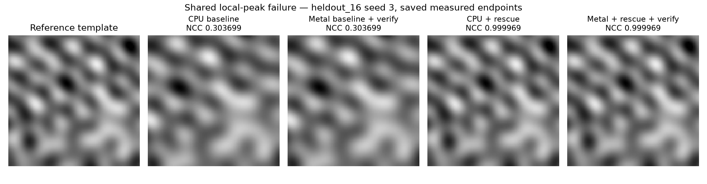
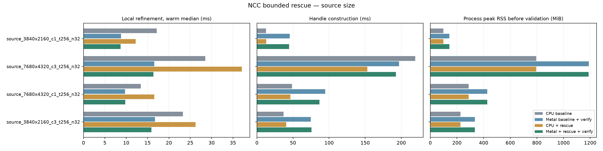
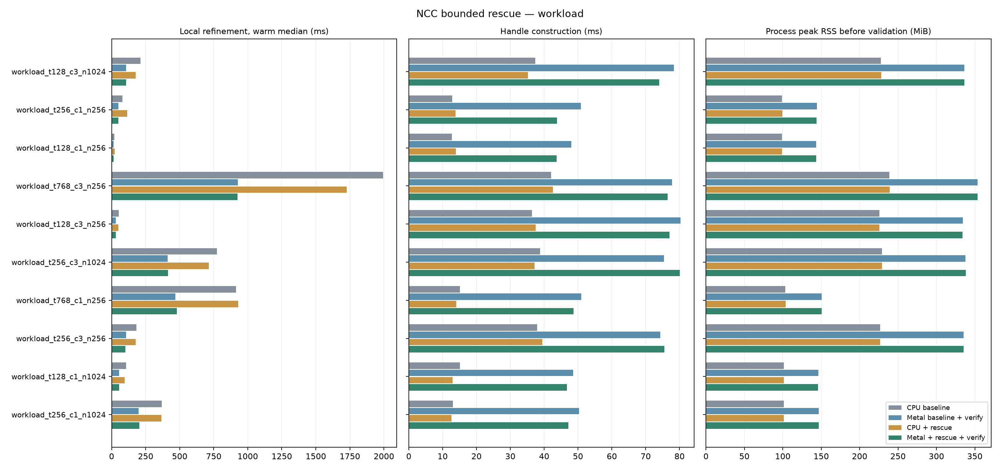

# NCC 錯峰救援與 Metal 粗 NCC 實驗

實驗基準：`958ab79`，Apple M4 Pro（12 CPU／16 GPU cores）、48 GiB、macOS 26.6.2、Release、CPU 8 threads，2026-10-13。舊版 binary 已在新版本編譯前另存，SHA-256 見 [baseline-provenance.json](ncc-rescue/baseline-provenance.json)。

**有預算的多起點修復了已知 CPU／Metal 共同錯峰，納入精度驗收的局部姿態與 6／12 物件整圖案例全部通過。** 第一輪速度驗收未通過；修正實際分數門檻後，完整流程與配對診斷通過，但不能宣稱全面加速。Metal 頂層粗 NCC 已完成第一版，輸出精確一致，但大型整圖測試未加速，因此維持可選研究路徑。高分週期錯峰仍未解決，見下方挑戰結果。

## 實測結果

正式測量含 90 組案例 × 4 種方法，每組保留第一次及 5 次暖機後結果，共 2,160 次呼叫。納入局部姿態精度驗收的不同 seed 共 6,182 個；舊 CPU／Metal 各通過 6,181 個，救援版各通過 6,182 個。原 43 組案例共 606 個 seed，其中 326 個有局部精度真值；另外獨立 24 組共有 96 個，大圖與大量候選提供其餘 5,760 個驗收 seed。這些都是本測試分布內的結果，不是未來任意圖片的成功率。

| 已知共同錯峰：4 個候選整批 | 原版暖機中位數 | 多起點版 | 準確結果 |
|---|---:|---:|---|
| CPU | 2.229 ms | 3.777 ms | 3／4 → 4／4 |
| Metal 常駐＋CPU 分數複核 | 3.635 ms | 7.246 ms | 3／4 → 4／4 |

失敗候選的 NCC 由 **0.303699 → 0.999969**，新 CPU／Metal 在保存的第一次＋5 次量測均恢復。此批只救援 1 個候選、16 個短起點、1 次延續，Metal 共 3 次提交／等待；CPU 救援 workspace 約 1.5 KiB，GPU 保留 buffer 比原版增加約 18.9 KiB。小批資料的 GPU 啟動成本明顯，CPU 仍較快。



局部精度標準固定為 NCC ≥ 0.8、位置 ≤ 0.5 px、角度 ≤ 0.5°、尺度相對誤差 ≤ 1%。6／12 物件整圖測試的每次保存結果皆零漏檢、零誤檢，幾何門檻為 2 px／1°／2%。Src7 無校準真值，只驗證新舊結果逐一一致。負樣本共 192 個 seed-call，無超過接受門檻的檢出；近週期挑戰仍有 **NCC 約 0.999992、位置錯 8 px** 的假峰，因高分而未觸發救援，不能說所有共同失敗已解決。

### 超大型圖片與大量運算

以下是新救援 API 的暖機局部精修時間，沒有觸發重搜；仍包含 CPU 精確分數複核。GPU／CPU 在不同新程序量測，不把波動當成救援本身的提速。

| 來源、模板、候選 | CPU | Metal | 精度 |
|---|---:|---:|---|
| 3840×2160 RGB，256²，32 個 | 26.23 ms | 15.91 ms | 32／32 |
| 7680×4320 RGB，256²，32 個 | 37.10 ms | 16.38 ms | 32／32 |
| 3840×2160 RGB，128²，1024 個 | 177.52 ms | 107.76 ms | 1024／1024 |
| 3840×2160 RGB，256²，1024 個 | 713.50 ms | 414.34 ms | 1024／1024 |
| 3840×2160 RGB，768²，256 個 | 1726.70 ms | 924.78 ms | 256／256 |

4K → UHD 8K 的 Metal handle 準備時間由 75.70 → 192.68 ms，程序 peak RSS 由 334.81 → 1188.95 MiB；CPU 的 UHD 8K 為 795.69 MiB。固定候選時，來源變大主要增加準備／保留影像成本，暖機局部 GPU 時間近似；增加模板面積／候選數才直接增加 NCC 精修工作量。256² RGB、1024 候選的 Metal peak RSS 約 338.23 MiB，CPU 約 229.14 MiB。





### Metal 粗搜尋與整合

先確認救援精度，再以相同下游 Metal 救援比較 CPU／Metal 粗搜尋。每次都重新搜尋整張圖；時間是完整流程，不是只有 GPU kernel。

| 案例 | CPU 粗搜尋＋Metal 救援 | Metal 粗搜尋＋Metal 救援 | 結果 |
|---|---:|---:|---|
| Src7 | 179.477 ms | 179.303 ms | 持平，無真值，輸出一致 |
| 6 物件 | 226.222 ms | 223.060 ms | 約快 1.4%，5 次樣本最小–最大範圍重疊 |
| 12 物件 | 530.372 ms | 496.716 ms | 本批約快 6.35%，5 次樣本最小–最大範圍未重疊 |

此處的樣本範圍不是信賴區間，未據此推論跨設備或長期運行的統計顯著性。

另做 **8192×8192（約 6711 萬像素）全圖搜尋**：256² 模板為 CPU 101.648／Metal 104.128 ms；512² 模板為 97.899／99.949 ms。兩案 CPU／Metal 各第一次＋5 次均找齊 6 個物件、零誤檢漏檢、結果精確一致，但 Metal 約慢 2%。這兩組是固定角度 0°／尺度 1 的灰階貼入物件，不能延伸成 8K 任意旋轉、尺度或 RGB 的整圖保證。Metal peak RSS 約 402.06／400.44 MiB，比 CPU 增加 12.13／14.69 MiB。

Src7／6／12 物件整合案例的 shared-buffer memcpy 只占完整流程約 **0.011–0.051%**，不是主要瓶頸。Src7／6／12 物件仍分別需要 40／140／140 次粗 NCC 提交及等待；同一回合等待時間扣掉 GPU command 時段約 6.06／20.73／23.28 ms，包含提交、排程、同步與喚醒，不能全部稱為 CPU 忙碌或傳輸時間。GPU command 時段與 wait、wall 重疊，不能相加。

8192² 兩案頂層 NCC 僅占整體 **2.93%／2.31%**；CPU 已將金字塔降到 512²／256² 才交給 GPU。相對本次 Metal 完整流程，即理想化將頂層 NCC 成本降為零、其他不變，推論總提速也僅 1.030×／1.024×。下一步應先逐段量測金字塔、旋轉、細層搜尋，再搬移占比高的部分；算法仍有平行化空間，這輪不能把「傳輸」當成主要原因。完整來源與各段結果見 [coarse-summary.json](ncc-rescue/coarse-summary.json)。

## 速度驗收與門檻修正

預先規定：無重搜的簡單案例增加不得超過 `max(10%, 0.5 ms)`；完整流程增加不得超過 `max(10%, 2 ms)`。首輪正式報告的精度驗收通過，**11 個比較超過速度門檻，總驗收 false**，詳見 [summary.json](ncc-rescue/summary.json)。

其中 Src7 實際接受分數為 0.5，救援原預設 0.8 卻把已接受的約 0.64 分候選重搜，沒有改善輸出。首輪 Metal 完整流程由 178.10 增至 271.68 ms，CPU 由 249.62 增至 444.28 ms。因此新增 caller helper，將上限設為 `min(0.8, 實際最低分數)`。不改算法預設、不讀取真值，且低於 0.1 的門檻會產生空救援區間；如需主動重搜已接受結果，可明確配置 API。

首輪另有 12 物件的 Metal 完整流程由 523.067 增至 600.127 ms，4 個候選進入救援；加上 Src7 兩種後端，共 3 個完整流程比較未過。其餘 8 個超時比較完全沒有重搜；同次呼叫救援總時間扣除內部 baseline 的中位數僅 CPU 0.000126／Metal 0.000250 ms，但這只能指示程序間波動，不能直接抹掉首輪失敗。另依 [protocol-v2.json](ncc-rescue/protocol-v2.json) 進行 9 回合、同程序、交錯 ABBA 比較舊 binary baseline／新 binary baseline／新 rescue，以及 9 回合完整流程重測。跟進結果另存，不覆寫原正式報告。

修正觸發門檻後的完整流程重測，12 組方法、每組第一次＋9 回合，全部精度／來源與 binary hashes／速度門檻通過：

| 完整流程 | CPU 原版 → 救援 | Metal 原版 → 救援 | 救援耗時增幅 |
|---|---:|---:|---|
| Src7，最低分數 0.5 | 253.438 → 255.315 ms | 182.959 → 184.943 ms | 0.74%／1.08% |
| 6 物件，最低分數 0.8 | 212.296 → 220.809 ms | 218.204 → 230.648 ms | 4.01%／5.70% |
| 12 物件，最低分數 0.8 | 521.260 → 529.734 ms | 536.825 → 551.109 ms | 1.63%／2.66% |

Src7 不再重搜、GPU buffer 零增加，host workspace 僅增加 72 bytes。6／12 物件仍有 4 個候選進入救援，GPU 保留 buffer 分別增加 116,368／71,136 bytes，程序 peak RSS 分別增加約 0.06／1.34 MiB；RSS 含程序及 driver 波動，不可把單輪負增幅解讀為省記憶體。這是有限工作量預算下可接受的精度／時間交換，不代表救援沒有成本。

同程序配對的 8 個案例也全部通過原精度與時間增幅門檻；每案保留 3 次初始結果與 72 次交錯量測。相對舊 baseline 的配對中位增幅最高約 5.80%，相對同一新版 binary、不開救援的 baseline 最高約 2.13%。後者更直接分離救援 wrapper 的影響；多次量測仍存在系統波動，不能把負增幅稱作算法加速。三個 handle 同時存活的 peak RSS 不與前述單 handle 程序直接比較。

可核對 [跟進摘要](ncc-rescue/dispatch-summary.json)、[完整流程原始結果](ncc-rescue/dispatch-full.json.gz)、[配對原始結果](ncc-rescue/dispatch-paired.json.gz)。原 [formal.json.gz](ncc-rescue/formal.json.gz) 的失敗旗標、所有原始時間與輸出保留不變；[獨立保存資料稽核](ncc-rescue/saved-audit.json) 無精度／邊界錯誤。

## 程式驗證

Release 測試 11／11、ASan／UBSan 9／9 通過，Metal API validation 下救援與粗 NCC 測試通過。再強化實際 uint32 溢位邊界測試後，該測試於 Release／sanitizer 各重跑通過；caller helper 的分數門檻、邊界與非法值檢查及全部新增 Python 語法檢查通過。驗證記錄見 [build-validation.json](ncc-rescue/build-validation.json)、[Release 紀錄](ncc-rescue/release-tests.txt)、[sanitizer 紀錄](ncc-rescue/sanitizer-tests.txt)。沒有因測量結果而放寬原精度或速度門檻。

## 要解決的問題與限制

原 CPU 與 GPU 常駐精修，在同一個輸入都收斂到 NCC 約 0.304 的局部極大；加到 200 輪仍未找到分數接近 1 的正確姿態。救援的目標是改變起點所在的吸引域，而不是增加同一個錯峰的迭代預算。選擇起點、觸發、排序及停止都不得讀取真值或案例編號。

新路徑為 opt-in，原本 CPU、混合與 GPU 常駐 API 全數保留，GUI／Auto 預設不因研究實驗變更。GPU 模式內的 LM 求解、接受與停止仍由 GPU 完成；外圍低分觸發、多起點安排、CPU 精確分數比較屬於主機端策略，不等於救援與粗搜尋已全 GPU 常駐。

## 固定且有預算的多起點

預先固定策略記錄於 [protocol.json](ncc-rescue/protocol.json)。令原 seed 為 p、合法區域為 B(p)、既有精修結果為 q。只有 `0.1 ≤ NCC(q) < 0.8` 的候選可能觸發救援；按 q 的分數由高至低穩定排序，每次最多 4 個原候選。

16 個新起點由 Halton 低差異序列構成，四維基數為 2、3、5、7，索引固定為 1–16：

`p_j = project_B(p)(p + [3 px, 3 px, 6 degrees, 0.06 log-scale] × (2 H(j) − 1))`。

每個起點先精修 8 輪，只將比 q 更好的最佳結果再以原迭代預算延續一次。所有結果使用相同 CPU NCC 重新計分，只有嚴格提高分數才替換 q。這保證不降低原路徑的 NCC，**不代表幾何誤差一定降低**；因此精度驗收另外使用位置、角度與尺度真值。邊界始終相對原 seed，並保持凍結參數，沒有把每次重試範圍重新向外擴張。

除了候選數上限，再用 `模板 scalar samples × (16 × 8 + 原迭代預算)` 為每個候選預留工作額度；預設總額為 512 × 1024²，整組放不下就略過。這是工作量代理，不是像素操作總數或毫秒上限：每輪還可能有多次阻尼嘗試及最後分數複核。API 回報實際起點／延續數、略過數及預留工作量，便於辨識速度是來自跳過救援還是加速。

高分的週期重複圖樣可能位在錯誤位置，並且不會觸發這個低分策略；影像本身缺少區辨資訊時，也無法承諾唯一正解。此類案例保留為挑戰結果，不以調整真值容差或排除失敗來聲稱通用問題已解決。

## 測量方法

時間、程序 peak RSS、保留的 CPU／Metal buffers 與幾何精度分開記錄。新舊方法使用相同圖片、模板與初始候選，worker 序列執行，固定亂序，每組暖機後 5 次；另存第一輪及建構成本。真值與獨立 float64 NCC oracle 僅在計時與 RSS 截取後執行。Metal shared buffers 與 RSS 有重疊，不能相加當作實體總記憶體。

原始案例用來驗證前輪失敗是否恢復；另有政策凍結前指定的新獨立 24 組紋理、姿態與偏移，不與用來選 Halton 範圍的探索案例混用。6／12 物件整圖重新跑粗搜尋，不把真值位置餵入精修。Src7 實圖沒有校準真值，僅能比較輸出一致性。

大型量測分成兩個問題：4K／8K 來源圖配固定模板與候選，量測全圖準備與記憶體；增加模板大小及候選到 1024，量測真正的局部運算量。**8K 已知候選精修不等於 8K 全圖搜尋**，後者由粗 NCC 實驗另列。

## Metal 粗 NCC 的範圍

新增獨立的 `fpm_coarse_experiment` 與 `fpm_coarse_create / match / scoremap / destroy`。Metal 對金字塔頂層每個滑動窗口並行計算整數 `ΣI、ΣI²、ΣIT`，CPU 與舊版共用相同 double 正規化式及數值保護。模板面積不超過 66051 像素時使用 uint32，較大時使用 uint64；測試跨過真正超出 uint32 的累加量，並覆蓋常數、低對比、負相關、stride、邊界、排序、角域與次像素設定。

來源金字塔、旋轉畫布、峰值選取、較細層搜尋及 NMS 仍在 CPU。每個角度仍複製畫布到 shared buffer，並等待結果；`upload_ms` 是 CPU memcpy 時間，不是獨立顯卡的 PCIe 傳輸時間。16 MiB 上限只限制統計工作區，來源、模板及 CPU double 分數圖另列。每個 scale 使用獨立 handle，建構與 shader 初始化也另計。

## 使用與重現

完整算法來源：

- [C ABI 與配置／統計定義](../experiments/pose_ncc.h)、[C++ 多起點與精確複核](../experiments/pose_ncc.cpp)、[Python 包裝](../tools/pose_experiment.py)。
- [Metal 常駐迭代](../experiments/pose_resident.metal)、[像素／導數統計](../experiments/pose_ncc.metal)、[配置與派工](../experiments/pose_metal.mm)。
- [粗 NCC C ABI](../experiments/coarse_ncc.h)、[整合](../experiments/coarse_ncc.cpp)、[Metal 派工](../experiments/coarse_metal.mm)、[完整整數 kernel](../experiments/coarse_ncc.metal)。
- [救援回歸測試](../tests/pose_rescue_test.cpp)、[粗 NCC 精確一致測試](../tests/coarse_ncc_test.cpp)。

CMake 將可閱讀的 Metal 源碼嵌入 library；沒有把算法藏在預編譯模型中。CPU 救援可在無 Metal 平台使用，Metal 路徑無裝置時明確報錯。C API 保持與現有 stable ABI 分離，便於其他語言包裝或逐步移植。

```python
from pose_experiment import Scorer
from rescue_policy import rescue_policy_for_threshold
policy = rescue_policy_for_threshold(minimum_score=0.5)
with Scorer('build/fourier-gpu', source_float, template_float,
            backend='metal', threads=8) as scorer:
    poses, scores, stats, metrics = scorer.refine_rescue(seeds, resident=True, **policy)
    print(metrics['rescue'])
```

建立 `cpp-core` 時啟用 `FPM_BUILD_EXPERIMENTS=ON`、`FPM_BUILD_TESTS=ON`、Release。比較基準必須由獨立保存的 `958ab79` binary／checkout 提供，不可把新版 library 複製成舊版。以下工具均保留完整配置、輸入／來源／binary hashes 與每回合結果；CPU threads=8、量測序列執行。

```sh
python-port/venv/bin/python cpp-core/tools/benchmark_ncc_rescue.py \
  --baseline build/rescue-baseline \
  --baseline-manifest build/rescue-baseline/baseline-provenance.json \
  --build build/fourier-gpu --suite all --profile large \
  --repeats 5 --warmup-ms 1000 --output build/ncc-rescue/formal.json
python-port/venv/bin/python cpp-core/tools/benchmark_coarse_ncc.py \
  --baseline build/rescue-baseline --build build/fourier-gpu \
  --suite all --repeats 5 --warmup-seconds 1 \
  --output build/coarse-ncc/report.json
python-port/venv/bin/python cpp-core/tools/benchmark_coarse_rescue.py \
  --baseline build/rescue-baseline --build build/fourier-gpu \
  --repeats 5 --warmup-seconds 1 --output build/coarse-ncc/full-rescue.json
python-port/venv/bin/python cpp-core/tools/benchmark_rescue_dispatch.py \
  --formal build/ncc-rescue/formal.json --suite full \
  --repeats 9 --warmup-ms 1000 --output build/ncc-rescue/dispatch-full.json
python-port/venv/bin/python cpp-core/tools/benchmark_rescue_dispatch.py \
  --formal build/ncc-rescue/formal.json --suite paired \
  --rounds 9 --warmup-ms 1000 --output build/ncc-rescue/dispatch-paired.json
```

無需重新跑 GPU，也可從儲存的 JSON 產生表格與圖：

```sh
python-port/venv/bin/python cpp-core/tools/report_ncc_rescue.py \
  cpp-core/docs/ncc-rescue/formal.json.gz \
  --output build/ncc-rescue/review --plots
python-port/venv/bin/python cpp-core/tools/audit_ncc_rescue.py \
  --report cpp-core/docs/ncc-rescue/formal.json.gz \
  --output build/ncc-rescue/saved-audit.json
```

畫圖另需 Matplotlib。參數選擇時使用的 [探索工具](../tools/probe_ncc_rescue.py) 與正式獨立驗證分開；探索圖案不能重新標成未見資料。
