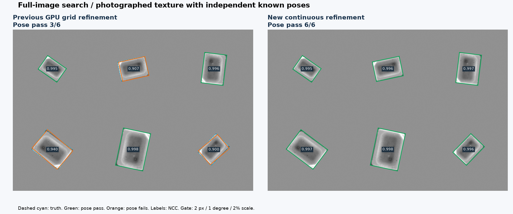
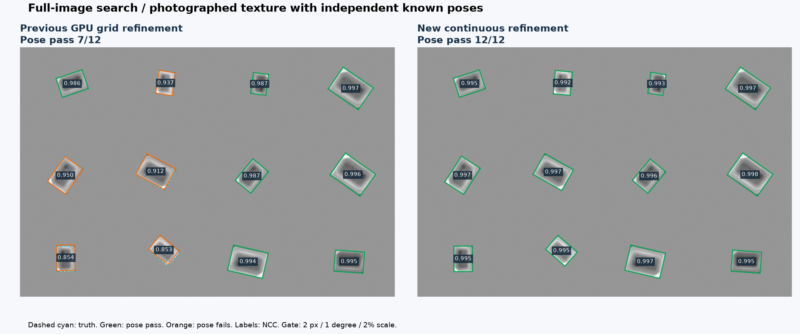
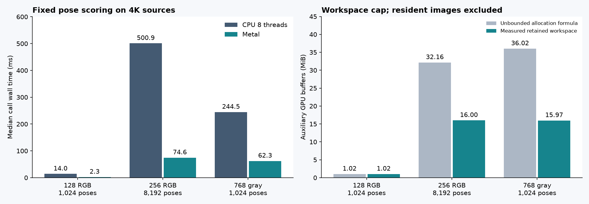

# 大量候選性能與連續姿態精修：第一輪實作結果

2026-10-12，分支 `codex/ncc-fourier-gpu-experiments`。Apple M4 Pro，12 核 CPU／16 核 GPU／48 GiB；Release、NEON、Metal。三個 agent 分別實作連續精修、保守 NCC 篩選、獨立壓力測試；主 agent 整合 Python 研究排程、C ABI、GPU 記憶體分批及驗證。

**這輪已改善受控旋轉／尺度精度，也確認大型批次的 GPU 收益；沒有證明所有場景都會更快。** 目前是可重現的研究分支，正式 GUI 還沒有新增這些研究模式。

## 實作內容

1. **C++ 連續精修**：位置 x／y、旋轉 θ、log-scale α；自行實作解析雙線性導數、正規化 NCC Jacobian、阻尼 Gauss–Newton、4×4 求解。每次接受更新必須提高相同 scorer 的分數。無 OpenCV 比對或 ECC 黑盒依賴。
2. **保守 NCC 提前排除**：2×2 區塊投影上界，加上部分內積的 Cauchy–Schwarz 上界。不可能達到當層門檻才跳過剩餘乘積；保留浮點誤差餘裕。只用於粗搜尋，細層／既有 subpixel 分數圖保持完整。
3. **Metal 有界批次**：候選、分塊統計與輸出緩衝合計最多約 16 MiB，超過後分批提交並保留原始順序。影像與模板常駐，不屬於此上限。若單一候選本身超過上限則至少配置一個候選；裝置單一 buffer 限制仍適用。
4. **測試與量測**：完整灰階圖片搜尋、獨立局部精修、4K 灰階／真正不同三通道的 RGB、大量候選、全分數 CPU／Metal 一致性、分批一致性、峰值 RSS。

新增 C 介面 `fpm_pose_refine`；穩定 ABI 1 保持原結構，另加 `fpm_match_pruned`。C++ 使用 `MatchConfig::coarseNccPruning`，預設關閉。演算法核心保留完整 C++／Metal 原始碼，Python 負責研究排程與量測。這輪沒有新增 CUDA、GPU FFT、GPU Jacobian 精修或自動 CPU／GPU 切換。

## 全圖結果：從整張圖搜尋，沒有輸入答案座標

沿用原 C++ 金字塔粗搜尋。原始照片固定尺度；有真值的兩張圖使用 0.75／1／1.25 三尺度提案。在這兩張圖，各方法的提案門檻為 0.5、最後門檻為 0.8。姿態合格需同時滿足 **位置 ≤2 px、角度 ≤1°、相對尺度 ≤2%**。

| 測試圖 | 舊 GPU 網格：合格數／時間 | 新連續精修：合格數／時間 |
|---|---:|---:|
| 原六物件受控圖 | 3/6；221.65 ms | **6/6；217.28 ms** |
| 新增十二物件圖 | 7/12；541.05 ms | **12/12；537.35 ms** |

上表新版本為 `continuous_metal`：CPU 粗搜 → Metal 評分額外角度／尺度候選 → **CPU** 連續精修 → 抑制重疊。最後一步沒有冒稱 GPU 精修。數毫秒差距可能受熱與排程影響，這裡支持的主要結論是精度改善、總耗時相近。

六物件圖最大位置／角度／相對尺度誤差為 0.024 px／0.027°／0.191%；十二物件圖為 0.090 px／0.048°／0.250%。十二物件圖在演算法實作時預先固定亂數，角度遍布 ±180°、尺度 0.72–1.28，另加亮度增益、偏移及雜訊，未用來調整演算法。兩張圖都使用同一張真實電容紋理，**不是跨物件、透視、遮擋或真實相機尺度變化的全面驗證**。





額外消融實驗移除新增候選庫，將同樣的粗搜尋結果直接送入 LM（`continuous_direct_cpu`）：仍分別通過 **6/6、12/12**，時間 206.61／511.05 ms。該次配對的含候選庫 CPU 版本為 215.41／528.96 ms。因此這批資料不需要額外候選庫；保留它供後續困難案例研究，不宣稱它已證明有效。

新 LM 每個種子最多移動 ±12 px／±15°／±log(1.3)，候選庫另有 ±6°／±log(1.1)。舊網格角度總移動不足 2°，尺度固定裁切至 0.65–1.4。新舊可達範圍不同，改善包含「允許充分修正」；不是把兩者當成相同搜尋範圍的求解器速度競賽。

### 原始實圖的速度取捨

| 圖片 | 原 CPU 完整搜尋 | 舊 GPU 網格混合 | 新連續精修混合 | 找到數量 |
|---|---:|---:|---:|---:|
| Src7 六孔轉盤，4024×3036 | 368.41 ms | **177.94 ms** | 278.50 ms | 均為 6 |
| Src3 電路板 | 8.91 ms | 10.40 ms | 11.22 ms | 均為 36 |
| Src5-45 旋轉零件 | 38.71 ms | 38.00 ms | 37.41 ms | 均為 1 |

照片沒有校準姿態真值，找到數量不能換算成準確率。大模板的 CPU Jacobian 掃描較貴；轉盤有幾個低分候選需要 25–28 輪，新精修確實比舊 GPU 網格慢。因此本輪保留原快速模式，未全面替換。

## 大量候選與 RGB

以下是**資料常駐後的固定候選 NCC 評分**，不含產生候選與全圖搜尋。每個變體用獨立程序序列執行，暖機後量 5 次取中位數；記錄 p95，但 5 次樣本不構成可靠的尾端延遲分布。

| 來源／模板／候選數 | CPU 8 執行緒 | Metal | CPU 8 / Metal |
|---|---:|---:|---:|
| 4K RGB／128²／1,024 | 14.03 ms | 2.34 ms | 6.01× |
| 4K RGB／256²／8,192 | 500.92 ms | **74.56 ms** | **6.72×** |
| 4K 灰階／768²／1,024 | 244.54 ms | 62.29 ms | 3.93× |

七組批次案例的完整分數向量比較均通過，CPU／Metal 最大分數差 **1.014×10⁻⁶**，門檻外沒有接受／拒絕分歧。另以獨立 float64 取樣驗證部分姿態，並比較單次批次與每 257 候選切分的結果。

4K RGB／256²／8,192 案例，原未分批配置公式需要 32.16 MiB 工作暫存，本次實際保留 **16.00 MiB**。全部 Metal buffer 含來源和模板共 111.67 MiB，程序峰值 RSS 為 382.66 MiB；不能把「16 MiB」說成整個演算法只用 16 MiB。原 CPU 八執行緒程序峰值 RSS 為 275.27 MiB。共享記憶體重疊，這些數字不能相加。



小批次仍可能 CPU 較快：64² 灰階單候選，CPU 單執行緒約 0.018 ms，Metal 約 0.121 ms。平台、通道數、模板大小與批次一起決定交會點，尚未實作自動路由。

緩衝區擴容時，為保留配置失敗前的有效狀態，會短暫同時保留新舊配置；16 MiB 是穩態保留工作量，不是瞬時程序 RSS 上限。每次提交有自己的 autorelease pool，全部批次完成才回傳；任一批 GPU 時間戳無效則 device_ms 回報 -1。

## 獨立局部精修

12 種以連續函數生成的灰階／RGB 紋理，每種 4 個預先設定的種子誤差，共 48 組。涵蓋簡單案例，以及 2.5°／5.5°／8°、位置與尺度偏差。

| 方法 | 原門檻合格 | 更嚴格 ≤0.5 px／0.5°／1% |
|---|---:|---:|
| 舊 6 輪網格，CPU 或 Metal | 24/48 | 12/48 |
| 新 LM，CPU 1 或 8 執行緒 | **48/48** | **48/48** |

這裡的種子由真值加已知誤差生成，**只測局部收斂，不是完整偵測的召回率**。與上面無答案種子的全圖實驗分開。所有 LM 結果重新評分一致，且分數未下降。

## NCC 保守篩選的效益與限制

640×480 圖片的單張 NCC 分數圖，合格位置與分數逐項驗證，24 組門檻／模板組合全部一致。以下挑選非區塊結構的隨機紋理，門檻 0.8：

| 模板 | 完整 NCC | 保守篩選 | 加速 |
|---|---:|---:|---:|
| 16² | 5.05 ms | 5.01 ms | 1.01×，自動繞過 |
| 32² | 10.64 ms | 4.70 ms | 2.26× |
| 64² | 33.32 ms | 12.04 ms | 2.77× |
| 128² | 73.81 ms | 25.25 ms | **2.92×** |

四區塊合成模板對投影上界極有利，最高出現約 43×，不能視為一般照片的預期收益。實際金字塔頂層小、門檻逐層放寬，常不啟用上界；五張全圖開關後輸出完全相同，但沒有足夠證據宣稱完整偵測可獲同等倍數。

對中心化向量 x、t 與區塊常數正交投影 Q：

\[
\langle x,t\rangle \le \langle Qx,Qt\rangle+
\|(I-Q)x\|\,\|(I-Q)t\|.
\]

除以相同的 NCC 分母得到上界。部分內積法對尚未計算的尾段使用 Cauchy–Schwarz。浮點餘裕採保守方向；只能保證**已評估姿態**的門檻一致，不能補救根本未搜尋的角度／尺度。沒有宣稱旋轉區域能直接用原圖四次積分查表；積分圖是在對應的粗層旋轉影像建立。

連續精修用 p=(tx,ty,θ,α)、W=t+exp(α)Rθu。P 為逐通道去平均，z=PI(W)/‖PI(W)‖、τ=PT/‖PT‖：

\[
E=\tfrac12\|z-\tau\|^2=1-\mathrm{NCC},\quad
J_z=\frac{(I-zz^T)P J}{\|PI(W)\|}.
\]

逐像素累加足夠統計量建立小矩陣，不配置「像素數×4」Jacobian 陣列。低變異輸入回報無效，固定角度／尺度可關閉對應參數。這是局部解法，沒有全域最佳保證。

## 驗證、重現與剩餘工作

- Release：核心、C ABI、OpenCV 參照、GUI 工作流程、姿態實驗 **5/5 通過**。
- ASan／UBSan：**3/3 通過**。整合時修正實驗庫與測試的 sanitizer 旗標不一致，沒有關閉容器檢查。
- 最終 Metal 分批版本另外使用 Metal validation layer 重驗；見 `validation.json`。
- 效能量測期間所有 agent 的建置與其他效能任務已停止。全圖時間排除解碼／模板學習／初始化／GUI，批次時間包含提交、等待和回讀。
- 量測後補強 GPU 全批次時間戳完整性、sanitizer 建置傳遞，以及統一角度轉換的浮點運算順序；原始 JSON 留有當時來源和二進位雜湊。最終驗證另記目前來源雜湊，不把量測時的 Git HEAD 當成已提交本輪更動。

```sh
cmake -S cpp-core -B build/fourier-gpu -DCMAKE_BUILD_TYPE=Release -DFPM_BUILD_EXPERIMENTS=ON -DFPM_WITH_OPENCV=ON -DFPM_BUILD_GUI=ON
cmake --build build/fourier-gpu -j 6
ctest --test-dir build/fourier-gpu --output-on-failure
python cpp-core/tools/real_image_experiments.py --methods cpu_fixed cpu_fast hybrid_metal continuous_cpu continuous_metal --held-out --repeats 5 --output build/continuous-full.json --assets build/continuous-assets
python cpp-core/tools/real_image_experiments.py --methods continuous_direct_cpu continuous_cpu --cases controlled_scale held_out_scale --held-out --repeats 5 --output build/continuous-ablation.json --assets build/continuous-assets
python cpp-core/tools/benchmark_pose_stress.py --profile standard --suite all --repeats 5 --output build/pose-stress/report.json
build/fourier-gpu/fpm_ncc_pruning_benchmark 640 480 5 > build/ncc-pruning-benchmark.json
python cpp-core/tools/report_performance_accuracy.py
```

執行需要 NumPy、OpenCV，繪圖另需 Matplotlib。報表工具讀取 `docs/performance-accuracy/` 已保存資料，不自動覆寫量測紀錄；重新量測後需明確更新資料快照。固定 Git 分支、來源雜湊及量測協定見 JSON。

下一步以 GPU 累積 Jacobian／Hessian 統計量，再交 CPU 解小矩陣，處理大模板精修成本；同時擴充真實 RGB、遮擋、重複紋理、透視與更大尺度範圍。NCC 上界先保持選配。這輪沒有額外堆疊 FFT，因為已有證據顯示主要精度缺口可由連續精修補足。

原始紀錄：[全圖](performance-accuracy/full-image.json)、[移除額外候選庫的消融](performance-accuracy/ablation.json)、[全圖剪枝對照](performance-accuracy/full-image-pruned.json)、[壓力測試](performance-accuracy/stress.json)、[NCC 基準](performance-accuracy/ncc-pruning.json)、[摘要](performance-accuracy/summary.json)、[最終驗證](performance-accuracy/validation.json)。

原始碼：[精修 C API](../experiments/pose_ncc.h)、[C++ 精修](../experiments/pose_ncc.cpp)、[NCC 上界](../src/ncc.cpp)、[Metal 分批](../experiments/pose_metal.mm)、[全圖研究排程](../tools/real_image_experiments.py)、[壓力測試工具](../tools/benchmark_pose_stress.py)。
