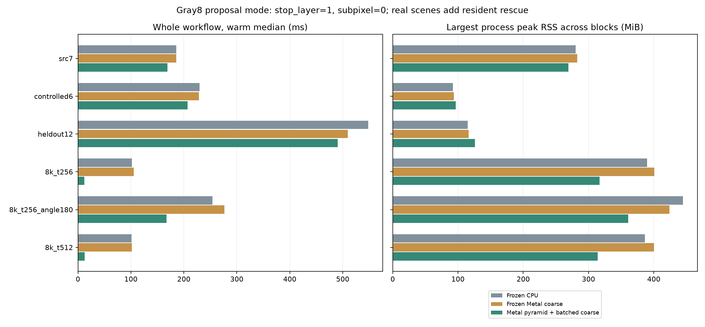
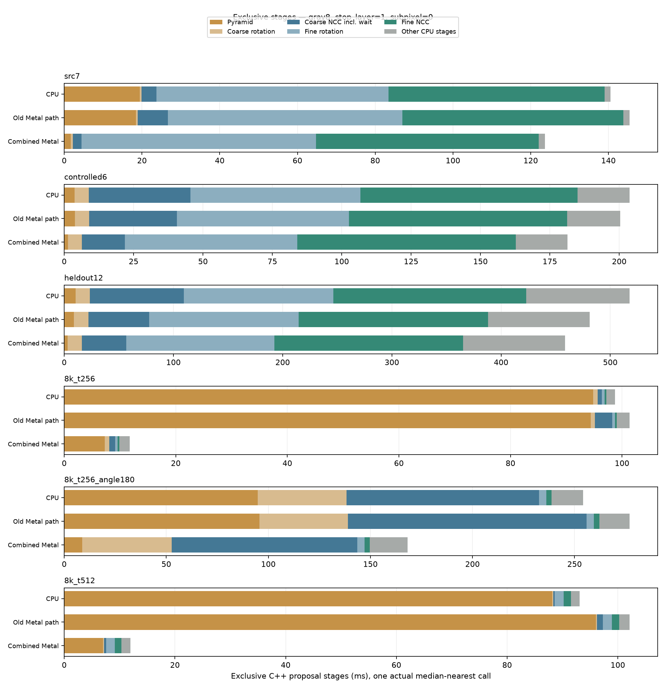

# 搜尋流程分段量測與 Metal 平行化

後續實作與測試見 [跨尺度共用金字塔與 Metal 批次細搜尋](SHARED_FRAME_AND_FINE_METAL_zh-TW.md)；下文保留此輪原始結果。

基準版本 `91842dd`，Apple M4 Pro／48 GiB／macOS 26.6.2。此次先量來源複製、金字塔、粗層旋轉、粗 NCC、峰值選取、細層旋轉、細 NCC、控制與次像素、NMS，再選擇實作。預先約定的驗證方式見 [protocol.json](pipeline-stages/protocol.json)，凍結的舊 binary 雜湊見 [baseline-provenance.json](pipeline-stages/baseline-provenance.json)。正式比較採 6 個場景、10 種執行／計時設定、正反順序各一個獨立程序區塊，每區塊暖機至少 1 秒並量測 5 次。

## 先量測，再選擇搬移部分

只加分段計時、尚未搬移金字塔或合併角度時的初步結果如下。每個場景暖機至少 0.5 秒、3 次量測，表列總時間中位數所對應的同一回合，時間單位 ms，涵蓋整圖產生候選的 C++ 核心，沿用既有提案設定 `stop_layer=1、subpixel=0`（半解析度停止）；此表不含後續連續姿態救援，不能讀成全解析度加次像素模式的時間。所有保存量測的輸出與凍結 CPU 一致。原始資料與可重現探針見 [decision-probe.json](pipeline-stages/decision-probe.json)、[decision_probe.py](pipeline-stages/decision_probe.py)。此初步量測用於選擇實作，正式速度驗收另外執行。

| 既有 Metal 粗 NCC 路徑 | 金字塔 | 粗層旋轉 | 粗 NCC（含等待） | 細層旋轉 | 細 NCC | 核心總時間 |
|---|---:|---:|---:|---:|---:|---:|
| Src7 | 18.35 | 0.46 | 14.55 | 57.94 | 54.98 | 147.89 |
| 6 物件／3 尺度 | 3.63 | 4.44 | 47.93 | 58.83 | 76.63 | 208.46 |
| 12 物件／3 尺度 | 9.58 | 12.27 | 79.21 | 133.46 | 171.76 | 494.76 |
| 8192²／256² 模板 | 88.71 | 0.70 | 3.11 | 0.60 | 0.48 | 95.19 |

表格只選部分階段，因此列數字不會剛好加成總時間；完整資料還有來源複製、峰值／排序、控制與 NMS。瓶頸因場景而異：大圖金字塔占約 93%；Src7／6／12 的細層旋轉＋NCC 約占 76%／65%／62%。因此本輪選擇 GPU 整數金字塔處理大圖瓶頸，另以角度批次減少既有粗 NCC 等待；不能把這兩個改善宣稱成中型場景的細搜尋已全搬到 GPU。

細搜尋候選各自有逐層、角度收斂和停止狀態。單純把每一個小 ROI 改成 GPU 並立即等待，會增加同步次數；後續應研究跨候選的分批派工，讓同一層的大量 ROI 共同計算，再各自更新狀態。搬到 GPU 後能否保持原 double 旋轉的精度，則需另行驗證。

## 正式比較結果

**Metal 精確金字塔加粗角度批次，在本次六個場景的兩個順序區塊都通過整體速度門檻；輸出保持完全一致。** 下表為關閉分段時鐘的暖機後 10 次中位數（ms）。「舊 CPU／舊 Metal」指前段搜尋使用的 backend；「舊 Metal」為凍結的 `91842dd`，候選產生前段只有頂層 NCC 使用 Metal；「新組合」採直接金字塔、最多 4 角度一批。前三列包含相同的 Metal 常駐精修／救援，後三列是半解析度停止的整圖搜尋，不能跨列當成同工作量比較。

| 場景 | 舊 CPU | 舊 Metal | 新組合 | 相對舊 Metal 時間減少 |
|---|---:|---:|---:|---:|
| Src7 | 185.60 | 185.96 | 168.80 | 9.2% |
| 6 物件／3 尺度 | 229.42 | 228.34 | 207.33 | 9.2% |
| 12 物件／3 尺度 | 548.06 | 509.45 | 490.78 | 3.7% |
| 8192²／256²／0° | 101.69 | 105.28 | 12.32 | 88.3% |
| 8192²／256²／±180° | 254.07 | 276.41 | 167.42 | 39.4% |
| 8192²／512²／0° | 101.54 | 101.88 | 12.86 | 87.4% |

整體比較使用預先約定的「各區塊中位數不得慢超過 `max(10%, 2 ms)`」門檻，新組合相對舊 CPU、舊 Metal、當前單角度 Metal 均通過。金字塔分段在全部場景兩區塊都改善；批次粗 NCC 在 Src7、6／12 物件及 8K 全角度場景兩區塊都改善。0° 大圖只有一張粗分數圖，沒有角度批次可合併，不能把該 NCC 時間差歸因於批次。

**沒有刪掉失敗或慢樣本**：未啟用新組合的當前單角度 Metal 對照，在 Src7 第 2 區塊、8K／256 第 1 區塊相對凍結 Metal 超過門檻；8K 全角度的第 1 區塊相對凍結 CPU 也超標。新組合 Src7 有一筆 697.83 ms 的慢樣本，保留在原始紀錄；本輪通過的是中位數門檻，不是即時系統的最壞延遲保證。正反順序降低順序偏差，未控制背景程序／頻率，不能將所有波動直接歸因於程式修改。

計時開／關使用相同順序區塊的獨立程序，觀察到整體中位數差異介於 −14.25% 到 +14.12%；負值代表測試波動與工作環境影響，不能宣稱計時本身負成本。最終速度主張只採關閉分段時鐘的路徑；分段數據用於定位明顯瓶頸，不用來推論微小差異。



## 記憶體與金字塔實作取捨

下表程序 peak RSS 取兩個獨立程序中的較大者（MiB），包含 Python、影像與 driver。最後一欄是新組合各 handle 保留的粗搜尋／金字塔 Metal buffer 容量總和，**已與 RSS 重疊，不能相加**；前三列另有共同不變的連續姿態精修 buffers，完整值見 JSON。

| 場景 | 舊 CPU RSS | 舊 Metal RSS | 新組合 RSS | 新組合搜尋 Metal buffers |
|---|---:|---:|---:|---:|
| Src7 | 280.41 | 282.83 | 269.39 | 15.70 |
| 6 物件／3 尺度 | 92.09 | 93.80 | 96.78 | 5.14 |
| 12 物件／3 尺度 | 115.03 | 116.27 | 125.89 | 14.42 |
| 8192²／256²／0° | 389.64 | 400.81 | 317.03 | 88.33 |
| 8192²／256²／±180° | 444.67 | 423.84 | 360.81 | 103.01 |
| 8192²／512²／0° | 386.30 | 400.22 | 314.03 | 86.04 |

大圖不用 CPU 金字塔第一層約 128 MiB 的水平 int 暫存，因此即使增加 GPU 保留容量，實測 RSS 仍下降。6／12 物件則分別增加約 3／10 MiB RSS，並不是每個場景都省記憶體。

實作選擇前另用 Src7 與 8K／256、兩區塊各 3 次比較直接／可分離金字塔，參見 [tuning summary](pipeline-stages/pyramid-tuning-summary.json)。8K 的直接版整體 11.39 ms、可分離版 9.47 ms，原始 tuning 紀錄的金字塔分段六次中位數約 7.17／5.12 ms（連結摘要另列中位數附近的單次呼叫）；但金字塔保留容量從 85.25 增至 149.25 MiB，差 64 MiB。正式組合採直接版降低容量，可分離版仍可明確選用。這是各自新 handle 的比較；buffer 只增不縮，同一 handle 用過可分離版再切回直接或 CPU，暫存仍保留到 handle 銷毀，metrics 會如實記錄。RSS 不一定逐 byte 反映 Metal 容量，不以 RSS 的小幅波動宣稱可分離版省記憶體。

## 搬移後的階段與等待

以下比較當前 `metal_profile`（CPU 金字塔、單角度）與 `combined_profile`，不是沒有計時 hook 的凍結 binary。各方法取最接近候選流程中位數的**同一實際呼叫**，時間 ms；與上面關閉時鐘的整體中位數不同。金字塔、旋轉、NCC 等主流程區間互斥，GPU 子區間則重疊。

| 場景 | 金字塔：舊路徑 → 新組合 | 新粗旋轉 | 新粗 NCC | 新細旋轉 | 新細 NCC |
|---|---:|---:|---:|---:|---:|
| Src7 | 18.44 → 1.72 | 0.52 | 2.25 | 60.25 | 57.36 |
| 6 物件／3 尺度 | 3.87 → 1.30 | 5.07 | 15.54 | 62.11 | 78.71 |
| 12 物件／3 尺度 | 8.95 → 3.08 | 13.05 | 40.69 | 135.52 | 172.99 |
| 8192²／256²／0° | 94.40 → 7.26 | 0.78 | 1.07 | 0.45 | 0.29 |
| 8192²／256²／±180° | 95.66 → 8.77 | 43.80 | 90.91 | 3.58 | 2.58 |
| 8192²／512²／0° | 96.02 → 6.99 | 0.18 | 0.41 | 1.55 | 1.23 |

| 場景 | 粗 NCC 提交／等待次數：前 → 後 | 額外金字塔提交 | 粗 NCC 等待 ms：前 → 後 |
|---|---:|---:|---:|
| Src7 | 40 → 10 | 1 | 7.23 → 1.85 |
| 6 物件／3 尺度 | 140 → 36 | 3 | 25.75 → 10.58 |
| 12 物件／3 尺度 | 140 → 36 | 3 | 41.41 → 27.84 |
| 8192²／256²／0° | 1 → 1 | 1 | 2.66 → 0.63 |
| 8192²／256²／±180° | 52 → 21 | 1 | 77.67 → 53.94 |
| 8192²／512²／0° | 1 → 1 | 1 | 0.97 → 0.29 |

三尺度各自有尾批，所以 140 張圖是 36 次提交，並非直接除以 4 的 35 次；8K 全角度部分分數圖受 16 MiB 統計上限拆批，因此 52 張圖是 21 次提交。等待減少是真實的提交數變化，沒有把它當成同倍率的整體加速。

在新 8K／256 的代表呼叫，金字塔寫入 shared buffer 約 1.53 ms、結果複製回來 0.45 ms、GPU command interval 5.09 ms、同步等待 5.26 ms；等待已包含 GPU 工作，不能相加成 12 ms。粗 NCC 寫入只有 0.005 ms。Apple 統一記憶體上的這些是 CPU memcpy，不是 PCIe 傳輸；舊版主要成本是 CPU 金字塔計算，本輪大幅加速後才讓複製占比更明顯。下一步可以減少 level 0 重複複製、共用同幀多尺度金字塔，或將消費金字塔的細搜尋也留在 GPU。

新 Src7、6／12 物件中，細旋轉加細 NCC 約占核心的 95%／78%／67%；12 物件另有約 89 ms 的峰值／排序工作。8K 全角度則變成粗 NCC 約 91 ms、粗旋轉約 44 ms，其中 NCC 的 CPU double 正規化約 35 ms。應依場景分別優化：中型多候選先做細搜尋共同派工；大圖多角度先看旋轉、NCC／正規化融合與 GPU 取峰。搬移任何 double 計算都須保留獨立精度驗證。



## 「預編譯／預先計算」能省下什麼

| 項目 | 能否事先完成 | 目前狀態與限制 |
|---|---|---|
| 模板金字塔、各層平均值與 norm | 可以，模板不變就重用 | `Pattern` 建立時已計算並保存；不是每張來源圖重建模板 |
| 每個尺度的模板 | 可以建立尺度模型組 | 實驗流程已保留多個 pattern handle；模板內容或尺度集合改變才需更新 |
| Metal shader／compute pipeline | 可以預編譯或在初始化後保留 | 現有 handle 初始化時編譯，暖機匹配重用；預編譯主要改善冷啟動，不會消除逐張圖像運算 |
| 尺寸、角度、派工配置、buffer 容量 | 可以在輸入規格固定時預備 | 本輪已重用 buffer 容量；尚未專門快取尺寸／角度派工計畫。規格改變時需重新檢查；buffer 重用會增加保留記憶體 |
| 來源圖金字塔像素 | 新圖片仍需計算 | 同一張圖被多尺度／多模板使用時可共用，但本輪每個 handle 仍各自建圖，尚未實作跨模型共用；跨幀只因尺寸相同就重用像素會產生錯誤 |
| 旋轉後像素 | 來源與角度都固定時可重用 | 每幀全角度快取可能佔用大量記憶體；只有固定座標表可跨影像使用，仍需插值讀取新像素 |

因此，預編譯與 GPU 平行化解決不同成本。完整可閱讀 C++／Metal 源碼仍保留，不能以預編譯 binary 取代算法來源。

## 精度與時間的解讀

來源金字塔使用整數 `[1,4,6,4,1]` 濾波、REFLECT_101 邊界、兩軸計算完只捨入一次。這個定義可以在 GPU 保持逐像素一致。旋轉的既有定義則使用 double 座標與雙線性插值，再捨入成 gray8；若直接改成 float，臨界像素可能不同，進而改變 NCC 與峰值，不能用「視覺上相似」代替精度驗證。

分段主流程時間使用互斥區間，可相加；GPU device、wait、copy 等為其中的子區間，不可再加進總和。程序 peak RSS 包含影像、語言執行環境與 driver；Apple shared buffers 與 RSS 重疊，也不可相加。profiling 開啟本身的成本另以開／關量測。

## 實作內容與範圍

- **精確整數金字塔**：每層輸出尺寸為向上取整的一半；5 × 5 權重總和為 256，8-bit 輸入的最大累加值為 65,280，最後 `(sum + 128) >> 8`。直接版在一個 kernel 完成兩軸；可分離版先保存未捨入的 uint16 水平和，再做垂直加權，兩者都與原 CPU 逐像素一致。一次送出所有層，只等一次；為保持現有細搜尋，完成後仍把各層複製回 CPU Image。
- **粗角度批次**：CPU 照原 double 規則旋轉，最多 4 張一起交給 Metal 算整數 NCC 統計；CPU 依原角度順序做 double 正規化、取峰與穩定排序。批次來源 arena 上限 64 MiB、統計 workspace 上限 16 MiB；超過則拆批，單張超限時使用既有 Metal 分塊路徑。這些上限不是整個程序的記憶體上限。
- **可關閉的階段分析**：新 `fpm_coarse_match_profile` 回傳互斥區間及工作量；原 match 呼叫不讀這些分段時鐘。profile／execution 各有帶 version 與 size 的獨立結構，原本 160-byte metrics 保持 ABI。
- **保持預設**：實驗 handle 預設仍是 CPU 金字塔、每次一個粗角度；新路徑明確選用。GUI、原 CPU API、連續精修與錯峰救援策略沒有因這次速度實驗改變。

新增設定 `pyramid_mode=0/1/2` 分別是 CPU／Metal 直接／Metal 可分離，`batch_angles=1..4`。完整來源見 [C API](../experiments/coarse_ncc.h)、[C++ 流程](../src/matcher.cpp)、[Metal 配置與派工](../experiments/coarse_metal.mm)、[可閱讀的 kernels](../experiments/coarse_ncc.metal)、[Python 呼叫包裝](../tools/coarse_experiment.py)。GPU 不可用或執行失敗會明確報錯，不會偷偷改走 CPU 後仍記成 GPU 成績。

目前 queue、compute pipeline 與 buffer 容量在 handle 內保留；一般 command buffer 每次重新編碼，不能把已提交的 command buffer 再提交。這也符合 [Apple 的命令結構說明](https://developer.apple.com/documentation/metal/setting-up-a-command-structure)。預先編譯 metallib／binary archive 可另減初始化成本，本輪沒有宣稱已產生離線 metallib。

下一階段要減少等待，可把細搜尋改為跨候選、同層共同派工，並讓影像與中間分數保留在 GPU；連續幀則可用多份輸入／輸出 buffer 重疊 CPU 準備與 GPU 執行。後者改善吞吐量，不保證降低單張延遲，且需要更高記憶體與明確生命週期管理，參見 [Apple 的 CPU／GPU 同步說明](https://developer.apple.com/documentation/metal/synchronizing-cpu-and-gpu-work)。本輪只合併粗 NCC 提交與金字塔層，沒有把單張 API 改成非同步。

## 實驗解讀與限制

正式實驗三個實圖／合成多物件場景包含原有 Metal 常駐連續精修與 CPU 驗分／有預算救援；新舊方法只更換前段搜尋，其餘一致。三個 8192² 場景量測整圖 C++ 搜尋，不配置整張圖的 float 姿態精修器。兩組都沿用 `stop_layer=1、subpixel=0` 的候選產生設定；6／12 物件的後段連續精修會再調整位置、角度與尺度。不能把 8K 數字當成全解析度、RGB 或既有 subpixel 開啟的模式。

`8k_t256_angle180` 是六個正向模板、搜尋 ±180° 的大量角度負載；真正非零旋轉／尺度的精度由 6／12 物件場景驗證。Src7 沒有獨立校準真值，只能主張新舊輸出一致。所有第一輪、暖機與正式呼叫比較完整輸出或其 SHA；有真值的第一輪與正式結果另外驗證零誤檢、零漏檢及位置 ≤2 px、角度 ≤1°、尺度相對誤差 ≤2%。

這輪是固定測試分布的效能與不退步驗證；沒有改善 NCC 對高分週期紋理的錯峰，沒有任意圖片全域最佳解保證。錯峰方法的既有通過案例及尚未解決案例仍見 [上一份報告](NCC_RESCUE_AND_METAL_COARSE_zh-TW.md)。

## 驗證與重現

三個 agent 分別負責核心計時／API／測試、Metal kernels／資源管理、序列 benchmark／摘要驗證，主執行緒負責凍結基準、正式量測、整合與報告。效能 worker 序列執行；沒有讓 agent 同時跑 CPU／GPU benchmark。

- Release：14／14 通過（含 GUI／OpenCV 對照與新 profile／execution 測試）。
- ASan／UBSan：12／12 通過（scalar、GUI／OpenCV 關閉）。
- Metal API validation：額外 `--stress` 通過，覆蓋 4097² 批次來源拆分、8193² 單張來源超過 arena 上限後的既有 Metal 路徑。
- Python 資料驗收與封存重讀：10／10 通過。
- 正式比較：120 個獨立 worker、120 次第一輪、600 次正式結果及 1,631 次暖機摘要，所有新舊輸出一致。五個有真值場景全部通過；6／12 物件的最大位置誤差分別約 0.023／0.090 px，最大角度誤差約 0.027／0.050°，最大相對尺度誤差約 0.191%／0.250%。8K 六個物件誤差為 0；這些數字是新舊相同，不是本輪提高了精度。

新增 [profile 測試](../tests/coarse_profile_test.cpp) 與 [execution 測試](../tests/coarse_execution_test.cpp) 除了效能流程所用模式，也驗證完整解析度／subpixel、反相、stride、奇數尺寸、單像素邊界、32／64-bit 統計、定值模板、批次尾數及同地址影像內容變更後不讀到舊資料。來源、library 與輸入 SHA 在正式量測前後相同，並於封存前再驗證。量測後只有 C header 的兩段說明註解澄清；驗證記錄與封存中保留量測當時的 source snapshot，不把它冒充成重新編譯測量。

首次呼叫與建構成本也保留，沒有混進暖機中位數：例如新 8K／256 第一次匹配為 32.22–38.00 ms，建構（含圖片解碼）為 208.71–211.37 ms；`algorithm_setup_ms` 另外排除解碼。系統 shader cache 未清除，不能主張這是完全冷機編譯測試。

[正式摘要](pipeline-stages/formal-summary.json)、[驗證清單](pipeline-stages/validation.json)、[約 3 MB 的原始紀錄封存](pipeline-stages/raw-results.tar.gz)、[封存 SHA-256](pipeline-stages/archive-sha256.json) 均保留。封存含正式／tuning 報告、每個 job 的輸入設定、完整結果、warmup digest、stderr、建置／測試日誌及量測時源碼；不含 binary 與可由固定 seed 重建的大圖。worker 結果各有 SHA 驗證，摘要可在不同目錄重建。

在此工作區重跑正式比較：

```sh
cmake --build build/fourier-gpu --parallel 8
ctest --test-dir build/fourier-gpu --output-on-failure
python-port/venv/bin/python cpp-core/tools/benchmark_pipeline_stages.py \
  --baseline build/pipeline-baseline --build build/fourier-gpu \
  --methods frozen_cpu,frozen_metal,cpu,cpu_profile,metal,metal_profile,batched_profile,pyramid_direct_profile,combined,combined_profile \
  --suite all --blocks 2 --repeats 5 --warmup-seconds 1 \
  --combined-pyramid direct --output build/pipeline-stages/rerun.json
python-port/venv/bin/python cpp-core/tools/summarize_pipeline_stages.py \
  build/pipeline-stages/rerun.json --output build/pipeline-stages/rerun-summary.json
```

`build/pipeline-baseline` 是編譯新版本前保留的 `91842dd` binary，不能用新 build 覆寫。其他機器需以該 commit 建置基準的 core／coarse／pose 三個 library，產生對應 `baseline-provenance.json`（同一 commit、三個相對路徑及各自 SHA）；其平台與編譯差異應另記錄，不能沿用本機數字。

只讀原始紀錄、重建摘要，不執行任何匹配：

```sh
mkdir -p build/pipeline-stages-replay
tar -xzf cpp-core/docs/pipeline-stages/raw-results.tar.gz -C build/pipeline-stages-replay
python-port/venv/bin/python cpp-core/tools/summarize_pipeline_stages.py \
  build/pipeline-stages-replay/formal.json \
  --worker-root build/pipeline-stages-replay \
  --output build/pipeline-stages-replay/formal-summary.json
cmp cpp-core/docs/pipeline-stages/formal-summary.json build/pipeline-stages-replay/formal-summary.json
python-port/venv/bin/python -m unittest discover -s cpp-core/tests -p test_pipeline_stages.py -v
```

`--worker-root` 強制只讀封存內的 worker，即使原始絕對路徑仍存在也不會回讀；SHA 不符會停止。圖表由 [plot_pipeline_stages.py](../tools/plot_pipeline_stages.py) 讀摘要產生，僅需 matplotlib，不會再次執行演算法。
