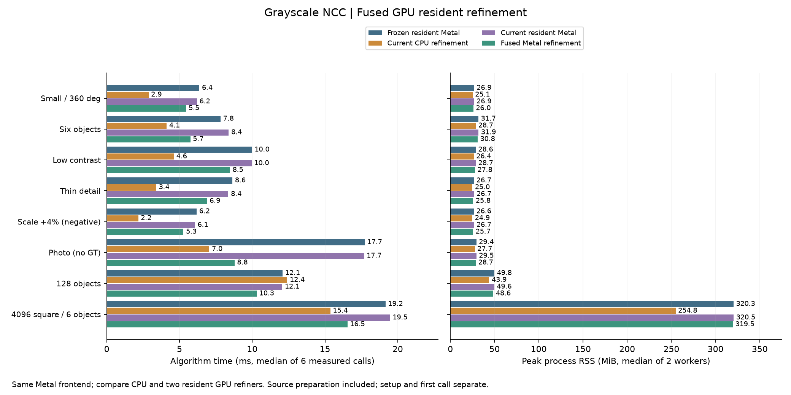

# 灰階 Metal 精修融合：單候選工作群組

日期：2026-10-15，第22輪。承接[提交合併實驗](SPARSE_METAL_MERGE_zh-TW.md)，搜尋前段維持分開提交 `metalSubmissionMode=0`；本輪只改最後 NCC 連續姿態精修。完整 C++、Metal、測試與研究工具原始碼保留。

## 結論與建議

**融合版對原Metal精修有效，但沒有全面勝過CPU精修。** 主實驗八個場景、每個正反block的完整時間均比同建置原resident快；六次中位數改善約12%～50%。所有提案及最終融合輸出在本輪實際逐值相同；正常144個不同GT姿態零FP／FN，既有尺度負控制失敗不變。

固定尺度128物件可選Metal前段＋融合精修：主量測CPU／原resident／融合為12.41／12.07／10.31ms，複查11.43／11.65／10.66ms；兩輪各兩block皆有收益。相對CPU的完整流程收益約7%～17%，峰值RSS多約4.7MiB。這不是通用的候選數分流門檻。

小圖、六物件、低對比、細線、Src4及4096²六物件仍優先用CPU精修。4096²CPU／融合為15.37／16.55ms，峰值RSS254.80／319.51MiB；融合相對CPU的記憶體門檻失敗，複查也相同。大圖只有23候選，不能以影像大就強制GPU精修。已有GPU精修需求且符合灰階模板限制時，可手動選融合mode1；API預設與GUI不改。

## 正式時間與記憶體

下表為每路六次正式呼叫中位數，單位ms；四路都使用相同分開提交的Metal搜尋前段。

| 場景 | 凍結原Metal精修 | 同建置CPU精修 | 同建置原Metal精修 | 融合Metal精修 |
|---|---:|---:|---:|---:|
| 小圖、全角度 | 6.37 | 2.87 | 6.20 | 5.46 |
| 六物件 | 7.82 | 4.12 | 8.38 | 5.75 |
| 低對比、兩物件 | 9.99 | 4.61 | 9.96 | 8.48 |
| 細線 | 8.64 | 3.40 | 8.36 | 6.90 |
| 尺度+4%負控制 | 6.18 | 2.17 | 6.07 | 5.27 |
| Src4實圖、無GT | 17.73 | 7.05 | 17.69 | 8.78 |
| 128物件 | 12.09 | 12.41 | 12.07 | 10.31 |
| 4096²、六物件 | 19.16 | 15.37 | 19.48 | 16.55 |

峰值RSS是兩個新程序各自峰值的中位數，單位MiB：

| 場景 | CPU精修 | 原Metal精修 | 融合Metal精修 |
|---|---:|---:|---:|
| 小圖、全角度 | 25.12 | 26.85 | 26.00 |
| 六物件 | 28.74 | 31.88 | 30.84 |
| 低對比、兩物件 | 26.40 | 28.70 | 27.82 |
| 細線 | 24.97 | 26.74 | 25.81 |
| 尺度+4%負控制 | 24.89 | 26.70 | 25.74 |
| Src4實圖、無GT | 27.67 | 29.45 | 28.73 |
| 128物件 | 43.95 | 49.63 | 48.64 |
| 4096²、六物件 | 254.80 | 320.52 | 319.51 |



融合相對原resident的速度與記憶體容忍全部通過。相對CPU則小圖、低對比、細線、尺度負控制各兩block速度失敗；4096²兩block記憶體失敗。容忍門檻為速度最多增加`max(10%,2ms)`、記憶體最多增加`max(10%,32MiB)`；六物件與Src4雖通過速度容忍，實際仍比CPU慢。全部失敗配對保存於[檢查細節](pose-fused/validation-details.json)，不把正確性全通過誤寫為性能全通過。

### 128物件與大圖獨立複查

看到候選數相關收益後，以相同來源、binary與設定追加16個新程序、48次量測，兩block正反順序、每程序至少1秒暖機。這是事後複查，**不併入或取代主結果**。

| 場景 | CPU ms | 原resident ms | 融合 ms | 融合／CPU逐block比 | 融合／原resident逐block比 |
|---|---:|---:|---:|---|---|
| 128物件 | 11.43 | 11.65 | 10.66 | 0.9567／0.8940 | 0.8866／0.9460 |
| 4096²六物件 | 15.35 | 18.91 | 16.46 | 1.0689／1.0912 | 0.8511／0.8951 |

複查RSS：128 CPU43.95／原resident49.60／融合48.65MiB；4096² CPU254.85／原resident320.38／融合319.52MiB。正確性、路徑及原版回歸全部通過；4096²相對CPU記憶體兩block仍失敗。[獨立複查摘要](pose-fused/recheck-results.json)及完整資料保留。

### 收益發生在哪裡

128場景有256候選，原resident／融合的精修階段9.942→8.160ms、GPU區間8.492→6.962ms、CPU編碼0.230→0.002ms、CPU驗分約1.014→1.013ms；dispatch1023→1，但提交／等待仍1→1。小圖5候選也是1023→1，GPU區間卻只從3.610→3.284ms，遠未追上CPU。**少kernel邊界有幫助，但不是把派工數減少千倍就會快千倍。**

Src4有256候選、較小17×33模板，GPU區間13.542→5.411ms，整體17.692→8.781ms，顯示小模板的kernel邊界與中間統計成本值得處理；它仍無GT，24個結果相同不代表正確率100%。4096²精修7.796→5.071ms、dispatch1298→2，來源搜尋時間仍存在。

128融合對CPU的精修階段主量測8.743→8.160ms，複查8.715→8.621ms；完整時間收益較大，包含相同前段在不同執行順序／系統狀態下的時間變異。因此不能把完整流程差額全歸因精修算術，也不把主量測17%當成固定加速比。

融合workspace：128為207616→53504bytes，4096²為39680→10240bytes；這是中間統計節省，不含來源與模板。Metal精修仍常駐一份float32來源，4096²約64MiB，尚未與稀疏前段8-bit方向表示共用；RSS差距與此配置相容，但本輪未逐配置追蹤RSS。暖機GPU等待已包含GPU計算，沒有證據支持「主要慢在每次大量CPU↔GPU傳輸」。

下一個可獨立驗證的方向是少候選的群組配置／導數暫存與lane利用率，以及跨後端來源資源共用；目前只是由實作和分段時間提出的候選方向，還沒有硬體counter證明哪一個是剩餘主瓶頸。

## 實作與適用範圍

新增可選 `residentMode=1`。每個候選由一個 256 執行緒的 GPU 工作群組完成初始 NCC、導數統計、阻尼 Gauss–Newton 求解、最多10次試步、接受與停止；不同候選不互相等待。CPU仍做候選整理、救援排程、最後精確驗分與 NMS，並非整條流程全GPU化。

沿用原版1024像素分塊。NCC用256 lanes、每lane最多4像素；導數用前128 lanes、每lane最多8像素，其餘lane仍參與所有群組同步。維持相同tile內加總樹及跨tile合併順序。暫存宣告為9216-byte統計陣列、144-byte總統計、208-byte求解狀態及4-byte試步分數，合計約9.35KiB、對齊後仍不到10KiB；評分與導數重用同一暫存。

原版將各tile統計寫入全域buffer，再用後續kernel合併、求解。融合版將這些中間值保留在群組內，最後只寫回每候選208-byte狀態。這是明確控制工作群組共享記憶體的分塊方式；本輪沒有量硬體L1／L2命中率、occupancy或頻寬counter，不能由程式結構推定特定cache命中率或已達極限。

原版30次迭代預先編碼 `3+34×30=1023` 次dispatch，已停止候選由GPU條件化處理；融合版每批一個dispatch，GPU迴圈按候選停止。**兩者本來都能在GPU求解與停止，這輪主要減少kernel邊界與中間統計的全域讀寫。** 原版每批也只提交並等待一次，因此不能把dispatch減少直接等同CPU等待減少。

只接受灰階、模板面積≤16,384像素，每批≤512候選，保留原迭代與救援預算。超範圍、RGB或CPU handle選mode1明確回報錯誤，不暗中切回其他路徑。mode0保留原 Metal resident，預設不變。模式切換不提前初始化lazy Metal資源，最後diagnostics包含baseline與全部救援批次，記憶體容量取最大值。

```cpp
fpm::research::Settings settings;
settings.backend = 1;
settings.scales = {1.};
settings.sparseOrientation = true;
settings.sparse.responseMode = 1;
settings.sparse.searchBackend = 1;
settings.sparse.metalSubmissionMode = 0;
settings.residentMode = 1;
```

獨立 C API使用 `fpm_pose_set_resident_mode(handle,1,error,capacity)`，接著呼叫原 `fpm_pose_refine_resident` 或 GPU `fpm_pose_refine_rescue`。原ABI結構大小不變；新增 `fpm_pose_last_resident_metrics` 讀取最近resident／rescue呼叫的聚合指標。一般CPU精修與score API不因選擇此模式而改動。原生runner使用 `pose_resident_mode`，`refinement_mode`表示所選模式，派工數為0代表該次沒有GPU精修。

來源：[kernel](../experiments/pose_fused.metal)、[Metal排程](../experiments/pose_metal.mm)、[C API](../experiments/pose_ncc.h)、[原生Session](../experiments/research_pipeline.cpp)。GUI尚未新增融合模式選項，RGB全圖亦未在本輪實作。

## 比較設計

Apple M4 Pro、12 CPU／16 GPU cores、48GiB、macOS26.6.2、AppleClang21、Release；CPU精修使用8執行緒。四路使用相同Metal稀疏前段、查表、compact回應、候選與救援設定：凍結`60a8936`的原Metal精修、同建置CPU精修、同建置原Metal精修、同建置融合Metal精修。

八個沿用場景，兩block正反執行順序，每個新程序至少1秒暖機後3次正式量測；64個新程序、192次正式呼叫。另保留32程序試跑。完整時間包含每次來源建圖、搜尋、精修、CPU驗分、救援與NMS；影像解碼、建模與首次呼叫另記。GPU時間包含在等待中，不得再相加；GPU buffer容量與RSS重疊，亦不能相加。

凍結版與同建置原resident的最終結果必須逐值相同。四路提案順序與整數搜尋工作量必須完全一致；融合版與凍結版以完整一對一配對檢查位置≤0.25px、角度≤0.25°、相對尺度≤0.002、分數差≤1e-4，另外檢查獨立GT。CPU跨求解器差異另列，不能替代融合回歸檢查。正常GT門檻仍是2px／1°／2%尺度；尺度+4%負控制及無標註實圖均保留，沒有將原本失敗移出比較。

## 驗證與限制

Release完整34/34通過，相關ASan／UBSan 6/6通過（`detect_leaks=0`，不宣稱LeakSanitizer）；Metal API／Shader Validation下59次GPU呼叫通過。涵蓋獨立連續紋理與二遍float64 NCC oracle、CPU驗分、旋轉／尺度GT、鎖定參數、低對比與零對比、影像外、35998°角度、sub-ULP向內邊界、奇數模板與16384面積上限、模式切換、錯誤後恢復、513候選跨批次及有預算救援。

新增比較工具30項控制測試通過，包含忽略模式、缺失指標、CPU回退、不同候選／工作量／派工、共同GT錯誤、重複或缺失結果、超差分數與幾何、一對一配對、缺worker及檔案竄改。無GPU時間戳以-1明示不可用，不誤判為回退；mode、buffer與派工仍獨立檢查。

最初新增的Session測試誤認0.75倍縮小隨機紋理在最後0.9 NCC門檻也會保留；檢查後原resident與融合版都只保留原尺度那一個，兩者仍提出兩候選。修正的是測試預期，保留原失敗與診斷log；沒有為了通過而更改演算法或降低精度門檻。連續尺度GT由另外的解析影像測試覆蓋。

三個agent分別撰寫kernel、獨立測試、比較工具；另有host/API只讀審查，發現無候選時模式回報不明確，已修正並測試。後段協作工具中斷後，主agent接手工具收尾、整合、來源審查及全部串行量測。沒有把未完成的agent測試或審查當作已通過。

本輪資料主要是同模板、固定尺度、物件分離的沿用測資；不是新的盲測、不同模板庫、遮擋或新影格串流證據。513候選是分批邊界測試，不能稱為513實物偵測。沒有新增30分鐘穩定性測試、手動GUI操作、CUDA或跨硬體性能。

## 原始資料與重播

[protocol](pose-fused/protocol.json)、[結果](pose-fused/results.json)、[驗證](pose-fused/validation.json)、[完整來源及原始資料](pose-fused/raw-results.tar.gz)、[封存SHA](pose-fused/artifact-sha256.json)。比較工具：[benchmark](../tools/benchmark_pose_fused_pipeline.py)、[封存／繪圖](../tools/report_pose_fused_pipeline.py)、[C++測試](../tests/pose_fused_test.cpp)、[工具控制](../tests/test_pose_fused_harness.py)。

封存包含凍結版Git來源、新版完整來源快照、輸入、首次／逐次結果、protocol、試跑、建置與驗證log；binary保留SHA，不封存可執行檔。NumPy／OpenCV環境下可在別的目錄離線重算，不需GPU：

```sh
python3 EXTRACT/formal/source-snapshot/cpp-core/tools/benchmark_pose_fused_pipeline.py --summarize EXTRACT/formal/results.json --output /tmp/fused-replayed.json
```

重新實測需重建兩版binary並建立新protocol，不能繞過既有來源／binary／輸入SHA檢查。

本輪封存993個內容檔、34,485,398bytes，全部member SHA通過。主實驗與獨立複查搬到其他目錄重算，摘要皆逐byte相同；複查入口改為`EXTRACT/formal/recheck/results.json`即可。主／複查量測期間的來源、binary、輸入及快照SHA均未變。

封存完成後，只修正Session測試註解的插值名稱（nearest→bilinear），不改執行程式或斷言；精確diff及前後SHA記於[註解更正](pose-fused/post-study-comment.json)。封存保留當時受測來源，沒有改寫舊protocol或重跑挑選數據。
