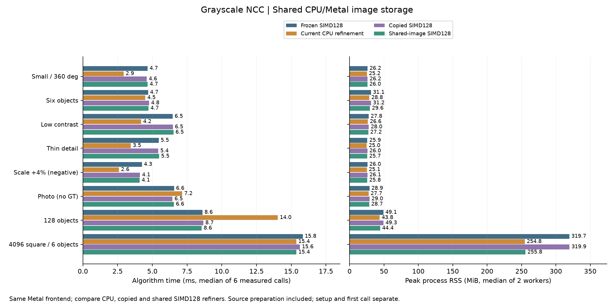

# CPU／Metal 精修共用影像：4K與8K記憶體比較

日期：2026-10-15，第24輪。承接[SIMD128精修](POSE_SIMD_zh-TW.md)，只改影像儲存與初始化計時，所有pose Metal kernel來源hash不變。新增手動選項`poseStorageMode=1`，完整C++、Metal主機層、測試與原始資料保留。

## 結論與建議

**共用儲存有效降低大圖記憶體，沒有降低本輪精度，也沒有穩定的暖機速度收益。** 原本CPU驗分與GPU精修各持有一份相同的中心化float32來源；新版讓兩者使用同一份由核心持有的頁面。4K主量測RSS少64.05MiB、複查少64.04MiB；8K少256.03MiB，接近少一份float32來源的容量。

| 場景／同輪比較 | 複製模式 ms | 共用模式 ms | 複製RSS MiB | 共用RSS MiB | CPU精修 ms／MiB |
|---|---:|---:|---:|---:|---:|
| 128物件、主量測 | 8.67 | 8.55 | 49.34 | 44.41 | 14.04／43.80 |
| 4K六物件、主量測 | 15.63 | 15.37 | 319.85 | 255.80 | 15.37／254.84 |
| 128物件、獨立複查 | 8.56 | 8.46 | 48.83 | 44.52 | 11.92／44.05 |
| 4K六物件、獨立複查 | 15.68 | 15.74 | 319.83 | 255.79 | 15.11／254.83 |
| 8K二十四物件、擴充測試 | 49.82 | 49.78 | 1202.60 | 946.57 | 53.10／945.62 |

時間為六次正式呼叫中位數，RSS為兩個新程序各自峰值中位數。共用相對同建置複製模式的所有block速度／記憶體容忍通過；有快有慢，不應稱作普遍加速。八場景主結果與三場景複查／擴充的GPU最終姿態、分數、有序候選皆逐值相同。

本機大量候選可選`backend=1, residentMode=2, poseStorageMode=1`。128精修階段CPU／共用為8.81／6.64ms、複查8.83／6.42ms；完整時間還包含前段時間差，不能全歸因求解。小圖與4K少候選仍優先CPU精修；已需要Metal精修時，共用模式能去掉多一份來源的成本。4K主量測CPU與共用總時間接近，複查CPU稍快，精修階段兩次均CPU較快。8K24物件支持這組合可用，不構成通用圖片大小／候選數分流門檻。原複製模式及GUI預設保留。

## 主量測八場景

四路使用相同compact稀疏Metal前段、分開提交、候選、旋轉範圍、固定尺度、救援及CPU驗分。凍結版為`06eecd6`的SIMD128；同建置複製版檢查變更是否引入回歸。單位ms：

| 場景 | 凍結SIMD128 | 同建置CPU精修 | 同建置複製SIMD128 | 共用SIMD128 |
|---|---:|---:|---:|---:|
| 小圖、全角度 | 4.66 | 2.94 | 4.60 | 4.67 |
| 六物件 | 4.69 | 4.50 | 4.77 | 4.72 |
| 低對比、兩物件 | 6.47 | 4.19 | 6.48 | 6.53 |
| 細線 | 5.46 | 3.45 | 5.43 | 5.49 |
| 尺度+4%負控制 | 4.25 | 2.60 | 4.12 | 4.09 |
| Src4實圖、無GT | 6.57 | 7.15 | 6.45 | 6.55 |
| 128物件 | 8.61 | 14.04 | 8.67 | 8.55 |
| 4096²、六物件 | 15.83 | 15.37 | 15.63 | 15.37 |

峰值RSS，單位MiB：

| 場景 | CPU精修 | 複製SIMD128 | 共用SIMD128 |
|---|---:|---:|---:|
| 小圖、全角度 | 25.22 | 26.21 | 25.99 |
| 六物件 | 28.84 | 31.16 | 29.61 |
| 低對比、兩物件 | 26.62 | 27.97 | 27.21 |
| 細線 | 24.97 | 26.02 | 25.74 |
| 尺度+4%負控制 | 25.06 | 26.09 | 25.75 |
| Src4實圖、無GT | 27.72 | 29.03 | 28.66 |
| 128物件 | 43.80 | 49.34 | 44.41 |
| 4096²、六物件 | 254.84 | 319.85 | 255.80 |



主量測正常144個GT姿態皆零FP／FN。共用相對CPU仍有3個速度配對失敗：低對比兩block、細線block0；所有記憶體容忍通過。前輪4K相對CPU約65MiB的額外RSS已降到本輪約0.95MiB；CPU/GPU的其他資源仍有差異，不代表整個程序配置完全相同。容忍門檻仍為速度增加不超過`max(10%,2ms)`、RSS增加不超過`max(10%,32MiB)`。完整[失敗與檢查細節](pose-shared/validation-details.json)保留。

凍結與同建置複製版最終數值相同，時間仍可受執行狀態影響；共用效果應看同建置複製／共用，不能拿跨建置差額全算作共用加速。最後診斷修正前的完整研究亦封存：當時4K複製／共用15.88／16.41ms，本次15.63／15.37ms；記憶體皆少約64MiB，而微小速度差沒有一致方向。本表只用最終版本重測，不挑各次較快值。

## 128／4K複查與8K擴充

另24個新程序、72次正式量測，兩block正反順序，每程序至少1秒暖機。128與4K重用主測資；8K由原4K場景做2×2逐像素拼接，GT座標／角點／生成區域只加整數平移，保留拼接邊界參與搜尋。共有24個同模板實例，**不是24個不同模板，也不是新的獨立實拍／盲測準確度證據**。GT不傳給worker。

| 場景 | 共用／複製逐block時間比 | 各block RSS差 MiB | 最終GT |
|---|---|---|---|
| 128物件 | 0.9984／0.9744 | -4.53／-4.09 | 128/128，零FP／FN |
| 4K六物件 | 1.0063／1.0016 | -64.02／-64.06 | 6/6，零FP／FN |
| 8K二十四物件 | 0.9988／0.9998 | -256.12／-255.94 | 24/24，零FP／FN |

這組對照所有性能容忍皆通過，但4K兩block共用略慢，8K兩block僅微幅變快，不能稱為明顯加速。8K GPU最終結果逐值相同、GT最大位置誤差約0.06706px、角度約0.07686°，尺度鎖1。CPU亦通過相同GT與跨求解器配對。複查結果與主結果分開保存，不合併選較快數字。

## 資料持有方式與精確性

舊流程：呼叫端float影像 → 核心vector副本並中心化 → 複製到Metal shared buffer。即使buffer標為shared，原先CPU仍讀自己的vector，因此有兩份內容相同的影像。

新流程：呼叫端float影像 → 核心擁有的VM頁面並中心化 → CPU與Metal讀相同頁面。`mmap`配置單一連續VM區域，起點及長度按執行時系統頁面對齊；Metal以`newBufferWithBytesNoCopy`包裝，並檢查`buffer.contents`等於CPU資料指標。頁面由`shared_ptr`持有，Metal的deallocator block也保留同一owner；CPU資料與Metal資源都釋放後才`munmap`。這符合Apple對[no-copy buffer的對齊、VM區域與生命週期要求](https://developer.apple.com/documentation/metal/mtldevice/makebuffer%28bytesnocopy%3Alength%3Aoptions%3Adeallocator%3A%29?language=objc)。

兩模式都先複製呼叫端輸入，呼叫端可在建立後釋放或改寫原圖；不借用外部指標。中心化均值、template能量、NCC、求解、CPU驗分、救援預算均不改。初始化完成後頁面內容不再修改；所有GPU呼叫維持既有同步完成契約，handle仍不保證跨執行緒同時操作安全。

`poseStorageMode=1`使用前檢查裝置為unified-memory Metal；無法包裝、記憶體不足或不支援直接報錯，不暗中配置雙副本。C API auto handle仍延遲建立Metal：只先配置CPU可讀頁面，未使用GPU時`gpu_image_bytes`／`shared_image_bytes`為0；原auto遇到無Metal可用的CPU退回規則保留。CPU handle本身不能選共用模式。

所有`pose_*.metal`來源與第23輪hash完全相同。主／複查的GPU工作群組配置、派工、提交、等待次數及輔助workspace逐次相同，改動沒有縮短迭代或刪候選。

### 記憶體如何計算

新增`FpmPoseStorageInfo`，不修改原ABI結構大小：

| 欄位 | 意義 |
|---|---|
| `host_image_bytes` | CPU可讀影像容量，共用模式含頁面尾端對齊 |
| `gpu_image_bytes` | GPU包裝／配置的影像buffer長度 |
| `shared_image_bytes` | 上述兩者中實際重疊的容量，不能額外相加 |
| `unique_image_bytes` | `host + gpu - shared`，只算影像，不含workspace、driver、解碼或RSS |

4K+48×64模板的唯一影像容量由128.0234→64.0156MiB；8K由512.0234→256.0156MiB。原`host_buffer_bytes`仍包含CPU可讀容量，`gpu_buffer_bytes`仍包含Metal buffer容量；在新模式下相加會重複計入共用頁面。RSS是程序峰值，要另量，不能拿容量代替或加回RSS。

128唯一影像容量9.0234→4.5156MiB，RSS主量測少4.92MiB、複查少4.31MiB；這類小差異也有程序配置變異，不能宣稱RSS必然精確下降4.5078MiB。

### 初始化與暖機時間不能混為一談

影像中心化與包裝只在新pose context／反色重建時發生。新增`pose_create_ms`量這段（包含Session float轉換、舊context釋放、建立與模式設定），它包含在first／refine時間中；暖機正式呼叫全部為0。Session的臨時float轉換陣列仍存在，沒有在本輪去掉。

4K主量測複製／共用建立時間中位數33.05／28.29ms，複查32.77／29.55ms；首次完整呼叫主量測55.51／50.27ms、複查54.61／51.76ms。8K建立142.83／126.04ms，首次完整212.83／194.66ms。本次大圖初始化有節省，但每路只有兩個新程序，先前4K研究曾反向；系統shader cache不保證冷，不能外推成穩定初始化倍率。

暖機4K精修GPU區間複製／共用3.534／3.547ms，8K4.851／4.855ms；計算沒有明顯改變。這輪移除的是初始化時的一份影像複製／常駐副本，**不是每次搜尋都曾搬整張圖**。GPU區間包含在CPU等待中，不再相加。新相機影格的持續更新／同步仍要另外設計，不能用固定圖暖機結果宣稱已完成串流零拷貝。

## 使用、測試與重現

```cpp
fpm::research::Settings settings;
settings.backend = 1;
settings.scales = {1.};
settings.sparseOrientation = true;
settings.sparse.responseMode = 1;
settings.sparse.searchBackend = 1;
settings.sparse.metalSubmissionMode = 0;
settings.residentMode = 2;     // SIMD128計算方式
settings.poseStorageMode = 1; // CPU／Metal共用影像儲存
```

C API新增`fpm_pose_create_with_storage(...,storage_mode,error,capacity)`及`fpm_pose_storage_info`，原`fpm_pose_create`維持storage0。runner用`pose_storage_mode=1`；`pose_resident_mode=2`是另一個獨立選項。共用儲存本身支援原灰階／RGB局部API，SIMD128仍限灰階≤16384像素；本輪沒有新增RGB全圖搜尋或GUI選項。

源碼：[CPU資料與API](../experiments/pose_ncc.cpp)、[資料持有結構](../experiments/pose_internal.hpp)、[Metal包裝](../experiments/pose_metal.mm)、[公開介面](../experiments/pose_ncc.h)、[原生Session](../experiments/research_pipeline.cpp)、[生命週期／灰階RGB測試](../tests/pose_storage_test.cpp)、[共用精修測試](../tests/pose_fused_test.cpp)、[正式比較工具](../tools/benchmark_pose_shared_pipeline.py)、[封存工具](../tools/report_pose_shared_pipeline.py)。

Apple M4 Pro、12 CPU／16 GPU cores、48GiB、macOS26.6.2、AppleClang21、Release；CPU精修8threads。主量測64新程序／192正式次，試跑另32程序／32次；每個正式程序至少1秒暖機後3次，兩block路線正反順序，序列執行。總時間含建圖、搜尋、精修、驗分、救援與NMS；解碼、建模和首次呼叫分列。追加24程序／72次包含128／4K複查及8K擴充，不取代主量測。

- Release完整 **37/37**；相關ASan／UBSan **10/10**，`detect_leaks=0`，不宣稱LeakSanitizer或所有VM洩漏已被排除。
- Metal API／Shader Validation下，共用SIMD精修 **119次GPU呼叫**通過，包括旋轉／連續尺度、獨立NCC oracle、邊界、退化、奇數尺寸、513候選跨批、救援、lazy與錯誤恢復。
- 另 **9組複製／共用context對照**：8組不同奇數大小灰階／RGB＋1組4K灰階。呼叫端改寫／釋放後，GPU score、CPU refine、accelerated refine三次重複皆逐值相同；檢查頁尾對齊、workspace成長、配置統計、非法模式／尺寸／NaN。Session也驗證反色重建、快取重用，以及精修後關閉精修時仍正確回報保留的影像容量、建立時間為0且不派工。
- 工具 **34項控制測試**通過，包含共用模式被忽略、宣稱共用但容量不符、重複初始化、CPU回退、候選／工作量差異、共同GT錯誤與檔案竄改。共用的最終輸出必須逐值相同，沒有因為在配對容忍內就放行微小改變。

正常主GT為144個沿用姿態，仍零FP／FN；+4%尺度負控制仍TP0／FP1／FN1，Src4仍24結果但無GT，128提案鄰域仍127/128。這輪省記憶體不解決共同錯峰、遮擋或未知尺度。初次建置因內部測試直接使用原vector的`resize`而失敗，已改為新結構的vector欄位並重新完整通過；原失敗log保留。子agent仍因服務額度不可用，本輪由主agent完成，不聲稱獨立agent最終審查。

新舊來源快照、凍結源碼、輸入、GT、原始worker記錄、測試log與hash見[完整封存](pose-shared/raw-results.tar.gz)。[主protocol](pose-shared/protocol.json)、[主結果](pose-shared/results.json)、[複查／8K結果](pose-shared/recheck-results.json)、[檢查細節](pose-shared/validation-details.json)、[內容hash與搬移重播](pose-shared/artifact-sha256.json)可供review。封存不含執行檔，離線摘要重播使用Python＋NumPy／OpenCV，無須GPU。

保留凍結`build/pose-simd`，另建`build/pose-shared`。主工具用`--output 新路徑/results.json`；追加測試用`--cases heldout_crowd128_20,large4096_6 --tile8k`。最後review發現「做過精修後關閉精修」會把保留影像容量報成0，已修正並補測；上述主量測與複查均在修正後重新執行，受測來源、binary、輸入與快照hash全程不變。最終證據位於封存`formal/`，先前試跑位於`pilots/pilot/`；修正前的64程序／192次研究及24程序／72次複查完整保留於`pilots/formal/`，不與新數字合併。重複的不可變輸入用tar hardlink去重，修改時先複製；所有內容hash與主／追加摘要換目錄重播均核對通過。

下一步仍可減少Session建立時的float轉換暫存、解碼與來源副本；這需要獨立比較，不能把本輪共用頁面的收益算兩次。CPU少候選優勢、RGB全圖、持續新影格與多模板庫仍是不同課題；本輪沒有新增30分鐘soak或跨硬體結論。
