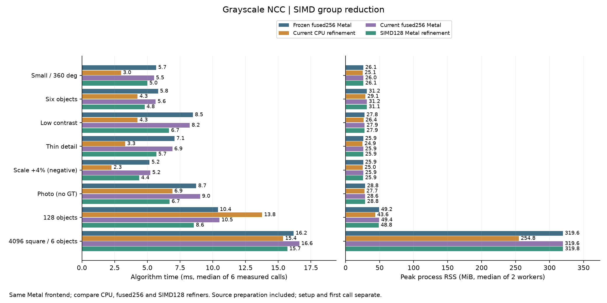

# 灰階 Metal SIMD128 精修：群組內同步與暫存優化

日期：2026-10-15，第23輪。延續[第22輪融合精修](POSE_FUSED_zh-TW.md)，保留原版與完整 C++／Metal 源碼，新增手動選配 `residentMode=2`。搜尋前段、候選、求解規則與精度門檻皆相同。

後續[第24輪精修影像共用](POSE_SHARED_STORAGE_zh-TW.md)已減少4K／8K重複影像配置；本頁數字保留第23輪歷史基準，當時的GPU額外記憶體不代表共用模式的現況。

## 結論與目前建議

**這輪優化有效，GPU 精修還有改善空間，尚未全面勝過 CPU。** 主實驗八場景、正反兩個 block，新 SIMD128 的完整時間都快於同建置 fused256；六次中位數縮短5.5%～25.7%。新舊 GPU 的提案、最終姿態與分數在本輪逐值相同；144個不同正常GT姿態零誤檢、零漏檢。四場景另作複查，收益方向一致。

- **128物件：** 本機可優先試 Metal 前段＋SIMD128精修。主量測 fused256／SIMD128為10.52／8.56ms，複查10.37／8.55ms；精修階段本身8.43→6.40ms、複查8.34→6.42ms。CPU精修階段為8.72／8.89ms。沒有通用候選數分流門檻。
- **少候選、小圖與4K六物件：** CPU精修仍優先。主量測小圖CPU／SIMD128為2.99／5.00ms，4K為15.38／15.70ms；4K CPU仍省約65MiB。影像大不代表精修候選多。
- **Src4：** 新版完整時間比CPU少約0.21～0.25ms，但精修階段本身仍較慢，前段時間差亦參與整體結果；無GT實圖不能據此聲稱全面勝出或準確率100%。可保留兩種組合作實機選擇。

原mode0／mode1與GUI預設保留。這輪只針對灰階精修；沒有新增RGB全圖、全GPU搜尋、自動routing或持續新影格驗證。

## 完整時間與記憶體

四路均使用相同 Metal compact 稀疏前段、分開提交、固定尺度與旋轉搜尋。每路六次暖機後正式呼叫中位數，單位ms。凍結版為 `e57cd8f` 的 fused256，與同建置 fused256 作回歸控制。

| 場景 | 凍結fused256 | 同建置CPU精修 | 同建置fused256 | SIMD128 |
|---|---:|---:|---:|---:|
| 小圖、全角度 | 5.68 | 2.99 | 5.51 | 5.00 |
| 六物件 | 5.82 | 4.25 | 5.63 | 4.79 |
| 低對比、兩物件 | 8.48 | 4.25 | 8.24 | 6.66 |
| 細線 | 7.07 | 3.31 | 6.91 | 5.69 |
| 尺度+4%負控制 | 5.17 | 2.27 | 5.23 | 4.37 |
| Src4實圖、無GT | 8.73 | 6.91 | 9.03 | 6.71 |
| 128物件 | 10.39 | 13.78 | 10.52 | 8.56 |
| 4096²、六物件 | 16.18 | 15.38 | 16.62 | 15.70 |

峰值RSS為兩個新程序各自峰值的中位數，單位MiB；並不是GPU共享暫存用量。

| 場景 | CPU精修 | fused256 | SIMD128 |
|---|---:|---:|---:|
| 小圖、全角度 | 25.14 | 26.04 | 26.13 |
| 六物件 | 29.14 | 31.18 | 31.10 |
| 低對比、兩物件 | 26.41 | 27.91 | 27.85 |
| 細線 | 24.93 | 25.87 | 25.95 |
| 尺度+4%負控制 | 25.01 | 25.92 | 25.85 |
| Src4實圖、無GT | 27.70 | 28.64 | 28.84 |
| 128物件 | 43.59 | 49.35 | 48.81 |
| 4096²、六物件 | 254.84 | 319.61 | 319.80 |



SIMD128相對fused256所有速度／記憶體容忍皆通過。相對CPU，主量測小圖block0、低對比兩block、細線兩block、尺度負控制block1，共6個速度配對失敗；4K兩block記憶體失敗。門檻為速度增加不超過`max(10%,2ms)`、RSS增加不超過`max(10%,32MiB)`。通過容忍不代表更快，所有失敗保存於[檢查細節](pose-simd/validation-details.json)。

### 四場景獨立複查

主結果出現128收益、Src4小幅跨越CPU及4K接近CPU後，另作32個新程序／96次量測。使用同一來源與binary、同設定、兩block正反順序及每程序至少1秒暖機；這是事後複查，不與主實驗合併，也不是新盲測資料。

| 場景 | CPU ms | fused256 ms | SIMD128 ms | SIMD128／fused256逐block時間比 |
|---|---:|---:|---:|---|
| 小圖、全角度 | 3.05 | 5.40 | 4.79 | 0.9010／0.8482 |
| Src4實圖 | 6.91 | 8.76 | 6.67 | 0.7649／0.7609 |
| 128物件 | 14.12 | 10.37 | 8.55 | 0.8367／0.8113 |
| 4096²、六物件 | 15.53 | 16.57 | 15.78 | 0.9522／0.9499 |

複查128 CPU／SIMD128 RSS為44.05／48.85MiB，4K為254.84／319.70MiB。4K相對CPU仍有兩個記憶體配對失敗。主／複查來源、binary、輸入與快照hash皆不變；提案、GPU最終結果、前段整數工作量與正常GT全部通過。[複查摘要](pose-simd/recheck-results.json)。

## 實作改了什麼

每個候選仍由單一GPU工作群組完成雙線性取樣、NCC、導數、阻尼Gauss–Newton、試步與停止；不同候選獨立。將群組從256改成128執行緒，導數原本只用128個lane，現在整組都參與取樣與累積。最後五層加總用32-wide SIMD群組交換暫存器值，省下共享暫存往返與整組barrier。

| 部分 | fused256 mode1 | SIMD128 mode2 |
|---|---|---|
| 每候選實體執行緒 | 256 | 128 |
| 導數取樣有效lane | 128 | 128 |
| 每tile邏輯像素 | 1024 | 1024 |
| 編譯後靜態threadgroup記憶體，本機查詢 | 9536bytes | 6976bytes |
| 單tile評分內barrier | 10 | 4 |
| 單tile導數內barrier | 10 | 4 |
| 每批派工／提交／等待 | 1／1／1 | 1／1／1 |

barrier數只計各tile內部，函式起末與求解控制仍有同步。編譯後共享暫存少26.8%，**程序RSS與來源buffer沒有同比例減少**。新的灰階導數統計為104bytes，64份scratch共6656bytes；評分以64份16-byte統計重用這塊scratch。不宣稱已測得硬體L1／L2命中率、occupancy、register spill或頻寬上限。

NCC邏輯加總順序保留：實體lane `l` 分別算舊邏輯lane `l` 與 `l+128`，每個仍按256像素步距累積，先在暫存器完成舊step128，再完成step64與step32。最後step16／8／4／2／1改成SIMD shuffle，只有lane小於step者合併；整個32-lane SIMD群組均執行shuffle。導數保持原128-lane像素分配與同一合併樹。

統計合併沿用中心化形式：兩份樣本數a、b，均值差δ，合併均值為 `μa + δ·b/(a+b)`，中心化平方和增加 `Ca + Cb + δ²·ab/(a+b)`；五維導數共變異改用 `δδᵀ`。減少資料搬動的位置，不更換NCC數學定義、精度、像素取樣順序或迭代預算。未開fast math或FP16，沿用相同浮點編譯模式；仍以實測驗證，不承諾跨編譯器逐位相同。

Host檢查SIMD寬度必須32、支援128執行緒與所需共享記憶體；不支援直接報錯。SIMD分組使用Metal的group/lane屬性，不假設一般thread index的映射。這符合Apple對[執行寬度](https://developer.apple.com/documentation/metal/mtlcomputepipelinestate/threadexecutionwidth)及[Metal語言shuffle語意](https://developer.apple.com/metal/Metal-Shading-Language-Specification.pdf)的定義。

### 收益與傳輸的界線

128物件有256候選。fused256→SIMD128精修8.426→6.402ms、GPU區間7.238→5.188ms、CPU等待7.414→5.348ms，派工／提交／等待仍1／1／1。小圖5候選GPU區間3.280→2.527ms；Src4 256候選、17×33模板為5.277→3.266ms。這支持群組內計算與同步改善，而非少一次主機提交。

主／複查每次新舊GPU呼叫的派工數、提交數、等待次數、auxiliary bytes、host與GPU buffer容量均相同。128輔助workspace仍53504bytes，4K仍10240bytes；4K GPU精修仍持有約64MiB float32來源副本。GPU時間包含在CPU等待中，不應再相加；buffer容量與RSS也重疊。這輪沒有新增傳輸追蹤，不能將等待全歸因影像傳輸，也未證明剩餘成本已達硬體極限。

128的完整CPU／SIMD128主量測13.78／8.56ms、複查14.12／8.55ms，不能全部解讀成精修算術收益：精修本身8.72→6.40ms、8.89→6.42ms，前段工作量雖相同，量到的前段時間仍有差異。Src4尤其如此：CPU精修3.78ms比SIMD128的4.03ms快，但完整時間為6.91／6.71ms；僅以完整結果宣稱GPU求解器較快會錯誤歸因。尚未量時脈、功耗或硬體timeline來解釋差異。

## 使用與源碼

只支援灰階模板面積≤16384像素，每批≤512候選，保留既有旋轉／連續尺度求解與鎖定參數功能。完整流程效能表測的是固定尺度；連續尺度由獨立解析影像測試驗證。RGB、大模板或CPU handle不可選mode1／2；模式設定不提前編譯lazy Metal資源。

```cpp
fpm::research::Settings settings;
settings.backend = 1;
settings.scales = {1.};
settings.sparseOrientation = true;
settings.sparse.responseMode = 1;
settings.sparse.searchBackend = 1;
settings.sparse.metalSubmissionMode = 0;
settings.residentMode = 2;
```

C API：`fpm_pose_set_resident_mode(handle,2,error,capacity)`後使用原resident／rescue入口。新增`fpm_pose_last_resident_kernel`查詢最近成功GPU呼叫的實際執行緒、SIMD寬度及編譯後共享暫存；原ABI結構不改，CPU／mode0／失敗呼叫回報零，單純切模式不改上一個成功紀錄。runner選項為`pose_resident_mode=2`，輸出新增三項`refinement_threads`、`refinement_simd_width`、`refinement_threadgroup_bytes`。

源碼：[SIMD kernel](../experiments/pose_simd.metal)、[原融合kernel](../experiments/pose_fused.metal)、[Metal主機排程](../experiments/pose_metal.mm)、[C API](../experiments/pose_ncc.h)、[Session](../experiments/research_pipeline.cpp)、[測試](../tests/pose_fused_test.cpp)、[比較工具](../tools/benchmark_pose_simd_pipeline.py)、[封存工具](../tools/report_pose_simd_pipeline.py)。沒有更改GUI選項。

## 驗證、重現與未解問題

Apple M4 Pro、12 CPU／16 GPU cores、48GiB、macOS26.6.2、AppleClang21、Release，CPU精修8threads。主量測8個沿用場景、64個新程序／192次，試跑另32程序／32次；每個正式程序至少1秒暖機，再3次測量，兩block正反路線順序、序列執行。完整時間包含每次來源建圖、搜尋、精修、CPU驗分、救援、NMS；解碼、建模、首次呼叫另記。沒有並行跑其他本任務GPU測試。

四路有序提案及搜尋整數工作量強制一致，凍結與同建置fused256最終結果強制逐值相同。SIMD128與CPU採一對一完整配對，位置≤0.25px、角度≤0.25°、相對尺度≤0.002、分數差≤1e-4，另以GT檢查；這輪SIMD128實際更達逐值相同，CPU有小幅浮點差但通過配對及GT。正常GT門檻2px／1°／2%尺度，SIMD128最大位置0.12119px、角度0.23170°，尺度鎖1。128提案鄰域仍只有127/128，後段才找齊；+4%尺度負控制仍TP0／FP1／FN1；Src4仍24個結果而無GT。共同錯誤沒有因速度優化而被解決。

- 最終Release **35/35**；相關ASan／UBSan **7/7**，`detect_leaks=0`，不宣稱LeakSanitizer。
- Metal API／Shader Validation啟用後 **119次GPU呼叫**通過。涵蓋獨立連續影像、float64二遍NCC oracle、旋轉／尺度、低／零對比、邊界、超大角度、sub-ULP界限、16384像素、513候選跨批、有預算救援與錯誤恢復。
- 新增10種模板形狀（含1×1、單列／單行、奇數與tile尾端）×驗分開關，對照mode1／2的姿態、分數、迭代次數、評估次數與停止狀態皆完全相同，重跑一致。
- 比較工具 **31項控制測試**通過，含忽略模式、錯誤工作群組、CPU回退、缺指標、共同GT錯誤、一對一重複結果、缺worker及檔案竄改。

開發中一次編譯變數作用域錯誤已修正；Metal驗證第一次因插樁增加靜態共享記憶體，觸發僅適用未插樁版的測試容量上限。修正測試：未插樁仍嚴格檢查原容量上限，插樁版容許32KiB且host仍檢查實際裝置上限；重新啟用驗證119次通過。原失敗log保留，沒有放寬數值或GT門檻。三個子agent因服務額度中斷，主agent接手完成；本輪不聲稱完成獨立agent最終審查。

重跑工具可用 `--pilot`、`--cases`選子集；先保留凍結`build/pose-fused`，另建`build/pose-simd`，不要覆寫基準。原始檔案、輸入、來源快照、凍結版本源碼及所有hash保存於[完整封存](pose-simd/raw-results.tar.gz)，不含執行檔。[protocol](pose-simd/protocol.json)、[主結果](pose-simd/results.json)、[檢查細節](pose-simd/validation-details.json)、[封存與搬移重播檢查](pose-simd/artifact-sha256.json)可供人工review。離線重播只需要Python、NumPy／OpenCV，不需GPU，方法在封存README。

下一個值得獨立驗證的是**精修來源副本共用與初始化配置**，以及少候選時單候選取樣／求解的剩餘成本。CPU列平行／SIMD、RGB、遮擋與真實新影格仍有工作；本輪沒有新增30分鐘測試或跨硬體曲線，不代表整個專案只剩穩定性測試。
