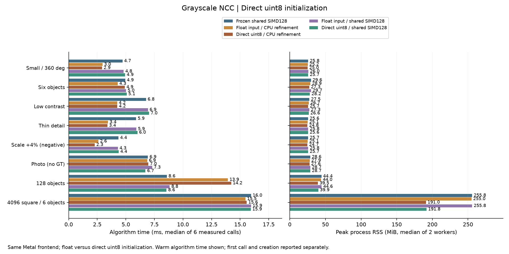
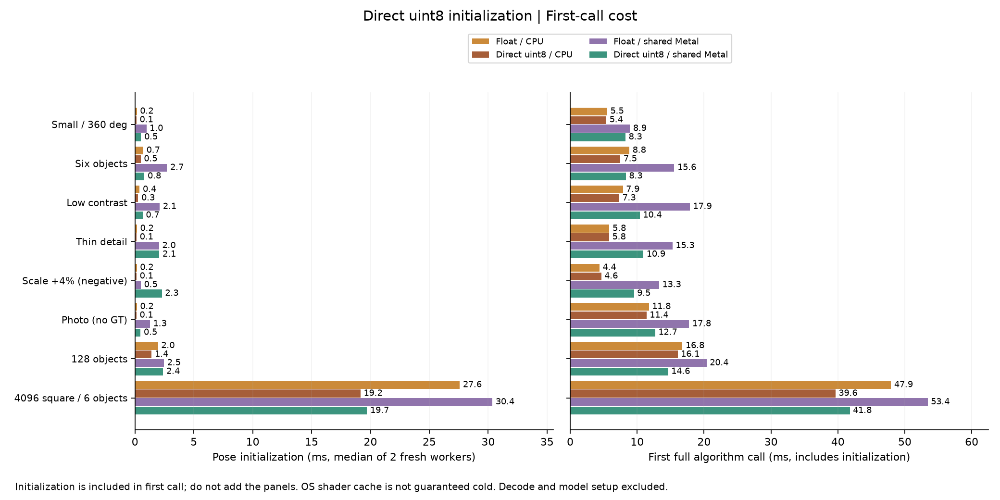

# 直接8-bit初始化：減少CPU／Metal精修的暫存與首次成本

日期：2026-10-15，第25輪。承接[第24輪影像共用](POSE_SHARED_STORAGE_zh-TW.md)，新增手動選項`poseInputMode=1`及完整C API。CPU與Metal都可直接把8-bit輸入轉入最終自有float影像，省去Session的中間float副本。所有Metal shader來源保持與`54ae7b6`相同。

## 結論與目前方案

**大圖初始化更快、峰值記憶體更低；暖機搜尋沒有穩定加速。** 這輪處理的是精修初始化，NCC、旋轉、尺度求解、救援、候選與驗分都不改。相同後端的新舊入口最終姿態、分數、候選逐值一致；GPU也與凍結版一致。

| 場景／Metal共用模式 | float入口初始化 ms | 直接8-bit初始化 ms | float峰值RSS MiB | 直接8-bit峰值RSS MiB | 暖機float／直接 ms |
|---|---:|---:|---:|---:|---:|
| 128物件、主量測 | 2.47 | 2.40 | 44.62 | 39.95 | 8.84／8.56 |
| 4K六物件、主量測 | 30.36 | 19.71 | 255.77 | 191.80 | 15.95／15.93 |
| 128物件、複查 | 2.49 | 1.62 | 44.30 | 39.74 | 8.69／8.64 |
| 4K六物件、複查 | 28.77 | 20.02 | 255.95 | 191.73 | 16.03／16.36 |
| 8K二十四物件、複查 | 125.84 | 81.29 | 946.59 | 690.53 | 51.29／51.40 |

4K主量測省63.97MiB、複查省64.22MiB，8K省256.05MiB。這是**第24輪已共用影像後再省掉初始化暫存**，不能把上一輪的常駐副本再算一次。8K初始化縮短約35.4%，首次完整搜尋195.75→149.04ms；暖機51.29→51.40ms，幾乎持平。

本機128物件可試Metal前段＋SIMD128＋共用影像＋直接8-bit入口；小圖與少候選仍優先CPU精修，也可選直接8-bit。CPU／Metal怎麼選仍須依場景量測，本輪不建立自動門檻。原float API、預設設定與GUI操作保留；尚未新增GUI的此選項或完整RGB全圖搜尋。

## 五路主量測

五路都使用相同compact稀疏Metal前段、分開提交、固定尺度、旋轉範圍與候選／救援設定。下表的「CPU」只指精修後端，**前段仍使用Metal，不能稱為全CPU對全GPU**。凍結版是`54ae7b6`的共用SIMD128。

80個新程序、240次正式呼叫；兩block正反執行，每程序先至少1秒暖機再量3次。以下為六次暖機後中位數，單位ms，解碼／建模與首次呼叫分開：

| 場景 | 凍結共用Metal | CPU float | CPU直接8-bit | 共用Metal float | 共用Metal直接8-bit |
|---|---:|---:|---:|---:|---:|
| 小圖、全角度 | 4.71 | 2.96 | 2.91 | 4.81 | 4.93 |
| 六物件 | 4.94 | 4.29 | 4.91 | 5.01 | 5.08 |
| 低對比、兩物件 | 6.76 | 4.24 | 4.25 | 6.93 | 7.02 |
| 細線 | 5.89 | 3.43 | 3.39 | 5.91 | 6.01 |
| 尺度+4%負控制 | 4.35 | 2.60 | 2.28 | 4.30 | 4.37 |
| Src4實圖、無GT | 6.93 | 6.87 | 6.97 | 7.30 | 6.72 |
| 128物件 | 8.59 | 13.93 | 14.21 | 8.84 | 8.56 |
| 4096²、六物件 | 15.95 | 15.46 | 15.57 | 15.95 | 15.93 |

峰值RSS為每路兩個新程序峰值的中位數，單位MiB：

| 場景 | CPU float | CPU直接8-bit | 共用Metal float | 共用Metal直接8-bit |
|---|---:|---:|---:|---:|
| 小圖、全角度 | 25.18 | 25.01 | 26.03 | 25.73 |
| 六物件 | 28.91 | 27.30 | 29.74 | 28.17 |
| 低對比、兩物件 | 26.70 | 25.73 | 27.27 | 26.62 |
| 細線 | 25.14 | 24.76 | 25.81 | 25.62 |
| 尺度+4%負控制 | 25.12 | 24.74 | 25.79 | 25.66 |
| Src4實圖、無GT | 27.92 | 27.58 | 28.68 | 28.70 |
| 128物件 | 44.02 | 39.49 | 44.62 | 39.95 |
| 4096²、六物件 | 254.96 | 190.98 | 255.77 | 191.80 |



**性能失敗完整保留。** Metal直接入口相對同建置float入口，所有主／複查block速度與記憶體容忍通過；通過仍可能稍慢。CPU直接入口主量測有兩個速度失敗：六物件block0、128物件block1。直接Metal相對直接CPU另有六個主速度失敗（小圖block0、低對比兩block、細線兩block、尺度負控制block1），複查4K block0亦失敗；所有記憶體容忍通過。門檻為增加不超過`max(10%,2ms)`與`max(10%,32MiB)`，不是「更快」的定義。

六物件CPU float／直接的失敗block總時間4.27／6.79ms，前段proposal1.37／3.92ms、精修2.97／3.03ms。128失敗block總時間11.74／14.02ms，proposal2.32／5.19ms、精修9.29／8.82ms；暖機建立時間皆0。主要差異出現在前段時段，不能歸因已不執行的初始化，也不能僅據此斷言是特定排程或cache原因。各欄中位數不必相加等於總時間。

## 複查、8K與首次時間

針對上述CPU慢樣本，追加六物件、128、4K及8K，共40個新程序、120次正式呼叫；同樣兩block正反順序。這是看到主量測後安排的複查，不是新的盲測。六物件／128的CPU直接入口性能容忍均通過，沒有覆蓋掉主量測失敗。8K沿用第24輪4K場景2×2拼接規則，24個同模板實例，保留拼接邊界；不是24個不同模板或新真實相機資料。

| 複查場景 | CPU float／直接 ms | Metal float／直接 ms | CPU直接RSS MiB | Metal直接RSS MiB | 最終GT |
|---|---:|---:|---:|---:|---|
| 六物件 | 4.26／4.29 | 4.98／4.82 | 27.42 | 28.23 | 6/6、零FP／FN |
| 128物件 | 13.98／12.73 | 8.69／8.64 | 39.30 | 39.74 | 128/128、零FP／FN |
| 4096²、六物件 | 15.75／15.46 | 16.03／16.36 | 191.01 | 191.73 | 6/6、零FP／FN |
| 8192²、二十四物件 | 54.24／53.70 | 51.29／51.40 | 689.67 | 690.53 | 24/24、零FP／FN |

初始化與第一次完整搜尋分開呈現；初始化已包含在第一次完整搜尋內，不能再相加：

| 場景／後端 | float初始化 ms | 直接初始化 ms | float首次完整 ms | 直接首次完整 ms |
|---|---:|---:|---:|---:|
| 4K主量測／CPU | 27.59 | 19.16 | 47.94 | 39.64 |
| 4K主量測／Metal | 30.36 | 19.71 | 53.42 | 41.78 |
| 4K複查／CPU | 27.79 | 19.31 | 48.61 | 39.88 |
| 4K複查／Metal | 28.77 | 20.02 | 51.17 | 42.17 |
| 8K複查／CPU | 117.23 | 80.01 | 184.08 | 146.78 |
| 8K複查／Metal | 125.84 | 81.29 | 195.75 | 149.04 |



首次完整時間也包含前段的首次GPU初始化；小圖的完整差額可能大於pose建立差額，不能全部歸因直接入口。每項首次時間只有兩個程序／路線，系統shader cache不保證冷；小圖的初始化可能受shader／系統狀態主導。例如尺度負控制的Metal直接入口初始化中位數反而較慢，128複查的首次完整時間也較慢，均保留在JSON。大圖初始化的收益在兩block方向一致，不能延伸成所有尺寸或首次完整流程的固定倍率。

## 修改原理與持有權

舊流程：Session持有gray8 → 配置並轉換整張float暫存 → pose複製到自有float儲存 → 中心化與統計 → CPU／Metal使用。

新流程：Session持有gray8 → pose配置最終自有float儲存並直接轉換 → 相同中心化與統計 → CPU／Metal使用。

每通道仍計算`float(v) / 255.f`，來源反色時用`float(255-v) / 255.f`。模板不反色。沒有改成近似倒數、量化NCC或降低求解精度；各通道均值、中心化與能量加總的順序沿用原碼。8-bit轉換必為有限的`[0,1]`，因此不需要原float入口的有限值／範圍掃描；原float入口仍完整驗證。初始化收益包含少掉暫存配置、複製及這項冗餘掃描，不能全稱作GPU傳輸減少。

設來源`W×H`、模板`w×h`、通道數`C`，移除的float暫存邏輯容量為：

`F = 4 × C × (W×H + w×h) bytes`

本輪gray8 Session：128場景暫存4,730,880bytes，4K為67,121,152bytes，8K為268,447,744bytes；新入口皆為0。`pose_conversion_temporary_bytes`量的是當次初始化vector容量，舊路徑返回前就釋放，**不是仍占用的常駐容量，也不是RSS**。暖機呼叫的新舊模式皆0。第24輪的`host_image_bytes`／`gpu_image_bytes`／`shared_image_bytes`／`unique_image_bytes`在本輪相同後端入口間完全相同；減少的是峰值暫存，不是再縮小最終影像。

直接API接受有列間距的HWC灰階／RGB。兩個影像的尺寸、通道、stride與位址跨度先檢查，再讀取內容；不讀padding。呼叫端須提供宣告範圍內可讀的資料。函式返回後不保留外部指標，呼叫端可改寫或釋放原圖；storage1仍由核心VM頁面與Metal buffer共同持有。CPU模式使用自有vector，auto仍延遲建立Metal。Session的反色切換會重建pose context，重複同圖則重用；關閉精修後仍能正確回報保留容量。

`pose_create_ms`計時到context建立及模式設定完成，含Session轉換（舊模式）、舊context釋放和新配置；函式返回時局部vector解構在該數字之外，但仍包含於refine／first總時間。來源gray8副本、解碼RGB暫存、稀疏建圖及新影格串流同步尚未在本輪移除。

## 使用與驗證

```cpp
fpm::research::Settings settings;
settings.poseInputMode = 1; // 直接把gray8轉入pose最終儲存
// CPU精修：backend=0, poseStorageMode=0。
// Metal SIMD128精修：backend=1, residentMode=2, poseStorageMode=1。
```

runner設定為`pose_input_mode=1`；它會從實際context查詢`fpm_pose_input_format`後回報，不只回顯設定。無context時才回報預定選擇。公開C API新增`fpm_pose_create_u8`與`fpm_pose_input_format`；原float入口完整保留。兩者都能處理局部RGB，SIMD128仍限灰階模板≤16384像素；原圖每維≤32768、每張最多128M通道值的既有限制保留。這不是完整RGB全圖搜尋或攝影機直接零拷貝。

- Release **39/39**；相關ASan／UBSan **12/12**，`detect_leaks=0`，不宣稱LeakSanitizer完成。
- 新API CPU **10組**、Metal **10組**與顯式float轉換對照：灰階／RGB、256個位元組值、奇數尺寸、緊密／含padding列、反色、呼叫端改寫／釋放。score、CPU／accelerated／resident精修的姿態、分數、迭代統計逐值相同，另測lazy auto、非法模式及跨度溢位。
- Metal API／Shader Validation下，新入口10組及既有共用SIMD128 **119次GPU呼叫**通過。Session補CPU／Metal原模式與fused1／2、storage0／1、input0／1的配對、快取、反色重建與關閉精修檢查。
- 比較工具 **42項控制測試**通過，涵蓋假路由、暫存未移除、暖機重建、最終微小誤差、CPU直接路徑差異、工作量或常駐容量偷改、共同GT錯誤與原始檔竄改。

主量測正常144個沿用GT姿態、複查164個姿態皆零FP／FN；兩集合有重複，不能相加當作獨立準確度樣本。+4%尺度負控制仍TP0／FP1／FN1，Src4仍24結果但無GT，128提案鄰域仍127/128。沒有修好共同錯峰、遮擋或未知尺度。

本機Apple M4 Pro、12 CPU／16 GPU cores、48GiB、macOS26.6.2、AppleClang21，Release，CPU精修8threads。正式量測序列執行，沒有同時跑其他本任務GPU測試；來源、binary、輸入與快照hash不變。試跑另外15程序／15次，主80／240、複查40／120分開保存。協作agent完成核心與測試／工具草稿後，兩agent因服務額度中斷；主agent補完工具、檢查與驗證，不聲稱獨立agent最終審查。

## 完整源碼與重現

[直接入口與共同初始化](../experiments/pose_ncc.cpp)・[公開C介面](../experiments/pose_ncc.h)・[影像持有結構](../experiments/pose_internal.hpp)・[原生Session](../experiments/research_pipeline.cpp)・[新API對照測試](../tests/pose_u8_test.cpp)・[Session測試](../tests/research_pipeline_test.cpp)・[比較工具](../tools/benchmark_pose_u8_pipeline.py)・[封存工具](../tools/report_pose_u8_pipeline.py)。

[事前protocol](pose-u8/protocol.json)・[主結果](pose-u8/results.json)・[複查／8K](pose-u8/recheck-results.json)・[性能失敗與驗證](pose-u8/validation-details.json)・[來源／輸入／raw workers／logs封存](pose-u8/raw-results.tar.gz)・[hash與換目錄重播](pose-u8/artifact-sha256.json)。封存`formal/`含主量測與`recheck/`，`pilots/pilot/`含試跑。重複不可變輸入以tar hardlink去重，修改時先複製。離線主／複查／試跑摘要重播皆逐byte一致；不含執行檔，保留binary hash與完整來源快照。

保留凍結`build/pose-shared`，新建`build/pose-u8`：

```sh
cmake -S cpp-core -B build/pose-u8 -DCMAKE_BUILD_TYPE=Release -DFPM_BUILD_EXPERIMENTS=ON -DFPM_BUILD_GUI=ON -DFPM_WITH_OPENCV=ON -DFPM_BUILD_TESTS=ON
cmake --build build/pose-u8 -j 6
ctest --test-dir build/pose-u8 --output-on-failure
python-port/venv/bin/python cpp-core/tools/benchmark_pose_u8_pipeline.py --output NEW_STUDY/results.json
python-port/venv/bin/python cpp-core/tools/benchmark_pose_u8_pipeline.py --output NEW_STUDY/recheck/results.json --cases crop_medium20,heldout_crowd128_20,large4096_6 --tile8k
```

暖機搜尋、來源轉換、首張初始化、串流更新是不同成本。下一步可獨立量測解碼與gray8來源持有副本，或擴充真實場景／RGB全圖；本輪沒有新增30分鐘soak、跨硬體結論或自動CPU／GPU分流。
