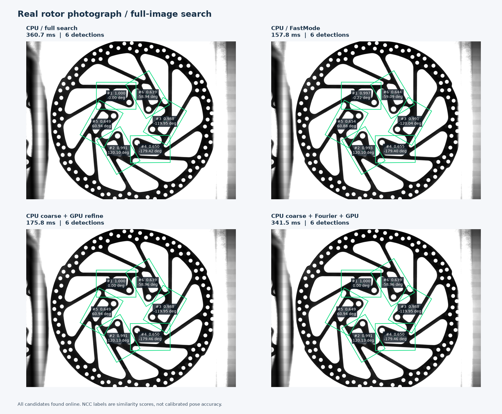
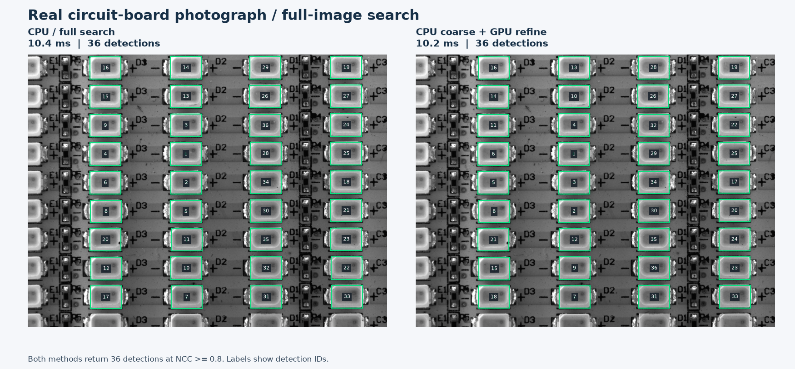
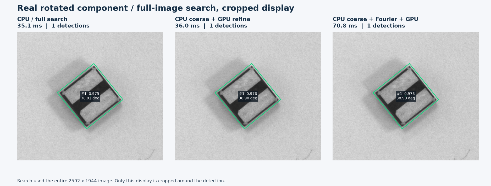
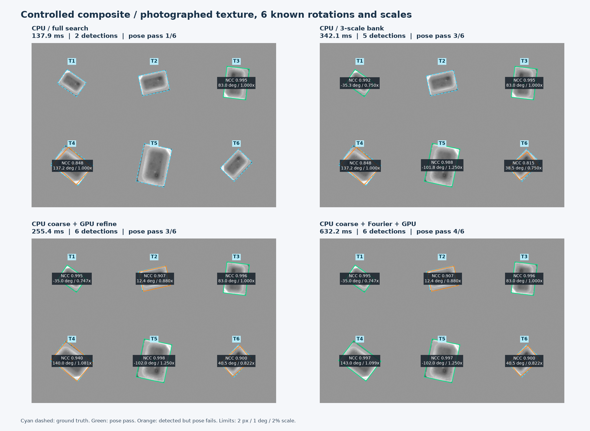

# 實圖完整搜尋與 RGB 批次比較

日期：2026-10-12。Apple M4 Pro（12 核 CPU、16 核 GPU、48 GiB）；Release、NEON CPU／Metal。

本次從整張圖重新產生候選，沒有讀入既有偵測座標或把真值交給搜尋。傳統基準是**目前可攜 C++ 金字塔 NCC**，不是重新執行 Windows MFC 原作者程式。

每種組合用獨立程序序列執行，固定亂數打散順序；先跑一次，再暖機至少 200 ms，量測 5 次取中位數。時間包括全圖搜尋、精修、CPU／GPU 提交等待與最後抑制重疊；不含解碼、模板學習、Metal 初始化、畫框和 GUI。輸入已駐留，初始化另列。不是攝影機到 GUI 的端到端延遲。

## 方法與比較邊界

| 方法 | 實際流程 |
|---|---|
| 原有 CPU 完整搜尋 | 原有 SIMD 金字塔粗到精，搜尋至原解析度；尺度固定 1；關閉既有 subpixel 選項 |
| 原有 CPU FastMode | 原有搜尋停在第 1 層；無原解析度精修。受控尺度圖套用相同三尺度模板庫 |
| 原有 CPU 三尺度搜尋 | 尺度 0.75、1、1.25 各跑完整搜尋，再合併結果 |
| CPU 粗搜＋CPU／Metal 精修 | 相同 FastMode 候選；6 輪局部位置／角度／log-scale 網格精修；各輪步長減半 |
| CPU 粗搜＋Fourier＋Metal | 同樣先完整執行粗搜，對每個候選做局部 Fourier–Mellin 提案，NCC 優於原候選才採用，再精修 |

原始實圖全部固定尺度；受控圖才開啟三尺度提案與連續尺度精修。這個多尺度搜尋是新的**研究腳本**，正式 GUI 尚未接入。搜尋／評分核心為 C++／Metal，排程、FFT、報表為 Python；目前還不是全 C++ 的 Fourier 搜尋器。

Fourier 使用 CPU NumPy FFT、頻譜幅值 log-polar 與 phase correlation；此版本仍保留 CPU 角度枚舉，因此是在量測「額外提案」的收益，不能把它當成已消除角度／尺度枚舉的完整 Fourier 偵測器。

原有 NCC 使用 uint8 旋轉影像；新精修使用浮點反向取樣。兩者分數的數值契約不完全相同，分數增加不能直接當成精度提高。公平隔離 GPU 的比較是「CPU 粗搜＋CPU 8 精修」對「CPU 粗搜＋Metal 精修」；FastMode 則顯示省略細層搜尋的成本。

## 原始實圖：時間與找到的數量

這些檔案內容都是灰階；部分容器雖有三通道，三通道數值相同。本次沒有把它們冒充真正的 RGB 實圖。原始照片沒有校準姿態真值；以下數量／一致性不能當成準確率。

| 圖片 | 方法 | 演算法 ms | 數量 | CPU 搜尋 ms | FFT 提案 ms | 精修 ms |
|---|---|---:|---:|---:|---:|---:|
| 六孔轉盤 | 原有 CPU 完整搜尋 | 360.675 | 6 | 360.609 | 0.000 | 0.000 |
| 六孔轉盤 | 原有 CPU FastMode | 157.754 | 6 | 157.690 | 0.000 | 0.000 |
| 六孔轉盤 | CPU 粗搜＋CPU 8 執行緒精修 | 295.620 | 6 | 139.982 | 0.000 | 156.601 |
| 六孔轉盤 | CPU 粗搜＋Metal 精修 | 175.809 | 6 | 137.258 | 0.000 | 39.050 |
| 六孔轉盤 | CPU 粗搜＋Fourier＋Metal | 341.470 | 6 | 141.583 | 162.395 | 38.655 |
| 電路板 | 原有 CPU 完整搜尋 | 10.355 | 36 | 9.842 | 0.000 | 0.000 |
| 電路板 | 原有 CPU FastMode | 6.190 | 36 | 5.637 | 0.000 | 0.000 |
| 電路板 | CPU 粗搜＋CPU 8 執行緒精修 | 23.179 | 36 | 5.842 | 0.000 | 16.896 |
| 電路板 | CPU 粗搜＋Metal 精修 | 10.227 | 36 | 5.376 | 0.000 | 4.300 |
| 旋轉零件 | 原有 CPU 完整搜尋 | 35.130 | 1 | 35.126 | 0.000 | 0.000 |
| 旋轉零件 | 原有 CPU FastMode | 35.757 | 1 | 35.753 | 0.000 | 0.000 |
| 旋轉零件 | CPU 粗搜＋CPU 8 執行緒精修 | 34.932 | 1 | 32.760 | 0.000 | 2.229 |
| 旋轉零件 | CPU 粗搜＋Metal 精修 | 35.997 | 1 | 31.338 | 0.000 | 4.650 |
| 旋轉零件 | CPU 粗搜＋Fourier＋Metal | 70.791 | 1 | 35.496 | 30.769 | 4.368 |

各階段分別取中位數，故相加不必恰好等於總時間中位數。

六孔圖 Metal 混合流程比原有完整搜尋快 **2.05×**；相同新精修流程換成 Metal，比 CPU 8 執行緒快 **1.68×**。原有 FastMode 本身更快，但省略了新流程做的原解析度精修，不能混為相同精度的結論。







| 實圖 | Metal 混合對 CPU 完整搜尋：配對數 | 最大中心差 px | 最大角度差 ° |
|---|---:|---:|---:|
| 六孔轉盤 | 6/6 | 0.4868 | 0.0474 |
| 電路板 | 36/36 | 0.6644 | 0.0000 |
| 旋轉零件 | 1/1 | 0.2183 | 0.0826 |

相同新流程的 CPU／Metal 輸出數量一致，角度與尺度一致。Src7 有兩組最後一格的中心選擇差異，最大 0.0625 px；其餘實圖與受控圖中心相同。兩組位置交给同一 CPU scorer 重新評分，確認為接近同分的候選；精確差值保留於 `real-image-validation.json`。這種局部最大值選擇差異與上述對原有演算法的差異應分開看。

## 已知旋轉與尺度：保留失敗結果

使用 Dst3.bmp 的真實電容紋理，透過獨立的 OpenCV 仿射轉換建立六個物件，加入 σ=1 灰階雜訊。這張是受控合成圖，不能代表真實物件的光照、透視或尺度改變。OpenCV 只用於解碼與產生獨立真值圖，搜尋本身沒有使用 OpenCV 比對。

六個尺度依序為 0.75、0.90、1.00、1.10、1.25、0.85；角度 −35°、12°、83°、143°、−102°、46°。所有方法用相同最終 NCC ≥0.8；提案門檻 0.5。姿態通過需同時滿足中心 ≤2 px、角度 ≤1°、相對尺度誤差 ≤2%。

| 方法 | ms | 找到 / 6 | 姿態通過 / 6 | 姿態 FP / FN |
|---|---:|---:|---:|---:|
| 原有 CPU 完整搜尋 | 137.870 | 2 | 1 | 1 / 5 |
| 原有 CPU FastMode | 199.048 | 5 | 2 | 3 / 4 |
| 原有 CPU 三尺度搜尋 | 342.067 | 5 | 3 | 2 / 3 |
| CPU 粗搜＋CPU 8 執行緒精修 | 237.878 | 6 | 3 | 3 / 3 |
| CPU 粗搜＋Metal 精修 | 255.370 | 6 | 3 | 3 / 3 |
| CPU 粗搜＋Fourier＋Metal | 632.209 | 6 | 4 | 2 / 2 |

這裡的 FP 包含「位置接近真正物件，但角度／尺度尚未達標」；不代表每個 FP 都是背景誤檢。姿態 FP/FN 是完整姿態標準，不等於只看物件是否存在的 precision/recall。



| 物件／真值 | Metal 混合：位置 px / 角度 ° / 尺度 % | Fourier 混合：位置 px / 角度 ° / 尺度 % |
|---|---:|---:|
| T1：-35°、0.75× | 0.050 / 0.025 / 0.354 | 0.050 / 0.025 / 0.354 |
| T2：12°、0.90× | 2.978 / 0.377 / 2.189 | 2.978 / 0.377 / 2.189 |
| T3：83°、1.00× | 0.058 / 0.025 / 0.000 | 0.030 / 0.006 / 0.034 |
| T4：143°、1.10× | 0.768 / 2.980 / 1.725 | 0.046 / 0.020 / 0.132 |
| T5：-102°、1.25× | 0.024 / 0.032 / 0.000 | 0.029 / 0.021 / 0.032 |
| T6：46°、0.85× | 0.751 / 5.542 / 3.254 | 0.751 / 5.542 / 3.254 |

六輪角度步長為 1°、0.5°、…，從單一種子可累積移動不足 2°；尺度不匹配時粗搜產生的角度偏差可能超出這個範圍。這是目前局部搜尋的可達範圍限制，不是 GPU 浮點誤差的證據。FFT 有時提供較好的起點，但仍有失敗；這批結果不足以宣稱多尺度功能已完成。

## RGB：三通道不保證 GPU 較快

以下另外使用三個不同的解析色彩通道；相同姿態、相同 RGB NCC，資料已駐留。這是評分核心的工作量曲線，不含全圖搜尋，也不是上述灰階實圖改成三份複製。

| RGB 模板／姿態數 | CPU 1 ms | CPU 8 ms | Metal wall ms | CPU 8 / Metal |
|---|---:|---:|---:|---:|
| 64_rgb_1 | 0.021292 | 0.031459 | 0.096166 | 0.33× |
| 64_rgb_49 | 1.045333 | 0.221292 | 0.121583 | 1.82× |
| 64_rgb_512 | 10.896917 | 1.570208 | 0.389292 | 4.03× |
| 128_rgb_512 | 43.833792 | 6.154542 | 1.164666 | 5.28× |

所有 RGB CPU／Metal 分數最大差 2.38e-07，最佳姿態索引相同。

通道數只是工作量的一部分。近似模型為 CPU 時間 ≈ a·N·模板面積·C，GPU 時間 ≈ 提交／同步固定成本 + b·N·模板面積·C；實際還受記憶體、重用、SIMD、執行緒與批次配置影響。C=3 不會消除 GPU 的固定成本，不能直接推出 GPU 一定更快，也不會必然恰好耗時三倍。

## 初始化與記憶體

RSS 是獨立 Python 程序的高水位，包含解碼器、NumPy、C++ 暫存、FFT、驅動與初始化，不是純演算法配置量。明列的 host／Metal buffer 屬於精修 scorer，沒有涵蓋 CPU 粗搜或 FFT 所有暫存；shared Metal buffer 與系統 RAM 重疊，不能和 RSS 相加。

| 圖片／方法 | 初始化 ms | 首次演算法 ms | 峰值 RSS MiB | scorer host MiB | scorer Metal MiB |
|---|---:|---:|---:|---:|---:|
| 六孔轉盤／原有 CPU 完整搜尋 | 3.52 | 365.21 | 126.97 | 0.00 | 0.00 |
| 六孔轉盤／原有 CPU FastMode | 4.22 | 161.57 | 125.06 | 0.00 | 0.00 |
| 六孔轉盤／CPU 粗搜＋CPU 8 執行緒精修 | 32.26 | 308.57 | 222.02 | 48.12 | 0.00 |
| 六孔轉盤／CPU 粗搜＋Metal 精修 | 68.51 | 194.80 | 278.69 | 48.12 | 51.96 |
| 六孔轉盤／CPU 粗搜＋Fourier＋Metal | 83.96 | 365.70 | 365.20 | 48.12 | 51.96 |
| 電路板／原有 CPU 完整搜尋 | 2.51 | 11.37 | 75.70 | 0.00 | 0.00 |
| 電路板／原有 CPU FastMode | 1.93 | 6.40 | 74.59 | 0.00 | 0.00 |
| 電路板／CPU 粗搜＋CPU 8 執行緒精修 | 9.53 | 24.30 | 91.77 | 7.74 | 0.00 |
| 電路板／CPU 粗搜＋Metal 精修 | 43.66 | 14.62 | 113.27 | 7.74 | 8.01 |
| 旋轉零件／原有 CPU 完整搜尋 | 3.85 | 39.40 | 90.36 | 0.00 | 0.00 |
| 旋轉零件／原有 CPU FastMode | 2.34 | 36.74 | 89.03 | 0.00 | 0.00 |
| 旋轉零件／CPU 粗搜＋CPU 8 執行緒精修 | 14.99 | 38.17 | 130.12 | 19.32 | 0.00 |
| 旋轉零件／CPU 粗搜＋Metal 精修 | 44.89 | 40.60 | 157.75 | 19.32 | 19.36 |
| 旋轉零件／CPU 粗搜＋Fourier＋Metal | 71.62 | 77.63 | 233.66 | 19.32 | 19.36 |
| 真實紋理受控尺度圖／原有 CPU 完整搜尋 | 2.49 | 139.15 | 68.75 | 0.00 | 0.00 |
| 真實紋理受控尺度圖／原有 CPU FastMode | 3.15 | 199.30 | 69.92 | 0.00 | 0.00 |
| 真實紋理受控尺度圖／原有 CPU 三尺度搜尋 | 3.47 | 308.64 | 70.80 | 0.00 | 0.00 |
| 真實紋理受控尺度圖／CPU 粗搜＋CPU 8 執行緒精修 | 6.55 | 238.99 | 77.59 | 3.18 | 0.00 |
| 真實紋理受控尺度圖／CPU 粗搜＋Metal 精修 | 47.33 | 259.33 | 92.31 | 3.18 | 4.22 |
| 真實紋理受控尺度圖／CPU 粗搜＋Fourier＋Metal | 74.28 | 649.96 | 199.52 | 3.18 | 4.22 |

## 判斷與下一步

大型模板的批次 NCC 精修值得保留；小圖、單一候選、或原本已很快的搜尋不一定受益。要以「整個工作量的實測」選 CPU／GPU，而不是只看有沒有 RGB。

目前 CPU 粗搜仍占混合流程大量時間；Fourier 提案沒有刪除原粗搜，實圖上的額外 FFT 成本大於時間收益。因此此版應定位成可重現研究原型，尚不適合直接取代正式比對器。

優先改善方向是讓粗搜的角度／尺度不確定度決定精修範圍，並保留多個競爭種子；接著減少逐輪同步、改善 CPU SIMD／多執行緒與 GPU 取樣重用。若要靠 Fourier 真正加速，需要證明它能在可靠召回率下替代一部分粗搜尋，而非持續疊加提案。

尚未實作：正式 GUI 多尺度與 RGB 全圖搜尋、CUDA 實機後端、GPU FFT、自動 CPU／GPU 路由。已有實作：C++／Metal 三通道浮點 NCC、平移／旋轉／尺度姿態評分、本報告中的全圖灰階研究排程。

## 重現與原始紀錄

依 `EXPERIMENTS_zh-TW.md` 編譯實驗庫，再用同一 Python 環境執行（NumPy、OpenCV；報表另需 Matplotlib）：

```sh
python cpp-core/tools/real_image_experiments.py
python cpp-core/tools/benchmark_rgb_batches.py
python cpp-core/tools/validate_real_image_experiments.py
python cpp-core/tools/report_real_image_experiments.py
```

- [完整實圖 JSON](real-image-experiments.json)：每次時間、全部偵測框／分數／姿態、分階段成本、真值、參數、來源與二進位雜湊。
- [RGB JSON](rgb-batch-benchmark.json)：全部 CPU／GPU 分數與一致性驗證。
- [實圖驗證 JSON](real-image-validation.json)：來源雜湊、六組 CLI 基準一致性、CPU／Metal 最後一格差異、幾何抑制重疊與灰階內容檢查。
- [先前 ROI 實驗](EXPERIMENT_RESULTS_zh-TW.md)：其時間邊界較窄，不能與本次全圖延遲直接混用。

本次多尺度抑制重疊使用交集／較小框面積；同尺度時與原本面積分母等價。它不是 IoU。原圖參數：Src7 分數 0.5、重疊 0.2、角度 ±180°；Src3 分數 0.8、重疊 0、角度 0°；Src5-45 分數 0.8、重疊 0、角度 ±180°。所有模板金字塔最小面積 256。
