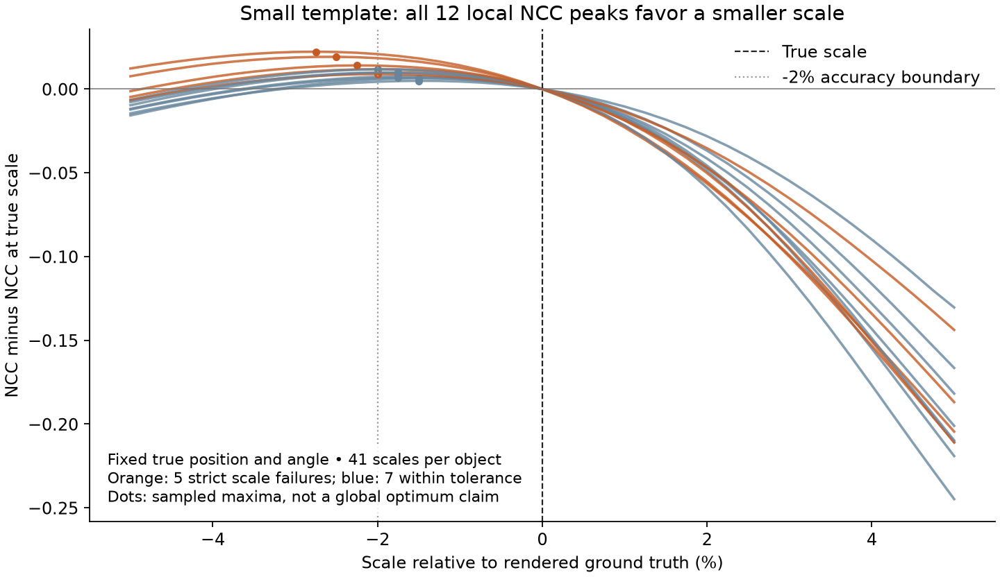

# 第33輪：多尺度精修組合與新場景驗證

2026-10-16，Apple M4 Pro、48 GiB，來源基準`f6b7d38`。本輪固定第32輪已封存的同一native binary，將既有resident0、fused256與SIMD128放進相同的多尺度／fine融合／strip／共用影像／直接8-bit流程。沒有改C++／Metal求解、預算、門檻或預設；新增完整實驗工具、新場景與失敗診斷。整體實驗缺口與後續優先順序見[審查報告](EXPERIMENT_GAPS_zh-TW.md)。

## 先固定比較，再保留成功與失敗

八個設定：既有6、128、512快速與512完整次像素；新排列的12個一般模板、12個小模板、前者加遮擋／模糊／雜訊，以及沒有目標的雜訊背景。每設定三種精修、兩個正反順序block；每程序首次＋一次repeat、無暖機，共48程序／96次算法呼叫。

三路都是Metal前段，固定fine mode2、fineFused、fineAngleReuse、input1、storage1、原尺度庫及救援預算。mode1／2只接受原精修模板≤16384pixels；放大後的提案模板可更大。批量512指提案數，不能把512個GT當成只有一批；512場景有1301個提案。前段有序proposals、工作量及frame容量要求完全相同；不同求解器的派工、救援與workspace允許合法變動。實際backend／執行緒／SIMD寬度／GPU活動與共享容量公式另驗證，空候選只驗無執行，不能當作執行過kernel。

最終結果除各路自身repeat exact，還以完整一對一配對檢查位置≤0.25px、角度≤0.25°、相對尺度≤0.002、分數差≤1e-4，並**另外**對GT驗證2px／1°／±2%尺度。相同的錯誤輸出不會被算成準確度通過。正常場景若失敗，分類與門檻不變；harness跑完全部worker並保存false旗標後才回傳exit1，不是中途崩潰或刪去壞樣本。

時間／RSS逐block保留，容忍仍為max(10%,2ms)／max(10%,16MiB)。各組只有兩個獨立程序；first與repeat互相關聯，不作小幅差值顯著性主張。GPU device與CPU wait包含關係不相加，pose建立包含於首次refine／total。原生runner沒有完整救援retry計數輸出，故只報實際派工及已有救援統計，不假設各mode迭代或救援相同。

## 新資料的範圍

`resident_validation_scenes.py`使用兩個既有實拍模板Dst3（140×102）、Dst4（33×17）及兩個新seed，生成24個不同的合成旋轉／尺度姿態。降質12物件重用一般模板的12個幾何姿態，不是另外12個獨立姿態，也不是新相機實拍圖。

渲染使用獨立OpenCV雙線性變換，圖像先量化／clip成gray8；降質組再在模板局部座標遮去0／10／25／40%寬度的條帶、映射回來源、加Gaussian sigma1模糊與標準差8雜訊。這是合成條帶遮擋，不是物件互相遮擋。空場景是標準差12的背景雜訊，只是簡單負控制，不代表已測全部困難背景。生成幾何與GT只在parent作事後分析，不提供給native搜尋。

正式前做了功能pilot，沒有依結果調整圖、seed、門檻或分類，因此不是完全盲測。另名agent驗證4張圖可逐像素重建、角點最大誤差約1.14e-13px、所有物件ROI不相交且不出界；8個pilot job沒有GT／metadata／seed洩漏。全部生成源碼、metadata、圖片與pilot也保留。

## 小模板的高分尺度偏差

新增小模板12個物件都能正確定位：最大位置誤差0.03746px、角度誤差0.14517°；但5個只因尺度偏小超過2%而strict失敗。五筆相對誤差約−2.7467%、−2.5710%、−2.0516%、−2.0020%、−2.2401%。12筆尺度估計全部向下偏，NCC仍約0.97467～0.99128。

原模式與SIMD在pilot有序結果相同；12個GT都有至少一個提案位於求解器允許的每軸12px／15°／log(1.3)範圍內。這支持排除「五個物件前段完全沒找到」或「180°方向錯峰」作為這五筆失敗的解釋，但有候選並不保證該候選進入正確吸引區域。

為檢查評分本身，新增`diagnose_scale_bias.py`只用CPU評分，固定真實位置與角度，另固定已估計的位置與角度；每物件掃描真實尺度×[0.95,1.05]的41格，外加精確GT與估計尺度，共1032點。獨立float64幾何、雙線性取樣與二遍中心化NCC交叉驗證，與CPU實作最大差2.964e-6，24條曲線的最佳格點完全相同。

令固定幾何下的評分為`ρ(s)=NCC(T, sample(I,x,y,θ,s))`。**固定GT真實位置和角度時，12／12的最佳格點仍偏小1.5%～2.75%，且最佳分數比真實尺度高0.004936～0.022306。** 因此即使找到這條局部曲線的最大值，也不保證得到渲染GT的尺度；不能只歸咎迭代沒收斂或GPU計算不足。



這支持目前保存影像的取樣／NCC目標存在尺度偏差；尚未證明雙線性插值、量化、邊界背景或aliasing哪一項是唯一原因。41格一維切片也不是全域最優或四維求解收斂證明。下一個算法實驗應固定資料，比較等效模糊／抗混疊的取樣模型與更高解析度渲染控制，確認尺度偏差能降低且不明顯拖慢。不能先放寬±2%門檻，或增加迭代後就宣稱問題已解。

## 降質場景的另一種共同失敗

pilot降質12物件只有4個通過strict，7個在20px內定位，最終7個接受結果中有3個strict誤檢。兩個方向錯約177.76°／179.18°，且前段沒有正確方向落在求解邊界內的提案；另有一個位置／角度／尺度皆偏。五個無定位者中三個缺正確提案、兩個有候選但沒有最後接受；目前輸出不足以進一步確定被哪個內部步驟拒絕。

這類錯誤涉及候選涵蓋與遮擋下評分，和小模板的單純尺度偏差分開追查。完整失敗留存，並未因原版與優化版共同失敗而視為成功。

## 正式結果與採用決定

48程序／96次全部完成，所有輸入／來源／binary前後hash一致，執行路徑及容量檢查通過；全部跨模式的有序proposals與最終matches實際逐值相同。**準確度、正常場景準確度及整體性能旗標皆為false。** 這些旗標和輸出一致性分開，沒有把共同錯誤當成驗收成功。

以下repeat為每組兩個新程序各一次repeat的中位數，單位ms；不含解碼／建模。RSS為截至final_memory快照之程序峰值的中位數，包含首次與結果JSON物件建立；不含之後最終JSON編碼／輸出可能新增的峰值。

| 設定 | 原resident0 ms | fused256 ms | SIMD128 ms | RSS MiB，原／fused／SIMD | 三路共同strict TP／FP／FN |
|---|---:|---:|---:|---|---|
| 既有6物件 | 66.08 | 74.25 | 64.62 | 39.70／38.94／39.93 | 6／0／0 |
| 既有128 | 827.75 | 858.06 | 826.61 | 229.51／229.30／229.12 | 128／0／0 |
| 既有512快速 | 2342.54 | 2454.86 | 2402.90 | 435.45／431.51／428.31 | 512／0／0 |
| 既有512完整次像素 | 14438.17 | 14549.23 | 14465.80 | 444.08／444.88／442.55 | 512／0／0 |
| 新一般模板12 | 72.94 | 79.26 | 74.86 | 39.72／39.20／39.01 | 12／0／0 |
| 新小模板12 | 91.44 | 82.82 | 81.85 | 36.37／36.66／37.01 | 7／5／5 |
| 降質12 | 72.41 | 89.32 | 81.94 | 40.02／38.85／39.34 | 4／3／8 |
| 無目標雜訊 | 27.00 | 30.44 | 27.45 | 32.20／32.10／32.05 | 0／0／0 |

七個逐block性能配對超門檻：既有6物件block1的fused／SIMD對原版，降質12兩block的fused／SIMD對原版，以及空場景block1 fused對原版repeat。全部RSS容忍通過。空場景沒有GPU精修派工，該時間失敗不能歸因於fused kernel；它也提醒小工作和兩個程序樣本的時間波動不可忽略。

只看完整時間會掩蓋精修本身的退步：

| 設定 | 原精修 ms | fused精修 ms | SIMD精修 ms |
|---|---:|---:|---:|
| 既有6物件 | 15.87 | 31.73 | 22.30 |
| 既有128 | 66.72 | 99.14 | 76.88 |
| 既有512快速 | 206.17 | 307.30 | 240.13 |
| 既有512完整次像素 | 196.44 | 292.52 | 231.17 |
| 新小模板12 | 10.80 | 5.42 | 3.59 |

因此**目前多尺度大模板流程仍保留residentMode0＋u8/shared＋fine strip／融合**；不把mode2升為通用預設。128完整時間幾乎相同，精修卻更慢；6物件SIMD完整中位數略低，也不能據此宣稱精修變快。小模板SIMD確實降低精修時間，但其尺度準確度未過，速度不能補償精度失敗。這不撤銷第23輪固定尺度稀疏前段下的歷史SIMD收益；工作量、尺寸與組合不同，應分別選擇。

本輪沒有更改搜尋或求解器，所以未宣稱已修好新增共同失敗。下一個具體算法實驗優先研究小模板尺度的取樣偏差，分開較高解析度渲染控制、抗混疊／等效模糊、邊界支撐；固定門檻、同樣的時間／記憶體／姿態誤差比較。遮擋錯方向與缺候選另列第二條線，避免把兩種問題混成一個旋轉步距問題。

## 驗證與完整證據

相關既有C++／Metal測試5/5通過（fused、SIMD、shared、u8 Metal、native多尺度），新增harness22項與scene4項通過。CPU尺度診斷包含獨立座標控制與1032點float64比對；它不混入正式速度。這輪未修改native算法，因此沒有宣稱新一輪全套ASan、30分鐘soak或跨平台驗收。獨立agent另驗239份來源、3個binary、20個輸入及144份job／raw／stderr hash，並以獨立一對一幾何配對重算96次GT與所有時間／RSS門檻，結果一致。封存來源重新編譯後，fused／SIMD測試2/2通過，三模式新一般模板的有序輸出與正式結果exact；搬移後摘要逐byte一致，且保留準確度false與exit1。

[事前協定](resident-multiscale/protocol.json)、[全部摘要](resident-multiscale/summary.json)、[全部失敗](resident-multiscale/failures.json)、[尺度曲線原始數據](resident-multiscale/scale-bias.json)、[新場景失敗診斷](resident-multiscale/new-scene-diagnosis.json)、[驗證與封存hash](resident-multiscale/validation.json)、[完整來源與原始證據](resident-multiscale/raw-results.tar.gz)。原始碼包括scene generator、benchmark、CPU診斷及負控制測試；同binary三路、所有圖片／metadata／job／raw／stderr、pilot與審查記錄一起封存。

```sh
python-port/venv/bin/python cpp-core/tools/resident_validation_scenes.py --output build/new-resident-inputs
python-port/venv/bin/python cpp-core/tools/benchmark_resident_multiscale.py \
  --cases-json build/new-resident-inputs/cases.json --output build/new-resident-results
# 完整執行後因保留的GT失敗而exit1；仍需檢查summary各旗標。
python-port/venv/bin/python cpp-core/tools/benchmark_resident_multiscale.py \
  --summarize build/new-resident-results/formal.json --output build/new-resident-replay.json
```

凍結`build/run-diagnostics`不覆蓋；重算工具不需要GPU，搬移封存後指向相鄰formal即可。重新量測先依input-paths重定位圖像，完整job不帶GT；重算時返回exit1是保留的準確度false，不應改成true才算重現。
