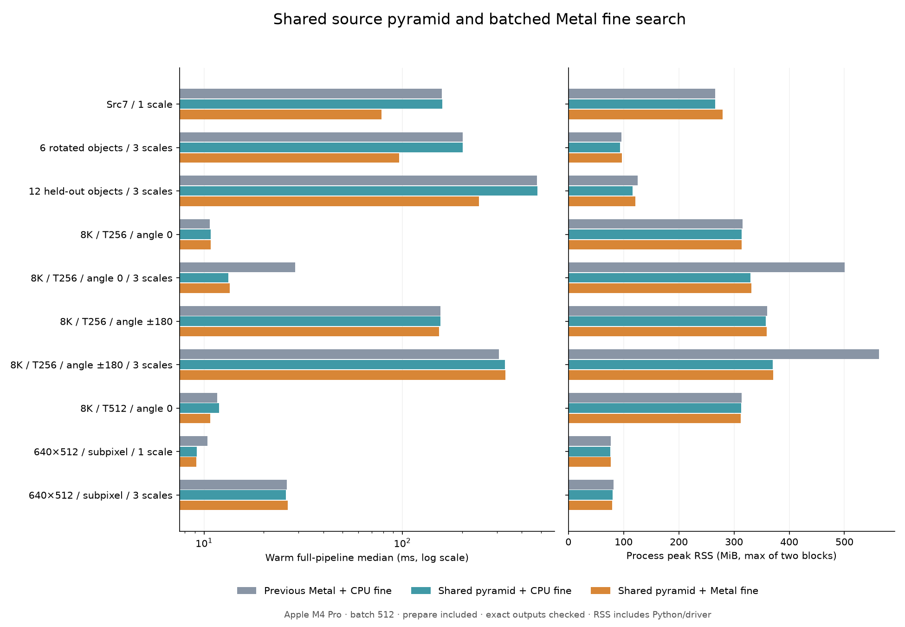

# 同圖跨尺度金字塔共用與 Metal 批次細搜尋

後續瓶頸改善見 [粗搜尋精確選峰與 GPU NCC 平行方式比较](COARSE_SELECTION_AND_PARALLEL_zh-TW.md)；此頁保留上一輪數據。

本輪從 `2c28ffbde86d3ef9840cb00c2d15268b5cf72624` 出發，增加明確的來源影像快照、跨尺度共用金字塔，以及可選的 Metal 局部旋轉／NCC。CPU 預設與 GUI 操作不變；這是有完整原始碼、可獨立驗證的實驗介面。以下數值與結論限於本輪 gray8 測試，不能推論 RGB、任意影像或全部裝置。

## 資料流程與快取邊界

```text
一次模型準備：各尺度 template → 學習 template 金字塔／均值／範數
每張新影像：prepare → 複製／反相一次 → 建到所有模型所需的最深層
  ├─ 尺度 A：粗搜尋 → 分組細搜尋 → CPU 候選選擇／次像素
  ├─ 尺度 B：讀同一份 source 金字塔 → 同上
  └─ 尺度 C：讀同一份 source 金字塔 → 同上
最後：跨尺度 NMS → 既有連續 pose／rescue（有啟用的案例）
```

`fpm_frame_prepare` 每次都刷新，不根據來源位址猜測內容是否相同。來源像素複製進 frame；呼叫者後續修改原陣列，不會改變已準備的快照。prepare 接收當次所有模型以決定最大金字塔深度，match 檢查深度、尺寸與反相設定。準備失敗後拒絕使用舊快照。Python 端驗證失敗也會關閉 matching readiness，直到下次 prepare 成功。

同一張圖的不同 template 尺度可共用來源金字塔，因為 source 的 Gaussian pyrDown 濾波與 template 尺度無關。template 的各尺度模型可預先學習並保留；**新影像的金字塔仍須由新像素計算**。這一輪沒有把影像內容「預編譯」，也沒有離線 metallib 或 GPU command buffer 重播。

Metal 金字塔的 input／output buffers 同時供細搜尋讀取，各層以 buffer offset 引用。每模型重設統計，但不清除本 frame 的來源對應，因此不必跨尺度重複上傳。新 prepare 清除來源對應；每模型清除 template 指標快取，防止銷毀後重建的模型重用同一記憶體地址而讀到舊模板。CPU 金字塔模式在第一次使用各層時上傳，之後在同 frame 內重用。

frame／pattern handle 不支援同時多執行緒寫入或 matching；需要並行 frame 時，各自建立 handle。frame 不擁有 pattern，呼叫 prepare／match 期間模型必須有效。buffer 採最大已用容量保留至 destroy，所以小圖接在大圖後，容量不一定下降。

## 細搜尋如何批次化

原本每候選依序旋轉、算 7×7 NCC、選角度，再進下一層。新版將至多 `fine_batch_size` 個候選分組，同一層與同一搜尋回合的旋轉請求一起送出。角度 bracket 擴張、角度步長減半、layer 0 的三次次像素處理、候選插入順序及 NMS 規則保留。

每批 GPU 先產生各請求的局部旋轉 ROI；CPU 修補極少數捨入不確定像素；GPU 再計算每個 ROI 的 49 個 NCC 視窗。**這裡旋轉的是來源影像的局部取樣區域**，template 保持原本像素。

每個 NCC 視窗由一個 SIMD group 分攤 template pixels，整數歸約三個統計量：

\[
S=\sum I_i,\quad Q=\sum I_i^2,\quad P=\sum I_iT_i.
\]

CPU 沿用原先 double normalization 計算 NCC。template 面積滿足 \(65025n\le 2^{32}-1\) 時使用 uint32；較大者用 uint64。64 位歸約拆成 16／16／32 位 limb，以 uint SIMD sum 後重新組合，保留進位。面積與 arena 上限會先檢查，避免溢位。

這一輪 **搜尋控制、停止／剔除判斷、peak、double normalization、次像素 fitting 與 NMS 仍在 CPU**。它不是整條 pipeline GPU 常駐。既有 pose resident refinement 是另一個獨立階段，不應和這裡的 pyramid fine search 混為一談。

## 為什麼旋轉仍能保留原 NCC 分數

原版使用 double 座標及 bilinear interpolation，最後四捨五入為 uint8。直接用 GPU float texture sampling，少量像素會跨過 0.5 邊界，足以改變 NCC 與後續選峰。因此使用有誤差界的 Q28 快速路徑，而非假設 float 足夠準確。

以 \(U=2^{28}\)，將 padded anchor、cos、sin 量化為 signed Q28。GPU 以整數計算 affine 座標與 bilinear 分子；分母為 \(U^2=2^{56}\)，最大分子 \(255\cdot2^{56}<2^{64}\)。加上 half-unit 再右移 56 位得到候選灰階值。

對 ROI 內 \(0\le x<w,0\le y<h\)，量化座標誤差每軸最多

\[
e_q=\frac{1+(w-1)+(h-1)}{2\cdot2^{28}}.
\]

再加原 double 運算的保守誤差界 \(32\epsilon(|a|+w+h-1)\)。zero-extended gray8 bilinear 函數在每個座標方向都是 255-Lipschitz，包括跨格與邊界，因此強度誤差界為

\[
E=255(e_x+e_y)+8192\epsilon.
\]

GPU 用整數判斷分子到最近半整數灰階門檻的距離；小於外向取整後的 \(E2^{56}\) 就標記。CPU 只對這些像素執行與原版相同表達式順序的 double 取樣。超出可證明座標／誤差界的請求，明確計入 `repair_all_maps` 並修補整個 ROI。沒有未記錄的 float 降精度。

目前每批仍有 **兩次 command buffer 提交／等待**：warp 後 CPU repair，以及 NCC 後 CPU double normalize／選峰。批次化减少的是逐候選排程成本，並未消除所有同步。後續若要完全消除此界線，需要 GPU 精確高精度取樣、或經獨立評估接受新的取樣／分數定義。

## 使用方式與完整原始碼

C ABI 新增 `FpmFrameConfigV1`（32 bytes）、`FpmFrameMetricsV1`（80 bytes）及 `FpmFineMetricsV1`（216 bytes），舊 ABI 結構未更動。細搜尋 `fine_batch_size=0` 為 CPU，`1..1024` 啟用 Metal；本輪正式實驗明確指定 512。單 ROI 限 64 MiB，批次也受 arena／統計 workspace 上限限制。

```python
# 從專案根目錄執行；PYTHONPATH=cpp-core/tools
import ctypes as C
import numpy as np
from coarse_experiment import CoarsePattern, SourceFrame, Config, Image

def view(a):
    assert a.dtype == np.uint8 and a.ndim == 2 and a.flags.c_contiguous
    return Image(a.ctypes.data_as(C.POINTER(C.c_uint8)),
                 a.shape[1], a.shape[0], a.strides[0])

# source_gray 與 scaled_templates 由呼叫者提供。
# scaled_templates 為預先生成的不同尺度灰階模板陣列。
models = []
try:
    for pixels in scaled_templates:
        models.append(CoarsePattern('build/fourier-gpu', view(pixels), 256,
                                    backend='cpu'))
    with SourceFrame('build/fourier-gpu', backend='metal',
                     pyramid_mode=1, batch_angles=4, fine_batch_size=512) as frame:
        config = Config(70, .8, .2, 180., 1, 0, 0, 0, None, 0)
        frame.prepare(view(source_gray), models)  # 必須計入每張圖總時間
        results = [frame.match(model, config) for model in models]
        memory = frame.frame_metrics  # 共用容量只計一次
        # 每組 result 是該尺度結果；跨尺度 NMS 由上層執行。
finally:
    for model in models:
        model.close()
```

- [核心排程／prepared pyramid](../src/matcher.cpp)、[內部契約](../src/internal.hpp)
- [公開實驗 C ABI](../experiments/coarse_ncc.h)、[frame 生命週期](../experiments/coarse_ncc.cpp)
- [Metal buffers／派工／CPU 修補](../experiments/coarse_metal.mm)
- [Q28 誤差界與原始 double 取樣](../experiments/fine_sampling.hpp)
- [GPU 金字塔、旋轉、NCC 完整 kernels](../experiments/coarse_ncc.metal)
- [Python binding](../tools/coarse_experiment.py)、[比較 harness](../tools/benchmark_shared_fine.py)
- [排程一致性測試](../tests/fine_scheduler_test.cpp)、[共享 frame 測試](../tests/shared_frame_test.cpp)、[GPU 邊界／取樣／64 位測試](../tests/fine_metal_test.cpp)

## 量測定義

凍結的舊 CPU 與舊 Metal 組合，對比目前未共用、共用＋CPU fine、共用＋Metal fine。各方法在新 process 串行跑，正反順序兩個 block，每 block 暖機至少一秒、測五次。每次 prepare 都在 proposal／total 計時內，沒有跨新影像偷用快取。另跑 profile 版本拆細階段；profile 關閉的 total 才作主要速度比较。

每個呼叫核對 ordered proposals、最終 match、refined pose 和 score；有 GT 的案例另外量測漏檢、誤檢及位置／角度／尺度誤差。來源與二進位 hash 在實驗前後核對。建構與第一張圖獨立記錄，暖機時間不等於冷啟動時間。

`wait_ms` 包含 GPU 執行與等待完成的 host wall；`device_ms` 是 GPU command 執行時間，不能和 wait 再相加。fine rotation／NCC 是互斥階段拆分；upload／encode／repair 是內含診斷，不能再加入 total。共享來源的準備成本單列且只加一次。

process peak RSS 包含 Python、影像與 driver；frame host／coarse GPU／fine GPU 是保留的 buffer 容量，與 RSS 重疊，不可相加。fine buffers 不重複計入已由 coarse pyramid 擁有的 source aliases。多尺度共用 frame 的容量只計一次。

## 正式結果：2026-10-13

環境：Apple M4 Pro（12 CPU／16 GPU cores）、48 GiB，macOS 26.6.2、AppleClang 21、Release。十組案例、八種含／不含 profile 設定、正反順序兩個 block，共 160 個新 process、800 次正式計時、160 次 first call、5,987 次暖機。完整有序輸出均與凍結 CPU 相同；before／after hash 未變。

下表為 profile 關閉時十次計時的 pooled median，單位 ms。舊 Metal 已包含上一輪的 Metal 金字塔與四角度粗 NCC；CPU 欄為凍結純 CPU proposal（實圖的後段 resident rescue 各方法相同）。

| 案例 | 凍結 CPU | 舊 Metal | 僅共用＋CPU fine | 共用＋Metal fine | 新／舊速度比 |
|---|---:|---:|---:|---:|---:|
| Src7（1尺度） | 175.26 | 158.52 | 159.18 | 78.37 | 2.02× |
| 6旋轉物件（3尺度） | 218.10 | 201.59 | 201.66 | 96.57 | 2.09× |
| 12旋轉物件（3尺度） | 521.24 | 476.32 | 480.14 | 243.80 | 1.95× |
| 8K／T256／0°（1尺度） | 95.16 | 10.69 | 10.80 | 10.78 | 0.99× |
| 8K／T256／0°（3尺度） | 270.86 | 28.75 | 13.26 | 13.47 | 2.13× |
| 8K／T256／±180°（1尺度） | 244.90 | 155.56 | 155.38 | 153.06 | 1.02× |
| 8K／T256／±180°（3尺度） | 614.87 | 306.72 | 329.84 | 330.81 | 0.93× |
| 8K／T512／0° | 99.20 | 11.64 | 11.93 | 10.76 | 1.08× |
| 640×512／次像素（1尺度） | 9.57 | 10.41 | 9.19 | 9.16 | 1.14× |
| 640×512／次像素（3尺度） | 36.81 | 26.11 | 25.91 | 26.45 | 0.99× |

**主要結果：大量細搜尋候選的三個實圖案例約 1.95–2.09×；8K 三尺度 0° 約 2.13×，主要來自金字塔共用。小圖／少候選的細搜尋沒有穩定 GPU 優勢。**

8K 三尺度 ±180° 必須列為退步：pooled median 306.72→330.81 ms。兩個配對 block 分別 +5.12%／+8.20%，皆在事先設定 max(10%, 2 ms) 的退步容忍門檻內，但「通過門檻」不等於「變快」。同組 CPU fine 共享版也退步；profile 獨立 process 又顯示較低時間，且各 block 有大幅波動，所以不能把差異直接歸因單一 kernel 或傳输。保留原始數據，不刪除慢樣本，也不以 profile 的較好時間替代正式成績。

每組比較 shared Metal fine 對凍結 CPU、舊 Metal、目前未共用、shared CPU fine 的配對效能門檻均通過。這支持作為可選方案；不足以把所有場合自動切到 GPU。GUI 預設仍不啟用此實驗模式。



### 記憶體

峰值 RSS 為兩個 process block 的最大值（MiB）。這不是純演算法配置量；含 Python、影像、driver，不能再加上 retained buffers。

| 案例 | 舊 Metal RSS | 共用＋CPU fine RSS | 共用＋Metal fine RSS |
|---|---:|---:|---:|
| Src7（1尺度） | 266.3 | 266.3 | 279.1 |
| 6旋轉物件（3尺度） | 95.8 | 93.4 | 96.7 |
| 12旋轉物件（3尺度） | 125.2 | 116.5 | 121.0 |
| 8K／T256／0°（1尺度） | 315.4 | 313.9 | 313.9 |
| 8K／T256／0°（3尺度） | 500.2 | 329.5 | 331.5 |
| 8K／T256／±180°（1尺度） | 360.4 | 357.6 | 359.0 |
| 8K／T256／±180°（3尺度） | 562.7 | 369.7 | 371.0 |
| 8K／T512／0° | 313.5 | 313.4 | 312.4 |
| 640×512／次像素（1尺度） | 76.6 | 76.3 | 76.6 |
| 640×512／次像素（3尺度） | 81.5 | 79.7 | 79.6 |

8K 三尺度 0° 的 RSS 500.2→331.5 MiB（約少 33.7%）；±180° 562.7→371.0 MiB（約少 34.1%）。新 frame 的 source host pyramid 約 85.31 MiB 只保留一份。Metal fine 額外容量：Src7 約 13.05 MiB、6／12 物件約 3.97 MiB、8K 三尺度 ±180° 約 1.32 MiB。因此單尺度／高解析 ROI 仍可能增加記憶體，例如 Src7 266.3→279.1 MiB。

### 瓶頸與 CPU／GPU 等待

以下來自獨立 profile process，不能和上表不含 profile 的總時間直接拼加。CPU／GPU欄只比較共享來源下的 fine rotation＋fine NCC；每張圖 preparation 已另計入完整總時間。

| 案例 | CPU fine rotation＋NCC ms | Metal fine rotation＋NCC ms | fine maps | Metal command buffers | GPU source 再上傳 |
|---|---:|---:|---:|---:|---:|
| src7 | 114.67 | 31.91 | 2199 | 16 | 0 bytes |
| controlled6 | 138.24 | 40.73 | 13059 | 72 | 0 bytes |
| heldout12 | 301.39 | 89.12 | 27960 | 142 | 0 bytes |

六物件 formal profile：細搜尋 wall 約 41.12 ms，其中 host wait 約 38.12 ms、GPU device 約 27.97 ms；upload 僅約 0.044 ms，CPU uncertainty repair 約 0.447 ms。來源層沒有再上傳。**這裡剩餘成本主要是 GPU 計算與提交／同步，不是搬動整張 source 的傳輸。** wait−device 不是純 API 開銷的精確分離，只能視為等待中非 device 的粗估；沒有用它宣稱獨立傳輸耗時。

同六物件的 128 tuning cap 需 272 個 command buffers；512 formal cap 降為 72，所有 13,059 張 score maps 不變。各階段重排沒有略過原候選。Q28 repair：Src7 7,446／21,165,960 pixels（0.0352%）；六物件 2,191／25,207,124（0.00869%）；十二物件 7,523／56,274,546（0.0134%）。正式所有 Metal fine 記錄的 repair_all_maps=0。

十二物件的 CPU peak selection 仍约 85 ms，coarse rotation 約 12.5 ms、coarse NCC 約 36.9 ms；下一個明顯目標是粗搜尋／選峰的批次或 GPU 化。8K 全角度則由 coarse rotation／NCC 主导；搬 fine 本來就不能期待同樣倍數。小圖 fine device 約 1.44 ms、host wait 約 5.13 ms，說明工作太少時同步成本仍顯著。

### 精度、驗證及限制

六物件與十二物件分別全數找回，FP=FN=0；最大位置誤差 0.0228／0.0903 px，最大角度誤差 0.0271／0.0503°，最大相對尺度誤差 0.191%／0.250%。其他有 GT 的 8K／小圖也全部零漏檢零誤檢。8K 的六個 planted objects 是正立、scale=1 的固定測資，即使搜尋範圍開到 ±180°／三尺度，也不能聲稱已測試 8K 任意旋轉尺度物件。真正非零角度及非1尺度由六／十二物件案例覆蓋。Src7 無獨立 GT，只能證明與舊版一致。

這是一項保留算法結果的效能更改，沒有提高或修復舊算法的共同失敗，也沒有保證全域最優。小圖兩組另測 stop_layer=0、subpixel=1；其餘 proposal 使用 stop_layer=1、subpixel=0，實圖再套既有 pose rescue。

- Release：19／19 通過。
- ASan＋UBSan、scalar Debug：17／17 通過。macOS 此工具鏈不支援 LeakSanitizer；首次 detect_leaks=1 明確失敗，改用支援的 detect_leaks=0，**未聲稱已通過 leak 檢查**。
- 純資料 harness：6／6 通過，另驗證 Python CPU 預設、context manager、failed prepare readiness 與恢復。
- Metal 局部 map 測試：1,812 張 ×49 個 double scores 逐值相同，覆蓋邊界、半像素、狹長影像、constant template、CPU／direct／separable 金字塔、同位址新像素、真正超 uint32 的統計及超大 finite anchor 修補。
- frame 測試覆蓋混合深度、2＋2 真實匹配、反相、模板銷毀重建、容量不足不得部分寫入、ABI 尺寸／版本及失敗狀態。

暖機不包含 model／Metal pipeline 初始化。shared Metal fine 的「建構＋第一張」六物件約 150–154 ms、Src7 約 166–167 ms、8K 三尺度全角度約 512–532 ms；這還會受 OS shader cache 影響，不是無快取冷啟動保證。

### 重跑與封存

[正式摘要](shared-fine/formal-summary.json)、[protocol](shared-fine/protocol.json)、[驗證清單](shared-fine/validation.json)、[原始結果封存](shared-fine/raw-results.tar.gz)、[封存 SHA-256](shared-fine/archive-sha256.json) 一併保留。封存包含正式／pilot／tuning 的 job、worker 結果、完整輸出／GT、warmup digest、stderr、測試日誌與正式量測源碼。可由固定種子重建的大圖和平台 binary 不提交，雜湊與凍結 baseline provenance 保留。

```sh
cmake -S cpp-core -B build/fourier-gpu -DCMAKE_BUILD_TYPE=Release -DFPM_BUILD_EXPERIMENTS=ON
cmake --build build/fourier-gpu --parallel 8
ctest --test-dir build/fourier-gpu --output-on-failure
# baseline 必須是上述 commit 的三個 library，並有經核對的 baseline-provenance.json。
python-port/venv/bin/python cpp-core/tools/benchmark_shared_fine.py \
  --methods frozen_cpu,previous_combined,current_unshared,shared_cpu_fine,shared_metal_fine,current_unshared_profile,shared_cpu_fine_profile,shared_metal_fine_profile \
  --blocks 2 --repeats 5 --warmup-seconds 1 --fine-batch-size 512 \
  --output build/shared-fine/formal.json
# 純資料重建：解開封存後，以 root 明確指定新的 archive 位置。
python-port/venv/bin/python cpp-core/tools/benchmark_shared_fine.py \
  --summarize /path/to/archive/formal.json --worker-root /path/to/archive \
  --output /path/to/replayed-summary.json
```
