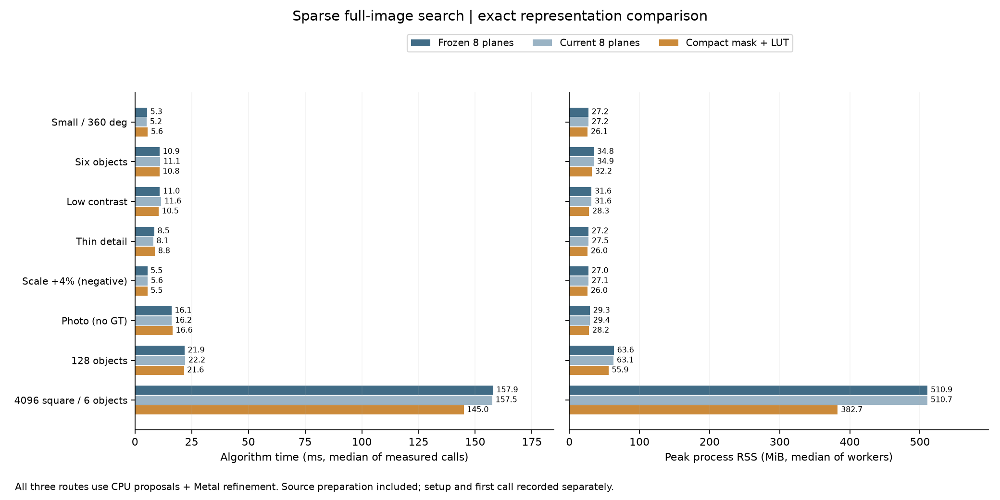

# 稀疏方向回應的等價壓縮：單張 bitmask＋2 KiB 查表

日期：2026-10-14。這輪延續完整C++無金字塔、固定尺度全圖搜尋；只改中間資料表示，不改特徵、步距、角度、選峰、候選上限或後段NCC。數學與其他agent提出的後續方向見[推導文件](SPARSE_NEXT_STEPS_MATH_zh-TW.md)。

2026-10-15後續：同一執行期已補齊八圖／compact各自的[全CPU與Metal精修對照](SPARSE_CPU_METAL_zh-TW.md)。多數場景CPU較快，128物件打平且CPU較省記憶體；本頁保存第17輪表示比較的歷史數值，最新後端建議見後續報告。

## 數學上為什麼能不改分數

每個來源像素的鄰域方向集合只有8個bit，共256種。原程式將它展開成8張方向回應圖；現在可保留集合M，以`L[b,M]`查出相同回應。L只有8×256個uint8，即2KiB。

```text
原表示：R_b(x) = L[b, M(x)]，事先存下8個R平面
新表示：只存M(x)，評分時查同一個L[b, M(x)]
```

每次回應、每候選的整數加總及提前排除界相同，因此選峰與後段NCC收到相同種子。這是**既有量化稀疏分數的等價表示**，不代表稀疏分數等於NCC，也不會修復原有漏檢風險。

來源回應payload從`8N`降為`N`；建圖時原有三張byte暫存仍在，故來源建圖payload由`11N`降至`3N`，另外計共用LUT。每個特徵多一次依賴查表；不能宣稱來源讀取次數少八倍、速度快八倍或cache永久命中。這輪沒有新增Metal提案kernel。

## 實作與使用

```cpp
fpm::research::Settings settings;
settings.sparseOrientation = true;
settings.scales = {1.};
settings.sparse.responseMode = 1; // 單張mask＋LUT；0保留八圖參考
```

其他限制和[第16輪](SPARSE_ORIENTATION_zh-TW.md)相同：完整NCC精修必須啟用，`stopLayer=0`，固定尺度1。預設`responseMode=0`保留，GUI沒有新增此選項。兩個新模式共用相同唯讀LUT；模式分支在worker入口、特徵迴圈之外，特徵迴圈透過C++17編譯期特化，沒有逐特徵判斷模式。

`sparse.source_bytes`是搜尋期間持有的來源回應容量，每次run結束釋放；不是Session常駐容量。`lookup_bytes=2048`是程序共用表，不應乘以模型或執行緒數。`working_bytes`仍是部分配置估計，不能當allocator峰值或RSS上界；RSS另量。

完整源碼：[表示與搜尋](../experiments/sparse_orientation.cpp)、[API](../experiments/sparse_orientation.hpp)、[原生runner](../tools/native_pipeline_runner.cpp)、[85組精確契約測試](../tests/sparse_orientation_compact_test.cpp)、[三路比較工具](../tools/benchmark_sparse_compact.py)、[報告與封存工具](../tools/report_sparse_compact.py)。

## 比較方法

三條路徑串行比較：凍結`70727a8`八圖binary、目前建置的八圖模式、目前建置的compact模式。舊binary／舊輸入／舊源碼SHA先核對；新來源與輸入在事前protocol凍結，完整來源snapshot與baseline archive另有SHA。三路同一圖片、角域、特徵128、位置步距4、擴散2、方向門檻0.75、最終NCC0.8、候選與最終上限256。

保留第16輪七個場景，另加4096×4096的六物件合成場景，±20°、原生像素64×48模板。新增大圖用於表示的尺寸擴展，不是8K／全角度或新相機真值。小圖另測CPU後段，其餘後段Metal；所有提案仍是CPU。每組兩block正反順序，各3次正式呼叫，暖機至少1秒；建立Session與首次呼叫獨立列出，解碼與JSON不在演算法計時內。

比較全部有序提案、最終輸出與搜尋工作量的JSON數值一致性；這不等於浮點位元比較（例如+0／−0）。獨立GT仍分開計算，原128場景提案127/128失敗和尺度+4%負控制保留。速度gate為每block相對兩個參考各不超過`max(2ms,10%)`，記憶體gate為不增加超過`max(32MiB,10%)`；通過容忍不等於確實加速。

## 正式結果與決定

Apple M4 Pro、48 GiB、Release。8場景，小圖另測CPU，共54個新程序、162次正式呼叫。來源／binary／輸入與snapshot SHA均不變。三路所有有序候選、最終輸出、評估特徵數、視窗數和門檻存活數的JSON數值完全相同，重複呼叫也一致。

下表是Metal後段，時間為每路6次正式呼叫的中位數；RSS為兩個程序峰值中位數。

| 場景 | 凍結八圖 ms | 目前八圖 ms | compact ms | peak RSS MiB（目前八圖→compact） |
|---|---:|---:|---:|---:|
| 小圖全360° | 5.35 | 5.19 | 5.64 | 27.20→26.15 |
| 六物件 | 10.87 | 11.12 | 10.82 | 34.89→32.18 |
| 低對比 | 10.96 | 11.58 | 10.47 | 31.58→28.26 |
| 細線 | 8.53 | 8.09 | 8.78 | 27.49→26.02 |
| 尺度+4%負控制 | 5.47 | 5.61 | 5.50 | 27.11→25.98 |
| Src4無GT實圖 | 16.10 | 16.24 | 16.58 | 29.35→28.24 |
| 128物件 | 21.86 | 22.17 | 21.58 | 63.14→55.85 |
| 4096²／六物件 | 157.92 | 157.52 | 144.95 | 510.74→382.73 |



**compact通過所有成對的速度／記憶體容忍門檻，但不是每例加速。** 同建置小圖5.19→5.64ms、細線8.09→8.78ms、Src4實圖16.24→16.58ms，均有退步；CPU小圖1.805→1.805ms幾乎不變、RSS19.74→18.69MiB。這輪最清楚的優點是大圖記憶體。

4096²同建置八圖→compact：總時間157.52→144.95ms（快約8.0%），peak RSS510.74→382.73MiB（少128.01MiB、約25.1%）；來源回應表示128→16MiB，來源建圖配置估計176.002→48.002MiB（含共用2KiB LUT）。這些buffer容量和RSS不能相加，也不能把峰值差完全歸因到某一個單獨配置。

**建圖省下的工作被較慢的掃描部分抵銷。** 同建置4096²來源準備94.14→67.49ms，掃描45.08→58.89ms；128物件準備9.20→7.33ms，掃描2.95→4.16ms，總時間22.17→21.58ms、RSS63.14→55.85MiB。這支持「避免展開有益」，同時證實「多一次依賴查表可能拖慢掃描」，沒有硬體cache／頻寬counter可證明具體微架構原因。

首次使用成本另列：4096²同建置建立約1.10→1.17ms，首次run229.98→208.93ms；128約0.18／0.18ms建立、64.77→62.83ms首次run。暖機結果不代表第一次呼叫時間。

新增4096²六個物件三路均找齊、零FP／FN，最大位置誤差0.06674px、角度0.07445°、尺度皆1。連同前輪重用資料，共144個正常合成姿態、三路最終皆零FP／FN；既有128提案鄰域仍是127/128，+4%尺度負控制仍不合格，無GT實圖仍24個結果。compact完全不改這些成功與失敗，沒有宣稱改善召回率。

**採用決定：新增明確的省記憶體研究選項，保留八圖模式與金字塔通用預設。** 本機大圖可試`settings.sparse.responseMode=1`；小圖需按總時間選擇。下一個優先改善是來源梯度／方向建置的有限輸入查表或串流分塊，與compact分開做變因；若搬Metal，應比較建圖、掃描與候選整理的連續批次，避免GPU建圖後又等待CPU掃描。

## 驗證與完整證據

- Release完整31/31通過，含原有GUI／CPU／Metal及新compact契約；ASan／UBSan受影響的稀疏契約、量化與compact共3/3通過，`detect_leaks=0`，沒有宣稱LeakSanitizer通過。
- 新compact測試85組逐值提案／工作量比對，另含CPU完整NCC、反相來源、固定尺度、非法模式、記憶體容量與閾值邊界。首次門檻測試資料未產生非滿分而失敗，修正為獨立亂數紋理後通過；保留原失敗日誌，未為此改runtime。
- Python實驗稽核5/5通過，包含錯誤提案分數、錯誤容量、缺worker及被修改原始檔的負控制。
- 128 compact另啟用Metal API／GPU Shader Validation，日誌確認啟用，首次與重複結果128/128、沒有驗證錯誤；插裝時間不列效能比較。
- 所有正式數據以事前規則產生；原始worker、輸入、完整受測源碼、凍結baseline源碼及試跑均封存。解壓到其他目錄，重新計算的摘要與保存摘要byte相同。

[事前protocol](sparse-compact/protocol.json)・[正式摘要](sparse-compact/results.json)・[驗證與SHA](sparse-compact/validation.json)・[完整原始資料／源碼封存](sparse-compact/raw-results.tar.gz)・[封存重播檢查](sparse-compact/artifact-sha256.json)。

本輪沒有新相機真值、遮擋／雜亂背景、8K全角度、CUDA或GPU compact kernel驗證；保留這些限制。數學建議、其他agent的優先序，以及FFT／旋轉基底的適用差異見[下一步推導](SPARSE_NEXT_STEPS_MATH_zh-TW.md)。
