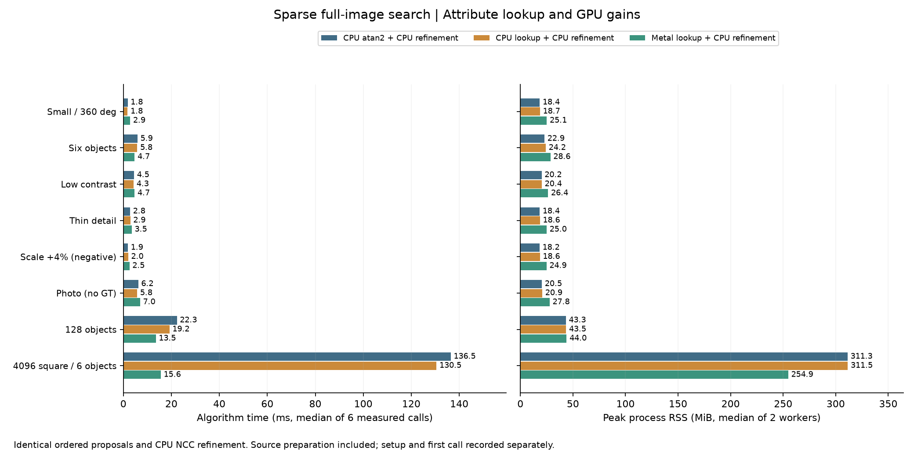

# CPU精確方向查表：拆開數學化簡與Metal平行的收益

日期：2026-10-15。第20輪承接[Metal稀疏前段](SPARSE_METAL_FRONTEND_zh-TW.md)，讓CPU也使用同一份有限梯度方向查表。目的不是預設CPU或GPU勝出，而是在相同數學處理下比較完整流程的時間、記憶體與準確度。

## 正式結果與建議

同一台Apple M4 Pro、48GiB、Release；表內時間為6次正式呼叫的中位數，單位ms。四路後段都固定CPU NCC精修。

| 場景 | 凍結CPU | 同建置CPU | 查表CPU | Metal前段＋CPU精修 |
|---|---:|---:|---:|---:|
| 小圖、全角度 | 1.83 | 1.80 | 1.78 | 2.85 |
| 六物件 | 5.97 | 5.89 | 5.79 | 4.69 |
| 低對比、兩物件 | 4.74 | 4.45 | 4.29 | 4.67 |
| 細線 | 2.74 | 2.81 | 2.91 | 3.51 |
| 尺度+4%負控制 | 1.90 | 1.89 | 2.03 | 2.54 |
| Src4實圖、無GT | 5.90 | 6.22 | 5.76 | 6.98 |
| 128物件 | 23.53 | 22.33 | 19.23 | 13.55 |
| 4096²、六物件 | 133.67 | 136.47 | 130.53 | 15.61 |

| 場景 | CPU峰值RSS MiB | 查表CPU MiB | Metal前段＋CPU MiB |
|---|---:|---:|---:|
| 小圖、全角度 | 18.40 | 18.69 | 25.15 |
| 六物件 | 22.94 | 24.17 | 28.57 |
| 低對比、兩物件 | 20.25 | 20.38 | 26.40 |
| 細線 | 18.36 | 18.61 | 25.01 |
| 尺度+4%負控制 | 18.25 | 18.58 | 24.89 |
| Src4實圖、無GT | 20.48 | 20.86 | 27.83 |
| 128物件 | 43.30 | 43.49 | 43.96 |
| 4096²、六物件 | 311.32 | 311.50 | 254.90 |

RSS為兩個新程序各自峰值的中位數；速度容忍為每block相對指定基準最多增加`max(10%,2ms)`，記憶體容忍最多增加`max(10%,32MiB)`。這些是回退容忍，不是顯著加速的判準。

**相同查表後，大圖GPU優勢仍成立。** 4096²由原CPU136.47→查表CPU130.53ms，改善約4.3%；Metal前段15.61ms，相對查表CPU仍快8.36倍，程序峰值RSS由311.50降至254.90MiB（少56.60MiB）。正反兩block的Metal／查表CPU時間比分別0.117／0.125，即8.53／8.00倍。不能再將這個差距解釋成只省掉atan2，但仍含來源建圖並行、稀疏搜尋與配置差異，不是純硬體算力倍率。

128物件原CPU22.33→查表CPU19.23ms，改善約13.9%；Metal前段＋CPU精修13.55ms，相對查表CPU快1.42倍，RSS43.49→43.96MiB。兩block的Metal／查表CPU比分別0.758／0.605（1.32／1.65倍）。各路單次有波動，例如原CPU22.13～29.39ms、Metal11.25～15.19ms；本輪沒有功耗／時脈counter或長期尾端延遲統計，不能將6次量測推成穩定p95或交叉點曲線。

**小圖與低工作量繼續保留CPU。** 小圖查表只省約0.03ms，細線完整流程反而2.81→2.91ms；六物件CPU查表兩block一快一慢（0.962／1.013），不要宣稱小幅變化都穩定成立。低對比查表CPU4.29ms，比Metal4.67ms快；Src4實圖查表CPU5.76ms，但無GT不能憑輸出數量判準確。

本輪所有時間／RSS容忍gate通過，仍不等於全面加速：Metal相對查表CPU的小圖慢約60%、細線慢21%、Src4慢21%，只是增加量小於2ms門檻。當前CPU與凍結CPU控制亦全數通過容忍，原始數字與每block結果全部保留。合併6次的中位數與每block中位數比較不是同一統計量，不可互換。

建議保留可選查表CPU，適用於反覆使用模板的CPU路徑；4096²繼續選Metal前段＋CPU精修。128也可選Metal前段；第19輪Metal精修組合仍是可用研究選項，但本輪未重新量該後端，不將不同輪的19.23ms與11.03ms直接相除。GUI、預設與自動分流沒有改動。



CPU每個非空模型新增261121bytes（約0.249MiB）唯讀表；實際程序RSS差額約0.13～1.23MiB，不能將表容量當成程序峰值差額。Metal前段buffer容量與前輪相同，128約6.03MiB、4096²約64.00MiB；與RSS重疊，不相加。

模型建立時間：原CPU約0.04～1.44ms、查表CPU1.73～3.14ms，配對增加約1.66～1.73ms；Metal前段約25.99～30.37ms。小圖首次呼叫CPU／查表CPU／Metal為2.10／2.03／8.86ms，4096²為170.09／163.41／62.20ms。這些為兩程序的中位數，與建立時間分開保存；一次性比對與模板重複使用的選擇應分開考量。

## 準確度與成本歸因

64程序、192次正式呼叫全部成功；有序原始候選、整數搜尋工作量及最終CPU精修結果四路逐值相同，各路重複呼叫一致。六個正常合成場景共144個不同真值姿態全部零FP／FN，最大位置誤差0.12021px、角度0.23185°，尺度皆1；GT門檻為2px／1°／相對尺度2%。這是重用資料，不是新增盲測144筆。

128粗提案捕獲鄰域仍127/128，後段才找到全部；尺度+4%負控制仍TP0／FP1／FN1，Src4仍24結果但無GT。這次是精確等價移植，沒有改善這些已知召回／假設限制。

| 場景 | 建圖：CPU／查表CPU／Metal ms | 完整提案：CPU／查表CPU／Metal ms | 精修：CPU／查表CPU／Metal前段後的CPU ms |
|---|---|---|---|
| 小圖全角 | 0.278／0.256／0.142 | 0.893／0.870／1.910 | 0.913／0.903／0.928 |
| 128物件 | 7.942／4.604／1.242 | 12.400／9.070／3.371 | 9.812／10.037／9.672 |
| 4096² | 69.951／64.405／5.535 | 132.786／126.935／11.547 | 3.675／3.843／4.035 |

查表對128建圖較明顯（7.94→4.60ms），對4096²建圖只有69.95→64.41ms；原CPU只在梯度超過門檻時才呼叫atan2，而且建圖時間也包含配置與兩段OR擴散，不能用總像素數估算被省去的atan2次數。這裡未另外拆分梯度／擴散時間，尚不能將64.41ms全部歸因某一段。

4096²即使用查表，CPU仍需約61.47ms稀疏掃描，Metal搜尋區間約6.00ms；單換方向量化不會消除掃描工作。Metal前段複製0.265、編碼0.046、等待11.088、讀峰0.008ms；等待內GPU區間10.271ms，共4次提交／等待、21個派工，並未變成全GPU流程。這組資料不支持傳輸是大圖前段的主要成本；GPU區間仍包含派工、記憶體與相依等待，沒有證明ALU或頻寬已飽和。

## 演算法不必依賴異構架構

目前數學流程是方向特徵提案＋完整NCC精修。它可以完全由CPU執行，方向建圖、稀疏評分與局部選峰也已有Metal實作；異構是目前的排程選擇，不是NCC或稀疏方向公式的必要條件。

模板學習與預算、候選整理、救援控制及最終NMS仍有CPU工作。這些可以設計GPU版本，但候選排序、逐峰抑制、有效數量與收斂都有相依關係；搬到GPU不會讓相依關係消失。若要保留現有輸出順序與規則，仍須處理同步與精確同分政策。

現有精修包含許多小kernel；「每個kernel都在GPU」與「適合GPU的融合執行」是不同層次。候選內完成取樣、歸約、求解、重試與停止是下一個可研究方向，並可能受暫存器／工作組容量與少量候選的平行度限制。本輪未實作融合精修或全GPU候選整理，沒有測出全GPU方案優於或劣於最佳異構方案。

現有[Metal常駐精修](../experiments/pose_metal.mm)已把迭代、試步接受與停止留在GPU，因此動態工作不是必須交回CPU的理由。但[救援流程](../experiments/pose_ncc.cpp)仍由CPU驗分、選救援種子與比較結果，[完整排程](../experiments/research_pipeline.cpp)仍在CPU組種子、最終排序與NMS。「Metal前段＋Metal精修」仍不能命名為全GPU版本。

可單獨驗證的下一步包括：將來源建圖與第一批搜尋合併提交，移除不需要CPU讀值的中途等待；融合小模板的單候選精修；讓來源與候選在前後段共用GPU資源。每一步都需保留目前CPU有序候選和獨立GT基準，不能用不同候選預算換取速度卻稱相同運算。

## 相同查表如何保留數學定義

「CPU查表」是先把有限輸入的計算結果存好，搜尋時直接讀取。例如左右亮度差20、上下亮度差10，原本每遇到一次都要算方向並分類；現在建立模型時先算出這組差值的分類，之後每張圖直接取用。這張表約255KiB，每個非空模型一份，與原本方向分類完全一致。

它加速的是稀疏前段的局部邊緣方向計算；旋轉角度搜尋、位置搜尋與完整NCC精修仍照常執行。表內八個方向類別是原本已有的特徵表示，不是將物件旋轉搜尋限制成八個角度。新圖仍須讀取像素、計算亮度差與建立方向圖。

灰階8-bit中心差分可寫成：

```text
dx = I(x+1,y) − I(x−1,y), dy = I(x,y+1) − I(x,y−1)
gx = dx/2, gy = dy/2, dx,dy ∈ {−255,…,255}
Gτ(dx,dy) = 0                            若 gx²+gy² < τ²
             1 << quantize(atan2(gy,gx))  其餘
```

只有511²=261121組輸入，建立模板時以原來double運算及量化規則完整計算。每次搜尋改用整數差分查同一byte表；表內包含梯度門檻，因此不同門檻須建立不同模型，不能共用錯誤設定的表。來源邊框仍為零，模板抽特徵、擴散、角度位置搜尋與整數剪枝保持不變。

CPU舊路徑與查表路徑並存，預設仍為舊路徑；Metal原本已使用查表，本輪只共用生成函式，不改shader或GPU排程。CPU查表是每模型唯讀資源，可供並行呼叫共用；空特徵模型不建立表。

## 使用方式與指標

```cpp
fpm::research::Settings settings;
settings.sparseOrientation = true;
settings.scales = {1.};
settings.sparse.responseMode = 1;
settings.sparse.searchBackend = 0;
settings.sparse.cpuGradientMode = 1; // 0保留逐像素atan2
settings.backend = 0;               // 本輪四路都用CPU NCC精修
```

`cpuGradientMode`只控制CPU來源建圖；Metal仍固定使用LUT。`gradientMode`回報實際路徑，`gradientLookupBytes`回報查表容量：CPU已包含於templateBytes，Metal已包含於gpuBufferBytes，不可再相加。workingBytes是部分暫存估計，不是程序RSS。

完整[C++來源](../experiments/sparse_orientation.cpp)、[設定／指標](../experiments/sparse_orientation.hpp)、[原生runner](../tools/native_pipeline_runner.cpp)、[CPU查表測試](../tests/sparse_orientation_gradient_test.cpp)保留。

## 事前比較方法

四路皆compact且CPU精修：凍結第19輪8e0bd61 CPU、同建置逐像素atan2 CPU、同建置查表CPU、同建置Metal前段。沿用八場景、模板、角域、步距、候選上限與救援預算；正常GT、尺度+4%負控制與無GT實圖全部保留。沒有加入新測試集或依結果調參。

兩block正反執行順序，64個新程序，各先暖機至少1秒再量3次，共192次正式呼叫；建立模型與首次呼叫另列。全部路徑要求原始候選、整數工作量與CPU精修後結果逐值等於凍結版，各次結果另外對獨立GT評分。GT與真值物件數只交給父程序評分，搜尋程序沒有GT或真值ROI。

先比較查表CPU對原CPU，再比較Metal前段對查表CPU；後者仍包含不同記憶體配置、建圖／搜尋排程與CPU等待，不能當成純GPU晶片算力倍數。總時間包含每次來源建圖、搜尋與精修，排除讀圖／JSON／模型建立；準備時間已含於proposal，device時間已含於wait，不能重複相加。程序峰值RSS、模型表容量與GPU buffer分列。

CPU來源梯度與水平／垂直OR擴散本輪仍為單執行緒；`cpuThreads=8`是稀疏角度掃描的設定，不能把來源建圖稱為八核心實作。尚未加入列平行、SIMD／分塊或常駐執行緒池；相同LUT對照是必要的一步，不代表CPU或GPU已到效能上限。

正式來源與輸入依protocol凍結，原始逐次結果與測試日誌封存，並驗證換目錄離線重播。

## 測試與覆蓋界線

Release完整33/33通過；ASan／UBSan受影響四項通過，`detect_leaks=0`，不宣稱LeakSanitizer。新CPU測試78組候選／角點／工作量精確一致，涵蓋八圖與compact表示、所有511²灰階差分、獨立內積最近方向的各bin存活數、梯度與分數門檻相鄰double、17特徵尾批、角域端點、非連續row stride、極小與空特徵模型、同位址來源變更、大小切換、同分cap及共享模型並行呼叫。這是對可觀察候選與工作量的驗證，沒有宣稱直接讀出所有中間像素圖。

Metal原有57組測試啟用API／Shader Validation後通過，並加入實際梯度模式與查表記憶體指標驗證；新Python驗收工具14項通過，包括模式被忽略、查表容量錯誤、GPU回退、候選／工作量／最終值／worker檔案被改、缺worker、以及四路共同錯誤仍被獨立GT拒絕。多agent分別實作、寫測試與比較工具，另由獨立agent唯讀審查，正式量測期間沒有並行GPU工作。

此輪沒有更改GUI選項或預設，沒有新增多模板、遮擋、RGB全圖、相機串流、CUDA或其他硬體結果，也沒有修復既有尺度假設違反與粗提案覆蓋失敗。

## 完整來源、資料與重播

正式來源、binary、input及snapshot雜湊前後一致；封存645個內容檔（22,527,796bytes），逐檔SHA核對通過，解壓到另一個目錄後重算摘要與保存摘要byte相同。完整演算法、測試與實驗工具來源、輸入、事前protocol、逐次worker資料、試跑、建置與驗證日誌都保留；binary僅記SHA，完整專案由本Git版本保存。

[事前規則](sparse-cpu-lut/protocol.json)・[正式摘要與block結果](sparse-cpu-lut/results.json)・[驗證結果](sparse-cpu-lut/validation.json)・[完整來源與原始封存](sparse-cpu-lut/raw-results.tar.gz)・[封存SHA與重播證據](sparse-cpu-lut/artifact-sha256.json)。

[量測工具](../tools/benchmark_sparse_cpu_lut.py)預設新build為`build/sparse-cpu-lut`、凍結CPU為`build/sparse-metal`。基準必須符合第19輪protocol的binary SHA；重建或換機需建立新的基準識別與protocol，不冒用原SHA。新建置開啟`FPM_BUILD_EXPERIMENTS=ON`、`FPM_BUILD_GUI=ON`、Release，Qt提供原生runner影像解碼；測試另開`FPM_BUILD_TESTS=ON`。離線摘要重播不需GPU或原binary，封存README提供命令。[報告工具](../tools/report_sparse_cpu_lut.py)負責繪圖、封存、全部雜湊與搬移重播驗證。

後續第21輪已實作[來源建圖與首批搜尋合併提交](SPARSE_METAL_MERGE_zh-TW.md)，非空搜尋少一次等待，但128物件速度回退，仍保留原分開提交預設；完整失敗與複查保留。
