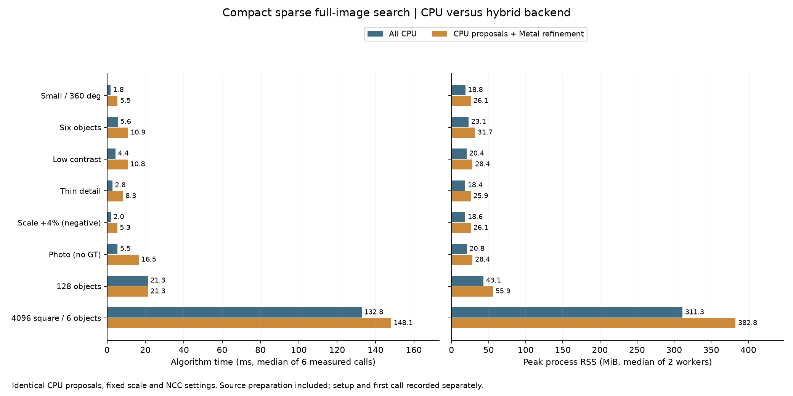

# 固定尺度稀疏搜尋：全 CPU 與 Metal 精修對照

整理：2026-10-15。**在目前這條稀疏搜尋流程與本機受測資料上，多數場景全 CPU 更快且更省記憶體；128 物件幾乎打平。** 因此這條研究路徑先建議 CPU，不能延伸為原有金字塔流程或未實作的全 GPU 搜尋也應全部採 CPU。本輪沒有修改演算法、GUI 預設或自動 routing。

## 比較範圍

受測執行期為 `ae0489fe90f035e4dcbdc0b7e9c989b15ac7361b`，沿用第17輪的 Release runner 與兩個動態庫，SHA 完全相同。Apple M4 Pro、48 GiB、macOS 26.6.2，CPU 設定8執行緒。新增的是實驗、驗收與封存工具。

兩路皆在 CPU 執行來源方向建圖、稀疏全圖搜尋與候選整理。差別在後段：`backend=0` 用 CPU NCC 精修／救援；`backend=1` 用 Metal 常駐精修／救援，仍含 CPU 最終驗分。這不是全 CPU 與全 GPU 的比較。

八張回應圖（`responseMode=0`）與 compact（`responseMode=1`）各自比較兩種後端。八個重用場景、四條路徑、正反順序兩個 block，共64個獨立程序；每程序至少暖機1秒後量3次，共192次正式呼叫。來源、模板、角域、特徵128、位置步距4、角步距6°、擴散2、候選上限256、稀疏門檻0.75、最終NCC門檻0.8相同，尺度鎖定1。搜尋程序不取得 GT、物件數或真值 ROI。

總時間包含每次重新建來源方向圖、搜尋、精修／救援與 NMS；解碼、JSON、Session 建立與首次呼叫另外記錄。`proposal_ms` **已包含** `prepare_ms`，不可重複相加。各欄中位數也不必恰好相加等於總時間中位數。

## 結果

下表為 compact；時間是每路6次正式呼叫中位數，RSS 是兩個程序峰值的中位數。完整八圖及 compact 數值、兩個 block 與逐次資料在[結果](sparse-backends/results.json)。RSS 包含程序與驅動資源，不能和另外記錄的 shared GPU buffer 容量相加。

| 場景 | 全 CPU ms | CPU＋Metal 精修 ms | 全 CPU peak RSS MiB | 混合 peak RSS MiB | 最終驗證 |
|---|---:|---:|---:|---:|---|
| 256²，小圖全360° | 1.82 | 5.47 | 18.83 | 26.07 | 1/1，零FP／FN |
| 768×512，六物件 | 5.62 | 10.93 | 23.05 | 31.74 | 6/6，零FP／FN |
| 低對比 | 4.37 | 10.76 | 20.37 | 28.37 | 2/2，零FP／FN |
| 細線 | 2.79 | 8.32 | 18.41 | 25.94 | 1/1，零FP／FN |
| 尺度+4%負控制 | 2.01 | 5.34 | 18.57 | 26.10 | 兩路仍失敗 |
| Src4實圖 | 5.47 | 16.54 | 20.82 | 28.38 | 均24結果，無GT |
| 1536×768，128物件 | 21.30 | 21.33 | 43.11 | 55.93 | 128/128，零FP／FN |
| 4096²，六物件 | 132.76 | 148.13 | 311.31 | 382.80 | 6/6，零FP／FN |



128物件的兩個 block，Metal／CPU 時間比各為1.009與0.997，勝負交錯；這是打平，不能報成穩定 CPU 加速。其餘 compact 場景兩個 block 都是 CPU 較快。八圖比較方向一致：小圖1.76／5.96ms、六物件5.97／11.13ms、128物件22.12／22.20ms、4096²為145.37／158.50ms。

首次呼叫有更大的差距：compact 小圖 CPU 兩程序約2.11／2.80ms，Metal 約39.53／39.56ms；4096² CPU 約166.63／165.60ms，Metal 約212.37／204.90ms。首次呼叫包含延後建立的 pose 資源等成本，不能當成純 GPU 核心時間，也不能用暖機表替代。

## 精準度與工作量

所有路徑的**有序原始候選與稀疏搜尋整數工作量相同**，各路重複輸出一致；CPU 後端確認沒有 pose GPU 配置，後端選擇與固定尺度契約通過。CPU 與 Metal 最終浮點姿態可有差異，不要求它們逐值相同，而是各自對獨立 GT 評分：位置2px、角度1°、尺度比[0.98,1.02]。

六個正常合成場景共144個不同真值姿態，兩種表示、兩個後端均零FP／FN。CPU 最大位置／角度誤差為0.12021px／0.23185°，Metal 為0.12119px／0.23170°，尺度皆1。192次是重複量測次數，不是192組獨立場景；名稱帶 `heldout` 的128場景本輪為重用資料，protocol 已標記 `held_out=false`。

既有失敗保留：128物件原始提案在事前6px／6°鄰域只覆蓋127/128，最後由NCC精修恢復；更換後端沒有改善提案召回。尺度+4%負控制兩路仍輸出尺度1，未通過尺度準確度。Src4沒有獨立GT，24個結果不等於準確率100%。

## 如何解讀 CPU 較快

| compact 場景 | CPU 精修／救援 ms | Metal 精修／救援 ms |
|---|---:|---:|
| 小圖 | 0.91 | 4.28 |
| 六物件 | 2.84 | 8.28 |
| 128物件 | 9.21 | 9.26 |
| 4096²六物件 | 3.57 | 19.05 |

差額集中在精修階段。稀疏提案已把密集搜尋壓縮成少量局部工作；GPU 提交、同步、CPU 驗分與實際運算都包含在此階段，可能抵銷並行收益。**本輪沒有拆分 device、copy、wait 或硬體時間線，不能將差額斷言為資料傳輸。** Metal 常駐求解已存在，不表示整條流程已無主機端工作。

4096²雖然圖很大，卻只有23個提案，並非大量 GPU 精修工作。CPU 來源建圖約69.61ms、含建圖的 proposal 約129.15ms，這才是此例主要時間。128物件和Src4均達256提案，但前者接近打平、後者 Metal 慢約3倍；模板面積、紋理、迭代與救援也影響成本，不能用「256候選」訂出通用交叉點。

## 採用與下一步

對目前固定尺度稀疏工作負載，先選 `settings.backend=0`，大圖配 `settings.sparse.responseMode=1`。八圖模式保留供小圖比較，Metal 精修仍保留完整源碼與手動選項；GUI 與通用金字塔預設不變，也未新增自動選型。

下一輪先分別驗證 CPU 有限梯度方向查表與串流建圖，保持有序候選／工作量一致，再量時間與RSS。若研究 GPU，應比較方向建圖→稀疏搜尋→候選整理→精修的連續資料流，避免只把建圖搬上 GPU 後又等待 CPU 搜尋；這尚未實作。本輪不能取代原有密集金字塔、大模板、多尺度或RGB的比較，也未驗證新相機串流／遮擋／複雜背景。數學與先前 agent 建議見[推導文件](SPARSE_NEXT_STEPS_MATH_zh-TW.md)。

## 重現與驗證

新增工具負控制測試5/5通過：候選被改、後端錯誤、CPU有GPU容量與最終位置錯誤都會失敗；小幅浮點差異可通過候選一致性但仍必須獨立通過GT。受測執行期未改動，所以沒有把前輪 Release31/31 或 Metal 插裝驗證宣稱為本輪新跑結果。

正式來源、binary、輸入與來源快照SHA未變。完整封存含輸入、逐次紀錄、事前規則、受測C++／Metal源碼與實驗工具；418個內容檔逐一核對雜湊，解壓到新目錄後重算摘要與保存摘要byte相同。執行檔以SHA識別，未放入封存。

```sh
# 使用與 protocol 相同的 frozen build；新輸出目錄不得已有 results.json。
python-port/venv/bin/python cpp-core/tools/benchmark_sparse_backends.py \
  --build build/sparse-compact --output build/sparse-backends-repeat/results.json

# 將 raw-results.tar.gz 解壓到 EXTRACT 後，離線重算；需要 NumPy/OpenCV，不需 GPU。
python3 EXTRACT/formal/source-snapshot/cpp-core/tools/benchmark_sparse_backends.py \
  --summarize EXTRACT/formal/results.json --output /tmp/sparse-backends-replayed.json
```

[事前protocol](sparse-backends/protocol.json)・[全部數值](sparse-backends/results.json)・[驗證](sparse-backends/validation.json)・[完整原始資料與源碼](sparse-backends/raw-results.tar.gz)・[封存SHA與重播](sparse-backends/artifact-sha256.json)・[比較工具](../tools/benchmark_sparse_backends.py)・[封存工具](../tools/report_sparse_backends.py)・[工具負控制測試](../tests/test_sparse_backends_harness.py)。

## 後續診斷：GPU 慢在哪裡，不代表不能執行

2026-10-15追加。沿用同一binary與前述小圖、128物件的原始提案，直接呼叫既有精修API，讀取內建計時；沒有改runtime或重建library。這兩例原流程皆無救援，診斷精修結果逐值等於同後端的完整`refine_rescue`入口輸出。每例暖機至少1秒、正式7次；下表取各例wall時間排序居中的**同一次run**，各欄不是分別取中位數。這是局部診斷，不是新增整圖速度／GT比較，沒有測量新圖像串流。

| 區間／計數 | 小圖，5提案 | 128物件，256提案 |
|---|---:|---:|
| Metal精修API wall ms | 3.979 | 9.472 |
| CPU命令編碼 ms | 0.277 | 0.281 |
| 提交至等待完成 ms | 3.656 | 7.880 |
| 其中GPU命令執行區間 ms | 3.529 | 7.767 |
| CPU最後驗分 ms | 0.040 | 1.299 |
| command buffers／CPU waits | 1／1 | 1／1 |
| 編碼dispatch數 | 1023 | 1023 |

**GPU命令區間已包含在等待內，不能相加。** 它也包含GPU內部派工、歸約、記憶體等待與各運算之間的依賴，不能當成純像素ALU時間或利用率。此診斷沒有per-kernel時間或硬體counter，因此不能把3.529ms全部歸因為空派工、barrier或記憶體；但可排除「CPU編碼／最後驗分已解釋小圖大部分成本」及「每輪CPU等待」這兩個說法。編碼約占小圖wall的7%，並非最大區間。

源碼仍有具體的改善方向：`pose_metal.mm`對每批預先編碼`3+34×max_iterations`個派工，30輪即1023；每個派工各用一個encoder，迭代中包含多次partial、finish、求解／接受控制。提前停止會把後續indirect grid設為0，但CPU編碼已付出；1023是編碼數，不是1023次非空像素kernel，也不是1023次CPU等待。大批時各個kernel尚有較多像素可攤成本，小圖模板僅64×48且只有5提案。Metal路徑仍是通用RGB／尺度可變的統計結構：固定尺度時把該導數設0，但沒有專用的低維kernel。實際的資源使用與編譯器消除程度仍需檢查。

另用獨立CPU程序在GPU診斷之後量相同提案，7次代表wall為小圖1.080ms、128物件9.132ms；非交錯設計，不能替換前表正式比較。小圖CPU／GPU迭代總數89／87、評估總數239／246；128為2070／1858輪、5699／6106次評估。數值路徑與單次評估成本不同，但此資料不支持「GPU只是多迭代數倍才慢」。

**可執行性與是否值得採用分開：** 全部方向建圖、角度／位置搜尋、候選整理、精修與NMS都可設計GPU版本，目前這條稀疏前段仍在CPU。固定模板、角度特徵與設定可以預算／專用化；新圖方向、活躍候選與收斂結果仍須每次計算，這些動態工作也能放GPU，並非必須交給CPU。

下一個GPU實驗宜先測「小模板每候選一個threadgroup，組內完成取樣、歸約、求解、重試與停止」，減少跨kernel的中間結果與全域同步；大模板保留分tile路徑。此融合尚未實作，可能受暫存器／threadgroup容量及少量候選的並行度限制，也會改變浮點歸約順序，不能承諾勝過CPU。後續再評估來源建圖→搜尋→候選整理→精修的連續GPU流程。這比僅將現有小kernel逐個移植更有研究價值；原始CPU基準與GT條件必須保留。

Apple的[命令提交指引](https://developer.apple.com/library/archive/documentation/3DDrawing/Conceptual/MTLBestPracticesGuide/CommandBuffers.html)支持平衡提交數與GPU利用率，但本例只有一個command buffer，不能套用成「只要減少CPU提交就會變快」。[threadgroup文件](https://developer.apple.com/documentation/metal/calculating-threadgroup-and-grid-sizes)指出可用執行緒數也受kernel所需的暫存器與記憶體影響。

[診斷摘要、來源／library雜湊](sparse-backends/resident-diagnosis.json)・[診斷腳本與全部逐次輸出](sparse-backends/resident-diagnosis.tar.gz)。新增封存獨立於正式64程序封存；7個檔案雜湊核對通過。腳本保留原始歷史路徑，沒有宣稱本次小型診斷已完成跨目錄可執行重播。
