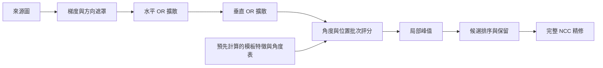

# 稀疏粗搜尋的 GPU 架構，以及 Liquid NN 適用的位置

2026-10-15。本文分析目前 [sparse_orientation.cpp](../experiments/sparse_orientation.cpp) 的固定尺度、灰階稀疏提案流程；既有量測見 [CPU／Metal 比較](SPARSE_CPU_METAL_zh-TW.md)。新的 Metal 前段已完成實作與64程序／192次正式比較，時間、記憶體、準確度與限制見[第19輪實測](SPARSE_METAL_FRONTEND_zh-TW.md)。本文保留設計推導；Liquid／CfC尚未實作或訓練，設計建議不等於已測結果。

**前段建圖與全圖稀疏搜尋可以交給 GPU，也不需要先訓練神經網路。** 目前適合優先實驗的是把既有分數寫成固定的平行運算流程，讓大量像素、位置與角度直接在 GPU 執行。Liquid NN 可以作為未來影片預測的另一個實驗方向，但不會自動將 NCC 或稀疏方向分數轉換成更快且等價的搜尋器。

## 1. Liquid NN 解決的是什麼問題

這裡將使用者提到的 Liquid NN 解讀為 **Liquid Time-constant Networks（LTC）與 Closed-form Continuous-time Networks（CfC）**，不將其他冠上 liquid 名稱的模型視為相同架構。

LTC 是具有連續時間隱藏狀態的循環模型。概念式為：

```text
dh/dt = −[1/τ + f(h, u; w)] ⊙ h + A ⊙ f(h, u; w)
```

其中 `u` 是輸入、`h` 是狀態、`w` 是學習參數，時間常數會隨輸入與狀態改變。原論文針對動態系統與時序預測，原作者程式以數值 ODE 步驟更新狀態；它並不是不需訓練的模板比對公式。[LTC 原論文，AAAI 2021](https://arxiv.org/abs/2006.04439)、[作者 LTC 原始碼](https://github.com/raminmh/liquid_time_constant_networks/blob/master/experiments_with_ltcs/ltc_model.py)

CfC 從 LTC 的近似閉式解出發，移除逐小步數值積分。作者完整 CfC cell 的計算可以概括為：

```text
z = backbone(concat(uₜ, hₜ₋₁))
g = sigmoid(a(z) Δt + b(z))
hₜ = [1 − g] ⊙ tanh(f₁(z)) + g ⊙ tanh(f₂(z))
```

這是作者完整 gating 版本的符號改寫，不是所有 CfC 變體的共同公式。線性層與逐元素運算可以平行，但作者序列程式仍逐時間點更新先前狀態；閉式更新不等於時間相依性消失。論文的加速比較主要針對 ODE 模型，不能套用為對本專案 CPU 或 NCC 的加速倍率。[CfC 原論文，Nature Machine Intelligence 2022](https://www.nature.com/articles/s42256-022-00556-7)、[作者 CfC PyTorch 原始碼](https://github.com/raminmh/CfC/blob/main/torch_cfc.py)

| 選項 | 是否需要學習參數 | 與目前搜尋結果的關係 | 建議用途 |
|---|---|---|---|
| 現有稀疏算子的 GPU 移植 | 不需資料集訓練；從裁切模板抽特徵 | 可要求整數分數與候選逐值一致 | 本輪優先 |
| 將相同分數寫成稀疏卷積／固定運算圖 | 不需訓練 | 數學上可等價，仍須守住取整與候選規則 | 比較不同 GPU 排程 |
| LTC／CfC 預測下一幀位置、角度 | 需訓練或已有適用權重 | 學習式預測，沒有現有候選召回保證 | 有影片資料後的輔助提案 |
| 學習式影像特徵／相關網路取代粗搜尋 | 通常需訓練或預訓練模型 | 改變評分與泛化假設 | 獨立研究，不混入等價移植結論 |

以上用途判斷是本專案的工程推論；LTC／CfC 論文沒有提供本專案固定尺度、任意裁切模板、全圖多物件搜尋的性能證明。

## 2. 現有前段已能表示成 GPU 運算圖

令來源影像為 `I`，像素數 `N=W×H`，模板含 `F` 個特徵 `(uᵢ, αᵢ)`，搜尋角度集合為 `Θ`。目前來源梯度使用中心差分，方向採無正負的八個 bin，弱梯度不編碼。

```text
B(x) = 1 << bin(∇I(x))                    強梯度像素
       0                                 其餘像素及來源外框
M(x) = OR { B(x+d) : d∈[−r,r]² 且 x+d 在影像內 }

L[b, 0] = 0
L[b, m] = max { round(255 |cos((b−k)π/8)|) : m 的第 k bit 為 1 }
```

`M` 是每像素一個 byte，`L` 是 `8×256=2048` byte 的表。令影像座標的旋轉矩陣為 `Rθ=[[cosθ,sinθ],[−sinθ,cosθ]]`，則既有候選分數為：

```text
δᵢθ = round_away_from_zero(Rθ uᵢ)
bᵢθ = bin(αᵢ − θ)
P(t, θ) = Σᵢ L[bᵢθ, M(t + δᵢθ)]
S(t, θ) = P(t, θ)/(255F)
```

對固定的角度與特徵，位置之間可獨立計算；對固定的來源圖，角度之間也可獨立計算。前段不是因為數學上有無法平行的相依性而必須留在 CPU。可以安排為：



方向量化、鄰域擴散、查表與稀疏加總也與 LINEMOD 的表徵方向相關。原研究利用量化與線性化回應圖改善記憶體存取，這比將時序循環模型直接套進靜態比對更接近本問題；但本專案的旋轉採樣、整數分數與候選保留規則須以本地程式為準。[Hinterstoisser 等，ICCV 2011 原論文](https://doi.org/10.1109/ICCV.2011.6126326)、[作者論文清單](https://www.stefan-hinterstoisser.com/)

若改以八張回應圖 `R_b(x)=L[b,M(x)]` 表示，還可定義固定稀疏核：

```text
Kθ,b(d) = 特徵中滿足 δᵢθ=d 且 bᵢθ=b 的數量
P(t,θ) = Σ_b Σ_d Kθ,b(d) R_b(t+d)
```

這是八通道稀疏互相關；同一位置、方向可能因取整而有多個特徵，核值須保留數量，不能簡化為布林值。它展示「模板可變成固定網路權重」的數學含義，不代表一定要使用密集卷積。將大量零權重展開成密集矩陣，可能增加原本只有 `F` 次 gather 的工作量；需要將直接 gather、分塊稀疏加總與密集運算各自實測。

## 3. 可預先定義的部分與保留動態工作的方式

模板抽特徵、各角度整數座標、方向 bin、分數門檻、方向查表、固定形狀的工作配置都可以預算。新來源圖的梯度、分數、候選是否存活仍必須逐幀計算，但能在 GPU 以固定容量緩衝區加有效計數處理。GPU 支援逐像素獨立工作與工作組內共享資料，不需要神經網路才能執行這種運算。[Apple：threads 與 threadgroups](https://developer.apple.com/documentation/metal/creating-threads-and-threadgroups)

現有剪枝也可保留。已累積 `j` 個特徵、部分分數為 `pⱼ` 時：

```text
Uⱼ = pⱼ + 255(F−j)
若 Uⱼ < ceil(τ×255F)，此位置不可能達到稀疏門檻 τ。
```

每個回應介於0至255，所以這個上界對目前整數分數成立。GPU 可以每16個特徵檢查一次，或先算固定小批再壓縮存活位置。前者可能有同一 SIMD 群組內工作量不一致，後者增加壓縮與再次派工成本；哪一個較快取決於背景、門檻、特徵數與存活比例。若改變特徵順序或檢查頻率，最後分數可相同，但 `featureEvaluations` 不必相同，量測必須交代。

此上界**不是完整 NCC 的上界**。稀疏取點、步距、方向量化、角度取樣與候選 cap 原有的漏檢風險仍在，最後必須保留獨立完整 NCC 驗證。

適合借鑑 FlashAttention 的是「計算時就考慮中間資料讀寫」：用位置 tile 共用來源遮罩，保留特徵表，盡量在分塊內完成加總與選峰，避免實體化所有角度的完整分數圖。若局部選峰跨 tile，要讀取相鄰分數 halo；若採全域 cap，單一 tile 過早截斷也可能改變候選。FlashAttention 的 attention 公式和效能倍率不直接適用本搜尋。[FlashAttention 原論文，NeurIPS 2022](https://arxiv.org/abs/2205.14135)

共享記憶體並非放越多越好；過大的 tile 或融合 kernel 可能提高暫存器、工作組記憶體需求，限制同時執行的工作組。應比較直接快取讀取與顯式共享兩種版本。[Apple：工作組大小與資源限制](https://developer.apple.com/documentation/metal/calculating-threadgroup-and-grid-sizes)

## 4. CPU → Metal 必須守住的等價條件

下列條件來自本地實作檢查，應納入移植審查與測試：

1. **梯度與半 bin 邊界。** CPU 用 double `atan2`、無正負方向正規化與 `floor(...+.5+1e-12)`；直接換 GPU float 可能改變方向。gray8 的水平／垂直像素差各有511種，故可用原 CPU 邏輯完整產生 `511²=261121` byte 的方向遮罩表。若把強度門檻一起編入表，須保留原本 double 門檻語意，設定改變時重建。
2. **模板旋轉與完整支撐範圍。** 原程式使用 `lround`，半整數向遠離零方向取整；完整旋轉矩形邊界有 `1e-9` 容差。先由 CPU 預算特徵、角度及網格，可避免 GPU sin/cos、取整與端點差異。
3. **網格最後一列與一行。** 步距無法整除範圍時，原程式另外加入 `maxX/maxY`。單純規則網格會漏掉邊界位置。角度集合也包含範圍端點、零度及 ±180° 正規化去重。
4. **門檻與加總。** `ceil(minScore×255F)` 先沿用 CPU double 計算再上傳整數。回應用 byte，總和用 uint32：`F≤4096` 時最多1,044,480。不可用半精度或 uint16 取代總分。
5. **資料邊界與初始化。** 來源 row stride、外框的零梯度、擴散邊界裁切、負特徵 offset、flat／空特徵模型都要保留；分數圖被剪枝的格子須明確歸零，不能帶入上一幀殘值。
6. **同分與候選順序。** 局部峰值同分採較小 row-major index。全域排序是分數降序、y升序、x升序、角度升序；每角度先做 `2×cap` 空間輪替保留，再跨角度 greedy NMS，最後做 `cap` 空間輪替保留。以 atomic append 的抵達次序替代上述規則會改變結果；一般 top-k 也不是相同政策。
7. **尾端特徵與測量意義。** 非16倍數的特徵數要正確處理最後一批。若為加速改變剪枝排程，應另列為「結果等價、工作量不同」，不可宣稱所有工作計數均逐值相同。

最先要求比較遮罩、整數分數、raw proposal 的數量與順序；再比較完整 NCC 結果、獨立真值召回／誤報。測試需包含負角度、180°、窄來源圖、非連續 stride、邊界位置、分數門檻上下相鄰 double、低對比、細線及128物件候選飽和。不能僅用最終精修成功掩蓋粗搜尋的差異。

## 5. Liquid NN 後續可以放在哪裡

若未來處理連續拍攝，可以把歷史匹配位置、`sinθ/cosθ`、分數、速度與實際幀間隔輸入小型 CfC，預測下一幀的搜尋位置、角度區間與不確定度。這是本專案建議的研究設計，尚未訓練、實作或量測。應同時比較簡單等速預測與 Kalman 類基準，確認學習模型真的減少整體時間或提高追蹤恢復率，而不只比較模型推論時間。

若預測只調整搜尋順序、仍完整搜尋全圖，可維持相同覆蓋但未必降低總工作量。若改為僅搜尋 ROI，工作量能下降但召回保證改變：新進物件、遮擋後重現、快速旋轉與預測失準可能漏掉。因此必須保留全圖重搜路徑，並量測觸發頻率與最壞重獲延遲；週期性重搜只能限制部分延遲，不能宣稱每幀與全圖搜尋等價。

資料應依實拍影片／物件分割訓練與測試，避免相鄰幀外洩。比較指標包含完整流程 p50／p95 延遲、峰值 RSS、GPU 緩衝區容量、平均搜尋面積、候選召回、最終漏檢／誤報、重獲延遲，以及訓練成本。RGB 或多模板會增加運算量與可共用的前處理，但也增加頻寬與工作集，不能預先保證 GPU 必勝。

本輪已完成固定算子的GPU前段，測量結果見[正式報告](SPARSE_METAL_FRONTEND_zh-TW.md)；Liquid NN 留作有時序資料與清楚目標後的獨立實驗。兩者可組合，但回答的是不同問題。
