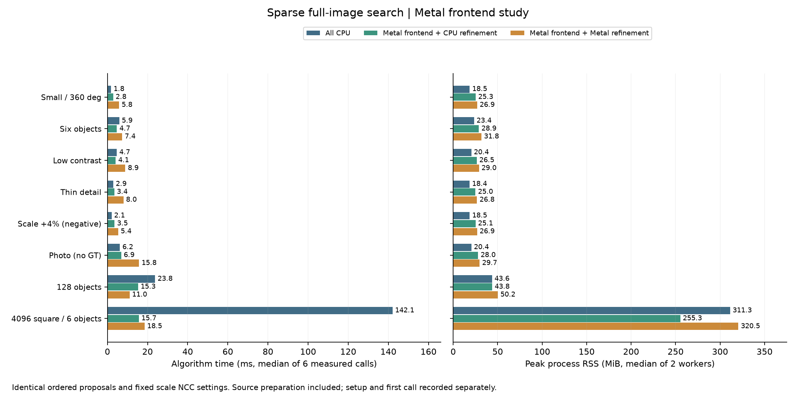

# Metal 稀疏前段：保持候選規則的 GPU 建圖與搜尋

日期：2026-10-15。延續第18輪固定尺度比較，本輪將來源方向建圖、稀疏全圖評分與局部選峰搬到 Metal，後段可獨立選 CPU 或 Metal 精修。這是完整自有 C++／Metal 源碼的運算移植，沒有使用訓練模型。Liquid／CfC 與固定運算圖的適用差異見[架構研究](SPARSE_GPU_ARCHITECTURE_zh-TW.md)。

## 已實作範圍

```text
CPU：模板選特徵、精確方向查表、各角度整數座標／邊界
                          ↓
GPU：來源梯度 → 方向遮罩 → 水平／垂直OR擴散
                          ↓
GPU：角度／位置批次稀疏評分 → 3×3局部選峰
                          ↓
CPU：原有排序、每角空間輪替、跨角去重與候選上限
                          ↓
CPU或Metal：完整NCC精修／有預算救援 → CPU最終NMS
```

Metal 不讀回整張方向圖或分數圖；每批讀回局部峰值和小型工作量統計，候選排序仍使用原來的 CPU 規則。這是 GPU 前段＋異構後段，尚非全 GPU 搜尋，也尚未實作單候選融合精修 kernel。GUI 預設與原有金字塔模式保持不變。

來源灰階差分的 `dx,dy∈[-255,255]` 只有261121組，建立模型時以原 CPU double 門檻與方向量化產生 byte LUT，避免 Metal float `atan2` 的邊界差異；另外沿用2048-byte方向回應表。每個位置使用相同特徵順序、uint32加總與每16個特徵的精確排除界。這個界僅適用於稀疏方向分數，不是完整NCC的上界。

整張來源只在每次搜尋開始複製一次；方向遮罩、擴散暫存與輸入共三張byte圖，跨角度批次共用。每批至多64個角度、4,194,304個評分位置，分數暫存至多16MiB；局部峰值初始每角1024筆，超出時先等待、依實際數量擴容，再重跑選峰，沒有默默丟棄候選。最壞峰值容量上界48MiB是邏輯上界，不等於整個程序記憶體。

單一角度網格超過4,194,304個位置會明確報錯；未實作角度內的分列切割。來源索引須可用signed32表示，完整旋轉模板須放得下。Backend擁有並重用GPU緩衝區，以mutex序列化同一模型的GPU呼叫；各次仍更新來源像素，不能將重複圖片的緩衝區重用理解為省略每張建圖。

## 使用與完整源碼

```cpp
fpm::research::Settings settings;
settings.sparseOrientation = true;
settings.scales = {1.};
settings.sparse.responseMode = 1;
settings.sparse.searchBackend = 1; // Metal 建圖、評分、局部選峰；0為CPU
settings.backend = 0;             // NCC 精修後端；1為Metal
```

仍須啟用完整NCC精修、`stopLayer=0`、`nccMode=0`、關閉粗搜尋重疊選項。Metal前段僅支援compact表示，非法組合明確拒絕；非Apple建置不宣稱提供Metal。模板特徵與角度表目前仍由CPU準備，沒有推論式模型或閉源計算核心。

[C++整合](../experiments/sparse_orientation.cpp)・[設定與指標](../experiments/sparse_orientation.hpp)・[Metal backend](../experiments/sparse_orientation_metal.mm)・[可讀Shader](../experiments/sparse_orientation.metal)・[內部介面](../experiments/sparse_orientation_metal.hpp)・[原生runner](../tools/native_pipeline_runner.cpp)・[精確性測試](../tests/sparse_orientation_metal_test.cpp)。

## 比較方法

同一台Apple M4 Pro、48GiB、Release；CPU設定8執行緒。比較四路：凍結`ae0489f`全CPU、目前建置全CPU、Metal前段＋CPU精修、Metal前段＋Metal精修。四路都使用compact與同一模板、來源、角域、分數、步距、特徵128、候選上限256與救援預算。正常GT、尺度+4%負控制與無GT實圖均沿用第18輪，沒有依新結果重新調參。

八場景、兩block正反順序、每程序暖機至少1秒後正式3次，共64個新程序與192次正式呼叫。GT、物件數與真值ROI只供父程序評分，不提供搜尋程序。所有有序原始候選與整數搜尋工作量必須等於凍結CPU；CPU精修時要求最終結果也逐值相同，Metal精修浮點結果則獨立對GT驗證。每路自身重複呼叫仍必須一致。

總時間含每次來源建圖、搜尋、精修／救援與NMS；解碼、JSON、建立與首次呼叫另列。`prepare_ms`已包含在`proposal_ms`，`device_ms`已包含在`wait_ms`，不可重複相加。來源複製、命令編碼、等待與峰值讀取另有診斷欄，但GPU命令時間不是純ALU運算時間。程序RSS與GPU buffer容量分列，不相加；`working_bytes`僅為部分配置估計。

每block的時間容忍為不高於目前CPU的`max(10%,2ms)`，RSS容忍為不增加超過`max(10%,32MiB)`；通過容忍不等於加速。不同輪次數字不能直接相乘成累積加速比。

## 正式時間、記憶體與採用決定

下表為暖機後完整演算法時間中位數，單位ms；每列每路6次。凍結CPU用於偵測重構偏差；加速比均相對同建置CPU。

| 場景 | 凍結CPU | 同建置CPU | Metal前段＋CPU精修 | Metal前段＋Metal精修 |
|---|---:|---:|---:|---:|
| 小圖、全角度 | 1.80 | **1.81** | 2.83 | 5.82 |
| 六物件 | 5.90 | 5.88 | **4.71** | 7.36 |
| 低對比、兩物件 | 4.66 | 4.65 | **4.12** | 8.91 |
| 細線 | 2.93 | **2.90** | 3.43 | 7.99 |
| 尺度+4%負控制 | 2.32 | **2.09** | 3.54 | 5.36 |
| Src4實圖、無GT | 6.56 | **6.19** | 6.85 | 15.77 |
| 128物件 | 23.41 | 23.76 | 15.29 | **11.03** |
| 4096²、六物件 | 139.38 | 142.08 | **15.66** | 18.54 |

| 場景 | CPU peak RSS MiB | Metal前段＋CPU MiB | Metal前段＋Metal MiB | 前段GPU buffer MiB |
|---|---:|---:|---:|---:|
| 小圖、全角度 | 18.54 | 25.29 | 26.94 | 1.74 |
| 六物件 | 23.41 | 28.90 | 31.76 | 2.19 |
| 低對比 | 20.39 | 26.52 | 28.97 | 1.25 |
| 細線 | 18.38 | 25.05 | 26.78 | 0.64 |
| 尺度+4%負控制 | 18.48 | 25.07 | 26.88 | 0.64 |
| Src4實圖 | 20.44 | 28.01 | 29.68 | 2.01 |
| 128物件 | 43.58 | 43.75 | 50.21 | 6.03 |
| 4096²、六物件 | 311.27 | 255.26 | 320.52 | 64.00 |

RSS為兩程序峰值的中位數；最後一欄只含新前段持有的Metal buffer，兩個Metal前段路徑相同，不含後段pose資源，也不能加在RSS上視為總記憶體。

**建議按已測場景選路徑。** 4096²使用Metal前段＋CPU精修，完整時間快9.07倍、程序峰值RSS少56.02MiB；128物件使用Metal前段＋Metal精修，快2.15倍、RSS多6.63MiB。128若優先記憶體可選Metal前段＋CPU精修，快1.55倍、RSS增加約0.17MiB。小圖全角、細線與本輪實圖仍採CPU；六物件／低對比的混合路徑有較小收益，可依應用量測採用。此表不構成通用尺寸或候選數自動分流門檻，GUI預設未改。

Metal前段＋CPU精修全部通過時間容忍，但小圖慢約57%、細線慢18%、Src4慢11%；不能寫成全面加速。Metal前段＋Metal精修的小圖、低對比、細線、尺度負控制和Src4，兩個block皆未過速度門檻。兩個Metal前段路徑所有RSS容忍均通過。4096²混合CPU的兩block時間比為0.108／0.114，128混合Metal為0.452／0.477，大場景收益在正反順序皆存在；六物件混合CPU為0.895／0.635，仍有明顯波動。



建立模型與首次呼叫不藏在暖機結果：新CPU建立約0.04～1.45ms、Metal前段建立約25.00～36.03ms，含方向查表、shader與pipeline建立。4096²的首次呼叫CPU／混合CPU／混合Metal為174.29／60.94／81.32ms；小圖為2.10／8.27／13.13ms。這些是每路兩程序的中位數，首次呼叫與建立須分開計入一次性工作，不能用暖機數字估計開啟即比對的總延遲。

## 時間花在哪裡

以下三欄相同順序為CPU／Metal前段＋CPU精修／Metal前段＋Metal精修，單位ms。各階段中位數不必恰好相加為整體中位數。

| 場景 | 來源建圖（已含於提案） | 完整提案 | 完整精修／救援 |
|---|---|---|---|
| 小圖全角 | 0.282／0.147／0.141 | 0.893／1.919／1.919 | 0.915／0.918／3.902 |
| 128物件 | 7.570／1.391／0.898 | 11.979／4.747／1.947 | 11.666／10.454／8.999 |
| 4096² | 71.918／5.608／5.222 | 137.139／11.655／11.442 | 4.927／3.993／7.041 |

4096²有9,158,685個角度／位置與439,759,904次特徵評估，完全保留工作量；CPU前段137.14→11.65ms才是主要改善。該Metal前段有4次提交／等待（建圖1次、角度批次3次），21個派工；主機複製0.265、編碼0.056、等待11.139、峰值讀取／整理0.009ms。等待內GPU命令區間10.235ms，來源傳輸與峰值讀回不是此例的主要成本。統一記憶體上的複製時間不等同PCIe傳輸時間，也沒有據此測出GPU算力或頻寬上限。

**歸因限制：** Metal建圖使用建立模型時預算的511²方向LUT，凍結與同建置CPU仍逐像素執行double `atan2`。本輪同時改變計算表示與執行裝置，候選／整數工作量一致不表示底層指令數相同。9.07倍是對現有CPU實作的完整流程收益，不能當成GPU相對最佳CPU的硬體倍率。下一個必要對照是讓CPU也用同一精確LUT，單獨量出數學化簡與GPU平行的貢獻。

小圖有60角度、123個派工；Metal前段兩次等待約1.813ms，內含GPU區間1.575ms，CPU整個提案只0.893ms。少量工作仍可能被GPU派工與相依階段成本抵銷。128物件兩個Metal前段路徑使用相同shader／工作量，但前段GPU區間4.170／1.011ms不同；後續CPU或GPU精修會改變整條測試的活動節奏，本輪沒有時脈／功耗counter，不能將差距斷言為特定原因或kernel本身更快。這也是保留完整流程比較、兩block與原始逐次資料的理由。

## 準確度與既有失敗

64程序、192正式呼叫全部完成，所有路徑的有序原始候選與整數工作量完全一致；CPU精修最終結果也與凍結CPU逐值相同，各路重複呼叫一致。六個正常合成場景共144個不同真值姿態皆零FP／FN，CPU／混合CPU最大位置誤差0.12021px、角度0.23185°；混合Metal為0.12119px、0.23170°。驗收門檻為2px、1°與相對尺度2%。

這是同資料、同演算法移植的驗證，不是新增144筆盲測資料；名稱帶`heldout`的128場景本輪仍為重用。128粗提案捕獲鄰域仍只覆蓋127/128，靠後段找到全部物件；尺度+4%負控制四路仍嚴格TP0／FP1／FN1，沒有因GPU化解決尺度假設違反。Src4仍回傳24結果，但無GT不能宣稱全部正確。

## 驗證範圍

Release完整32/32通過；ASan／UBSan相關三項通過（`detect_leaks=0`，未宣稱LeakSanitizer通過）。新Metal測試57組CPU候選／工作量一致，涵蓋全部261121組灰階差分、旋轉／角域端點、奇數尺寸、非連續row stride、門檻相鄰double、特徵尾批、同分cap、來源內容與尺寸更新、同模型並行呼叫、峰值擴容重試、超過64角度分批、過大單角度網格拒絕。Metal API與Shader Validation均啟用並通過同一組測試。

Python驗收工具7/7負控制通過：錯候選、錯工作量、偷偷走CPU、CPU精修最終值改變與缺worker均判失敗；Metal精修允許浮點差異但仍獨立檢查GT。本輪先保留12程序試跑，再做正式量測，不能把試跑當成暖機效能結論。

正式來源、binary、輸入與source snapshot的SHA前後一致。631個內容檔的封存逐一核對SHA，解壓到新目錄後離線重算摘要與保存摘要byte相同；包含受測演算法與工具來源、輸入、protocol、原始worker紀錄、試跑與測試日誌，執行檔僅保存SHA。封存22,451,879bytes。完整可建置專案（包含GUI入口）由本Git版本保存；封存以驗算實驗結果為目的，不是獨立安裝包。

[正式規則](sparse-metal/protocol.json)・[全部摘要與block結果](sparse-metal/results.json)・[驗收結果](sparse-metal/validation.json)・[完整來源與原始資料](sparse-metal/raw-results.tar.gz)・[封存SHA／重播驗證](sparse-metal/artifact-sha256.json)。

重跑工具：[benchmark_sparse_metal_front.py](../tools/benchmark_sparse_metal_front.py)（以`--help`查看新量測、指定建置及離線摘要）與[report_sparse_metal_front.py](../tools/report_sparse_metal_front.py)（繪圖、封存、搬移重播檢查）。舊凍結CPU為`ae0489f`，新建置須啟用experiments、tests及原生runner所需Qt；預設建置路徑保留於protocol。量測工具會拒絕與prior protocol不同的凍結binary SHA；換機重建須另建protocol記錄該機的來源、輸入及binary識別，不能沿用原SHA宣稱同一執行檔。離線摘要重播不需要原路徑、binary或GPU。

## 尚未完成的擴充

未將全域候選整理與最終NMS搬上GPU，未融合前段與後段的資源生命週期，未實作新的單候選融合精修kernel；來源建圖後仍有一次等待，再進角度批次。這些可另做單變因實驗。未新增遮擋、複雜實拍背景、多模板、RGB全圖、連續相機影格、跨平台或CUDA結果，也未宣稱解決原來128提案127/128的覆蓋失敗。

Liquid／CfC仍是有影片資料後的研究選項，用於預測下一幀位置／角度與搜尋區域；需與等速／Kalman等基準比較、另備訓練資料並保留全圖重搜。它沒有作為本輪加速或精準度的依據。
