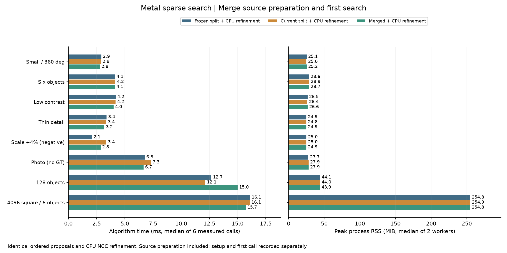

# Metal建圖與首批搜尋合併提交：少一次等待，但沒有全面加速

日期：2026-10-15，第21輪。承接[CPU查表公平對照](SPARSE_CPU_LUT_zh-TW.md)，只調整GPU工作提交時機：來源梯度、水平／垂直OR擴散與第一批稀疏搜尋、局部峰值共用一次command buffer。完整C++／Metal原始碼保留。

## 決定

**功能與等價性通過，效能未達全面採用條件。** 保留`metalSubmissionMode=1`為可選實驗，預設維持0。每個非空搜尋確實少一次CPU等待／GPU提交，GPU派工、搜尋範圍與候選規則不變；128物件卻出現速度gate失敗，因此不把此改動稱為普遍改善，也沒有繼續將後續融合精修當成已完成。

演算法不必異構，這次負結果也沒有證明完整GPU架構較差。它只說明：同一個GPU計算圖少一個提交邊界，完整流程未必更快。目前仍有CPU候選整理、NCC精修／救援與NMS；本輪不是全GPU實驗。

## 正式時間與記憶體

Apple M4 Pro、48GiB、Release。三路都使用Metal稀疏前段＋CPU NCC精修，八個沿用場景，2個block正反執行順序、每程序至少1秒暖機後3次正式呼叫。48新程序、144次正式量測；模型建立、首次呼叫另存。下表為6次正式呼叫的中位數，單位ms。

| 場景 | 凍結第20輪 | 同建置分開提交 | 合併提交 |
|---|---:|---:|---:|
| 小圖、全角度 | 2.92 | 2.89 | 2.79 |
| 六物件 | 4.13 | 4.16 | 4.12 |
| 低對比、兩物件 | 4.20 | 4.18 | 4.00 |
| 細線 | 3.39 | 3.36 | 3.18 |
| 尺度+4%負控制 | 2.08 | 3.36 | 2.85 |
| Src4實圖、無GT | 6.76 | 7.32 | 6.66 |
| 128物件 | 12.68 | 12.14 | 15.00 |
| 4096²、六物件 | 16.11 | 16.08 | 15.73 |

| 場景 | 分開提交峰值RSS MiB | 合併提交峰值RSS MiB |
|---|---:|---:|
| 小圖、全角度 | 25.02 | 25.17 |
| 六物件 | 28.85 | 28.70 |
| 低對比、兩物件 | 26.38 | 26.62 |
| 細線 | 24.84 | 24.87 |
| 尺度+4%負控制 | 24.99 | 24.87 |
| Src4實圖、無GT | 27.88 | 27.87 |
| 128物件 | 43.96 | 43.85 |
| 4096²、六物件 | 254.90 | 254.75 |

RSS是兩個新程序各自峰值的中位數；前段GPU buffer容量三路相同，128約6.03MiB、4096²約64.00MiB，與程序RSS重疊，不能相加。這次沒有新的像素buffer或查表。



小圖同建置2.8854→2.7874ms，約3.4%；兩block合併／分開比分別0.9579／0.9742。低對比4.1811→3.9991ms，約4.4%，兩block均較快。這些只支持局部小幅收益，沒有本輪CPU比較或自動routing門檻。

**128物件未通過速度門檻。** 六次中位數12.1395→14.9991ms，慢約23.6%；逐block中位數比為1.3560／1.3512，兩次均失敗。這兩種統計量不同，不能互相替換。4096²為16.0837→15.7273ms，約2.2%，但兩block一快一慢（0.9079／1.0483），尚非穩定改善。

六物件合併六次中位數4.1609→4.1217ms看似略快，逐block卻分別慢2.9%／0.4%；細線亦有一個block慢13.4%。尺度負控制與無GT實圖有明顯時間波動，不能挑六次中位數就宣稱全部加速。所有記憶體容忍通過；速度容忍為最多增加`max(10%,2ms)`，未過的配對完整保留於結果與validation-details，而通過也不等於加速。

## 針對128與4K的獨立複查

發現128回退後，來源、binary、設定與場景都不變，另開12個新程序、36次正式量測，同樣正反2個block、1秒暖機。這是事後確認，不併入或取代上面的主要結果，原始資料在封存`formal/recheck/`。

| 場景 | 凍結第20輪 ms | 分開提交 ms | 合併提交 ms | 合併／分開逐block比 |
|---|---:|---:|---:|---|
| 128物件 | 11.37 | 12.71 | 13.59 | 0.9852／1.1891 |
| 4096² | 15.47 | 15.28 | 15.03 | 0.9766／0.9917 |

128仍有一個block未過速度門檻；同建置分開提交相對凍結版也有一個block失敗，顯示短時間量測有不可忽略的環境／排程變異。不能把所有差額精確歸因這幾行提交修改，但更不能據此忽略原本失敗而升為預設。4K複查兩block均小幅改善，合併中位數約1.6%，不足以支持大量物件全面採用。

複查RSS：128分開43.94／合併43.87MiB；4096²分開254.91／合併254.79MiB；所有記憶體容忍通過。見[複查摘要](sparse-metal-merge/recheck-results.json)。

## 等價性、時間歸因與限制

主實驗144次與複查36次正式呼叫，連同首次呼叫，都保持有序候選、整數搜尋工作量與最終CPU結果逐值相同。沿用六個正常尺度合成場景的144個不同GT姿態零FP／FN；這是重用測資，不是新增盲測。128粗候選鄰域仍127/128，由後段找到全部；尺度+4%負控制仍嚴格TP0／FP1／FN1，Src4仍24輸出但沒有GT。

每次非空搜尋：小圖／128的提交與等待2→1，4K為4→3；派工數小圖123、128／4K21完全相同，溢出重試亦一致。Source/search分段計時的意義改變：分開模式的source_prepare_ms包括建圖GPU等待；合併模式只計CPU配置、複製與編碼，建圖GPU執行落在第一批搜尋等待中。因此只可跨模式比較完整proposal／total，或source_prepare_ms＋search_ms，不能用建圖欄位下降宣稱建圖演算法變快。

小圖分開／合併的等待中位數1.823／1.711ms，GPU區間1.565／1.574ms，與省掉主機邊界成本的解釋相容。128則等待2.769／5.051ms、GPU區間2.345／4.609ms，讀回0.031／0.018ms、上傳0.021／0.019ms：較慢沒有表現在大量CPU複製。4K等待12.146／11.578ms、GPU區間11.206／10.822ms、上傳0.269／0.274ms。GPU時間已包含在等待，不可重複相加；各欄獨立中位數不一定加總成完整時間。

本輪沒有收集GPU時脈、功耗、occupancy或硬體記憶體counter，不能斷言128回退來自某個cache／頻率機制。相同kernel與工作量仍可能受命令排程與系統狀態影響。只減少提交次數沒有證明已消除主要成本，也沒有量出CPU／GPU理論極限。

下一步若研究精修融合，應獨立使用原分開提交基準，將單候選取樣、歸約、求解與停止放入較少kernel，保留完整驗分／救援與GT。這仍待實作與實測；不應先把本輪合併模式強制疊上去。

## 完整實作與驗證

設定位於[SparseOrientationSettings](../experiments/sparse_orientation.hpp)，主程式經[稀疏排程](../experiments/sparse_orientation.cpp)呼叫[Metal backend](../experiments/sparse_orientation_metal.mm)。新的mode只控制Metal提交，CPU回報有效mode0；非法值拒絕，GUI與預設不變。Metal kernel源碼[sparse_orientation.metal](../experiments/sparse_orientation.metal)未改動。

```cpp
settings.sparseOrientation = true;
settings.scales = {1.};
settings.sparse.responseMode = 1;
settings.sparse.searchBackend = 1;
settings.sparse.metalSubmissionMode = 1; // 實驗；0保留原分開提交
settings.backend = 0;                   // 本輪所有路徑都用CPU NCC精修
```

原生runner輸入`sparse_metal_submission_mode`、輸出`sparse.metal_submission_mode`；分開／合併同時保留。建立來源的command在合併模式尚未提交，交給第一個非空批次；使用既有tracked buffer與encoder相依關係。後續批次與峰值溢出重試維持原流程，不丟棄峰值。完成後清除command持有，擴容前可釋放舊輸出；mutex保護共用模型，同位址換圖仍每次重新複製。

Release完整33/33通過；ASan／UBSan相關4/4通過，detect_leaks=0，不宣稱LeakSanitizer。Metal API／Shader Validation下58組CPU／分開／合併三路精確一致，涵蓋角域端點、旋轉、空前導plan、極小／空模型、非法模式、換圖、大小切換、共享模型並行、row stride、同分cap、511²梯度組合、超過64角度、溢出重試與超預算拒絕後重用。新增比較工具19項負控制通過，包含模式被忽略、缺失指標、提交／派工數不符、CPU回退、精修替換、結果修改、缺worker、檔案竄改及共同錯誤的獨立GT檢查。

多agent完成初步分工與部分實作後，主agent接手補完、整合與審查；最終測試和量測由主agent串行執行，沒有與其他GPU實驗並跑。未宣稱完成獨立agent最終審查。本輪沒有新增手動GUI操作驗收、RGB全圖、多模板、遮擋、CUDA或跨硬體結果。

## 審查與重播

[主protocol](sparse-metal-merge/protocol.json)、[主結果](sparse-metal-merge/results.json)、[複查結果](sparse-metal-merge/recheck-results.json)、[驗證](sparse-metal-merge/validation.json)、[速度失敗與檢查細節](sparse-metal-merge/validation-details.json)、[完整來源與原始資料](sparse-metal-merge/raw-results.tar.gz)、[封存SHA](sparse-metal-merge/artifact-sha256.json)。完整[比較工具](../tools/benchmark_sparse_metal_merge.py)、[封存／繪圖工具](../tools/report_sparse_metal_merge.py)、[C++測試](../tests/sparse_orientation_metal_test.cpp)、[工具負控制](../tests/test_sparse_metal_merge_harness.py)保留。

主實驗與複查source／binary／input／snapshot SHA均未變。封存788個內容檔、32,389,765bytes，所有member SHA通過；換目錄重播主／複查摘要均逐byte相同。封存含主實驗、複查、9程序試跑、來源快照、基準Git source、輸入、逐次結果與建置／驗證日誌；binary保留SHA，未封存可執行檔。解壓後可用NumPy／OpenCV環境離線重算摘要，不需GPU：

```sh
python3 EXTRACT/formal/source-snapshot/cpp-core/tools/benchmark_sparse_metal_merge.py --summarize EXTRACT/formal/results.json --output /tmp/merge-main.json
python3 EXTRACT/formal/source-snapshot/cpp-core/tools/benchmark_sparse_metal_merge.py --summarize EXTRACT/formal/recheck/results.json --output /tmp/merge-recheck.json
```

重新實測需另建基準／新binary並產生新protocol，不能繞過既有SHA驗證。模型建立與首次呼叫均在逐次資料保存；本頁暖機時間不代表一次性整體延遲。
