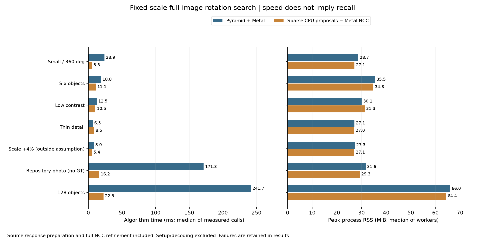
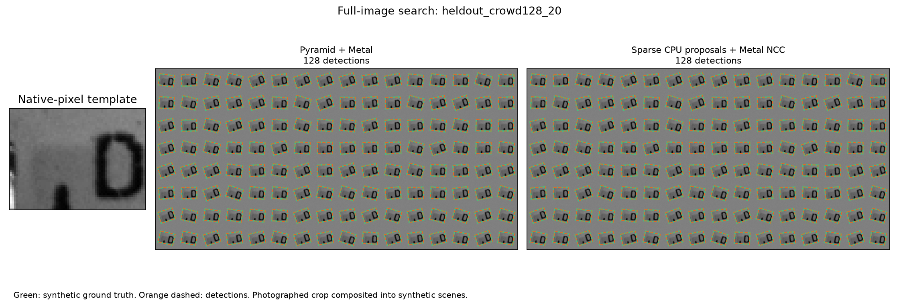

# 固定尺度：原圖稀疏方向提案＋完整 NCC 精修

日期：2026-10-14。需求是從實拍圖裁模板，搜尋整張影像，允許旋轉、尺度固定為1。這一輪新增完整 C++ 提案器，重用既有 CPU／Metal NCC 精修；GUI 尚未新增此研究選項。**在已測的128物件場景約快10.75倍、零FP／FN；細線場景反而慢約31%，且提案召回門檻仍有一項失敗，因此保留研究選項，不改通用預設。**

## 實際做了什麼

```text
模板（建立 Session 時）
  中央差分梯度 → 強邊緣排序／分散取點 → 128 個點與方向

每次全圖搜尋
  原尺寸來源梯度 → 8 個無向方向的鄰域回應圖
  → 旋轉模板的點座標／方向，以4像素步距掃整張圖
  → 角度內選峰、跨角度去重、空間分區輪流保留候選
  → 完整模板 NCC ＋固定尺度連續精修／有預算救援
  → 最終 NCC 門檻、角度範圍與矩形重疊篩選
```

來源不縮小、不旋轉整張影像；只旋轉模板特徵座標及方向。提案器目前在 CPU，按角度平行，最多8執行緒。`backend=1`只把既有後段常駐求解放在 Metal，最後仍有 CPU 驗分／救援控制／NMS；不能稱為全 GPU 搜尋。

新 Session 路徑完全略過金字塔模型與來源 frame 建立，不是把 `min_area`調大後繼續做密集 NCC。原金字塔路徑保留。搜尋不接收真值、物件數或已知位置 ROI；公開最終數量上限對兩路一律256，提案上限也固定256。

## 數學與近似的範圍

在原圖計算 `g=(I(x+1,y)-I(x-1,y), I(x,y+1)-I(x,y-1))/2`，只保留梯度長度至少8的像素。梯度方向以模π量化為8個bin，來源每個位置的5×5鄰域收集方向集合。每個bin的回應為該集合內最大 `|cos(方向差)|`，量化為0到255；沒有強邊緣時為0。

模板保留F個強且分散的梯度點 `(uᵢ,αᵢ)`，候選姿態為 `(t,θ)`。影像座標x向右、y向下，正角度的座標變換為 `(cx+sy,-sx+cy)`；方向因此減θ。候選分數：

```text
S(t,θ) = Σᵢ R[bin(αᵢ−θ)](t + round(Rθuᵢ)) / (255 F)
```

每角度掃描原圖中心位置網格，含可放置邊界。角度最大間隔6°，範圍端點與0°保留；±180°等價去重。每16個點可用「目前總分＋剩餘點數×255」提前排除達不到稀疏門檻的候選。這個界只對**稀疏整數分數**成立，並不是 NCC 上界。

128點相對完整64×48模板的3072像素，降低每位置相關工作；稀疏方向分數會失去部分灰階與紋理資訊。無向梯度也會接受反相外觀，必須由完整 NCC 排除。位置網格、角度採樣、選峰與256候選上限都可能漏檢；不能從數學式直接承諾召回率。

提案召回以事前固定的6px／6°／尺度比0.98–1.02，做一對一幾何配對；這只是候選是否落入指定鄰域，**不保證局部 NCC 求解會收斂**。最終結果另用2px／1°／尺度比0.98–1.02配對，保留 FP／FN。

## 使用與重現

```cpp
#include "research_pipeline.hpp"
fpm::research::Settings settings;
settings.backend = 1; // Metal 常駐精修；0 為 CPU 精修
settings.scales = {1.};
settings.sparseOrientation = true;
settings.sparse.featureCount = 128;
settings.sparse.positionStride = 4;
settings.sparse.angleStepDegrees = 6;
settings.sparse.spreadRadius = 2;
settings.sparse.minScore = .75; // 方向提案分數，與 NCC 分開
settings.sparse.candidateCap = 256;
fpm::research::Session session(sourceView, templateView, settings);
fpm::research::Options options;
options.match.stopLayer = 0;
options.match.toleranceAngle = 20;
options.match.minScore = .8; // 最終完整 NCC
options.match.maxTargets = 256;
auto result = session.run(options);
```

此路徑要求單一尺度1、`refine=true`、`stopLayer=0`、`nccMode=0`、粗搜尋重疊關閉；不符合的設定會明確拒絕。Session持有來源／模板，模板特徵建立一次，每次run重算來源方向圖；只重複同一張圖的實驗不代表新影格串流已驗證。

建置與執行：

```sh
cmake -S cpp-core -B build/sparse-orientation -DCMAKE_BUILD_TYPE=Release \
  -DFPM_BUILD_EXPERIMENTS=ON -DFPM_BUILD_GUI=ON -DFPM_WITH_OPENCV=ON
cmake --build build/sparse-orientation -j 8
python3 cpp-core/tools/benchmark_sparse_orientation.py --prepare-only
python3 cpp-core/tools/benchmark_sparse_orientation.py
```

比較工具預設需要保留的`build/gui-integration`舊binary，並驗證第15輪所記錄SHA；新機器可從封存來源重新建置，但不能宣稱得到相同binary或直接通過舊SHA門檻。正式資料的離線摘要重播不需要GPU，解壓封存後依README執行即可。

`proposal_ms`包含來源方向圖準備，不能再與`prepare_ms`相加。來源8個回應圖占`8×W×H`bytes，準備期間另有3張單byte暫存；這些逐次建立、釋放，不是全都常駐。`working_bytes`是已計入配置的診斷估計，不能當完整峰值上界；程序peak/current RSS另量，也不與GPU shared-memory容量相加。一次模板建立、首次呼叫和暖機時間分開保存。

源碼：[提案器](../experiments/sparse_orientation.cpp)、[介面](../experiments/sparse_orientation.hpp)、[排程與完整NCC](../experiments/research_pipeline.cpp)、[比較工具](../tools/benchmark_sparse_orientation.py)、[契約測試](../tests/sparse_orientation_contract_test.cpp)。方向回應圖的研究背景與其他FFT／旋轉基底方向見[設計文件](FIXED_SCALE_SEARCH_DESIGN_zh-TW.md)；本實作沒有宣稱完整重現LINE2D，也未實作GPU FFT。

## 正式實測與採用決定

Apple M4 Pro、48 GiB、Release。凍結舊binary並核對第15輪SHA，新binary／完整相關源碼／輸入在正式量測前存檔。七個場景、小圖另測CPU，共32個新程序、96次正式呼叫；兩block正反順序、各3次，暖機至少1秒，程序串行，沒有同時執行其他build／GPU測試。所有正式期間來源／binary／輸入hash不變。

先以小圖、六物件、細線做一次試跑；128物件保留到正式測試，沒有依它調參。試跑後僅修正無向方向在半bin邊界的浮點取整一致性，沒有調整特徵數／步距／門檻／候選數。試跑原始輸出與來源也封存，不拿它當正式樣本。

下表兩路均使用Metal後段，列六次暖呼叫中位數；RSS是兩程序peak的中位數。新的稀疏提案本身在CPU。兩路公開最終上限都256，與第15輪64不同，因此只用本輪同設定的成對結果算加速比。

| 場景 | 金字塔 ms | 稀疏 ms | 金字塔／稀疏 | peak RSS MiB（舊→新） | 最終結果 |
|---|---:|---:|---:|---:|---|
| 256²／全360°／1物件 | 23.87 | 5.28 | 4.53× | 28.67→27.12 | 兩路均零FP／FN |
| 768×512／±20°／6物件 | 18.78 | 11.07 | 1.70× | 35.46→34.80 | 兩路均零FP／FN |
| 低對比／2物件 | 12.49 | 10.49 | 1.19× | 30.07→31.27 | 兩路均零FP／FN |
| 細線／1物件 | 6.51 | 8.51 | 0.77× | 27.11→27.02 | 兩路均零FP／FN |
| 尺度+4%負控制 | 7.99 | 5.44 | 1.47× | 27.27→27.05 | 兩路皆尺度不合格 |
| 原始Src4實圖（無GT） | 171.31 | 16.21 | 10.57× | 31.63→29.29 | 兩路均24個；沒有GT |
| 1536×768／±20°／128物件 | 241.65 | 22.48 | 10.75× | 65.98→64.37 | 兩路均零FP／FN |



**效能不是全過：** 細線兩個block分別慢31.74%／31.48%，都略超事先的`max(2ms,10%)`容忍；其他配對通過。所有記憶體gate通過，不等於每例都更省。五個正常固定尺度GT場景共有138個不同合成姿態，兩路最終均零FP／FN；不能把重複96次呼叫當96批獨立場景。

**提案召回不是全過：** 稀疏128物件的事前6px／6°捕獲鄰域只覆蓋127/128（99.22%），這個gate保留失敗。第84號真值角度−6.129°，最近保留候選角度0°，位置差0.387px、角度差6.129°；後段NCC仍成功收斂，最終128/128。不能事後把容差放寬為7°來改成通過，也不能把幾何鄰域當成收斂保證。

128場景稀疏掃589,405位置角度組合，實際31,819,824個特徵回應累加；門檻以上8,211個網格點，選峰／去重／分區限制後留下256候選，已達上限。來源回應圖9MiB，配置診斷估計12.375MiB；程序peak約64.37MiB。分段時間：原金字塔提案238.05ms→新提案12.56ms（其中來源準備9.45ms、掃描3.02ms），後段精修3.65ms→9.58ms。新瓶頸已轉向來源準備與較粗種子的精修，而非原來密集旋轉／NCC搜尋。

小圖CPU完整流程41.27→1.74ms，RSS18.35→19.66MiB；同一小圖新CPU還快過新Metal後段的5.28ms。這一點支持保留CPU選項，但只測一個CPU場景，尚未建立跨尺寸的自動CPU／GPU切換曲線。

暖機數字不代表首次回應：128場景舊建立／首呼叫23.66／256.22ms，新0.17／58.28ms；小圖Metal舊26.59／39.40ms，新0.11／36.93ms。新路徑在第一次精修才建立Metal資源，因此不能把`construct_ms`降低完全解讀成初始化消失。



上述GT由實拍原生像素裁切片獨立旋轉合成，背景簡單、同模板分離實例；不是128種不同物件，也不是新相機的獨立真值。正常Metal GT最大位置誤差舊0.12120px／新0.12119px，最大角度誤差舊0.25096°／新0.23170°，尺度全部精確固定1。+4%負控制雖能高分定位，尺度仍不合格，兩路均保留FP=1／FN=1；無GT實圖24個結果只能當輸出觀察。

## 驗證、完整原始資料與下一步

- Release完整30/30通過，含原有CPU／Metal／GUI回歸、新提案契約及半bin反向角一致性。
- ASan／UBSan先做受影響的核心／原生流程4/4；最後量化修正後再跑新提案與量化2/2。`detect_leaks=0`，沒有宣稱LeakSanitizer通過。一個新測試target因建置系統重新產生後的舊make入口未找到，重新建置後通過；失敗診斷也保留。
- Python提案配對／真值隔離／128fixture等5/5通過。
- 128物件另外開Metal API與GPU Shader Validation，日誌確認兩者啟用；首呼叫及重複呼叫均128/128，無驗證錯誤。插裝時間不列入效能表。
- 32workers全部成功，單一路線自己的有序輸出重複精確一致；跨路線只比較獨立GT，不要求浮點pose逐位相同。

**採用決定：** 保留可呼叫的C++研究選項，通用基準仍是金字塔。下一階段較值得先做來源方向圖的分塊／SIMD與Metal建圖，再量小批候選CPU精修和大批Metal精修的分界；但應同時加入複雜背景、接近／遮擋與新實拍資料，檢查256候選壓力。不要直接把128簡單背景的10.75倍外推到8K全角度或所有模板。

完整[事前protocol](sparse-orientation/protocol.json)、[正式摘要](sparse-orientation/results.json)、[驗證紀錄](sparse-orientation/validation.json)、[原始輸出／輸入／全部相關源碼封存](sparse-orientation/raw-results.tar.gz)、[封存SHA與離線重播檢查](sparse-orientation/artifact-sha256.json)均保留。封存另含舊版本源碼、試跑與失敗gate；摘要可從任意目錄解壓重播，不依賴本機GPU。
