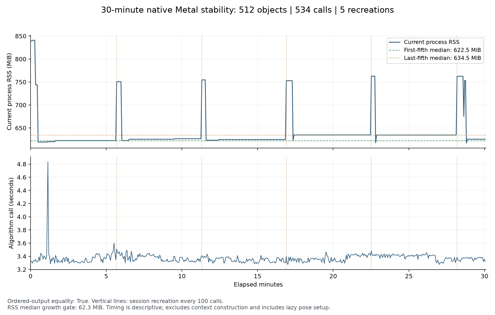

# 512 物件：30 分鐘 Metal 持續運行驗證

日期：2026-10-14。依本輪約定執行 30 分鐘，驗證既有灰階 C++／Metal Session 的重複運算與資源重建。本輪沒有改動演算法、GPU kernel 或 GUI；受測版本為 `a989183ffa51a49a8696afa3662726743f8fa90b`，與上一輪正式比較的來源、二進位及輸入 SHA 相同。

**本輪通過：實際 1802.26 秒（30 分 2.26 秒），534 次持續比對、5 次 Session 重建。** 完整輸出、非同步完成、generation、工作量、buffer 容量及事前 RSS 門檻全數通過；受測來源、二進位與輸入 SHA 前後不變。

## 測試範圍與事前規則

使用原六場景中物件數最多的 `many512_pose`：單一模板的 512 個分離實例，包含旋轉與尺度。設定沿用正式 `native_combined`：mode2、CPU／GPU 粗搜尋重疊、peak1、pyramid1、batch4、fine512、GPU 常駐姿態精修與既有預算的低分救援。選這條路徑是為了涵蓋較大的資源負載與非同步生命週期，不代表它比 mode2 關重疊更快。

Apple M4 Pro（12 CPU／16 GPU）、48 GiB、macOS 26.6.2，使用既有 Release runner。先完成初次呼叫與暖機，再開始 1800 秒持續循環；最後一個完整呼叫可以超過截止時間。每 100 次銷毀並重建 Session；每次保存精簡紀錄，避免測試器自己累積全部候選結果。期間不建置、不執行其他 GPU 測試或 profiling。

[事前規則](stability-30min/protocol.json)要求：

- 所有最終結果與 proposals 的順序、位置、角度、尺度、分數及四角完全相等；初次結果另對上一輪正式基準核對。
- 所有非同步工作均完成，frame generation 在同一 Session 內遞增，重建後重新開始。
- 粗／細搜尋工作量及保留 buffer 容量不變，程序無錯誤。
- 最後五分之一樣本的 current RSS 中位數，減去最前五分之一中位數，不超過 `max(32 MiB, 起始中位數的 10%)`。
- 原有來源、二進位及輸入 SHA 在測試前後不變。

## 實際結果

| 項目 | 結果 |
|---|---:|
| 每次找到的物件／完整輸出相等次數 | 512／534 次全部相等 |
| Session 重建 | 5 次，合計使用 6 個 Session |
| 起始／結尾各 106 次的 current RSS 中位數 | 622.52／634.55 MiB |
| RSS 中位數增加／允許增加 | 12.03／62.25 MiB，通過 |
| current RSS 最小／最大值 | 617.28／840.89 MiB |
| 程序 peak RSS | 840.89 MiB |
| 演算法每次時間中位數／P95 | 3367.80／3437.49 ms |
| 演算法最短／最長時間 | 3275.32／4835.13 ms |
| 起始／結尾各 106 次的時間中位數 | 3353.71／3379.91 ms |
| 初始 Session 建構／初次呼叫 | 30.24／3561.00 ms |

五次重建的建構時間為 7.69、8.75、7.56、7.78、9.66 ms。每次三個尺度合計 140 張粗 score maps、99,960,878 個粗視窗、659,376 張局部細搜尋 maps，全部維持一致；保留 buffer 容量也一致。未刪除重建附近的記憶體波動或 4835.13 ms 的較慢樣本。

摘要中的六個五分鐘區段依呼叫完成時間分組；最後一個呼叫在 1800 秒後完成，不列入這六個半開區段，仍包含於全部 534 次的統計與驗收。



RSS 為整個原生 runner 程序的 resident memory，包含 Qt 讀圖、配置器與驅動相關部分；buffer 邏輯容量不能再加到 RSS。曲線上的直線標示 Session 重建。演算法時間不含圖片解碼、Session 建構、結果序列化與寫檔；新 Session 首次呼叫的 lazy pose 初始化仍計入該次演算法時間，建構耗時另存於原始資料。

這份時間序列用於檢查持續運作，沒有相同時段的另一條路徑作配對對照，因此不能用來替換上一輪正式效能數據，或聲稱本輪有加速／省記憶體。上一輪小圖 combined 慢 33.90% 的失敗，以及 512 開重疊增加記憶體的結果仍保留。

## 可以得出的結論與後續範圍

**此設定通過約定的 30 分鐘穩定性檢查，可作為本階段灰階原生 GUI 的運算基準。** 觀察到記憶體在重建附近有短暫上升，之後回落；起末中位數差通過既定容忍，不能據此宣稱所有生命週期都絕無洩漏。此次沒有額外安排 24 小時驗收。

這次使用與 GUI 相同的原生 Session，但不是讓 GUI 視窗自動操作 30 分鐘，也沒有測持續新相機影格、頻繁換圖／切換模式或 512 個不同模板。所有呼叫重複同一張圖，因此只增加運算與生命週期穩定性的證據，不增加獨立圖像準確度樣本；既有 GT 與最大幾何誤差仍引用 [原生 GUI 整合報告](GUI_INTEGRATION_AND_STABILITY_zh-TW.md)。本輪的完整交付範圍與待辦見 [專案狀態](PROJECT_STATUS_zh-TW.md)。

## 可供人工 review 的資料

- [獨立重算的摘要](stability-30min/summary.json)：實際時長、每項檢查、RSS、時間分布、每五分鐘統計與輸入紀錄 SHA。
- [完整原始封存](stability-30min/raw-results.tar.gz)：逐次 JSONL、原生結果、job、stderr、原始 harness 摘要、正式參考 job／結果、87 個受測來源快照及補充分析程式。
- [封存 SHA 與重播驗證](stability-30min/artifact-sha256.json)：各成員驗證及從其他目錄重算摘要的結果。

原有 harness 的說明文字仍含上一輪「10min／2min」字樣，原始紀錄保持不改；本輪依 `seconds_requested=1800`、實際 `duration_ms` 及新 protocol 判讀。封存省略二進位與大型輸入圖檔，保留其 SHA 與原生成程式；要重跑全部六路效能比較，使用上一輪的 [完整封存](gui-integration/raw-results.tar.gz)。

解壓後，僅用 Python 標準函式庫即可重算本輪摘要，與封存內 `summary.json` 逐位元組核對：

```sh
python3 <解壓目錄>/supplementary/summarize.py \
  --data <解壓目錄> --output /tmp/replayed-summary.json
```
