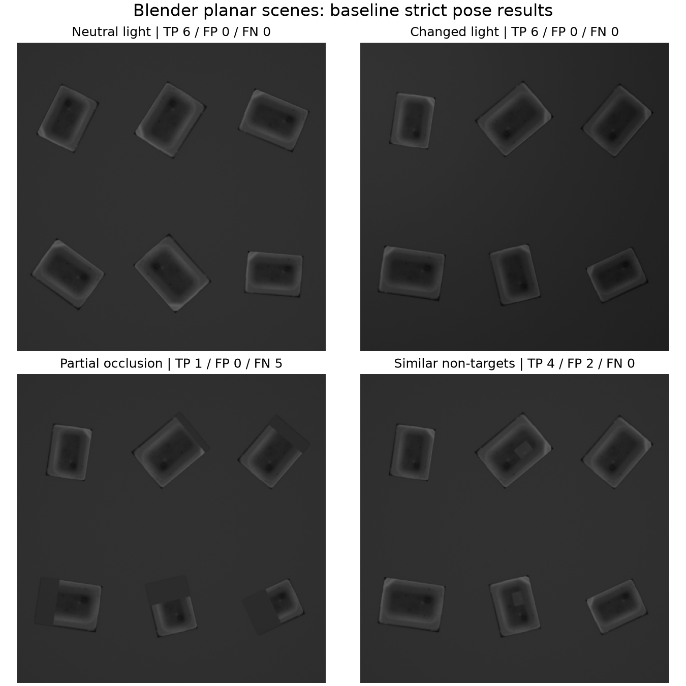
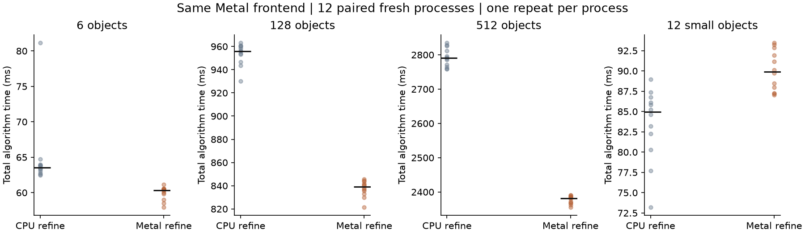
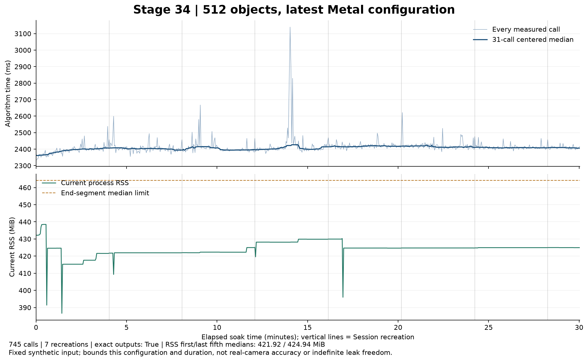

# 第34輪：五項實驗缺口的階段結果

本輪基準為 `821fd77`，Apple M4 Pro／48 GiB／Metal。使用者確認沒有已標註實拍序列，並授權加入Blender生成素材。本輪包含實作、可重播實驗及反例；「實驗完成」不等於所有場景已通過或算法已達極限。

## 比較的共同規則

所有正式算法測量串行執行；本任務沒有同時啟動編譯、Blender渲染或其他密集CPU／GPU工作，系統背景活動不保證完全靜止。使用Release原生執行檔；來源、執行檔、圖片、工作設定與原始輸出保存雜湊。先跑功能pilot，正式資料與門檻不依pilot結果調整。pilot曾抓到一個量測器假設錯誤：小模板只跑金字塔頂層，合法地沒有fine派工；修正為確認coarse實際GPU工作，並保留負測試及原pilot紀錄。

strict GT持續使用位置2px／角度1°／尺度±2%；實作配對使用0.25px／0.25°／0.2%／分數1e-4。相同錯誤不算準確度成功。速度容忍為max(10%,2ms)，RSS比較為max(10%,16MiB)。RSS是整個程序截至快照的峰值，包含影像、配置器與驅動；不能再加上共享buffer邏輯容量。

本輪沒有新的實拍標註、CUDA或完整RGB搜尋驗收；Blender RGB先按相同BGR2GRAY規則轉灰階，不能當成RGB匹配算法已完成。

## 1．尺度偏差：從固定幾何診斷到實際搜尋

原尺度診斷固定正確位置和角度，只能回答目標函數是否偏移，不能代表能自己找到物件。本輪先固定41格尺度曲線與五種評分：原雙線性、去兩圈邊界、等效模糊、前向逐像素、前向4×4積分。三個模板、36個不同未調參姿態，分別以OpenCV雙線性及4×4面積渲染；另保留第33輪12姿態，共84條曲線／方法。雙重渲染不是72個獨立姿態。五個CPU程序共34,440個評分點，包含兩次曲線測量。

小模板33×17的固定幾何診斷中，原方法兩種渲染各9/12通過尺度門檻；去邊界各12/12，最大誤差0.25%。前向方法也有效，但Python參考實作較慢；等效模糊在此小模板反而各只1/12通過。這些反例完整保留，不把「抗混疊」當成保證改善的通則。

設原模板像素集合為Ω，刪除兩圈邊界後為Ω₂。實驗評分為

`ρ₂(s) = ΣΩ₂ (T−meanΩ₂(T))(I(g(x,y,θ,s))−meanΩ₂(I∘g)) / sqrt(ΣΩ₂(T−mean)² · ΣΩ₂(I∘g−mean)²)`。

模板座標中心不變，只改參與評分的支撐範圍；減少模板邊界與背景混合對尺度最大值的影響，是這批結果支持的假設，不是所有影像的唯一因果證明。

新增完整C++ `refineScaleSupport`：在**實際求解得到的**位置／角度／尺度附近，以初始尺度×[0.96,1.04]的33格做有界尺度搜尋，不讀GT。僅適用最小邊≥7、面積≤4096的灰階模板；退化、無改善或最佳值在搜尋邊界時保留原值。候選尺度須重新計算完整模板NCC，仍用原分數／角度／NMS驗收。函式無heap或GPU配置，CPU時間與評分次數單獨記錄。選項預設關閉，且固定尺度路徑不執行。

完整流程比較含第33輪12物件、24張小模板雙渲染影像、8張較大模板控制圖；兩方法各兩個新程序／首次加repeat，共132程序、264次呼叫。這些新姿態先前已出現在固定幾何診斷，因此屬端到端交叉驗證，不稱完全盲測保留集。

| 完整流程資料 | 原模式strict TP | 開啟修正strict TP | 判讀 |
|---|---:|---:|---|
| 第33輪小模板12物件 | 7/12 | 12/12 | 五筆尺度失敗消除 |
| 新小模板24張雙渲染影像 | 16/24 | 24/24 | 改善在實際搜尋結果上成立 |
| 較大模板控制8張 | 6/8 | 6/8 | 兩筆約89.4°方向錯峰未解決 |

第33輪小模板repeat中位數88.93→97.83ms，新增支撐評分本身約5.13ms，110個提案、3691次NCC、約140萬像素訪問；沒有新增heap/GPU工作buffer。RSS比較全通過，但多個逐block時間比較未通過容忍，故尚不升為預設。較大模板Dst10的兩個共同失敗雖分數約0.979，角度仍錯約89.4°；尺度修正不能處理方向不明確的案例。另完成12block的針對性速度追查，與首輪數據分開保存。這三個案例是看過首輪結果後挑選的追查，不稱新盲測；在量測前固定三種組合，108程序／216次呼叫，來源、圖片、預算與門檻不變。

| 針對性追查 | 原Metal repeat ms | Metal＋修正 ms | CPU精修＋修正 ms | 原／修正 strict TP | 原／Metal修正／CPU修正 RSS MiB |
|---|---:|---:|---:|---|---|
| new_small12 | 89.94 | 98.79 | 92.42 | 7／12 | 36.23／35.99／34.56 |
| Dst4-2026101702-5-area4 | 21.26 | 21.73 | 13.59 | 0／1 | 26.34／26.35／24.80 |
| Dst3-2026101701-1-area4 | 12.20 | 12.13 | 13.27 | 1／1 | 27.30／27.30／25.86 |

小模板12物件的Metal＋修正，repeat配對變化中位+8.99%，95% bootstrap區間[+3.19%,+12.55%]，12對中5對超過時間容忍；修正本身中位5.17ms，是可量到的額外成本。CPU精修＋修正相對原Metal，repeat配對變化+3.49%，區間[−0.91%,+4.94%]，首次及repeat各12對全部通過時間容忍；它同時改精修後端與加入修正，不能把全部差額歸於尺度數學式。較小單物件Dst4的CPU組合更快，但較大Dst3控制仍有慢配對，故不作全域分流。

較大Dst3模板不符合修正面積條件，支撐評分耗時約0.000125ms、沒有新增NCC評分，repeat配對區間仍很寬。這支持短工作量有毫秒級比例波動；沒有證明所有慢樣本都是波動，也不能據此撤銷原時間失敗。

三組的前段／候選與自身repeat都相同，RSS門檻全通過。但CPU與Metal「加修正後」的小模板結果有一個物件的分數差0.000102784，超過原1e-4門檻；同一差異在12個block的first／repeat重現，24個比較旗標為false，不是24個獨立失敗物件。最大位置差0.00154px、角度0.00404°、相對尺度0.00982%，各自GT仍12/12且零FP／FN。**保留這個數值一致性限制，不放寬門檻；CPU＋修正僅列有界研究選項，未自動採用或改GUI預設。**

## 2．遮擋、干擾與Blender

原挑戰集先固定development／heldout各三張圖，包含條帶遮擋、相似非目標、接觸／互相遮擋。比較只改前段提案分數0.5→0.4及每尺度上限70→140，最後驗收門檻不變。候選覆蓋以求解邊界每軸12px／15°／log(1.3)判讀；有候選不保證落入正確收斂區域。未提供逐候選拒絕追蹤，不能把優化、驗分與NMS拒絕完全分開歸因。

Blender 5.0.1另生成中性光、變光、遮擋、相似干擾四張512×512圖，使用Cycles CPU、固定seed、32samples，保留完整packed `.blend`、材質、腳本與RGB渲染。模板為中性參考圖96×72裁切。正交相機、共平面材質卡，保持二維旋轉／尺度模型；不宣稱支援透視、曲面或離平面旋轉。相機投影與獨立解析幾何最大角點差2.87e-5px。首次生成的dependency graph投影錯誤已在搜尋前被QA拒絕，拒絕素材留存但不計入正式樣本。

Blender有12個不同幾何姿態：6個development及6個heldout；後三種條件重用heldout姿態，不能算18個獨立樣本。相似非目標定義為局部改變材質的身份負例，這比「外觀相像即可接受」更嚴格，結果需按此語義判讀。

| 場景 | 現行TP／FP／FN | 擴搜TP／FP／FN | 現行→擴搜repeat ms | 現行／擴搜 RSS MiB |
|---|---|---|---:|---:|
| development遮擋 | 2／1／4 | 2／1／4 | 57.25→92.48 | 39.66／40.49 |
| development相似非目標 | 4／4／0 | 4／4／0 | 65.82→111.15 | 40.02／40.69 |
| development接觸 | 5／0／1 | 5／0／1 | 54.42→90.51 | 41.08／42.40 |
| heldout遮擋 | 1／1／5 | 1／1／5 | 31.34→38.55 | 37.22／39.45 |
| heldout相似非目標 | 4／0／0 | 4／0／0 | 36.43→46.37 | 38.38／39.57 |
| heldout接觸 | 5／0／1 | 5／0／1 | 34.68→40.33 | 38.12／39.98 |
| Blender中性光 | 6／0／0 | 6／0／0 | 45.48→55.86 | 33.26／33.72 |
| Blender變光 | 6／0／0 | 6／0／0 | 39.89→51.04 | 33.05／33.84 |
| Blender遮擋 | 1／0／5 | 1／0／5 | 43.57→53.28 | 33.59／33.70 |
| Blender相似非目標 | 4／2／0 | 4／2／0 | 44.56→56.13 | 33.33／33.93 |

兩種預算的候選覆蓋與strict數量在所有場景都相同，擴搜只增加成本。因此**拒絕採用此擴搜方案**。Blender遮擋組只有一個GT有正確候選落入精修邊界；相似負例則已進入且通過全局NCC驗分，不能靠增加精修迭代解決。原高分8px週期錯峰仍以歷史反例保存，這輪沒有以新案例通過撤銷它，也未聲稱重新測過該歷史輸入。

## 3．新影格資源生命週期

新增 `Session::updateSource`，複製新影像、保留已學得的模板模型和frame配置容量；來源綁定的pose影像context仍須釋放、下次精修才重建。介面驗證／複製失敗時原Session保持可用，呼叫方可在返回後修改自己的影像。原本單呼叫者契約不變。

六張合成新影格包含平移、來源尺寸擴大／縮小、空圖與恢復；每程序四個循環，fresh／reuse正反順序各四個程序，共192次呼叫。所有有序候選／輸出、工作量與strict GT一致。此結果測試新來源與資源生命週期，不是實拍泛化證據。frame wall包含釋放／建立或更新加算法，解碼另計；不含JSON及輸出，不稱完整相機吞吐量。

fresh／reuse的每張frame wall中位數為81.88／77.80ms；以四對程序各自中位數計算，配對改善中位為5.39%。程序peak RSS中位58.56／57.67MiB；更新耗時中位0.60ms。只有四對程序，不能把此數字擴大成所有尺寸或相機吞吐量的保證。這是功能pilot兼有界比較，完整原始記錄保留其pilot名稱；沒有事後把它稱為盲測。

## 4．相同前段的CPU／Metal精修

新增 `Settings.refinementBackend=-1/0/1`，預設繼承原backend；只替換精修後端，前段固定Metal、fine strip／融合／角度重用、相同候選與預算。CPU使用支援的獨立影像儲存，Metal使用u8/shared；因此是可用後端組合比較，不是只換單一kernel的微基準。

6／128／512物件及小模板四種工作量，各12個正反順序配對block、首次和一次repeat，共96程序／192呼叫。bootstrap以程序配對為單位，不將first/repeat、物件數或相同圖的重複當成獨立樣本；P95是12筆的描述性插值，不作極端尾延遲保證。

| 工作量 | CPU／Metal總時間中位ms | CPU／Metal精修中位ms | CPU／Metal peak RSS MiB | Metal相對CPU的配對總時間變化，95%區間 |
|---|---|---|---|---|
| 6物件 | 63.56／60.36 | 18.20／15.75 | 38.26／39.31 | −5.66%，[−6.28%,−4.40%] |
| 128物件 | 956.06／839.09 | 147.51／66.83 | 223.42／224.55 | −12.12%，[−12.56%,−11.81%] |
| 512物件 | 2790.60／2381.91 | 549.93／205.45 | 423.77／425.57 | −14.78%，[−15.34%,−14.41%] |
| 小模板12物件 | 84.94／89.92 | 2.32／12.39 | 34.61／36.12 | +5.69%，[+4.52%,+9.61%] |

每條路徑自身repeat exact，所有前段工作／候選exact，CPU與Metal最終輸出通過原配對公差。兩路原小模板仍共同7/12，因此整體correctness旗標為false；後端一致性不是準確度。這是CPU8threads的已測設定，不是已窮舉CPU執行緒或所有硬體的最優性證明。**目前大型多尺度保留Metal精修，小模板可以明確選CPU精修；不採用「全部CPU較好」或「全部GPU較好」的結論。**

## 5．最新組合的性能分布與30分鐘穩定性

正式分布保存每輪總時間、精修時間、程序CPU時間、切換與缺頁計數；GPU device與wait為包含關係，不能相加或把wait全稱為傳輸。另行profiling不混入正式性能比較。

Metal System Trace另跑同一512設定首次＋3repeat，目標程序6984個command buffers。目標GPU活動區間聯集5409.12ms，首尾span10550.58ms，活動時間比51.27%；這不是GPU運算單元利用率。CPU encoding聯集86.45ms，start-latency合計813.98ms，彼此與GPU時間可重疊，不相加求total。CPU running樣本中的主要leaf包含旋轉775ms、NCC scoreOne609ms、coarse計算599ms、峰值選取597ms、fine計算593ms；包含採樣與instrumentation影響，不能替換正式算法時間。

目標記錄皆為Compute，沒有Blit channel，仍不能因此宣稱沒有CPU memcpy或統一記憶體流量。證據支持CPU前段準備、驗分與同步仍值得改善；不支持把全部空檔稱為傳輸，也未證明歷史慢48%樣本的唯一根因。

持續測試沿用本輪同一執行檔、512物件與Metal精修、u8/shared、fine融合／角度重用；1800秒，約每100次銷毀重建Session，逐次串流保存完整性、容量與current RSS。起末五分之一RSS中位增長門檻max(10%,32MiB)。這是最新固定圖大負載的有界穩定性驗證；新來源API另由上節序列驗證。

已完成並通過：1802.24秒、745次串流比對、7次Session重建。512個GT皆零FP／FN，全部有序結果相同，來源／執行檔雜湊、邏輯工作與保留容量不變。起末各149次current RSS中位421.92→424.94MiB，增加3.02MiB，低於42.19MiB門檻；觀察最大438.48MiB。算法時間中位2407.68ms，P95 2461.27ms，最大3139.49ms，慢樣本仍完整保留。不能從這30分鐘推出任意時間無洩漏或實拍串流精度。

## 驗證範圍

完整Release CTest 54/54通過；CPU新來源生命週期與尺度helper的ASan／UBSan 2/2通過，使用detect_leaks=0，不稱完整Metal消毒測試或LeakSanitizer驗收。Python量測／場景工具75項測試通過。新來源測試涵蓋尺寸與像素變更、空圖恢復、呼叫方所有權、無效更新、後端分離及完整輸出一致。預設關閉新尺度選項，6／128／512／小模板與第33輪有序輸出完全相同。離線量測器另有負控制，拒絕缺worker、篡改、錯路徑及共同準確度失敗被當成功。

六組正式／有界比較共384個程序、944次算法呼叫，另有上述745次持續串流記錄；這些呼叫數不是獨立影像數。六份核心summary已由原始worker重新計算，完全相同；針對性比較另核對每筆設定、路徑、候選、GT與hash，保留後端分數差失敗。首次獨立稽核誤將first的generation=1與repeat=2比較，修正為同phase比對，原錯誤log留存；沒有修改受測程式或原始資料。

## 階段採用決定與尚未解決的問題

這五項已完成本輪規劃的有界實驗，結果有正有負。大型多尺度保留Metal前段＋resident0精修，使用u8/shared與fine strip／融合；128／512物件的同版公平對照有穩定收益。CPU＋尺度支撐修正對已測小模板是值得選用的研究組合，但保留數值差異與其他控制的慢樣本，因此不自動分流。`Session::updateSource`可用於新來源更新，但pose影像仍重建；擴大提案預算則不採用。

下一個算法缺口是遮擋下的候選召回及相似負例的身份區分，可分別研究分區一致性／部分支撐評分與多峰歧義判斷；不能再只靠提高迭代或放寬分數。CPU前段準備、精確修補與選峰仍有GPU化空間；本輪時間線沒有證明達到GPU算力或頻寬極限。實拍GT、完整RGB全圖流程、透視／離平面、不同模板的大型庫與其他硬體仍未驗收。

## 可審查與重現的保存內容

- [實驗資料與Blender場景](stage34-closure/raw-results.tar.gz)及[完整來源與測試素材](stage34-closure/source-and-fixtures.tar.gz)兩份封存，須解壓到同一目錄：C++／Metal／Qt／MFC來源、量測工具與測試、受測arm64執行檔、原始worker、圖片／GT、先導及失敗紀錄、packed `.blend`與生成腳本。系統OpenCV／Qt／Blender依賴不打包為專案原始碼。
- [封存內容雜湊](stage34-closure/archive.json)與[解壓／統計重播／重建驗證](stage34-closure/validation.json)，附[原始驗證log](stage34-closure/validation-logs.tar.gz)。1895個內容檔hash全數相符，六組summary與目標GPU時間線完全重算；從解壓後來源重新編譯，兩項原生測試及controlled6／小模板CPU修正兩組重新執行皆與原輸出完全相同。來源凍結清單包含257個檔案；封存另含GUI資源與測試素材。
- `evidence/`各protocol／formal／summary保持原名及失敗旗標，`input-paths.json`將歷史絕對路徑對應到封存輸入；`reviews/stage34-replay-archive.py`可離線重算六組統計，無須啟動GPU。
- `trace-target/`保存本次matcher程序的原始事件值、統計與計算程式；完整系統trace留在本機`build/stage34-trace/metal.trace`，內容hash一併保存。含其他系統程序的原始trace不推送到遠端。

原生建置使用`cmake -S cpp-core -B build/stage34-closure -DCMAKE_BUILD_TYPE=Release -DFPM_BUILD_EXPERIMENTS=ON -DFPM_BUILD_GUI=ON -DFPM_WITH_OPENCV=ON`，接續建置與CTest。新增選項在研究C++ API／runner：`refinement_backend`、`scale_support_refine`、`source_frames`／`sequence_mode`；尚未新增GUI控制項。原預設保持不變。
