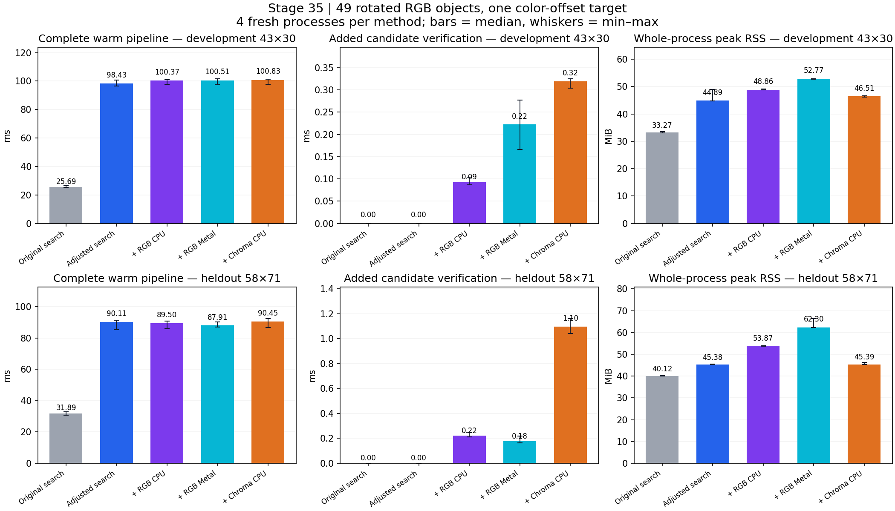
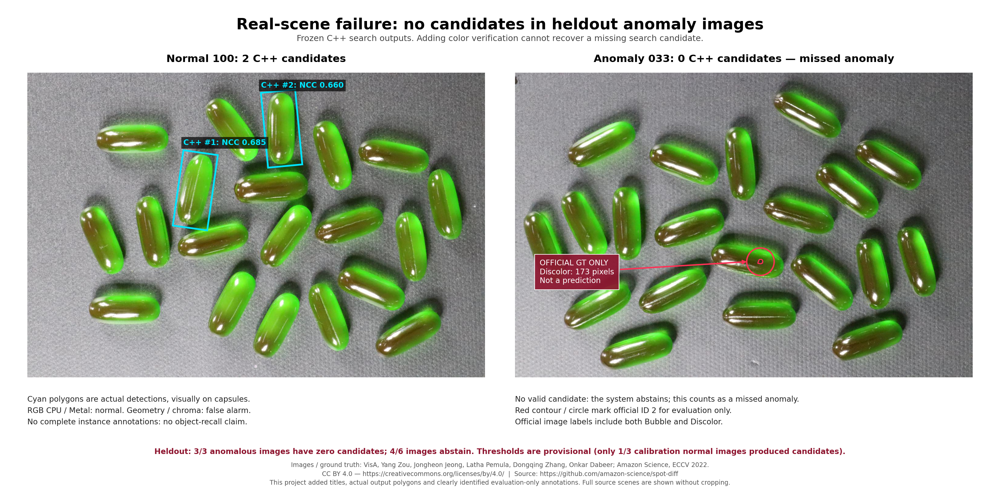

# 第35輪：密集實拍、49物件旋轉與RGB顏色驗證

日期：2026-10-17；Apple M4 Pro、48 GiB、macOS；Release原生C++／Metal。**本輪完成了有界實驗與可重現整理，結論是保留研究工具，不升為通用預設。** 小模板的召回有實際改善，顏色檢查在控制場景有效；時間代價、白平衡誤報與實拍漏搜也很明確。

給第一次閱讀的人：[專案導覽](../../docs/PROJECT_GUIDE_zh-TW.md) → [目前建議方案](CURRENT_BEST_zh-TW.md) → 本文 → [Log分類](LOG_CATALOG_zh-TW.md)。逐場景指標見[閱讀版summary](stage35-real-rgb/summary.json)，採用決定見[decision](stage35-real-rgb/decision.json)。

## 階段結論

| 問題 | 實測結論 | 決定 |
|---|---|---|
| 小模板旋轉後漏搜能否改善？ | 43×30郵票控制圖由4/49恢復49/49；暖機25.58→100.28ms，RSS33.33→44.93MiB | 可以改善，但不是免費加速；保留手動設定，不全面減少金字塔層數 |
| RGB NCC能否找出顏色不同的一個物件？ | 兩張各49物件的異色控制均漏掉1個異色；CPU／Metal一致 | NCC通道均值消除會抵消固定色偏，不能單獨當異色檢測器 |
| 線性色度檢查有沒有幫助？ | 同兩張控制各TP1／FP0／FN0，新增檢查約0.32／1.10ms；中性曝光無誤報 | 保留為定位後的研究選項 |
| 光照變化是否穩健？ | 白平衡負控制兩張各49個正常物件全部被色度標為異常 | 未過關，不能直接部署為顏色缺陷判斷 |
| 真實密集RGB場景是否已成功？ | VisA保留集3張異常全部無搜尋候選；6張共4張拒答 | 未通過；主要限制在前段召回，後段色差能力也未充分驗證 |
| RGB一定適合GPU嗎？ | 小模板驗色CPU約0.09ms、Metal約0.22ms；較大模板CPU約0.22ms、Metal約0.18ms | 有工作量交界，尚不足以建立通用分流；本輪GPU色彩副本也未用既有shared選項 |

本輪沒有修改灰階核心搜尋定義、GUI預設、shader或既有多尺度採用方案。新增完整C++色度評分、同程序搜尋＋驗色runner、資料準備器、量測／重播與負控制測試。第34輪的128／512物件優勢與30分鐘穩定性是另外一組證據，不與本輪時間相除。

## 1．場景與標註

共25個場景：4張FSC實拍、8張半合成控制、13張VisA實拍。五方法、四個獨立程序block，每程序首次＋一次repeat，共500程序／1000次算法呼叫。重複次數不是獨立影像數。

### 真實密集場景：FSC147

[Learning To Count Everything，CVPR 2021作者repository](https://github.com/cvlab-stonybrook/LearningToCountEverything)提供類別點標註及範例框。本輪準備12張照片檢視，正式選兩張郵票2933／7417及兩張瓶蓋1913／1924；分別有45／43／50／48個官方類別點。搜尋模板取第一個官方範例框，RGB原圖不修改。鏡像固定revision，annotation逐位元組的Git blob與作者版本一致。

**同一張圖內的郵票或瓶蓋可能不是同一外觀／顏色。** 所以只報「搜尋框中心對類別點的10px一對一覆蓋」，不把所有郵票當成同一模板身份GT，也不把未覆蓋點直接宣稱為同模板漏檢。2928在搜尋前QA發現同一可見郵票有重複點，已排除準確度使用；排除理由與原標註保留。

### 49物件控制：真實裁切、半合成場景

從development照片2933與heldout照片7417各裁出43×30、58×71模板，壓縮強度至`.65*x+45`以避免改色裁切飽和，再各放置49個隨機角度副本。每個模板有四種條件：正常、只改第24號物件的RGB偏移、中性線性曝光變化、全圖白平衡變化。每模板四條件重用同49個姿態，合計98個獨立生成姿態，**不是392個獨立實拍物件**。既定種子、OpenCV雙線性生成與解析GT均保留；渲染器與C++評分實作分開。

幾何成功要求位置≤2px、角度≤1°、尺度比例在[.98,1.02]，最大基數一對一配對。異色TP還必須配對到指定變色物件；前段漏掉它仍計色彩FN，重複預測計FP。所有半合成場景尺度固定1；不把它當作新的尺度精度驗收。

### 真實異常：VisA capsules

[VisA／SPot-the-Difference，ECCV 2022作者repository](https://github.com/amazon-science/spot-diff)提供正常與異常RGB圖及官方缺陷mask。本輪固定13張1500×1000圖：normal000只供裁模板及self-check，正常050／200／400供閾值校準，030／036／042是pilot異常觀察；正常100／300／500與異常033／039／044是保留集。

六張異常官方皆標為bubble＋discolor；只用原mask的ID2評估局部變色，143–300px，並非整顆換色。沒有每顆膠囊的完整框與姿態GT，不能報全場景物件recall。原圖來源、CC BY4.0、官方mask核對與限制見[資料歸屬](stage35-real-rgb/data-provenance.md)。

模板為正常000的`[878,25,112,245]`裁切，色度支撐mask只由這顆正常模板的飽和前景建立；query的異常GT永遠不進搜尋／驗色job。官方缺陷mask只在結果產生後做位置覆蓋評估。

## 2．比較方法與時間邊界

| 方法 | 全圖搜尋 | 定位後檢查 |
|---|---|---|
| geometry_original | 原min_area256、proposal .5、limit100 | 無新增檢查，沿用灰階分數 |
| geometry | pilot選定512、.25、300 | 無新增檢查 |
| rgb_cpu | 與geometry完全相同 | RGB NCC，CPU8threads |
| rgb_metal | 與geometry完全相同 | RGB NCC，Metal |
| chroma | 與geometry完全相同 | 線性色度，CPU1thread、正常模板支撐mask |

共同前段使用Metal搜尋與精修、fine mode2／融合／角度重用、u8/shared、resident0。半合成最終分數.8、scales=[1]；實拍分數.65、FSC scales=[.75,1,1.25]、VisA=[.85,1,1.15]。完整參數見[事前protocol](stage35-real-rgb/protocol.json)。512/.25/300由development pilot選定，保留原路作成本／精度對照；不是純單參數因果實驗。獨立pilot已逐項拆出金字塔效應，見[診斷報告](STAGE35_PYRAMID_DIAGNOSIS_zh-TW.md)。

RGB NCC每通道各自去均值，再合併能量正規化；若`I_c=a*T_c+b_c`且無裁切／量化，固定`b_c`會被消掉。線性色度則先明確sRGB解碼，再算`c=RGB/(R+G+B)`；共同線性增益抵消，不同通道增益不抵消。每像素距離`||cT-cI||/sqrt(2)>.04`算改變。這不是Lab／DeltaE，沒有相機色彩校正，內嵌ICC也未轉換；完整數學、有效支撐及座標契約見[runner文件](COLOR_VERIFY_RUNNER.md)。

控制圖的預定決策是NCC loss>.2或色度改變比例>.1。VisA只用三張正常校準圖的有效候選最大值，再取三圖最大值＋1e-6；三張只有200找到候選，因此覆蓋1/3，**所有VisA閾值都標為provisional**。零候選保留null與拒答，不算正常TN。閾值檔在60個校準worker完成後保存，才執行其他場景，異常與heldout不調參。

各方法每張圖用獨立程序，同一程序內完成搜尋與驗色，因此RSS不用跨程序相加。程序順序以block正反交錯，無並行benchmark／建置。pipeline時間包含搜尋、候選轉換、驗色；解碼、建模、JSON、GT評估、繪圖分開。summary同時保留first、repeat、初始化及cold-ready；cold-ready是decode＋construct＋first，仍不含程序啟動／JSON，非完整相機吞吐量。四程序只報中位與min/max，不估P95或總體成功率。

first表示新程序中的首次呼叫，沒有清除系統Metal shader／driver快取；不宣稱GPU完全冷啟動。

## 3．幾何改善的代價

| 場景 | 原設定TP/49 | 調整後TP/49 | 原→調整暖機ms | 原→調整peak RSS MiB |
|---|---:|---:|---:|---:|
| development正常 | 4 | 49 | 25.58→100.28 | 33.33→44.93 |
| development單一異色 | 4 | 49 | 25.69→98.43 | 33.27→44.89 |
| development曝光 | 21 | 49 | 27.27→100.34 | 33.65→41.80 |
| development白平衡 | 8 | 49 | 27.29→99.57 | 33.46→44.99 |
| heldout正常 | 49 | 49 | 32.61→88.96 | 40.20→45.34 |
| heldout單一異色 | 49 | 49 | 31.89→90.11 | 40.12→45.38 |
| heldout曝光 | 49 | 49 | 32.35→90.37 | 40.22→45.37 |
| heldout白平衡 | 49 | 49 | 32.59→90.30 | 40.25→45.35 |

調整後八個控制均49個唯一正確結果、零幾何FP/FN。development模板縮到11×8時細紋不足，保留22×15層可恢復；正確GT位置的NCC原本均>.951，已排除「本來沒有高分解」。原Stage34 runner與新runner完整搜尋結果一致，CPU與Metal前段也共同失敗。這支持層級／候選召回限制，沒有證據稱某個Metal實作算錯。

**heldout模板原來就49/49，調整只是變慢。** 所以不採用全面512/.25/300；下一個研究方向是依模板資訊量選層級與預算，而非無條件增加工作。此輪沒有實作自動選層。

## 4．顏色、時間與記憶體

兩張單一異色控制，geometry與RGB CPU／Metal都是色彩TP0／FP0／FN1；chroma各為TP1／FP0／FN0。正常與曝光控制四圖均無色彩FP；白平衡控制的chroma卻各FP49，RGB NCC皆不報異常。這個負例解釋為何色度有幫助但不能直接當生產缺陷判斷。

| 場景／方法 | 完整repeat ms | 其中驗色ms | 程序peak RSS MiB |
|---|---:|---:|---:|
| development異色／geometry | 98.43 | 0 | 44.89 |
| 同圖／RGB CPU | 100.37 | .092 | 48.86 |
| 同圖／RGB Metal | 100.51 | .223 | 52.77 |
| 同圖／chroma CPU | 100.83 | .319 | 46.51 |
| heldout異色／geometry | 90.11 | 0 | 45.38 |
| 同圖／RGB CPU | 89.50 | .220 | 53.87 |
| 同圖／RGB Metal | 87.91 | .178 | 62.30 |
| 同圖／chroma CPU | 90.45 | 1.095 | 45.39 |

各方法是不同程序，完整時間中位數的差額含搜尋波動，不能全部歸因驗色；例如heldout Metal的完整時間少2.20ms，實際驗色只有.178ms，不宣稱因此整條RGB加速。資料常駐後的CPU／Metal RGB分數最大差1.79e-7，低於3e-5；四路有序幾何完全相同。原路不要求與調整路相同，但每路自身跨程序與repeat一致。



事前時間容忍為geometry＋max(10%,2ms)，RSS容忍為geometry＋max(10%,16MiB)。800個方法／block／phase配對中240筆至少一個門檻失敗：first126、repeat114；時間失敗19筆、RSS失敗224筆，兩者交集3筆。**同一程序的peak RSS在first與repeat重用，因此RSS實際是112個worker事件，不能稱224個獨立記憶體失敗。** chroma有5筆時間失敗，沒有RSS失敗；所有失敗原值保留，不用整體中位數把它們撤銷。

RGB記憶體失敗有可解釋的實作因素：額外RGB context在搜尋前就初始化，即使最後零候選仍存在。RGB CPU保留3通道float來源；本runner的RGB Metal使用`storage_mode=0`，CPU與GPU各一份，1500×1000×3×4約17.17MiB一份。共享模式在既有API可用，但本輪未對照，因此**不是最佳Metal記憶體或GPU必然昂貴的證明**。例如VisA anomaly033，geometry／RGB CPU／RGB Metal RSS為59.75／77.00／95.15MiB，零候選時驗色近零。灰階前段的shared1與這個RGB verifier儲存模式要分開看。

這輪不再擴充效能實驗：先保存完整結論。若要繼續，RGB context延遲到有候選才建立、已有shared儲存、只準備候選ROI，可各作獨立對照；不能把尚未量測的收益寫成完成。

## 5．實拍結果與尚未過關項目

| FSC實拍 | 原→調整類別點覆蓋 | 調整後檢出框／未配對框 | 原→調整repeat ms |
|---|---|---|---:|
| 郵票2933 | 0/45→2/45 | 2／0 | 53.06→112.80 |
| 郵票7417 | 41/43→41/43 | 42／1 | 38.86→73.78 |
| 瓶蓋1913 | 48/50→49/50 | 49／0 | 64.36→305.43 |
| 瓶蓋1924 | 11/48→11/48 | 11／0 | 37.93→100.90 |

這些是類別點覆蓋，不是同模板身份recall／precision；尤其42個框對41個點的未配對框不能在沒有身份標註時稱為確定誤檢。資料示範了密集RGB場景可得到不同覆蓋，也示範不能因圖裡有50個同類物件就要求單一像素模板找到50個。

VisA正常校準050／400無候選，200一個；self-check000一個，不算泛化成功。六張heldout中100有2個候選、500有1個，視覺均落在完整膠囊；300與三張異常033／039／044都是零候選。所有方法拒答4/6；異常保留FN3，缺陷ID2覆蓋與定位色彩TP均0。缺少全物件GT，這個觀察不能換成膠囊總recall。

| VisA heldout（3正常＋3異常） | TP | FN | 正常FP | 正常TN | 拒答 |
|---|---:|---:|---:|---:|---:|
| geometry／original／chroma | 0 | 3 | 2 | 0 | 4/6 |
| RGB CPU／Metal | 0 | 3 | 0 | 2 | 4/6 |

拒答與FN有重疊，不能將這些欄位相加當總樣本數；正常300拒答不算TN。RGB在兩張有候選正常圖沒有誤報，但全部異常都沒進驗色，且閾值只有1/3校準覆蓋，**不能稱RGB缺陷檢測成功**。優先需要多個正常外觀模板、更穩健前段及局部小缺陷統計，不宜只增加迭代次數。



## 6．測試、整理與重現

完整Release CTest 55/55、C++色度ASan／UBSan 1/1、native runner契約5/5（含Metal）、離線量測負控制26/26通過。sanitizer使用detect_leaks=0，不是完整Metal消毒或洩漏驗收。負控制涵蓋輸入hash、GT mask篡改、缺worker、方法／後端參數、偽exact旗標、跨程序共同偏移、重複TP／FP、閾值竄改與零候選拒答。正式期間來源、二進位與輸入hash未變；完整summary由原始worker重算相同。這些通過是實作／證據完整性，沒有把實拍精度與性能失敗改為成功。

解壓封存後另核對2213個內容檔hash並離線重算全部summary，一致；從解壓源碼重建全部Release目標，包含Qt GUI。核心／色度兩項原生測試、五項runner契約與26項量測負控制再次通過；以封存VisA正常100及重新建出的chroma／RGB Metal runner實跑，兩個候選與全部分數逐值符合原始結果。這是重建與數值重現，不新增性能樣本，也不是跨平台GUI包裝驗收。

專案文件已整理為現行建議、完成範圍、外部導覽及逐輪證據；舊建議與狀態移到HISTORY文件。Log透過分類索引連接protocol、pilot、calibration、formal、失敗、validation、source及provenance，保留原路徑與內容，避免破壞歷史引用。

- [資料與原始worker封存](stage35-real-rgb/raw-results.tar.gz)、[完整來源與原有測試素材](stage35-real-rgb/source-and-fixtures.tar.gz)：解壓至同一目錄。
- [封存與SHA256](stage35-real-rgb/archive.json)、[離線重播／重建驗證](stage35-real-rgb/validation.json)與[驗證logs](stage35-real-rgb/validation-logs.tar.gz)。
- 封存內`evidence/formal`保留500組job／raw／stderr、事前protocol、校準及summary；`evidence/pilot*`保留失敗及GT診斷；`reviews`保留獨立稽核與繪圖源碼。
- `data/visa`保留CC BY4.0小子集及歸屬。FSC照片與其衍生控制圖未確認再散布授權，不塞入Git封存；保存來源revision、原圖hash、裁切／渲染程式、輸入與GT manifest。離線統計重播不需要這些照片，重新跑算法則先按下載器取得。

建置及算法測試從repo根目錄：

```sh
cmake -S cpp-core -B build/stage35 -DCMAKE_BUILD_TYPE=Release \
  -DFPM_BUILD_EXPERIMENTS=ON -DFPM_BUILD_GUI=ON -DFPM_WITH_OPENCV=ON
cmake --build build/stage35 -j 6
ctest --test-dir build/stage35 --output-on-failure
python3 cpp-core/tests/color_verify_runner_test.py \
  --runner build/stage35/experiments/fpm_color_verify_runner --metal
python3 cpp-core/tests/real_rgb_benchmark_test.py
```

資料準備與正式重跑用Python3＋NumPy／OpenCV／Pillow，繪圖另需matplotlib。生成器拒絕覆蓋既有case，benchmark也拒絕覆蓋既有正式結果：

```sh
python3 cpp-core/tools/prepare_stage35_fsc.py --output build/stage35-data/fsc
python3 cpp-core/tools/prepare_stage35_visa.py --output build/stage35-data/visa
python3 cpp-core/tools/stage35_scenes.py \
  --fsc-manifest build/stage35-data/fsc/manifest.json \
  --visa-manifest build/stage35-data/visa/manifest.json --output build/stage35-inputs
python3 cpp-core/tools/benchmark_real_rgb.py --build build/stage35 \
  --cases build/stage35-inputs/cases.json --output build/stage35-formal --blocks 4
```

從封存解壓目錄可用`reviews/replay_archive.py`重播所有正式數據；它核對檔案hash並把原GT路徑映射到封存mask，不啟動GPU。重新測性能請在自己的硬體以相同參數執行，不以本機毫秒值作保證。
