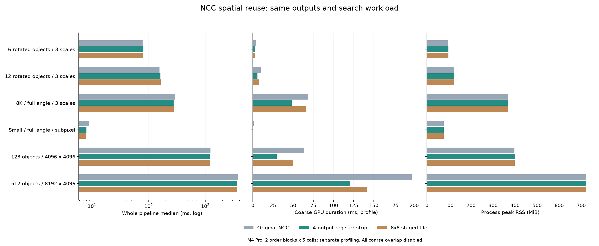
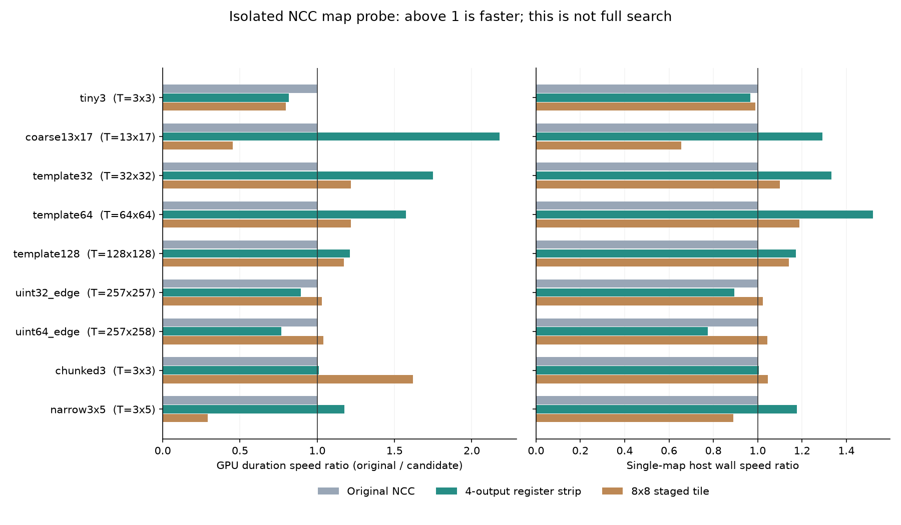

# NCC 空間分塊：暫存器重用與 threadgroup staging

2026-10-14，Apple M4 Pro（12 CPU／16 GPU cores）、48 GiB，Release。本輪固定搜尋參數與原始 CPU double 正規化，只更改粗搜尋的整數統計計算；GUI 與 API 預設仍維持原模式。完整實驗歷史與推薦組合見 [人工 review 索引](EXPERIMENT_REVIEW_zh-TW.md)。

## 兩個可獨立比較的新 kernel

| NCC mode | 每個 GPU 工作單元 | 額外晶片內資料 | 本輪是否改 fine 搜尋 |
|---|---|---|---|
| 0：原始對照 | 一 thread 算一個完整視窗 | 三個整數累加器 | 否 |
| 2：水平 strip | 一 thread 算四個相鄰輸出，逐列滑動四像素暫存值 | 三組四通道整數累加器＋四像素值 | 否 |
| 3：顯式 staging | 64 threads 算 8×8 輸出，合作載入最多 16×16 模板與 23×23 source | 宣告 785 bytes threadgroup tile，另有每 thread 累加器 | 否 |

mode1 是前輪「一整個 SIMD group 算一視窗」的失敗對照，源碼仍保留。這輪兩種方式將重用方向改成相鄰輸出，不是單純增加同一視窗的 threads。

mode2 在模板每列的第一個位置讀四個像素，接著每向右一步只載入一個新像素，另外三個沿用。若模板寬高為 w、h，四個完整相鄰輸出的 source 邏輯讀取從 4wh 減為 (w+3)h，模板則從四份改為一份；三組 NCC 統計仍各自累加，沒有改變數學定義。這是最多接近四倍的**原始碼讀取重用機會**，不是 GPU 速度或實際 DRAM 流量倍數。

mode3 把模板切成最多16×16小塊，同組輸出的 source 聯集最多23×23。所有64 threads 合作載入後經 barrier，計算各自的部分統計，再經第二個 barrier 才覆寫 tile。邊界 threads 仍參與載入與同步，只停用無效輸出的累加與寫出；不能在第一個 barrier 前直接退出。小於完整tile的模板部分使用實際寬度／高度，不讀未初始化資料。

三個統計 S=ΣI、Q=ΣI²、P=ΣIT 可精確加總；以65025N的界限選uint32／uint64。257×257仍屬uint32，257×258才跨過界限。整數不溢位時改變分塊順序不改變統計；轉成double後仍用原式與原操作順序正規化，未採FP32近似門檻。

暫存器、L1／L2的實際配置由編譯器與硬體決定，程式沒有宣稱固定放入某一層CPU cache。host 對新 pipelines 檢查至少64 threads及 `staticThreadgroupMemoryLength <= maxThreadgroupMemoryLength`；785 bytes是宣告的tile payload，非編譯器總資源或實測cache佔用。[Apple 靜態 threadgroup 配置定義](https://developer.apple.com/documentation/metal/mtlcomputepipelinestate/staticthreadgroupmemorylength)。更完整的數學與FlashAttention適用界線見 [分塊研究](NCC_TILING_AND_OVERLAP_RESEARCH_zh-TW.md)。

## 整合與精確性界線

新kernel同時接入單張map、角度batch、原工作區切段與雙槽非同步三條路徑。原16 MiB statistics及64 MiB batch source上限不變，沒有新增device buffer。輸出tile以影像列定位，僅寫入原 `first_window <= index < first_window+count` 的範圍；跨工作區的切點不必對齊列、四像素strip或8×8tile。無效邊界可能產生額外計算，但邏輯視窗／候選數完全一致。

`FpmCoarseOptimizationConfigV1`尺寸與reserved欄位不變，`ncc_mode`擴充為0..3，`peak_mode`仍0..1。啟用時延遲建立新pipeline；裝置不符合要求則明確回報錯誤。CPU-only frame不接受新Metal模式。未將這輪模式接到GUI，也未更改產品預設。

```python
frame.set_coarse_optimization(peak_mode=1, ncc_mode=2)  # 3 為 staging 對照
frame.set_coarse_overlap(enabled=False)                # 本輪固定關閉，只改一個變因
```

完整源碼：[kernels](../experiments/coarse_ncc.metal)、[host派工與檢查](../experiments/coarse_metal.mm)、[ABI](../experiments/coarse_ncc.h)、[binding](../tools/coarse_experiment.py)、[分塊測試](../tests/coarse_tiling_test.cpp)。

## 測量設計

全流程對照凍結 `d60ec04`，並保留同一新build的mode0控制；所有模式皆peak1、pyramid1、batch4、fine512、overlap關閉、相同rescue。六場景含6／12／128／512物件、8K與全解析subpixel；每個方法各新process，正反兩block、至少1秒暖機後5次，profile另量。GT只由父程序事後評估；完整proposals／matches／scores與邏輯工作量相等和GT準確率分開檢查。

另用獨立C++單張map探針，固定九種source／template形狀，比較mode0／2／3，兩block、各10次；CPU scalar完整逐位參考在RSS取樣後執行，每次分數圖與first的完整逐位比較在計時外。RSS包含保留的first score map，與完整搜尋的RSS範圍不同。不能將此探針的wall時間與CPU參考時間直接作CPU／GPU競速。初次編譯／學習／配置與first各自保留。

事前固定 [protocol](coarse-tiling/protocol.json)。benchmark工具：[全流程](../tools/benchmark_coarse_tiling.py)、[獨立map](../tools/benchmark_tile_probe.py)、[C++ probe](../tools/coarse_tile_probe.cpp)。

## 正式結果

84 個獨立worker、420次正式計時、84次first與1909次暖機完成。六場景全部有序proposals／matches／scores與凍結版一致，邏輯coarse／fine工作量及路由一致；GT事後評估每方法全部零FP／FN。正反兩block均通過原先固定的「每block容忍max(10%,2ms)」門檻；這是退步容忍，**不是全面加速**。

### 全流程時間與記憶體

下表為不開profile的10次總時間中位數，括號為兩個新process的最大peak RSS MiB。來源prepare、搜尋、既有refine／rescue及NMS計入；一次學習／解碼與first另列於原始資料。8K與小型fullres兩例只執行proposal＋NMS，沒有後段pose精修；它們仍搜尋全角度，但植入真值是正向scale1，不代表驗證任意角度／尺度的GT。

| 場景 | 凍結 d60：ms（MiB） | 同build mode0 | mode2 暫存重用 | mode3 staging | mode2 對 mode0 時間變化 |
|---|---:|---:|---:|---:|---:|
| 6 物件／三尺度 | 79.36（97.8） | 78.27（97.1） | 79.60（97.9） | 79.21（97.9） | +1.69% |
| 12 物件／三尺度 | 156.26（123.5） | 155.93（123.7） | 161.51（121.9） | 162.96（122.0） | +3.58% |
| 8K／全角度／三尺度 | 290.34（371.6） | 291.86（368.1） | 276.74（369.2） | 277.25（367.7） | -5.18% |
| 640×512／全角度／subpixel | 8.80（76.2） | 8.84（76.6） | 8.00（76.4） | 7.96（76.7） | -9.54% |
| 128 物件／4096² | 1236.76（400.7） | 1239.20（397.2） | 1203.43（401.8） | 1209.24（397.9） | -2.89% |
| 512 物件／8192×4096 | 3786.29（720.9） | 3767.99（721.0） | 3635.22（721.0） | 3669.05（720.9） | -3.52% |

mode2在8K、128、512的兩個block均比兩種mode0對照快；但本輪只有單機、兩個排序block，未建立跨機通用閾值。128場景的同build mode0 block0為1318.95 ms、block1為1228.10 ms，有波動；對凍結基準看，mode2兩block分別減時2.35%、2.42%，不把單個9.04%的差額當穩定收益。512相對同build兩block減時6.31%、2.33%；相對凍結版亦均減時。

每個場景所有方法的frame來源／金字塔／coarse／fine retained容量相同，每worker量測期間容量亦固定。mode2最大RSS增量為128場景的4.61 MiB，512幾乎不變；這是程序峰值差異，不能稱作新device buffer。沒有把shared frame重複乘以尺度數，也沒有把RSS和GPU bytes相加。



### 核心收益與等待

以下是另外profile workers的coarse GPU command區間中位數；非純kernel指令時間，與host wait、NCC wall包含關係不同。

| 場景 | mode0 device ms | mode2 device ms | mode3 device ms |
|---|---:|---:|---:|
| 6 物件／三尺度 | 3.598 | 2.959 | 3.081 |
| 12 物件／三尺度 | 9.803 | 5.628 | 8.063 |
| 8K／全角度／三尺度 | 68.266 | 48.170 | 66.133 |
| 640×512／全角度／subpixel | 1.156 | 0.510 | 0.397 |
| 128 物件／4096² | 63.786 | 29.677 | 49.850 |
| 512 物件／8192×4096 | 196.973 | 120.724 | 141.602 |

512的mode0→2：device196.97→120.72 ms、host wait255.37→176.01 ms，source/template copy2.33→2.42 ms；CPU normalization仍218.20→219.35 ms。收益主要來自粗計算及其等待減少，**本輪沒有證據支持「時間主要花在資料複製」**。CPU double normalization尚未搬GPU，因此不是整條NCC全GPU。

512的fine旋轉約795 ms、fine NCC約1566 ms仍是大頭；本輪沒改這兩段。下一個優先研究方向是fine的精確分塊／旋轉與統計融合，先保留guard及CPU repair的數值契約，再量完整成本；不能把本輪coarse模式直接套入就宣稱完成。

小fullres的mode0 profile block1比獨立未profile block慢69.46%，12物件mode0兩block也多5.59–7.87%；這些是獨立process間的觀察差，包含插樁與執行波動，不能全算插樁成本。所有原始值保留。因此全流程採用結論只依未profile資料，不用profile表反推缺失的速度收益。

### 獨立單張 NCC map

54workers、540正式次數、54first、120399暖機呼叫；全部逐位等於CPU scalar，工作量／容量相等。表格為device／host wall ms，非全圖搜尋。小時間不解讀為穩定的百分比。

| source；template | mode0 device／wall | mode2 device／wall | mode3 device／wall |
|---|---:|---:|---:|
| 64×64；3×3 | 0.0046／0.0981 | 0.0056／0.1015 | 0.0058／0.0992 |
| 512×512；13×17 | 0.4218／1.0897 | 0.1935／0.8433 | 0.9286／1.6632 |
| 256×256；32×32 | 0.3830／0.6132 | 0.2189／0.4602 | 0.3149／0.5577 |
| 256×256；64×64 | 1.1517／1.4253 | 0.7322／0.9378 | 0.9453／1.1987 |
| 256×256；128×128 | 2.4900／2.6731 | 2.0563／2.2808 | 2.1217／2.3426 |
| 273×271；257×257 | 4.3411／4.4951 | 4.8500／5.0273 | 4.2159／4.3899 |
| 273×272；257×258 | 4.9347／5.1197 | 6.4313／6.6075 | 4.7439／4.9081 |
| 1537×1001；3×3 | 0.5871／4.6998 | 0.5815／4.6795 | 0.3627／4.4895 |
| 20×1024；3×5 | 0.0104／0.1612 | 0.0088／0.1369 | 0.0355／0.1811 |

13×17模板的mode2 device約2.18×，但host wall僅1.29×；mode3同例反而更慢。257×258且僅255個輸出時mode2也更慢；把輸出合併到同一thread會減少可同時排程的threads，加上較多累加器，存在不利小輸出面的可能，尚無occupancy counter可確認主因。顯式threadgroup同步與搬運也有成本，不能只由reuse公式預測勝負。單map各模式RSS約15.8–58.1 MiB，完整數值保留於probe結果。



### 採用決定

**通用基準維持mode0；mode2作本機8K及128／512多實例的可選方案；mode3保留對照，不作全局預設。** mode2大場景有一致方向的收益且輸出精確，值得保留；6／12場景沒有全流程收益，大模板少輸出時亦有反例。目前未實作自動形狀選擇，也沒有把mode2與overlap同時開啟做效能實驗，因此不相乘兩輪加速比。異步路徑的功能／ownership已有測試，與組合效能證據分開。

正式證據：[全流程review數據](coarse-tiling/results.json)・[全流程完整封存](coarse-tiling/raw-results.tar.gz)・[SHA／驗證](coarse-tiling/artifact-sha256.json)・[單map數據](coarse-tiling/probe/results.json)・[單map封存](coarse-tiling/probe/raw-results.tar.gz)・[單map SHA](coarse-tiling/probe/artifact-sha256.json)。

## 驗證

- Release：原有23項通過，新增tiling測試通過；新測試最初因測試helper與`std::equal`名稱衝突未能建置，修正後重跑通過，沒有刪除失敗日誌。
- Debug scalar＋ASan／UBSan：22／22通過；`detect_leaks=0`，不宣稱LeakSanitizer驗證。
- Metal API／GPU Shader Validation確認啟用，新增測試通過且無stderr違規；其795張精確map對照涵蓋32／64-bit邊界、飽和值、退化模板、常數source、strided／窄圖、tile尾部、工作區切段、batch、兩槽ownership、同步fallback與完整旋轉／subpixel有序結果。
- 效能量測不啟用上述診斷／sanitizers。Shader Validation是另輪功能驗證，不拿其時間當正式效能。[Apple Shader Validation](https://developer.apple.com/documentation/xcode/validating-your-apps-metal-shader-usage)。
- Python benchmark 路徑／GT 邊界測試9／9通過，其中新增3項確認 mode2／3 路由、關閉 overlap 及 worker 不取得真值。

仍未測量硬體cache命中率、occupancy或DRAM counters，不能僅以kernel加速或理論重用式宣稱原版必定頻寬受限。RGB全圖、遮擋及不同硬體也不在本輪證據範圍。

## 重現與離線審查

從 repository root 建置，需本機可用的 Apple 編譯器、Metal、Qt 及 OpenCV；詳細依賴見 [README](../README_zh-TW.md)：

```sh
cmake -S cpp-core -B build/coarse-tiling -DCMAKE_BUILD_TYPE=Release -DFPM_BUILD_EXPERIMENTS=ON -DFPM_BUILD_TESTS=ON -DFPM_BUILD_GUI=ON -DFPM_WITH_OPENCV=ON
cmake --build build/coarse-tiling -j 8
ctest --test-dir build/coarse-tiling --output-on-failure
MTL_DEBUG_LAYER=1 MTL_SHADER_VALIDATION=1 MTL_SHADER_VALIDATION_REPORT_TO_STDERR=1 build/coarse-tiling/experiments/fpm_coarse_tiling_test
```

全流程 benchmark 要求另行保留 `d60ec04` 的三個實驗／核心 dylib 與 provenance manifest；不能拿新binary覆寫baseline。封存提供已量測source、input／binary SHA、場景生成器、原始有序結果、worker、pilot及測試日誌，省略binary與大型生成PNG。原始測量的absolute paths保持不動以便核對SHA；解壓後透過 `--worker-root` 明確選擇離線資料，避免誤讀原路徑。

```sh
python cpp-core/tools/benchmark_coarse_tiling.py --summarize /path/to/full-archive/formal.json --worker-root /path/to/full-archive --output /tmp/tiling-summary.json
python cpp-core/tools/benchmark_tile_probe.py --summarize /path/to/probe-archive/formal.json --worker-root /path/to/probe-archive --output /tmp/probe-summary.json
```

各輸出應與各封存的 `replayed-summary.json` 逐位相同。封存內 `sha256.json` 驗證所有其他檔案，旁邊的 `artifact-sha256.json` 驗證壓縮檔；CPU／GPU時間、RSS與buffer有重疊，不能直接相加。
