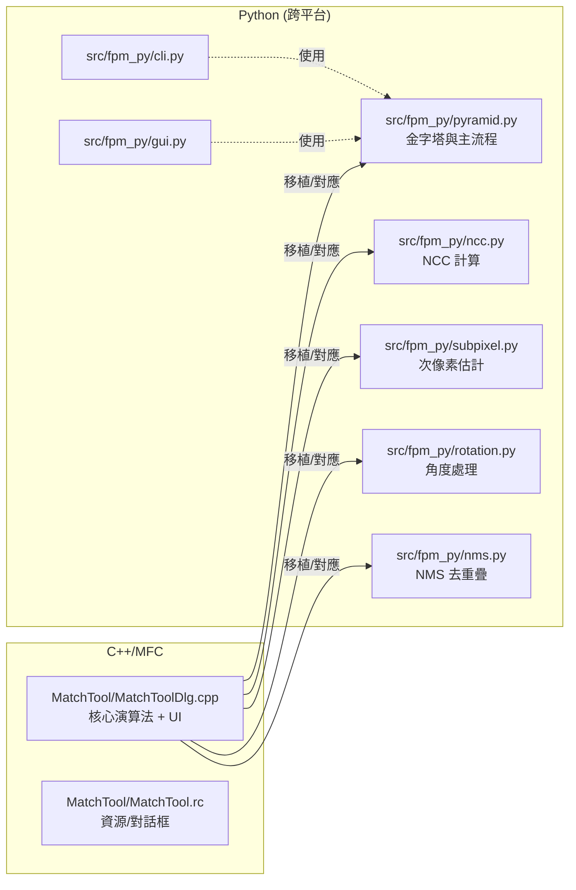

# 1. 專案概述

## 🎯 什麼是影像樣板比對？

影像樣板比對是一種電腦視覺技術，用來在大圖像中尋找特定的小圖樣（樣板）。就像在一張大地圖上尋找特定建築物一樣。

### 實際應用場景
- **工業檢測** - 在電路板上尋找特定零件
- **醫學影像** - 在 X 光片中定位特定結構
- **自動駕駛** - 識別交通號誌和路標
- **遊戲開發** - 自動化遊戲測試
- **品質控制** - 產品外觀檢測

---

## 🏆 為什麼這個專案特別？

### 世界級效能
這個專案被稱為「世界最快的影像樣板比對實作」，在商業軟體比較中表現優異：

| 軟體 | 執行時間 | 效能比較 |
|------|---------|---------|
| **本專案** | 76ms | 🥇 最快 |
| Cognex | 125ms | 64% 慢 |
| Aisys | 202ms | 166% 慢 |

註：上述數據來自作者內部測試，實際效能會因硬體、影像內容與參數而異。

### 核心優勢
1. **超快速度** - 使用多項優化技術
2. **高精度** - 支援角度旋轉和次像素定位
3. **跨平台** - C++ 與 Python 雙重實作
4. **實用性** - 提供完整的使用介面

---

## 🔧 專案架構

```
Fastest_Image_Pattern_Matching/
├── MatchTool/              # C++/MFC 原版（Windows）
│   ├── MatchToolDlg.cpp   # 主要演算法實作
│   └── MatchToolDlg.h     # 資料結構定義
├── python-port/            # Python 移植版本（跨平台）
│   ├── src/fpm_py/        # 核心演算法模組
│   ├── tests/             # 單元測試
│   ├── docs/              # 教學文檔（本文檔系統）
│   └── assets/            # 測試影像
└── Test Images/           # 官方測試資料集
```



---

## 🧠 核心技術概念

### 1. 正規化互相關 (NCC)
- **目的**: 測量兩個影像的相似度
- **輸出**: 相似度分數（0-1，越高越相似）
- **優勢**: 對光照變化具有抗性

### 2. 影像金字塔
- **概念**: 建立多種解析度的影像版本
- **策略**: 從小圖開始搜尋，逐層精修
- **效益**: 搜尋速度通常可提升數倍至數十倍

### 3. 角度搜尋
- **挑戰**: 目標可能旋轉任意角度
- **方案**: 粗到細兩階段搜尋
- **結果**: 精確的角度定位

### 4. 次像素估計
- **問題**: 整數像素定位精度有限
- **解法**: 3x3 鄰域二次曲線擬合
- **改善**: 次像素級精度定位

---

## 📊 移植成果

### C++ 版本特色
- ✅ **高效能** - SIMD 向量化優化
- ✅ **Windows 專用** - MFC 圖形介面
- ✅ **商業級品質** - 經過工業驗證

### Python 版本特色
- ✅ **跨平台** - Windows/macOS/Linux
- ✅ **多重介面** - GUI/CLI/API
- ✅ **現代化** - 完整測試與文檔
- ✅ **可擴展** - 模組化設計

### 移植完成度：95%
- **核心演算法** ✅ 完全移植
- **效能優化** ✅ 保留主要技術
- **使用介面** ✅ 更加豐富
- **跨平台性** ✅ 大幅提升

---

## 🎓 學習收穫

通過學習這個專案，你將獲得：

### 技術技能
- 深度理解電腦視覺演算法
- 學習高效能程式設計技巧
- 掌握 C++ 到 Python 移植經驗
- 熟悉影像處理最佳實踐

### 工程經驗
- 大型專案架構設計
- 效能優化實戰經驗
- 跨平台開發策略
- 測試與文檔撰寫

### 實務應用
- 工業影像處理解決方案
- 電腦視覺產品開發
- 演算法效能調校
- 開源專案貢獻

---

## 🚀 開始學習

準備好深入學習了嗎？建議的學習順序：

1. **[影像樣板比對基礎](02-template-matching-basics.md)** - 建立技術基礎
2. **[快速上手指南](07-quick-start.md)** - 實際操作體驗
3. **[演算法原理](03-algorithm-principles.md)** - 深入理解技術
4. **[Python 實作重點](05-python-implementation.md)** - 掌握實作細節

---

**下一步：** [影像樣板比對基礎 →](02-template-matching-basics.md)
