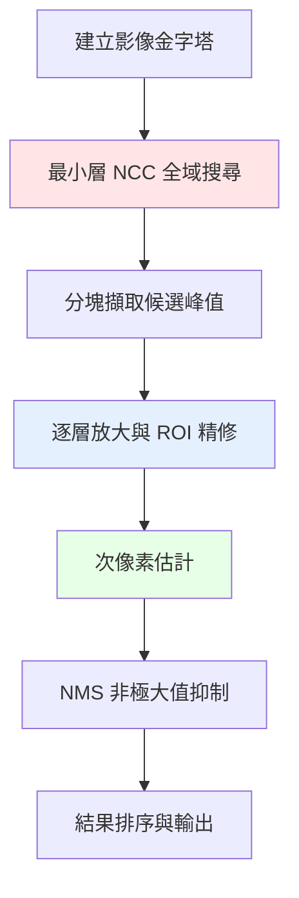

# 2. 影像樣板比對基礎

## 🎯 什麼是樣板比對？

影像樣板比對是一種在大影像中尋找特定樣本（樣板）的技術。就像在茫茫人海中尋找特定的人臉，或在地圖上找到特定的建築物。

### 直觀理解

```
大影像 (來源)：📸 [..................]
                   [....🎯目標.......]  ← 我們要找的位置
                   [..................]

小樣板：🔍 [🎯目標]  ← 已知的樣本
```

**目標**：找出樣板在大影像中的所有位置，以及它們的相似程度。

---

## 🔍 基本概念

### 1. 相似度測量

**問題**：如何判斷兩個影像區域是否相似？

**常見方法**：

#### 平方差 (SSD - Sum of Squared Differences)
```
SSD = Σ[I(x,y) - T(x,y)]²
```
- 值越小表示越相似
- 對噪音敏感
- 計算簡單

#### 正規化互相關 (NCC - Normalized Cross Correlation)
```
NCC = Σ[I(x,y) × T(x,y)] / √[Σ I(x,y)² × Σ T(x,y)²]
```
- 值越大表示越相似（範圍 0-1）
- 對光照變化有抗性
- **本專案採用的主要方法**

### 2. 搜尋策略

#### 暴力搜尋
```python
# 概念示意（實際不這樣寫）
for y in range(image_height - template_height):
    for x in range(image_width - template_width):
        similarity = calculate_ncc(image[y:y+th, x:x+tw], template)
        if similarity > threshold:
            results.append((x, y, similarity))
```

**問題**：計算量巨大，O(W×H×w×h)

#### 金字塔搜尋（本專案方法）
```python
# 1. 縮小影像建立金字塔
pyramid = build_pyramid(image)

# 2. 從最小層開始搜尋
small_results = search_in_smallest_layer()

# 3. 逐層精修到原尺寸
for layer in reversed(pyramid):
    refined_results = refine_in_layer(small_results, layer)
```

**優勢**：計算量大幅降低，速度提升數倍至數十倍（依場景而定）



---

## 🧮 數學基礎

### 卷積與相關

#### 卷積 (Convolution)
```
(I * T)(x,y) = Σ Σ I(x-i, y-j) × T(i,j)
```

#### 相關 (Correlation) 
```
(I ⊗ T)(x,y) = Σ Σ I(x+i, y+j) × T(i,j)
```

**樣板比對使用相關**，因為我們要找的是樣板在影像中的位置。

### 正規化的重要性

#### 未正規化的問題

```python
# 兩個不同亮度的相同圖案
bright_pattern = [[100, 150, 200],
                  [150, 200, 250],  
                  [200, 250, 255]]

dark_pattern = [[20, 30, 40],
                [30, 40, 50],
                [40, 50, 60]]
```

未正規化時，亮度不同會被誤判為不相似。

#### 正規化解決方案

正規化消除了絕對亮度的影響，只考慮相對模式：

```python
def normalize_pattern(pattern):
    mean = np.mean(pattern)
    std = np.std(pattern)
    return (pattern - mean) / std

# 正規化後兩個圖案會被認為是相似的
```

---

## 💻 基礎實作範例

### 1. 最簡單的樣板比對

```python
import cv2
import numpy as np

def simple_template_match(source, template):
    """最基本的樣板比對範例"""
    
    # 使用 OpenCV 內建函數
    result = cv2.matchTemplate(source, template, cv2.TM_CCOEFF_NORMED)
    
    # 找出最佳匹配位置
    _, max_val, _, max_loc = cv2.minMaxLoc(result)
    
    return max_loc, max_val

# 使用範例
src = cv2.imread('source.jpg', cv2.IMREAD_GRAYSCALE)
tmpl = cv2.imread('template.jpg', cv2.IMREAD_GRAYSCALE)

location, score = simple_template_match(src, tmpl)
print(f"最佳位置: {location}, 相似度: {score:.3f}")
```

### 2. 多個結果的搜尋

```python
def find_multiple_matches(source, template, threshold=0.8, min_distance=30):
    """找出多個匹配位置"""
    
    result = cv2.matchTemplate(source, template, cv2.TM_CCOEFF_NORMED)
    
    # 找出所有超過門檻的位置
    locations = np.where(result >= threshold)
    matches = []
    
    for y, x in zip(*locations):
        score = result[y, x]
        matches.append((x, y, score))
    
    # 簡單的非極大值抑制
    filtered_matches = []
    matches.sort(key=lambda m: m[2], reverse=True)  # 按分數排序
    
    for match in matches:
        x, y, score = match
        too_close = False
        
        for existing in filtered_matches:
            ex, ey, _ = existing
            distance = np.sqrt((x-ex)**2 + (y-ey)**2)
            if distance < min_distance:
                too_close = True
                break
        
        if not too_close:
            filtered_matches.append(match)
    
    return filtered_matches

# 使用範例
matches = find_multiple_matches(src, tmpl, threshold=0.7)
print(f"找到 {len(matches)} 個匹配")
```

### 3. 結果視覺化

```python
def visualize_matches(source, template, matches):
    """視覺化匹配結果"""
    
    # 轉換為彩色影像以便顯示彩色框
    if len(source.shape) == 2:
        display = cv2.cvtColor(source, cv2.COLOR_GRAY2BGR)
    else:
        display = source.copy()
    
    h, w = template.shape[:2]
    
    # 在每個匹配位置畫框
    for i, (x, y, score) in enumerate(matches):
        # 畫矩形框
        cv2.rectangle(display, (x, y), (x+w, y+h), (0, 255, 0), 2)
        
        # 標註分數
        label = f"#{i+1}: {score:.3f}"
        cv2.putText(display, label, (x, y-10), 
                   cv2.FONT_HERSHEY_SIMPLEX, 0.6, (0, 255, 0), 2)
    
    return display

# 使用範例
result_image = visualize_matches(src, tmpl, matches)
cv2.imshow('Matches', result_image)
cv2.waitKey(0)
cv2.destroyAllWindows()
```

---

## 🎲 實際應用場景

### 1. 遊戲自動化

```python
def find_game_button(screenshot_path, button_template_path):
    """在遊戲截圖中找按鈕"""
    
    screenshot = cv2.imread(screenshot_path, cv2.IMREAD_GRAYSCALE)
    button = cv2.imread(button_template_path, cv2.IMREAD_GRAYSCALE)
    
    location, score = simple_template_match(screenshot, button)
    
    if score > 0.8:
        print(f"按鈕找到！位置: {location}")
        return location
    else:
        print("按鈕未找到")
        return None
```

### 2. 工業檢測

```python
def quality_inspection(product_image, standard_template):
    """產品品質檢測"""
    
    product = cv2.imread(product_image, cv2.IMREAD_GRAYSCALE)
    standard = cv2.imread(standard_template, cv2.IMREAD_GRAYSCALE)
    
    location, similarity = simple_template_match(product, standard)
    
    # 品質判定
    if similarity > 0.95:
        status = "優良"
    elif similarity > 0.85:
        status = "良好" 
    elif similarity > 0.7:
        status = "可接受"
    else:
        status = "不合格"
    
    print(f"品質檢測結果: {status} (相似度: {similarity:.3f})")
    return status, similarity
```

### 3. 醫學影像分析

```python
def find_anatomical_structure(medical_image, structure_template):
    """在醫學影像中尋找特定結構"""
    
    # 預處理：正規化對比度
    image = cv2.equalizeHist(cv2.imread(medical_image, cv2.IMREAD_GRAYSCALE))
    template = cv2.equalizeHist(cv2.imread(structure_template, cv2.IMREAD_GRAYSCALE))
    
    # 多尺度搜尋（因為結構可能有大小變化）
    scales = [0.8, 0.9, 1.0, 1.1, 1.2]
    best_match = None
    best_score = 0
    
    for scale in scales:
        # 縮放樣板
        h, w = template.shape
        scaled_template = cv2.resize(template, 
                                   (int(w*scale), int(h*scale)))
        
        if scaled_template.shape[0] > image.shape[0] or scaled_template.shape[1] > image.shape[1]:
            continue
            
        location, score = simple_template_match(image, scaled_template)
        
        if score > best_score:
            best_score = score
            best_match = (location, scale, score)
    
    return best_match
```

---

## ⚠️ 常見挑戰與限制

### 1. 光照變化

```python
# 問題：同樣的物件在不同光照下可能不匹配
bright_image = cv2.imread('bright_scene.jpg', cv2.IMREAD_GRAYSCALE)
dark_image = cv2.imread('dark_scene.jpg', cv2.IMREAD_GRAYSCALE)

# 解決方案：使用直方圖均衡化
bright_eq = cv2.equalizeHist(bright_image)
dark_eq = cv2.equalizeHist(dark_image)
```

### 2. 尺度變化

```python
# 問題：目標物件可能比樣板大或小
# 解決方案：多尺度搜尋
def multi_scale_search(image, template, scales=[0.5, 0.75, 1.0, 1.25, 1.5]):
    best_match = None
    best_score = 0
    
    for scale in scales:
        h, w = template.shape
        scaled = cv2.resize(template, (int(w*scale), int(h*scale)))
        
        if scaled.shape[0] > image.shape[0] or scaled.shape[1] > image.shape[1]:
            continue
            
        location, score = simple_template_match(image, scaled)
        if score > best_score:
            best_score = score
            best_match = (location, scale, score)
    
    return best_match
```

### 3. 旋轉變化

```python
# 問題：目標可能旋轉了角度
# 解決方案：多角度搜尋（計算量大）
def multi_angle_search(image, template, angles=range(-45, 46, 15)):
    best_match = None
    best_score = 0
    
    h, w = template.shape
    center = (w//2, h//2)
    
    for angle in angles:
        # 旋轉樣板
        M = cv2.getRotationMatrix2D(center, angle, 1.0)
        rotated = cv2.warpAffine(template, M, (w, h))
        
        location, score = simple_template_match(image, rotated)
        if score > best_score:
            best_score = score
            best_match = (location, angle, score)
    
    return best_match
```

---

## 🚀 為什麼需要進階演算法？

### 基礎方法的限制

1. **計算複雜度高** - O(W×H×w×h×A×S)
   - W,H: 影像尺寸
   - w,h: 樣板尺寸  
   - A: 角度數量
   - S: 尺度數量

2. **記憶體使用大** - 需要儲存多個旋轉/縮放的樣板

3. **精度有限** - 只能達到整數像素精度

4. **無法處理複雜場景** - 多個目標、部分遮擋等

### 本專案的進階解決方案

1. **影像金字塔** - 大幅降低計算複雜度
2. **分塊最佳化** - 加速大圖小模板搜尋
3. **次像素估計** - 提升定位精度
4. **非極大值抑制 (NMS)** - 處理多目標重疊
5. **多重後端** - OpenCV + FFT 雙重選擇

---

## 🎓 學習進階建議

### 理解程度自測

**基礎級別** ✅ 
- [ ] 理解什麼是樣板比對
- [ ] 知道 NCC 的基本概念  
- [ ] 能寫出簡單的比對程式

**中級級別** 🎯
- [ ] 理解金字塔搜尋的優勢
- [ ] 知道如何處理多個結果
- [ ] 能處理光照、尺度變化

**高級級別** 🏆  
- [ ] 理解次像素估計原理
- [ ] 能最佳化演算法效能
- [ ] 能應用到實際專案

### 下一步學習路徑

1. **實作練習** - 用提供的程式碼實際操作
2. **深入原理** - 閱讀 [演算法原理](03-algorithm-principles.md)
3. **使用進階版** - 體驗 [快速上手指南](07-quick-start.md)
4. **理解最佳化** - 學習 [Python 實作重點](05-python-implementation.md)

---

**下一步：** [演算法原理 →](03-algorithm-principles.md)

或者想要立即開始使用？跳到 [快速上手指南 →](07-quick-start.md)
