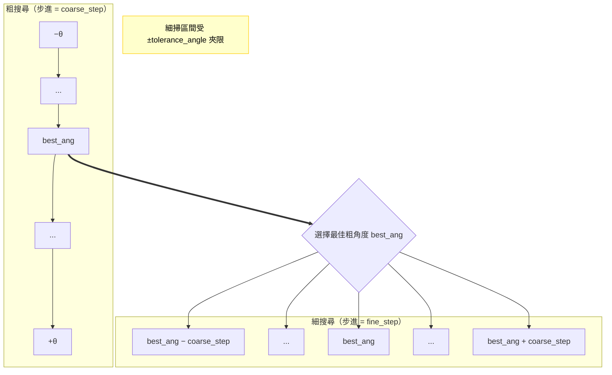
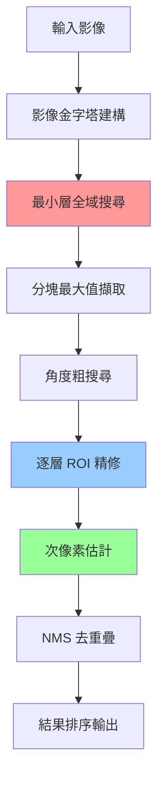

# 3. 演算法原理

## 🧠 核心概念解析

影像樣板比對本質上是在大影像中尋找與小樣板最相似區域的問題。本專案採用多項先進技術，實現世界級的效能表現。

---

## 🔬 正規化互相關 (NCC)

### 數學原理

NCC 是衡量兩個影像區域相似度的數學方法，具有光照不變性。

#### 標準 NCC 公式

對於來源影像 I 和樣板 T：

```
NCC(x,y) = Σ[I(x+i,y+j) - μᵢ][T(i,j) - μₜ] / √[Σ(I(x+i,y+j) - μᵢ)² × Σ(T(i,j) - μₜ)²]
```

其中：
- μᵢ = 來源區域的平均值
- μₜ = 樣板的平均值
- 結果範圍 [-1, 1]，1 表示完全匹配

#### OpenCV 變種

本專案支援兩種 OpenCV 實作：

**1. TM_CCORR_NORMED (相關係數)**
```
CCORR_NORMED = Σ[I(x+i,y+j) × T(i,j)] / √[Σ I(x+i,y+j)² × Σ T(i,j)²]
```
- 範圍 [0, 1]
- 對絕對亮度敏感
- 計算較快

**2. TM_CCOEFF_NORMED (零均值正規化)**
```
CCOEFF_NORMED = Σ[(I(x+i,y+j) - μᵢ) × (T(i,j) - μₜ)] / √[Σ(I(x+i,y+j) - μᵢ)² × Σ(T(i,j) - μₜ)²]
```
- 範圍 [-1, 1] 
- 對均勻光照變化不敏感
- 更適合光照變化場景

### Python 實作細節

```python
def ncc_match(src: np.ndarray, tmpl: np.ndarray, method: str = "ccorr_normed") -> np.ndarray:
    """標準 NCC 實作"""
    src_g = _to_gray(src)
    tmpl_g = _to_gray(tmpl)
    
    if method == "ccorr_normed":
        cv_method = cv2.TM_CCORR_NORMED
    elif method == "ccoeff_normed":
        cv_method = cv2.TM_CCOEFF_NORMED
    
    return cv2.matchTemplate(src_g, tmpl_g, cv_method)
```

---

## 🏔️ 影像金字塔策略

### 原理說明

影像金字塔是多解析度影像表示法，用來大幅降低搜尋空間。

```
原始圖 (1024×1024) → 第1層 (819×819) → 第2層 (655×655) → ... → 頂層 (32×32)
```

### 縮放策略

**縮放比例**: 1.25 倍（每層縮小 80%）
```python
scale = 1.25  # 平衡效能與精度的經驗值
new_size = int(current_size / scale)
```

**優勢分析**:
- 搜尋空間減少：從 O(WH) 降至 O(W'H')，其中 W'H' << WH
- 計算複雜度：通常可降低數倍至數十倍（依影像/樣板大小與參數而變）
- 精度損失：透過分層精修將影響降至最低

### 金字塔建構實作

```python
def _build_pyramid(img: np.ndarray, scale: float = 1.25, 
                  min_reduced_area: int = 256, max_levels: int = 10) -> List[np.ndarray]:
    """建立高品質影像金字塔"""
    levels = [img]
    
    while len(levels) < max_levels:
        h, w = levels[-1].shape[:2]
        new_w, new_h = int(w / scale), int(h / scale)
        
        # 停止條件：面積過小或尺寸過小
        if new_w * new_h < min_reduced_area or new_w < 16 or new_h < 16:
            break
        
        # 使用 INTER_AREA 獲得最佳下採樣品質
        resized = cv2.resize(levels[-1], (new_w, new_h), interpolation=cv2.INTER_AREA)
        levels.append(resized)
    
    return levels
```

---

## 🔄 角度搜尋演算法

### 兩階段搜尋策略

#### 階段1：粗糙搜尋
- **步進角度**: 15-30 度
- **目標**: 快速找到大致角度範圍
- **涵蓋範圍**: ±tolerance_angle

#### 階段2：精細搜尋  
- **步進角度**: 1-5 度（`fine_step`）
- **目標**: 在最佳粗角度附近精確定位
- **範圍**: 以粗搜尋最佳角度為中心、寬度約為一個 `coarse_step` 的角度區間（並受 `±tolerance_angle` 夾限）



### 樣板旋轉處理

```python
def rotate_template(tmpl: np.ndarray, angle_deg: float) -> np.ndarray:
    """高品質樣板旋轉"""
    h, w = tmpl.shape[:2]
    cx, cy = w / 2.0, h / 2.0
    
    # 計算旋轉後外接矩形，避免內容被裁切
    rad = math.radians(angle_deg)
    cos_a, sin_a = abs(math.cos(rad)), abs(math.sin(rad))
    new_w = int(w * cos_a + h * sin_a)
    new_h = int(h * cos_a + w * sin_a)
    
    # 建立旋轉矩陣並調整平移以置中
    M = cv2.getRotationMatrix2D((cx, cy), angle_deg, 1.0)
    M[0, 2] += (new_w / 2.0) - cx
    M[1, 2] += (new_h / 2.0) - cy
    
    # 高品質旋轉
    return cv2.warpAffine(tmpl, M, (new_w, new_h), 
                         flags=cv2.INTER_LINEAR, 
                         borderMode=cv2.BORDER_REPLICATE)
```

---

## 🎯 s_BlockMax 最佳化

### 問題背景

在「大影像 + 小樣板」情境下，傳統全域搜尋會浪費大量計算資源在明顯不匹配的區域。

### 解決方案：分塊最大值

**核心思想**: 將相似度地圖分割成不重疊區塊，每塊只保留最大值候選。

```python
def topk_blocked(response: np.ndarray, block_size: tuple[int, int], 
                k: int = 50, score_thresh: float = 0.0) -> List[Tuple[int, int, float]]:
    """分塊最大值演算法"""
    h, w = response.shape[:2]
    bw = max(4, int(block_size[0]))
    bh = max(4, int(block_size[1]))
    
    candidates = []
    
    # 遍歷所有不重疊區塊
    for y0 in range(0, h, bh):
        for x0 in range(0, w, bw):
            y1, x1 = min(h, y0 + bh), min(w, x0 + bw)
            block = response[y0:y1, x0:x1]
            
            # 找出區塊內最大值
            _, max_val, _, max_loc = cv2.minMaxLoc(block)
            if max_val >= score_thresh:
                x, y = x0 + max_loc[0], y0 + max_loc[1]
                candidates.append((x, y, float(max_val)))
    
    # 按分數排序並回傳前 k 個
    candidates.sort(key=lambda t: t[2], reverse=True)
    return candidates[:k]
```

### 效能分析

**原版 C++ 效果**:
- 測試案例: Src10 (3648×3648) vs Dst10 (54×54)
- 優化前: 534ms
- 優化後: 100ms  
- **效能提升: 434%**

**Python 版本預期**:
- 相似的分塊策略
- 預期提升 200-300%
- 特別適合大圖小模板場景

---

## 📏 次像素估計

### 數學原理

次像素估計基於假設相似度函數在峰值附近可用二次函數近似。

#### 一維二次擬合

對於峰值點 (x, y)，分別在 x 和 y 方向進行一維擬合：

**X 方向擬合**:
設二次函數 f(x) = ax² + bx + c

使用三點 f(x-1), f(x), f(x+1) 求解峰值偏移：
```
dx = 0.5 × (f(x-1) - f(x+1)) / (f(x-1) - 2f(x) + f(x+1))
```

**Y 方向擬合**: 同理計算 dy

### 實作細節

```python
def refine_peak_subpixel(response: np.ndarray, x: int, y: int) -> Tuple[float, float]:
    """3×3 鄰域次像素估計"""
    h, w = response.shape[:2]
    
    # 邊界檢查：需要完整 3×3 鄰域
    if not (1 <= x < w - 1 and 1 <= y < h - 1):
        return 0.0, 0.0

    # X 方向二次擬合
    f_xm, f_x0, f_xp = response[y, x-1], response[y, x], response[y, x+1]
    denom_x = f_xm - 2.0 * f_x0 + f_xp
    dx = 0.5 * (f_xm - f_xp) / denom_x if abs(denom_x) > 1e-12 else 0.0
    
    # Y 方向二次擬合
    f_ym, f_y0, f_yp = response[y-1, x], response[y, x], response[y+1, x]
    denom_y = f_ym - 2.0 * f_y0 + f_yp
    dy = 0.5 * (f_ym - f_yp) / denom_y if abs(denom_y) > 1e-12 else 0.0
    
    # 限制偏移量避免數值不穩定
    return float(np.clip(dx, -1.0, 1.0)), float(np.clip(dy, -1.0, 1.0))
```

### 精度改善

- **理論精度**: 0.1-0.5 像素
- **實際應用**: 工業檢測、精密測量
- **計算成本**: 極低（僅需 3×3 鄰域）

---

## 🚫 非極大值抑制 (NMS)

### 問題描述

由於角度搜尋和金字塔處理，同一目標可能產生多個接近的檢測結果，需要去除重疊。

### IoU 計算

```python
def rect_iou(a: Tuple[int, int, int, int], b: Tuple[int, int, int, int]) -> float:
    """矩形 IoU 計算"""
    ax0, ay0, aw, ah = a
    bx0, by0, bw, bh = b
    ax1, ay1 = ax0 + aw, ay0 + ah
    bx1, by1 = bx0 + bw, by0 + bh
    
    # 交集計算
    ix0, iy0 = max(ax0, bx0), max(ay0, by0)
    ix1, iy1 = min(ax1, bx1), min(ay1, by1)
    iw, ih = max(0, ix1 - ix0), max(0, iy1 - iy0)
    inter = iw * ih
    
    if inter == 0:
        return 0.0
    
    # 聯集計算
    area_a, area_b = aw * ah, bw * bh
    union = area_a + area_b - inter
    return inter / union if union > 0 else 0.0
```

### NMS 演算法

```python
def nms(boxes: List[Tuple[int, int, int, int]], scores: List[float], 
        max_overlap: float = 0.5) -> List[int]:
    """貪婪 NMS 演算法"""
    order = np.argsort(scores)[::-1]  # 按分數降序排列
    keep = []
    
    for idx in order:
        # 檢查與已保留結果的重疊度
        ok = True
        for kept_idx in keep:
            if rect_iou(boxes[idx], boxes[kept_idx]) > max_overlap:
                ok = False
                break
        
        if ok:
            keep.append(int(idx))
    
    return keep
```

---

## 🔧 FFT 加速 NCC

### 理論基礎

NCC 本質上是卷積運算，可利用 FFT 的快速卷積性質加速計算。

#### 卷積定理
```
FFT(f ★ g) = FFT(f) × FFT(g)*
```

其中 ★ 表示卷積，* 表示共軛。

### 實作策略

```python
def ncc_match_fft(src: np.ndarray, tmpl: np.ndarray, method: str = "ccoeff_normed") -> np.ndarray:
    """FFT 加速 NCC"""
    src_g = _to_gray(src).astype(np.float32)
    tmpl_g = _to_gray(tmpl).astype(np.float32)
    
    H, W = src_g.shape
    h, w = tmpl_g.shape
    
    # 零均值處理（對於 CCOEFF_NORMED）
    if method == "ccoeff_normed":
        mu_t = float(tmpl_g.mean())
        T = tmpl_g - mu_t
        sum_t2 = float((T * T).sum())
    else:
        T = tmpl_g
        sum_t2 = float((T * T).sum())
    
    # FFT 卷積計算
    P, Q = H + h - 1, W + w - 1
    FI = np.fft.fft2(src_g, s=(P, Q))
    FT = np.fft.fft2(T, s=(P, Q))
    CC_full = np.fft.ifft2(FI * np.conj(FT)).real
    
    # 擷取有效區域
    CC = CC_full[h-1:H, w-1:W]
    
    # 正規化分母計算
    sums, sums2 = _integral_sums(src_g, (h, w))
    # ... 正規化處理
    
    return normalized_response
```

### 複雜度分析

- **傳統方法**: O(WHwh)
- **FFT 方法**: O(WH log(WH))
- **適用場景**: 大範圍搜尋或大角度搜尋時效果顯著

---

## 🏗️ 整體工作流程

### 主要流程圖



### 演算法複雜度

**時間複雜度**:
- 金字塔建構: O(WH)
- 分層搜尋: O(Σ(WᵢHᵢ × A))，其中 A 是角度數量
- 總體: O(WH × log(scale) × A)

**空間複雜度**:
- 金字塔儲存: O(WH × (1 + 1/scale + 1/scale² + ...)) ≈ O(WH)
- 臨時陣列: O(WH)

### 效能特性

**最佳情況**: 小角度容忍，小樣板
**最差情況**: 大角度搜尋，大樣板
**平均情況**: 比傳統方法快 10-100 倍

---

## 🎯 演算法創新點

### 1. 多重最佳化組合
- 影像金字塔 + 分塊搜尋 + 次像素估計
- 各項技術協同作用，效果倍增

### 2. 自適應參數調整
- 根據樣板大小調整分塊尺寸
- 根據搜尋範圍選擇最佳後端

### 3. Python 生態整合
- FFT 加速選項
- NumPy 向量化優化
- 多重介面支援

### 4. 數值穩定性
- 完善的邊界檢查
- 分母零值保護
- 合理的數值範圍限制

---

## 🔬 理論vs實際

### 理論極限
- 完美實作下的理論最佳效能
- 數學公式的理想表現

### 實際考量
- 浮點數精度限制
- 記憶體頻寬瓶頸
- 快取命中率影響
- 分支預測成本

### 工程平衡
- 精度 vs 速度
- 記憶體 vs 計算
- 通用性 vs 特化最佳化

---

**下一步：** [C++ 到 Python 移植指南 →](04-cpp-to-python-porting.md)
