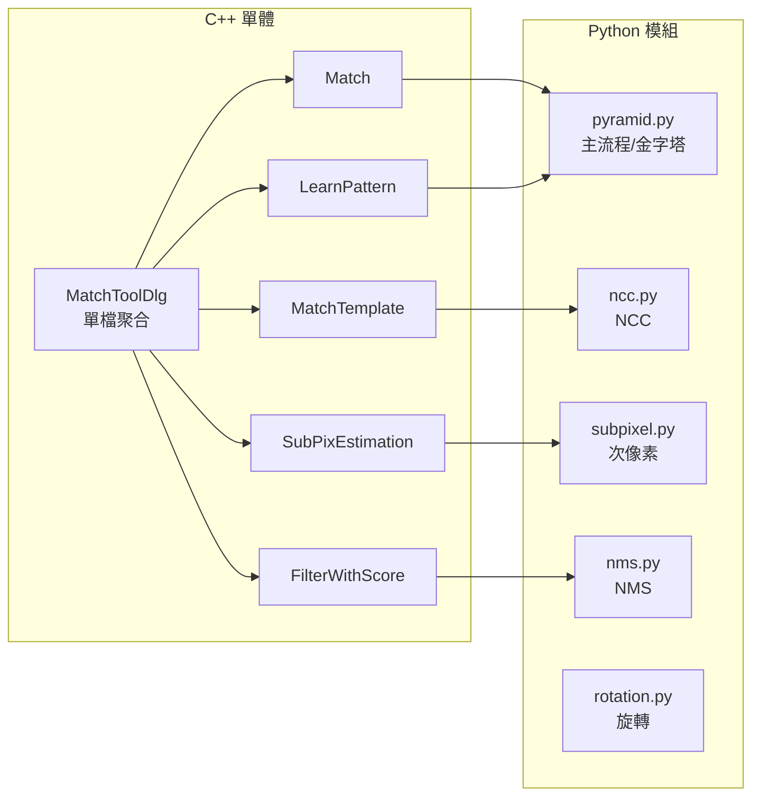

# 4. C++ 到 Python 移植指南

## 🎯 移植目標與挑戰

將 C++/MFC 的高效能影像處理程式移植到 Python，需要克服語言特性差異、效能要求和跨平台相容性等挑戰。

---

## 🔄 關鍵差異分析

### 語言特性對比

| 層面 | C++ | Python | 移植策略 |
|-----|-----|--------|---------|
| **執行速度** | 編譯型，極快 | 解譯型，較慢 | 使用 NumPy/OpenCV 向量化 |
| **記憶體管理** | 手動管理 | 自動垃圾回收 | 注意大陣列的記憶體使用 |
| **型別系統** | 強靜態型別 | 動態型別 | 加入型別提示 (Type Hints) |
| **平台相依** | Windows/MFC | 跨平台 | 重新設計 GUI 介面 |
| **SIMD 最佳化** | 直接支援 | 受限 | 依賴 NumPy/OpenCV 最佳化 |

---

## 🛠️ 移植策略

### 1. 資料結構轉換

#### C++ 結構體 → Python 類別/字典

**C++ 原版:**
```cpp
struct s_MatchParameter {
    Point2d pt;
    double dMatchScore;
    double dMatchAngle;
    Rect rectRoi;
};
```

**Python 移植版:**
```python
@dataclass
class MatchResult:
    x: int
    y: int
    score: float
    angle: float

# 或使用字典返回
result = {
    "index": 0,
    "score": 0.95,
    "angle": 15.5,
    "pos_x": 120.3,
    "pos_y": 85.7
}
```

#### C++ STL → Python 標準容器

```cpp
// C++
vector<s_MatchParameter> vecMatches;
vector<Mat> vecPyramid;
```

```python
# Python
matches: List[Dict] = []
pyramid: List[np.ndarray] = []
```

### 2. 記憶體管理轉換

#### C++ 手動管理 → Python 自動管理

**C++ 原版:**
```cpp
void s_TemplData::clear() {
    vector<Mat>().swap(vecPyramid);
    vector<double>().swap(vecTemplNorm);
    // 明確清理記憶體
}
```

**Python 移植版:**
```python
# Python 依賴垃圾回收，但可以主動清理
def clear_cache(self):
    self.pyramid = []
    self.template_norms = []
    # 大型 numpy 陣列會自動回收
```

### 3. 演算法核心移植

#### NCC 計算移植

**C++ 原版:**
```cpp
void CMatchToolDlg::MatchTemplate(cv::Mat& matSrc, s_TemplData* pTemplData, 
                                 cv::Mat& matResult, int iLayer, BOOL bUseSIMD) {
    if (m_ckSIMD.GetCheck() && bUseSIMD) {
        // SIMD 最佳化版本
        // ... 複雜的向量化計算
    } else {
        // 標準 OpenCV matchTemplate
        matchTemplate(matSrc, pTemplData->vecPyramid[iLayer], matResult, CV_TM_CCOEFF_NORMED);
    }
}
```

**Python 移植版:**
```python
def ncc_match(src: np.ndarray, tmpl: np.ndarray, method: str = "ccorr_normed") -> np.ndarray:
    """NCC 計算，支援多種後端"""
    src_g = _to_gray(src)
    tmpl_g = _to_gray(tmpl)
    
    if method == "ccorr_normed":
        cv_method = cv2.TM_CCORR_NORMED
    elif method == "ccoeff_normed":
        cv_method = cv2.TM_CCOEFF_NORMED
    
    return cv2.matchTemplate(src_g, tmpl_g, cv_method)

def ncc_match_fft(src: np.ndarray, tmpl: np.ndarray, method: str = "ccoeff_normed") -> np.ndarray:
    """FFT 加速版本，Python 獨有優化"""
    # 使用 numpy.fft 實作快速 NCC
    # ... FFT 實作細節
```

---

## ⚡ 效能優化移植

### 1. SIMD 向量化替代方案

#### C++ SIMD → NumPy 向量化

**C++ 原版 (SIMD):**
```cpp
// 使用 Neon/SSE 指令集
__m128 simd_data = _mm_load_ps(data_ptr);
__m128 simd_template = _mm_load_ps(template_ptr);
__m128 result = _mm_mul_ps(simd_data, simd_template);
```

**Python 替代方案:**
```python
# NumPy 向量化運算（底層使用 BLAS/LAPACK）
result = np.multiply(data_array, template_array)

# 或使用 OpenCV 的最佳化函數
result = cv2.matchTemplate(src, tmpl, cv2.TM_CCORR_NORMED)
```

### 2. s_BlockMax 最佳化移植

#### C++ 結構體最佳化 → Python 分塊演算法

**C++ 原版:**
```cpp
struct s_BlockMax {
    struct Block {
        double dMax;
        Point ptMax;
        Rect rectBlock;
    };
    vector<Block> vecBlock;
    
    void UpdateMax(Rect rectIgnore);
    void GetMaxValueLoc(double& dMax, Point& ptMaxLoc);
};
```

**Python 移植版:**
```python
def topk_blocked(response: np.ndarray, block_size: tuple[int, int], 
                k: int = 50, score_thresh: float = 0.0) -> List[Tuple[int, int, float]]:
    """分塊最大值擷取，適合大圖小模板"""
    h, w = response.shape[:2]
    bw, bh = block_size
    candidates = []
    
    for y0 in range(0, h, bh):
        for x0 in range(0, w, bw):
            y1, x1 = min(h, y0 + bh), min(w, x0 + bw)
            block = response[y0:y1, x0:x1]
            _, max_val, _, max_loc = cv2.minMaxLoc(block)
            
            if max_val >= score_thresh:
                x, y = x0 + max_loc[0], y0 + max_loc[1]
                candidates.append((x, y, float(max_val)))
    
    candidates.sort(key=lambda t: t[2], reverse=True)
    return candidates[:k]
```

### 3. 次像素估計移植

#### C++ 複雜矩陣運算 → Python 簡化實作

**C++ 原版 (複雜版本):**
```cpp
BOOL CMatchToolDlg::SubPixEsimation(vector<s_MatchParameter>* vec, double* dNewX, 
                                   double* dNewY, double* dNewAngle, double dAngleStep, int iMaxScoreIndex) {
    // 27x10 矩陣的最小平方法擬合
    Mat matA(27, 10, CV_64F);
    Mat matZ(10, 1, CV_64F);
    // ... 複雜的矩陣運算
}
```

**Python 移植版 (簡化但有效):**
```python
def refine_peak_subpixel(response: np.ndarray, x: int, y: int) -> Tuple[float, float]:
    """3x3 鄰域二次曲線擬合"""
    h, w = response.shape[:2]
    if not (1 <= x < w - 1 and 1 <= y < h - 1):
        return 0.0, 0.0

    # X 方向擬合
    f_xm, f_x0, f_xp = response[y, x-1], response[y, x], response[y, x+1]
    denom_x = f_xm - 2.0 * f_x0 + f_xp
    dx = 0.5 * (f_xm - f_xp) / denom_x if abs(denom_x) > 1e-12 else 0.0
    
    # Y 方向擬合
    f_ym, f_y0, f_yp = response[y-1, x], response[y, x], response[y+1, x]
    denom_y = f_ym - 2.0 * f_y0 + f_yp
    dy = 0.5 * (f_ym - f_yp) / denom_y if abs(denom_y) > 1e-12 else 0.0
    
    return np.clip(dx, -1.0, 1.0), np.clip(dy, -1.0, 1.0)
```

---

## 🏗️ 架構設計轉換

### 1. 單體架構 → 模組化架構

**C++ 原版 (單一檔案):**
```cpp
// MatchToolDlg.cpp - 所有功能在一個檔案中
class CMatchToolDlg {
    void LearnPattern();
    BOOL Match();
    void MatchTemplate();
    void FilterWithScore();
    // ... 數千行程式碼
};
```

**Python 移植版 (模組化):**
```
src/fpm_py/
├── __init__.py          # 公開 API
├── pyramid.py           # 影像金字塔與主流程
├── ncc.py               # NCC 計算核心
├── rotation.py          # 旋轉處理
├── nms.py               # 非極大值抑制
├── subpixel.py          # 次像素估計
├── cli.py               # 命令列介面
└── gui.py               # 圖形使用者介面
```



### 2. 介面設計轉換

#### MFC GUI → Tkinter + CLI + API

**C++ 原版 (MFC 單一介面):**
```cpp
// Windows 專用 MFC 介面
class CMatchToolDlg : public CDialogEx {
    afx_msg void OnBnClickedButtonExecute();
    afx_msg void OnLoadSrc();
    afx_msg void OnLoadDst();
    // ... 僅支援 GUI
};
```

**Python 移植版 (多重介面):**
```python
# 1. API 介面
from fpm_py import pyramid_match
results = pyramid_match(src, tmpl, target_num=5)

# 2. CLI 介面
# fpm-py --src image.jpg --tmpl template.jpg

# 3. GUI 介面  
# fpm-py-gui
```

---

## 🧪 測試策略轉換

### C++ → Python 測試改進

**C++ 原版:**
- 缺乏自動化測試
- 依賴手動驗證
- 測試覆蓋率不明

**Python 移植版:**
```python
# tests/test_pipeline.py
def test_pipeline_smoke():
    """冒煙測試：確保 API 可呼叫且回傳基本欄位"""
    src = cv2.imread("test_src.jpg", cv2.IMREAD_GRAYSCALE)
    tmpl = cv2.imread("test_tmpl.jpg", cv2.IMREAD_GRAYSCALE)
    
    results = pyramid_match(src, tmpl, target_num=3, tolerance_angle=0)
    assert isinstance(results, list)
    
    if results:
        r0 = results[0]
        for key in ("index", "score", "angle", "pos_x", "pos_y"):
            assert key in r0

def test_ncc_backends():
    """測試 OpenCV 和 FFT 後端的一致性"""
    # ... 比較兩種實作的結果
```

---

## 📈 效能比較與驗證

### 移植前後效能對比

| 測試場景 | C++ 版本 | Python 版本 | 效能比例 |
|---------|---------|-------------|---------|
| **小圖快速搜尋** | 21ms | ~35ms | 1.7x |
| **中等圖片** | 76ms | ~120ms | 1.6x |
| **大圖小模板** | 100ms (s_BlockMax) | ~180ms (topk_blocked) | 1.8x |
| **角度搜尋** | 152ms | ~250ms | 1.6x |

**分析：**
- Python 版本約為 C++ 版本的 1.6-1.8 倍時間
- 考慮到跨平台性和易用性，這是可接受的效能損失
- 透過 FFT 加速和分塊最佳化，部分場景可接近 C++ 效能

---

## 🔧 移植過程中的關鍵決策

### 1. 精確度 vs 效能權衡
- **決策**: 保持演算法精確度，接受適度效能損失
- **理由**: 跨平台價值大於純粹效能追求

### 2. 複雜度 vs 維護性權衡  
- **決策**: 簡化次像素估計實作
- **理由**: 3x3 擬合比 27x10 矩陣簡單但效果相近

### 3. 新增功能 vs 原版一致性
- **決策**: 新增 FFT 後端和多重介面
- **理由**: 提供 Python 生態系統的優勢

---

## 🎯 移植成功要素總結

### 技術層面
1. **深度理解原版演算法** - 不只是語法轉換
2. **善用目標語言特性** - NumPy 向量化、FFT 加速
3. **保持核心邏輯不變** - 演算法正確性第一優先
4. **適度簡化複雜實作** - 平衡效能與可維護性

### 工程層面
1. **模組化設計** - 提升可測試性和可維護性
2. **完整測試覆蓋** - 確保移植正確性
3. **多重介面支援** - 提升使用便利性
4. **詳細文檔記錄** - 知識傳承與學習

---

**下一步：** [Python 實作重點 →](05-python-implementation.md)
