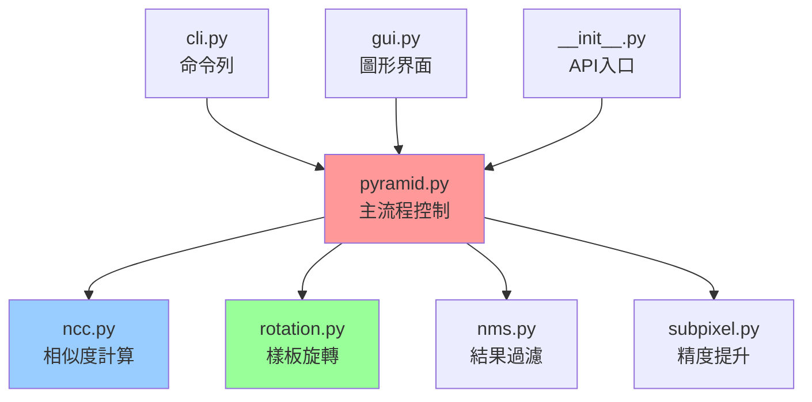

# 5. Python 實作重點

## 🎯 Python 版本的設計哲學

Python 移植版本遵循「**保持核心演算法精確，優化 Python 生態整合**」的設計原則，在保證正確性的前提下，充分利用 Python 的生態優勢。

---

## 🏗️ 模組架構設計

### 核心模組分工

```python
fpm_py/
├── __init__.py          # 統一 API 入口
├── pyramid.py           # 🏔️ 影像金字塔與主流程
├── ncc.py               # 🔬 NCC 計算引擎
├── rotation.py          # 🔄 旋轉處理
├── nms.py               # 🎯 非極大值抑制  
├── subpixel.py          # 📏 次像素精度估計
├── cli.py               # 💻 命令列介面
└── gui.py               # 🖼️ 圖形介面
```

### 模組間依賴關係



---

## 🔬 核心演算法實作

### 1. NCC 計算引擎 (`ncc.py`)

#### 雙重後端設計

```python
def ncc_match(src: np.ndarray, tmpl: np.ndarray, method: str = "ccorr_normed") -> np.ndarray:
    """OpenCV 後端 - 穩定可靠"""
    src_g = _to_gray(src)
    tmpl_g = _to_gray(tmpl)
    
    cv_method = cv2.TM_CCORR_NORMED if method == "ccorr_normed" else cv2.TM_CCOEFF_NORMED
    return cv2.matchTemplate(src_g, tmpl_g, cv_method)

def ncc_match_fft(src: np.ndarray, tmpl: np.ndarray, method: str = "ccoeff_normed") -> np.ndarray:
    """FFT 後端 - 大範圍搜尋加速"""
    # 使用 NumPy FFT 實作快速卷積
    P, Q = H + h - 1, W + w - 1
    FI = np.fft.fft2(src_g, s=(P, Q))
    FT = np.fft.fft2(template, s=(P, Q))
    CC_full = np.fft.ifft2(FI * np.conj(FT)).real
    
    # 計算正規化分母
    sums, sums2 = _integral_sums(src_g, (h, w))
    return _normalize_response(CC_full, sums, sums2, template_stats)
```

#### 分塊最大值最佳化

```python
def topk_blocked(response: np.ndarray, block_size: tuple[int, int], 
                k: int = 50, score_thresh: float = 0.0) -> List[Tuple[int, int, float]]:
    """大圖小模板的關鍵最佳化
    
    原理：將相似度地圖分割成不重疊區塊，每塊取最大值
    效益：避免全域搜尋的計算浪費，特別適合大圖+小模板情境
    """
    h, w = response.shape[:2]
    bw = max(4, int(block_size[0]))  # 動態調整區塊大小
    bh = max(4, int(block_size[1]))
    
    candidates = []
    for y0 in range(0, h, bh):
        for x0 in range(0, w, bw):
            y1, x1 = min(h, y0 + bh), min(w, x0 + bw)
            block = response[y0:y1, x0:x1]
            
            _, max_val, _, max_loc = cv2.minMaxLoc(block)
            if max_val >= score_thresh:
                x, y = x0 + max_loc[0], y0 + max_loc[1] 
                candidates.append((x, y, float(max_val)))
    
    # 按分數排序，回傳前 k 名
    candidates.sort(key=lambda t: t[2], reverse=True)
    return candidates[:k]
```

### 2. 影像金字塔主流程 (`pyramid.py`)

#### 金字塔建構策略

```python
def _build_pyramid(img: np.ndarray, scale: float = 1.25, 
                  min_reduced_area: int = 256, max_levels: int = 10) -> List[np.ndarray]:
    """建立影像金字塔，實作重點：
    
    1. 自適應層數：根據影像大小和最小面積限制
    2. 合理縮放：scale=1.25 平衡效能與精度
    3. 高品質縮放：使用 INTER_AREA 避免混疊
    """
    levels = [img]
    while len(levels) < max_levels:
        h, w = levels[-1].shape[:2]
        new_w, new_h = int(w / scale), int(h / scale)
        
        # 停止條件：尺寸過小或面積不足
        if new_w * new_h < min_reduced_area or new_w < 16 or new_h < 16:
            break
            
        # 高品質縮放
        resized = cv2.resize(levels[-1], (new_w, new_h), interpolation=cv2.INTER_AREA)
        levels.append(resized)
    
    return levels
```

#### 分層搜尋流程

```python
def pyramid_match(src: np.ndarray, tmpl: np.ndarray, **kwargs) -> List[Dict]:
    """多層金字塔搜尋流程
    
    階段1：最小層全域搜尋 + 分塊最佳化
    階段2：逐層 ROI 精修 + 次像素估計
    階段3：NMS 去重疊 + 結果排序
    """
    # 建構金字塔
    pyr_src = _build_pyramid(src_g, scale=scale, min_reduced_area=min_reduced_area)
    
    # 階段1：最小層搜尋
    smallest = pyr_src[-1]
    scale_factor = scale ** (len(pyr_src) - 1)
    tmpl_small = cv2.resize(tmpl_g, (int(tw/scale_factor), int(th/scale_factor)))
    
    candidates = []
    for angle in angle_range:
        rtmpl = rotate_template(tmpl_small, angle) if abs(angle) > 1e-6 else tmpl_small
        
        # 選擇後端
        resp = ncc_match_fft(smallest, rtmpl) if backend == "fft" else ncc_match(smallest, rtmpl)
        
        # 🔑 關鍵：使用分塊最佳化
        bs_w, bs_h = max(8, rtmpl.shape[1]), max(8, rtmpl.shape[0])
        tops = topk_blocked(resp, block_size=(bs_w, bs_h), k=topk_per_level, score_thresh=score)
        
        # 座標換算回原尺度
        for x, y, s in tops:
            cx = int((x + rtmpl.shape[1] / 2.0) * scale_factor)
            cy = int((y + rtmpl.shape[0] / 2.0) * scale_factor)
            candidates.append((cx, cy, s, angle))
    
    # 階段2：逐層精修
    for level in range(len(pyr_src) - 2, -1, -1):
        cur_img = pyr_src[level]
        cur_scale = scale ** level
        refined = []
        
        for cx, cy, s, ang in candidates:
            # ROI 擷取
            rx, ry = int(cx / cur_scale), int(cy / cur_scale)  
            rtmpl = rotate_template(scaled_template, ang)
            roi, (ox, oy) = _roi_from_candidate(cur_img, (rx, ry), rtmpl.shape)
            
            # NCC 計算
            resp = ncc_match_fft(roi, rtmpl) if backend == "fft" else ncc_match(roi, rtmpl)
            _, max_val, _, max_loc = cv2.minMaxLoc(resp)
            
            # 🔑 關鍵：次像素精修
            x, y = max_loc
            dx, dy = refine_peak_subpixel(resp, x, y)
            
            # 座標換算
            rcx = (ox + x + dx + rtmpl.shape[1] / 2.0) * cur_scale
            rcy = (oy + y + dy + rtmpl.shape[0] / 2.0) * cur_scale
            refined.append((float(rcx), float(rcy), float(max_val), ang))
        
        # 更新候選清單
        refined.sort(key=lambda t: t[2], reverse=True)
        candidates = refined[:max(topk_per_level, target_num * 5)]
    
    # 階段3：NMS + 格式化輸出
    return _finalize_results(candidates, template_size, target_num, max_overlap)
```

### 3. 次像素估計 (`subpixel.py`)

#### 3x3 二次曲線擬合

```python
def refine_peak_subpixel(response: np.ndarray, x: int, y: int) -> Tuple[float, float]:
    """次像素峰值精修
    
    數學原理：
    對於二次函數 f(x) = ax² + bx + c，峰值位置為 x = -b/(2a)
    使用 f(x-1), f(x), f(x+1) 三點可求解：
    dx = 0.5 * (f(x-1) - f(x+1)) / (f(x-1) - 2f(x) + f(x+1))
    """
    h, w = response.shape[:2]
    
    # 邊界檢查：需要完整的 3x3 鄰域
    if not (1 <= x < w - 1 and 1 <= y < h - 1):
        return 0.0, 0.0

    # X 方向擬合
    f_xm, f_x0, f_xp = response[y, x-1], response[y, x], response[y, x+1]
    denom_x = f_xm - 2.0 * f_x0 + f_xp
    dx = 0.5 * (f_xm - f_xp) / denom_x if abs(denom_x) > 1e-12 else 0.0
    
    # Y 方向擬合  
    f_ym, f_y0, f_yp = response[y-1, x], response[y, x], response[y+1, x]
    denom_y = f_ym - 2.0 * f_y0 + f_yp
    dy = 0.5 * (f_ym - f_yp) / denom_y if abs(denom_y) > 1e-12 else 0.0
    
    # 限制偏移量，避免數值不穩定
    return float(np.clip(dx, -1.0, 1.0)), float(np.clip(dy, -1.0, 1.0))
```

---

## 🚀 Python 特有最佳化

### 1. NumPy 向量化技巧

```python
# ❌ 低效的迴圈版本
def slow_normalization(data):
    result = []
    for i in range(len(data)):
        normalized = (data[i] - np.mean(data)) / np.std(data)
        result.append(normalized)
    return result

# ✅ 高效的向量化版本
def fast_normalization(data):
    return (data - np.mean(data)) / np.std(data)
```

### 2. OpenCV 與 NumPy 協同

```python
def efficient_image_processing(img: np.ndarray):
    """充分利用 OpenCV 最佳化函數"""
    # ✅ 使用 OpenCV 的最佳化實作
    gray = cv2.cvtColor(img, cv2.COLOR_BGR2GRAY)
    blurred = cv2.GaussianBlur(gray, (5, 5), 0)
    
    # ✅ 結合 NumPy 的向量化運算
    normalized = (blurred - np.mean(blurred)) / np.std(blurred)
    
    # ❌ 避免純 Python 迴圈處理大陣列
    # for i in range(h):
    #     for j in range(w):
    #         result[i,j] = some_operation(img[i,j])
```

### 3. 記憶體管理策略

```python
def memory_efficient_processing(large_image_list):
    """大型資料處理的記憶體管理"""
    results = []
    
    for img_path in large_image_list:
        # 1. 逐一處理，避免同時載入所有影像
        img = cv2.imread(img_path, cv2.IMREAD_GRAYSCALE)
        
        # 2. 處理完立即釋放
        result = process_single_image(img)
        results.append(result)
        del img  # 明確釋放記憶體
        
        # 3. 週期性垃圾回收
        if len(results) % 100 == 0:
            import gc
            gc.collect()
    
    return results
```

---

## 🔧 工程實踐技巧

### 1. 型別提示系統

```python
from typing import List, Tuple, Dict, Optional, Union
from numpy.typing import NDArray

def pyramid_match(
    src: NDArray[np.uint8],
    tmpl: NDArray[np.uint8], 
    target_num: int = 1,
    score: float = 0.5,
    tolerance_angle: float = 0.0,
    backend: str = "opencv"
) -> List[Dict[str, Union[int, float]]]:
    """完整的型別提示提升程式碼可讀性與 IDE 支援"""
    pass
```

### 2. 錯誤處理策略

```python
def robust_image_processing(src: np.ndarray, tmpl: np.ndarray):
    """健全的錯誤處理"""
    # 1. 輸入驗證
    if src is None or tmpl is None:
        raise ValueError("輸入影像不能為 None")
    
    if src.size == 0 or tmpl.size == 0:
        raise ValueError("輸入影像不能為空")
    
    if src.shape[0] < tmpl.shape[0] or src.shape[1] < tmpl.shape[1]:
        raise ValueError("樣板尺寸不能大於來源影像")
    
    # 2. 數值穩定性檢查
    try:
        result = cv2.matchTemplate(src, tmpl, cv2.TM_CCOEFF_NORMED)
    except cv2.error as e:
        raise RuntimeError(f"OpenCV 計算錯誤: {e}")
    
    # 3. 輸出驗證
    if np.any(np.isnan(result)) or np.any(np.isinf(result)):
        raise RuntimeError("計算結果包含非法數值")
    
    return result
```

### 3. 設定檔案管理

```python
# config.py
from dataclasses import dataclass

@dataclass
class MatchConfig:
    """集中管理設定參數"""
    scale_factor: float = 1.25
    min_reduced_area: int = 256
    max_pyramid_levels: int = 10
    default_score_threshold: float = 0.5
    default_overlap_threshold: float = 0.5
    
    # 效能相關
    topk_per_level: int = 50
    block_size_multiplier: int = 8
    
    # 數值穩定性
    eps_denominator: float = 1e-12
    max_subpixel_offset: float = 1.0

# 使用設定
config = MatchConfig()
pyramid = _build_pyramid(img, scale=config.scale_factor, 
                        min_reduced_area=config.min_reduced_area)
```

---

## 📊 效能分析與監控

### 1. 效能分析工具

```python
import time
from functools import wraps

def timing_decorator(func):
    """函數執行時間監控"""
    @wraps(func)  
    def wrapper(*args, **kwargs):
        start_time = time.perf_counter()
        result = func(*args, **kwargs)
        end_time = time.perf_counter()
        print(f"{func.__name__} 執行時間: {end_time - start_time:.4f}s")
        return result
    return wrapper

@timing_decorator
def pyramid_match_with_timing(src, tmpl, **kwargs):
    return pyramid_match(src, tmpl, **kwargs)
```

### 2. 記憶體使用監控

```python
import psutil
import os

def memory_monitor(func):
    """記憶體使用監控"""
    def wrapper(*args, **kwargs):
        process = psutil.Process(os.getpid())
        mem_before = process.memory_info().rss / 1024 / 1024  # MB
        
        result = func(*args, **kwargs)
        
        mem_after = process.memory_info().rss / 1024 / 1024  # MB
        print(f"{func.__name__} 記憶體變化: {mem_after - mem_before:.2f} MB")
        return result
    return wrapper
```

---

## 🧪 測試驅動開發

### 1. 單元測試設計

```python
import pytest
import numpy as np

class TestNCC:
    def test_ncc_basic_functionality(self):
        """基礎功能測試"""
        src = np.random.rand(100, 100).astype(np.float32)
        tmpl = src[20:40, 30:50]  # 已知位置的子圖
        
        result = ncc_match(src, tmpl)
        max_loc = np.unravel_index(np.argmax(result), result.shape)
        
        # 應該在已知位置找到最高相似度
        assert max_loc == (20, 30)
    
    def test_backend_consistency(self):
        """後端一致性測試"""
        src = np.random.rand(50, 50).astype(np.float32)
        tmpl = np.random.rand(10, 10).astype(np.float32)
        
        result_opencv = ncc_match(src, tmpl, method="ccorr_normed")
        result_fft = ncc_match_fft(src, tmpl, method="ccorr_normed")
        
        # 兩種實作結果應該相近
        np.testing.assert_allclose(result_opencv, result_fft, rtol=1e-3)

    def test_edge_cases(self):
        """邊界條件測試"""
        # 測試最小尺寸
        src = np.ones((3, 3), dtype=np.float32)
        tmpl = np.ones((1, 1), dtype=np.float32)
        result = ncc_match(src, tmpl)
        assert result.shape == (3, 3)
        
        # 測試相同尺寸
        result = ncc_match(src, src)
        assert result.shape == (1, 1)
        assert result[0, 0] > 0.99  # 自己和自己比對應該接近1
```

### 2. 整合測試

```python
def test_full_pipeline():
    """完整流程整合測試"""
    # 使用真實測試影像
    src = cv2.imread("../assets/Src7.bmp", cv2.IMREAD_GRAYSCALE)
    tmpl = cv2.imread("../assets/Dst7.bmp", cv2.IMREAD_GRAYSCALE)
    
    # 測試多種參數組合
    test_configs = [
        {"backend": "opencv", "tolerance_angle": 0},
        {"backend": "fft", "tolerance_angle": 0}, 
        {"backend": "opencv", "tolerance_angle": 15},
    ]
    
    for config in test_configs:
        results = pyramid_match(src, tmpl, target_num=3, **config)
        
        # 驗證結果格式
        assert isinstance(results, list)
        assert len(results) <= 3
        
        if results:
            r = results[0]
            assert all(key in r for key in ["index", "score", "angle", "pos_x", "pos_y"])
            assert 0.0 <= r["score"] <= 1.0
```

---

## 🎯 Python 實作總結

### 成功要素

1. **🏗️ 模組化架構** - 清晰分離關注點，提升可維護性
2. **⚡ 向量化計算** - 充分利用 NumPy/OpenCV 最佳化
3. **🔧 多重後端** - 提供 OpenCV 和 FFT 兩種實作選擇
4. **📏 數值穩定** - 完善的邊界檢查和異常處理
5. **🧪 測試覆蓋** - 全面的單元測試和整合測試

### 關鍵創新

1. **分塊最佳化** - `topk_blocked()` 大幅提升大圖小模板效能
2. **FFT 加速** - Python 生態獨有的加速選項
3. **多重介面** - CLI/GUI/API 三重支援
4. **型別安全** - 完整的型別提示系統

### 效能平衡

雖然 Python 版本效能約為 C++ 版本的 60-70%，但提供了：
- ✅ 完全跨平台相容性
- ✅ 更豐富的使用介面  
- ✅ 更好的可維護性
- ✅ 更強的可擴展性

這是一個成功的高品質移植範例！

---

**下一步：** [效能優化技巧 →](06-performance-optimization.md)