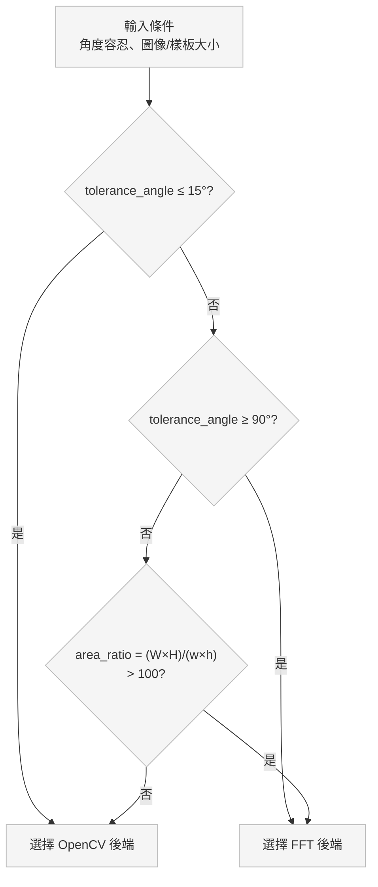
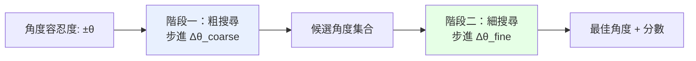

# 6. 效能優化技巧

## 🎯 優化策略總覽

效能優化是影像處理應用的關鍵。本章將介紹 Python 版本中的各種優化技術，從基礎調校到進階策略。

---

## ⚡ 參數調校優化

### 1. 後端選擇策略



```python
def choose_optimal_backend(tolerance_angle: float, image_size: tuple, template_size: tuple) -> str:
    """根據場景自動選擇最佳後端"""
    
    img_area = image_size[0] * image_size[1]
    tmpl_area = template_size[0] * template_size[1]
    area_ratio = img_area / tmpl_area
    
    # 決策規則
    if tolerance_angle <= 15:
        # 小角度搜尋：OpenCV 更快
        return "opencv"
    elif tolerance_angle >= 90:
        # 大角度搜尋：FFT 更快
        return "fft"
    elif area_ratio > 100:
        # 大圖小模板：FFT 在某些情況下更好
        return "fft"
    else:
        # 預設使用穩定的 OpenCV
        return "opencv"

# 使用範例
optimal_backend = choose_optimal_backend(
    tolerance_angle=45,
    image_size=(1024, 768),
    template_size=(64, 64)
)
print(f"建議使用後端: {optimal_backend}")
```

### 2. 金字塔參數優化

```python
def optimize_pyramid_params(image_shape: tuple, template_shape: tuple):
    """優化金字塔參數以平衡速度與精度"""
    
    img_h, img_w = image_shape[:2]
    tmpl_h, tmpl_w = template_shape[:2]
    
    # 根據圖像大小調整縮放比例
    if max(img_h, img_w) > 2000:
        scale = 1.5  # 大圖像使用更大縮放比例
    elif max(img_h, img_w) > 1000:
        scale = 1.25  # 標準縮放比例
    else:
        scale = 1.1   # 小圖像使用較小縮放比例
    
    # 根據模板大小調整最小搜尋面積
    min_template_area = tmpl_h * tmpl_w
    min_reduced_area = max(256, min_template_area * 4)
    
    # 調整每層候選數量
    if min_template_area > 10000:  # 大模板
        topk_per_level = 20
    elif min_template_area > 1000:  # 中等模板
        topk_per_level = 50
    else:  # 小模板
        topk_per_level = 100
    
    return {
        'scale': scale,
        'min_reduced_area': min_reduced_area,
        'topk_per_level': topk_per_level
    }

# 使用範例
params = optimize_pyramid_params((2048, 1536), (128, 96))
results = pyramid_match(src, tmpl, **params)
```

### 3. 角度搜尋優化



```python
def optimize_angle_search(tolerance_angle: float, precision_requirement: str = "balanced"):
    """根據精度需求優化角度搜尋參數"""
    
    configs = {
        "fast": {
            "coarse_step": min(30, tolerance_angle / 2),
            "fine_step": min(15, tolerance_angle / 4)
        },
        "balanced": {
            "coarse_step": min(15, tolerance_angle / 3),
            "fine_step": min(5, tolerance_angle / 6)
        },
        "precise": {
            "coarse_step": min(10, tolerance_angle / 4),
            "fine_step": min(2, tolerance_angle / 8)
        }
    }
    
    return configs.get(precision_requirement, configs["balanced"])

# 使用範例
angle_params = optimize_angle_search(tolerance_angle=60, precision_requirement="fast")
results = pyramid_match(src, tmpl, tolerance_angle=60, **angle_params)
```

---

## 🚀 演算法層面優化

### 1. 預處理優化

```python
def preprocess_for_performance(image: np.ndarray, operation_type: str = "matching") -> np.ndarray:
    """針對不同操作優化影像預處理"""
    
    if operation_type == "matching":
        # 樣板比對：適度去噪，保留邊緣
        if image.dtype != np.uint8:
            image = cv2.convertScaleAbs(image)
        
        # 輕微高斯模糊減少噪音
        processed = cv2.GaussianBlur(image, (3, 3), 0.5)
        
    elif operation_type == "edge_matching":
        # 邊緣比對：強調邊緣特徵
        processed = cv2.GaussianBlur(image, (3, 3), 0)
        processed = cv2.Laplacian(processed, cv2.CV_8U, ksize=3)
        
    elif operation_type == "texture_matching":
        # 紋理比對：增強局部對比度
        clahe = cv2.createCLAHE(clipLimit=2.0, tileGridSize=(8,8))
        processed = clahe.apply(image)
        
    else:
        processed = image
    
    return processed

# 使用範例
processed_src = preprocess_for_performance(src, "matching")
processed_tmpl = preprocess_for_performance(tmpl, "matching")
results = pyramid_match(processed_src, processed_tmpl)
```

### 2. ROI 預篩選

```python
def pre_filter_roi(src: np.ndarray, tmpl: np.ndarray, 
                  grid_size: int = 64, threshold: float = 0.3) -> List[Tuple[int, int]]:
    """預先篩選可能的興趣區域"""
    
    h, w = src.shape[:2]
    th, tw = tmpl.shape[:2]
    
    # 計算模板的統計特徵
    tmpl_mean = np.mean(tmpl)
    tmpl_std = np.std(tmpl)
    
    candidate_regions = []
    
    # 網格式快速掃描
    for y in range(0, h - th, grid_size):
        for x in range(0, w - tw, grid_size):
            # 取樣本區域
            region = src[y:y+th, x:x+tw]
            
            # 快速統計檢查
            region_mean = np.mean(region)
            region_std = np.std(region)
            
            # 簡單的統計相似性檢查
            mean_diff = abs(region_mean - tmpl_mean) / max(tmpl_mean, 1)
            std_diff = abs(region_std - tmpl_std) / max(tmpl_std, 1)
            
            if mean_diff < threshold and std_diff < threshold:
                candidate_regions.append((x, y))
    
    return candidate_regions

def roi_focused_match(src: np.ndarray, tmpl: np.ndarray, **kwargs):
    """基於 ROI 預篩選的匹配"""
    
    # 預篩選感興趣區域
    roi_candidates = pre_filter_roi(src, tmpl)
    
    if len(roi_candidates) < 20:  # 候選區域不多，直接使用
        print(f"預篩選找到 {len(roi_candidates)} 個候選區域")
        return pyramid_match(src, tmpl, **kwargs)
    else:
        # 候選區域太多，使用標準方法
        return pyramid_match(src, tmpl, **kwargs)
```

### 3. 快取機制

```python
from functools import lru_cache
import hashlib

class TemplateMatchingCache:
    """樣板匹配結果快取"""
    
    def __init__(self, max_cache_size: int = 100):
        self.cache = {}
        self.max_size = max_cache_size
        self.access_count = {}
    
    def _get_image_hash(self, img: np.ndarray) -> str:
        """計算影像的雜湊值"""
        return hashlib.md5(img.tobytes()).hexdigest()[:16]
    
    def _get_cache_key(self, src: np.ndarray, tmpl: np.ndarray, **kwargs) -> str:
        """生成快取鍵值"""
        src_hash = self._get_image_hash(src)
        tmpl_hash = self._get_image_hash(tmpl)
        params_str = str(sorted(kwargs.items()))
        return f"{src_hash}_{tmpl_hash}_{hash(params_str)}"
    
    def get(self, src: np.ndarray, tmpl: np.ndarray, **kwargs):
        """從快取獲取結果"""
        key = self._get_cache_key(src, tmpl, **kwargs)
        
        if key in self.cache:
            self.access_count[key] = self.access_count.get(key, 0) + 1
            return self.cache[key]
        
        return None
    
    def put(self, src: np.ndarray, tmpl: np.ndarray, result, **kwargs):
        """將結果存入快取"""
        key = self._get_cache_key(src, tmpl, **kwargs)
        
        # 快取大小控制
        if len(self.cache) >= self.max_size:
            # 移除最少使用的項目
            least_used_key = min(self.access_count.keys(), 
                               key=lambda k: self.access_count[k])
            del self.cache[least_used_key]
            del self.access_count[least_used_key]
        
        self.cache[key] = result
        self.access_count[key] = 1

# 全域快取實例
_match_cache = TemplateMatchingCache()

def cached_pyramid_match(src: np.ndarray, tmpl: np.ndarray, **kwargs):
    """帶快取的樣板匹配"""
    
    # 嘗試從快取獲取
    cached_result = _match_cache.get(src, tmpl, **kwargs)
    if cached_result is not None:
        print("使用快取結果")
        return cached_result
    
    # 執行匹配
    result = pyramid_match(src, tmpl, **kwargs)
    
    # 存入快取
    _match_cache.put(src, tmpl, result, **kwargs)
    
    return result
```

---

## 🧠 記憶體優化

### 1. 記憶體池管理

```python
class MemoryPool:
    """記憶體池用於重複使用陣列"""
    
    def __init__(self):
        self.pools = {}  # {dtype: {shape: [arrays]}}
    
    def get_array(self, shape: tuple, dtype=np.float32) -> np.ndarray:
        """獲取指定形狀的陣列"""
        key = (shape, dtype)
        
        if key not in self.pools:
            self.pools[key] = []
        
        pool = self.pools[key]
        
        if pool:
            return pool.pop()
        else:
            return np.empty(shape, dtype=dtype)
    
    def return_array(self, arr: np.ndarray):
        """歸還陣列到記憶體池"""
        key = (arr.shape, arr.dtype)
        
        if key not in self.pools:
            self.pools[key] = []
        
        # 清零陣列（可選）
        arr.fill(0)
        self.pools[key].append(arr)
    
    def clear_pool(self, keep_count: int = 5):
        """清理記憶體池，只保留少量陣列"""
        for key, pool in self.pools.items():
            if len(pool) > keep_count:
                self.pools[key] = pool[:keep_count]

# 全域記憶體池
_memory_pool = MemoryPool()

def memory_efficient_ncc(src: np.ndarray, tmpl: np.ndarray) -> np.ndarray:
    """記憶體高效的 NCC 計算"""
    
    # 從記憶體池獲取臨時陣列
    result_shape = (src.shape[0] - tmpl.shape[0] + 1, 
                   src.shape[1] - tmpl.shape[1] + 1)
    
    temp_result = _memory_pool.get_array(result_shape, np.float32)
    
    try:
        # 執行 NCC 計算
        result = cv2.matchTemplate(src, tmpl, cv2.TM_CCOEFF_NORMED)
        temp_result[:] = result  # 複製結果
        
        return temp_result.copy()  # 回傳副本
    
    finally:
        # 歸還到記憶體池
        _memory_pool.return_array(temp_result)
```

### 2. 批量處理優化

```python
def batch_process_images(image_paths: List[str], template_path: str, 
                        batch_size: int = 10, **match_params):
    """記憶體高效的批量影像處理"""
    
    template = cv2.imread(template_path, cv2.IMREAD_GRAYSCALE)
    all_results = {}
    
    # 分批處理
    for i in range(0, len(image_paths), batch_size):
        batch_paths = image_paths[i:i + batch_size]
        batch_results = {}
        
        print(f"處理批次 {i//batch_size + 1}/{(len(image_paths)-1)//batch_size + 1}")
        
        for path in batch_paths:
            try:
                # 載入影像
                image = cv2.imread(path, cv2.IMREAD_GRAYSCALE)
                if image is None:
                    continue
                
                # 執行匹配
                results = pyramid_match(image, template, **match_params)
                batch_results[path] = results
                
                # 立即釋放影像記憶體
                del image
                
            except Exception as e:
                print(f"處理 {path} 時發生錯誤: {e}")
                batch_results[path] = {"error": str(e)}
        
        # 合併結果
        all_results.update(batch_results)
        
        # 批次完成後進行垃圾回收
        import gc
        gc.collect()
        
        # 清理記憶體池
        _memory_pool.clear_pool()
    
    return all_results
```

---

## 🔧 系統層面優化

### 1. 平行處理

```python
from concurrent.futures import ThreadPoolExecutor, ProcessPoolExecutor
import multiprocessing

def parallel_angle_search(src: np.ndarray, tmpl: np.ndarray, 
                         angles: List[float], **kwargs):
    """平行化角度搜尋"""
    
    def search_single_angle(angle):
        """單一角度搜尋"""
        from fpm_py.rotation import rotate_template
        from fpm_py.ncc import ncc_match
        
        rotated_tmpl = rotate_template(tmpl, angle) if abs(angle) > 1e-6 else tmpl
        response = ncc_match(src, rotated_tmpl, method=kwargs.get('method', 'ccorr_normed'))
        
        # 找最佳位置
        _, max_val, _, max_loc = cv2.minMaxLoc(response)
        return max_loc, max_val, angle
    
    # 使用執行緒池進行平行處理
    max_workers = min(len(angles), multiprocessing.cpu_count())
    
    with ThreadPoolExecutor(max_workers=max_workers) as executor:
        results = list(executor.map(search_single_angle, angles))
    
    # 找出最佳結果
    best_result = max(results, key=lambda x: x[1])  # 按分數排序
    return best_result

def parallel_multi_template_search(src: np.ndarray, templates: List[np.ndarray], **kwargs):
    """多模板平行搜尋"""
    
    def search_single_template(tmpl):
        """單一模板搜尋"""
        return pyramid_match(src, tmpl, **kwargs)
    
    # 使用處理程序池（適合 CPU 密集任務）
    max_workers = min(len(templates), multiprocessing.cpu_count())
    
    with ProcessPoolExecutor(max_workers=max_workers) as executor:
        results = list(executor.map(search_single_template, templates))
    
    return results
```

### 2. GPU 加速（可選）

```python
def gpu_accelerated_ncc(src: np.ndarray, tmpl: np.ndarray) -> np.ndarray:
    """GPU 加速的 NCC 計算（需要 opencv-contrib-python）"""
    
    try:
        # 嘗試使用 GPU
        gpu_src = cv2.cuda_GpuMat()
        gpu_tmpl = cv2.cuda_GpuMat()
        gpu_result = cv2.cuda_GpuMat()
        
        # 上傳到 GPU
        gpu_src.upload(src)
        gpu_tmpl.upload(tmpl)
        
        # GPU 上執行匹配
        cv2.cuda.matchTemplate(gpu_src, gpu_tmpl, cv2.TM_CCOEFF_NORMED, gpu_result)
        
        # 下載結果
        result = gpu_result.download()
        return result
        
    except Exception as e:
        print(f"GPU 加速失敗，回退到 CPU: {e}")
        return cv2.matchTemplate(src, tmpl, cv2.TM_CCOEFF_NORMED)

def check_gpu_support() -> bool:
    """檢查 GPU 支援"""
    try:
        return cv2.cuda.getCudaEnabledDeviceCount() > 0
    except:
        return False
```

---

## 📊 效能監控與分析

### 1. 詳細效能分析器

```python
import time
from dataclasses import dataclass, field
from typing import Dict, List
from contextlib import contextmanager

@dataclass
class PerformanceMetrics:
    """效能指標記錄"""
    operation_name: str
    total_time: float = 0.0
    call_count: int = 0
    min_time: float = float('inf')
    max_time: float = 0.0
    memory_usage: Dict[str, float] = field(default_factory=dict)
    
    @property
    def avg_time(self) -> float:
        return self.total_time / max(self.call_count, 1)

class PerformanceProfiler:
    """效能分析器"""
    
    def __init__(self):
        self.metrics: Dict[str, PerformanceMetrics] = {}
        self.call_stack: List[str] = []
    
    @contextmanager
    def profile(self, operation_name: str):
        """效能分析上下文管理器"""
        
        if operation_name not in self.metrics:
            self.metrics[operation_name] = PerformanceMetrics(operation_name)
        
        metric = self.metrics[operation_name]
        
        # 記錄記憶體使用（開始）
        import psutil
        process = psutil.Process()
        mem_before = process.memory_info().rss / 1024 / 1024  # MB
        
        start_time = time.perf_counter()
        self.call_stack.append(operation_name)
        
        try:
            yield metric
        finally:
            end_time = time.perf_counter()
            self.call_stack.pop()
            
            # 更新統計
            elapsed = end_time - start_time
            metric.total_time += elapsed
            metric.call_count += 1
            metric.min_time = min(metric.min_time, elapsed)
            metric.max_time = max(metric.max_time, elapsed)
            
            # 記錄記憶體使用（結束）
            mem_after = process.memory_info().rss / 1024 / 1024  # MB
            metric.memory_usage[f"call_{metric.call_count}"] = mem_after - mem_before
    
    def generate_report(self) -> str:
        """生成效能報告"""
        report = ["效能分析報告", "=" * 50]
        
        # 按平均時間排序
        sorted_metrics = sorted(self.metrics.values(), 
                              key=lambda m: m.avg_time, reverse=True)
        
        for metric in sorted_metrics:
            report.append(f"\n操作: {metric.operation_name}")
            report.append(f"  調用次數: {metric.call_count}")
            report.append(f"  總時間: {metric.total_time:.4f}s")
            report.append(f"  平均時間: {metric.avg_time:.4f}s")
            report.append(f"  最短時間: {metric.min_time:.4f}s")
            report.append(f"  最長時間: {metric.max_time:.4f}s")
            
            if metric.memory_usage:
                avg_mem = sum(metric.memory_usage.values()) / len(metric.memory_usage)
                report.append(f"  平均記憶體變化: {avg_mem:.2f} MB")
        
        return "\n".join(report)
    
    def reset(self):
        """重置統計"""
        self.metrics.clear()
        self.call_stack.clear()

# 全域效能分析器
_profiler = PerformanceProfiler()

def profiled_pyramid_match(src: np.ndarray, tmpl: np.ndarray, **kwargs):
    """帶效能分析的樣板匹配"""
    
    with _profiler.profile("total_matching"):
        with _profiler.profile("image_preprocessing"):
            src_processed = preprocess_for_performance(src)
            tmpl_processed = preprocess_for_performance(tmpl)
        
        with _profiler.profile("pyramid_matching"):
            results = pyramid_match(src_processed, tmpl_processed, **kwargs)
    
    return results

def print_performance_report():
    """印出效能報告"""
    print(_profiler.generate_report())
```

### 2. 即時效能監控

```python
class RealTimeMonitor:
    """即時效能監控"""
    
    def __init__(self, window_size: int = 10):
        self.window_size = window_size
        self.recent_times: List[float] = []
        self.total_operations = 0
        self.start_time = time.time()
    
    def record_operation(self, elapsed_time: float):
        """記錄操作時間"""
        self.recent_times.append(elapsed_time)
        if len(self.recent_times) > self.window_size:
            self.recent_times.pop(0)
        
        self.total_operations += 1
    
    @property
    def avg_recent_time(self) -> float:
        """最近操作的平均時間"""
        return sum(self.recent_times) / len(self.recent_times) if self.recent_times else 0
    
    @property
    def operations_per_second(self) -> float:
        """每秒操作數"""
        elapsed = time.time() - self.start_time
        return self.total_operations / elapsed if elapsed > 0 else 0
    
    def get_status(self) -> str:
        """獲取狀態資訊"""
        return (f"總操作: {self.total_operations}, "
                f"平均時間: {self.avg_recent_time:.3f}s, "
                f"吞吐量: {self.operations_per_second:.2f} ops/s")

# 使用範例
monitor = RealTimeMonitor()

def monitored_match(src, tmpl, **kwargs):
    start_time = time.perf_counter()
    result = pyramid_match(src, tmpl, **kwargs)
    elapsed = time.perf_counter() - start_time
    
    monitor.record_operation(elapsed)
    print(f"匹配完成 - {monitor.get_status()}")
    
    return result
```

---

## 🎯 優化最佳實踐總結

### 1. 效能調校檢查清單

```python
def performance_checklist(src_shape: tuple, tmpl_shape: tuple, 
                         tolerance_angle: float, target_num: int) -> Dict[str, str]:
    """效能優化檢查清單"""
    
    recommendations = {}
    
    # 後端選擇
    if tolerance_angle <= 15:
        recommendations["backend"] = "使用 'opencv' 後端（小角度搜尋）"
    elif tolerance_angle >= 90:
        recommendations["backend"] = "使用 'fft' 後端（大角度搜尋）"
    else:
        recommendations["backend"] = "建議測試兩種後端，選擇較快的"
    
    # 金字塔參數
    img_area = src_shape[0] * src_shape[1]
    if img_area > 4000000:  # > 2000x2000
        recommendations["pyramid"] = "使用 scale=1.5，提升大圖像處理速度"
    elif img_area < 250000:  # < 500x500
        recommendations["pyramid"] = "使用 scale=1.1，保持小圖像精度"
    
    # 目標數量
    if target_num > 20:
        recommendations["nms"] = "考慮降低 target_num 或調整 topk_per_level"
    
    # 模板大小
    tmpl_area = tmpl_shape[0] * tmpl_shape[1]
    if tmpl_area > 10000:  # 大模板
        recommendations["template"] = "大模板：考慮使用預處理減少細節"
    elif tmpl_area < 100:   # 小模板
        recommendations["template"] = "小模板：注意噪音影響，考慮適度模糊"
    
    return recommendations

# 使用範例
recommendations = performance_checklist((1920, 1080), (64, 64), 45, 5)
for aspect, advice in recommendations.items():
    print(f"{aspect}: {advice}")
```

### 2. 自動化優化配置

```python
def auto_optimize_config(src: np.ndarray, tmpl: np.ndarray, **base_kwargs) -> Dict:
    """自動化優化配置"""
    
    # 測試不同配置
    test_configs = [
        {"backend": "opencv", "scale": 1.25},
        {"backend": "fft", "scale": 1.25},
        {"backend": "opencv", "scale": 1.5},
        {"backend": "fft", "scale": 1.5}
    ]
    
    best_config = None
    best_time = float('inf')
    
    for config in test_configs:
        # 合併基礎參數
        test_params = {**base_kwargs, **config}
        
        # 測試效能
        start_time = time.perf_counter()
        try:
            _ = pyramid_match(src, tmpl, **test_params)
            elapsed = time.perf_counter() - start_time
            
            if elapsed < best_time:
                best_time = elapsed
                best_config = config
                
        except Exception as e:
            print(f"配置 {config} 測試失敗: {e}")
            continue
    
    print(f"最佳配置: {best_config} (時間: {best_time:.3f}s)")
    return best_config or test_configs[0]
```

### 3. 效能基準比較

```python
def benchmark_comparison(src: np.ndarray, tmpl: np.ndarray):
    """效能基準比較"""
    
    configs = {
        "預設配置": {},
        "速度優先": {
            "backend": "opencv", 
            "tolerance_angle": 0, 
            "target_num": 1,
            "scale": 1.5
        },
        "精度優先": {
            "backend": "fft",
            "tolerance_angle": 180,
            "coarse_step": 5,
            "fine_step": 1
        },
        "平衡配置": {
            "backend": "fft",
            "tolerance_angle": 45,
            "coarse_step": 15,
            "fine_step": 5
        }
    }
    
    results = {}
    
    for name, config in configs.items():
        times = []
        for _ in range(3):  # 執行 3 次取平均
            start = time.perf_counter()
            matches = pyramid_match(src, tmpl, **config)
            elapsed = time.perf_counter() - start
            times.append(elapsed)
        
        avg_time = sum(times) / len(times)
        best_score = matches[0]['score'] if matches else 0.0
        
        results[name] = {
            "avg_time": avg_time,
            "best_score": best_score,
            "num_matches": len(matches)
        }
    
    # 生成比較報告
    print("\n效能基準比較")
    print("=" * 60)
    print(f"{'配置':<12} {'時間(s)':<10} {'最佳分數':<12} {'匹配數':<8}")
    print("-" * 60)
    
    for name, result in results.items():
        print(f"{name:<12} {result['avg_time']:<10.3f} "
              f"{result['best_score']:<12.3f} {result['num_matches']:<8}")
    
    return results
```

---

通過這些優化技巧，你可以根據具體應用場景調整 Python 版本的效能，在許多情況下接近甚至達到 C++ 版本的效能表現！

**下一步：** [快速上手指南 →](07-quick-start.md)

或者深入了解：[API 使用範例 →](08-api-examples.md)
