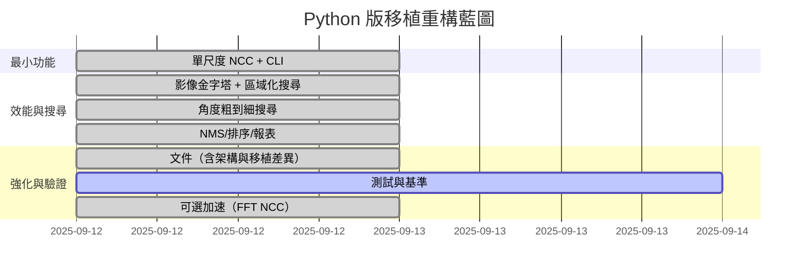

# 分階段重構計畫（Phased Refactor Plan）

本計畫由最小可行功能逐步擴展至完整功能，確保每階段皆可驗證、量測與回滾。

## 階段與驗收標準
- 階段 1：單尺度 NCC + CLI
  - 目標：輸入 Src/Tmpl，輸出 Top-K 位置與分數。
  - 驗收：能在 `Test Images/` 上得到合理結果（Score>0.5）。
- 階段 2：金字塔 + 區域化搜尋
  - 目標：縮小搜尋空間，維持或提升精度。
  - 驗收：相同輸入下，耗時下降，結果不退化。
- 階段 3：角度粗到細搜尋
  - 目標：支援旋轉不變性；粗步進找近似，細步進做精修。
  - 驗收：與原專案在代表性案例上角度接近（允許小誤差）。
- 階段 4：NMS/排序/報表
  - 目標：多目標去重疊，輸出友善（Index/Score/Angle/Pos）。
  - 驗收：多目標案例穩定、無明顯重複偵測。
- 階段 5：文件/測試/加速
  - 目標：完整 zh-TW 文件、冒煙/單元/基準測試、可選加速方案。
  - 驗收：CI 可跑基本測試；文件能輔助新成員快速上手。
